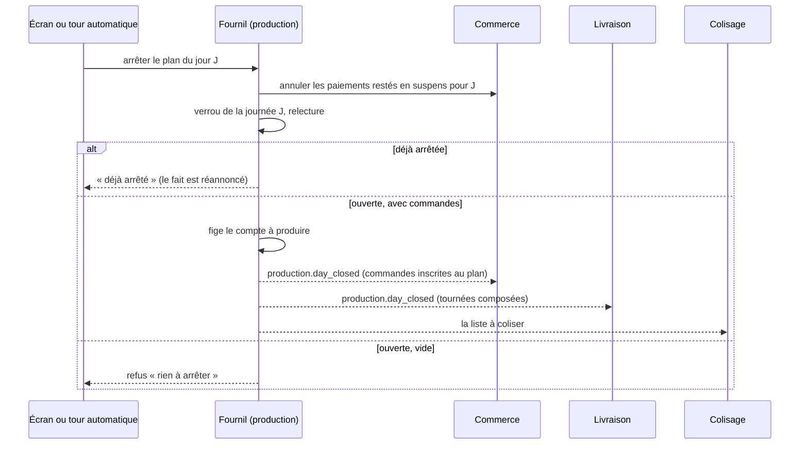
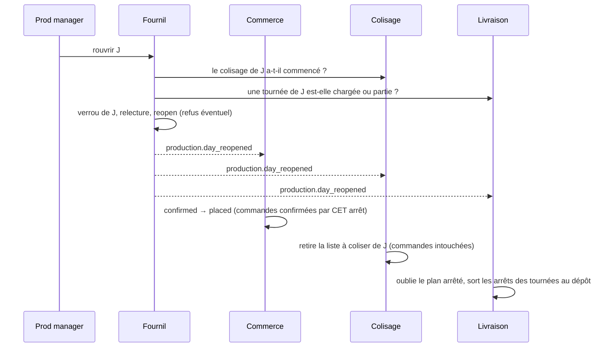

# L'arrêt du plan de production

**État au 2026-10-06, arrêt réécrit le 2026-10-21.** Remplace le plan de l’arrêt du plan (lots A0 à A3
bâtis le 2026-10-06, retiré ce jour-là — il vit dans l'historique git).

> Ce que l'arrêt fait aux commandes (jour plus proposé, client refusé,
> équipe reçue hors plan), avec les autres limites de commande :
> [`../limites-de-commande/README.md`](../limites-de-commande/README.md)
> (2026-10-21).

## En une phrase

**Arrêter le plan d'une journée, c'est figer ce que le fournil va produire.**
Tant qu'un plan n'est pas arrêté, rien ne part en fournée : pas d'heure de
tirage, pas de liste à coliser, pas de tournée composée.

**Depuis le 2026-10-21, l'heure limite générale déclenche tout** (décision de
Hugo, [`../limites-de-commande/plan-une-seule-heure.md`](../limites-de-commande/plan-une-seule-heure.md)
§5) : le plan de la journée J s'arrête **tout seul** à la fin du rattrapage de
la règle générale pour J (« la veille, 23 h » + rattrapage). Il n'y a plus de
mode manuel ou automatique, plus d'heure d'arrêt à part, plus d'alerte du
soir. Un arrêt à la main **avant** cet instant est refusé ; après (un arrêt
automatique qui a échoué), il reste ouvert. Rouvrir reste possible, et
l'équipe saisit toujours « hors plan ».

## Ce que fait un arrêt



- **Une seule fermeture, même à deux.** Deux arrêts simultanés (deux clics,
  ou l'arrêt automatique contre un arrêt anticipé) ne ferment qu'une fois : la
  journée est verrouillée par un verrou consultatif sur sa clé, puis relue
  sous lui (`infrastructure/prisma-production-day.lock.ts`). Le second trouve
  la journée close et réannonce seulement. Le retirage passe par le même verrou.
- **Une commande arrivée après l'arrêt** n'est pas perdue : « Reprendre le
  tirage » (le retirage, fiche d'atelier) l'ajoute à la fournée.
- **Un arrêt se défait** tant que rien n'a commencé : voir « Rouvrir une
  journée arrêtée » ci-dessous.

## Rouvrir une journée arrêtée

**État au 2026-10-14** (décision de Hugo, plan de lancement §3). Bâti, pas
encore déployé.

Une journée arrêtée par erreur se **rouvre** depuis le **Prod manager**
(`/prod-manager`) : bouton « Rouvrir la journée du … » à côté de l'arrêt quand
la prochaine journée est arrêtée, et dans le dossier du jour de toute journée
arrêtée. La confirmation dit l'effet : les clients peuvent de nouveau commander
pour ce jour, le plan est retiré et refait au prochain arrêt. Même droit que
l'arrêt (`production_count_stop:write`), route
`POST admin/production/batch/:date/reopen`.

**Refusée** — le message nomme le cas — dès que quelque chose s'appuie sur le
plan : une fournée déclarée et non annulée (ou une ligne cochée par l'ancien
poste), un colisage commencé (un contenant ouvert, même annulé, une ligne au
bac, un bac fermé), une tournée chargée (un bac chargé) ou partie. Le fournil
pose la question au colisage et à la livraison par deux ports qu'il déclare
(`DayPackingProgressReader`,
`DayDispatchProgressReader`), **avant** le verrou ;
l'agrégat (`ProductionDay.reopen`) décide sous le verrou de l'arrêt.



Ce qui est **défait** : chez le fournil, l'arrêt (`closed_at`, auteur), les
commandes inscrites, le compte à produire et le retirage — la trace reste
(`reopened_at`, `reopened_by`, migration `20261014400000_la_journee_rouverte`)
et le journal dit `production_day.reopened` avec son auteur ; au commerce, les
commandes confirmées par cet arrêt redeviennent `placed` ; au colisage, la
liste du jour ; à la livraison, le plan arrêté qu'elle avait appris et les
arrêts de commande posés dans les tournées au dépôt.

Ce qui **ne l'est pas** :

- les **tournées** elles-mêmes, même vides : la prochaine composition les
  réutilise ;
- les **transferts internes** et leurs arrêts : un retrait d'un site servi
  par transfert y entre dès sa passation, il reste dû ;
- le **dossier du jour déjà envoyé** par e-mail : le prochain arrêt en envoie
  un nouveau ;
- les fournées **annulées** : l'historique du four, pas du plan ;
- le drapeau « reçue hors plan » d'une commande saisie par l'équipe après
  l'arrêt : il reste posé ;
- l'**arrêt automatique** : sa tentative du jour est déjà tracée, il ne
  repasse pas — une journée rouverte s'arrête **à la main** (son heure limite
  est passée, l'arrêt à la main est donc permis).

L'ordre des faits n'est pas garanti par la boîte d'envoi : chaque abonné ne
défait que si la journée est **toujours ouverte** (`ClosedPlansReader`) ; le
commerce ne rend que les commandes dont `confirmed_at` est l'instant de l'arrêt
défait. Le fait de la liste à coliser porte la réouverture dans sa clé : sans
elle, le nouveau tirage d'une commande avait la clé de l'ancien et la boîte
d'envoi l'avalait.

L'e2e de la réouverture (`production-day-reopened`) joue « arrêter → rouvrir →
commander → arrêter » et les refus.

**Décidé le 2026-10-14 (Hugo)** : c'est le **Prod manager** qui décide de ce
qui entre au compte après l'arrêt, pas la fiche d'atelier — pour la
réouverture comme pour la reprise (le retirage). La reprise vit encore sur la
fiche d'atelier (bandeau d'écart) ; son déménagement est au plan de lancement.

## Le réglage — Production › Réglages

**Plus de réglage d'arrêt** depuis le 2026-10-21. La page affiche en lecture
« Arrêt automatique à l'heure limite : la veille, 23 h (rattrapage compris) —
se règle dans Réglages › Commandes › Heure limite », avec le lien
(`GET admin/production/settings` rend `automaticClose: { daysBefore, time }`,
rattrapage compris, ou `null` sans heure limite posée). La route `PUT
admin/production/settings/close` est retirée. Les colonnes
`production.production_settings.close_mode`, `close_at`, `alert_at` restent
en base, ni lues ni écrites (aucune migration) ; le fait
`production_settings.close_changed` est **retiré** du catalogue mais reste
lisible au journal.

Un arrêt à la main avant l'heure limite (rattrapage compris) est refusé en 409,
`production.day.before_order_cutoff`, **avant** le balayage des paiements :
« Le plan du mardi 8 septembre s'arrête tout seul à l'heure limite générale,
rattrapage compris : le lundi 7 septembre à 23:00. … Pour figer le plan plus
tôt, avancez l'heure limite dans Réglages › Commandes › Heure limite. » Une
journée déjà arrêtée se réannonce sans ce contrôle. Sans heure limite posée,
rien n'arrête le plan tout seul et l'arrêt à la main reste ouvert.

**Le calendrier des jours fermés du fournil** se tient sur la même page. La
veille d'un jour fermé, ni arrêt ni alerte.

## L'arrêt automatique et les alertes

Le Worker réveille l'API toutes les cinq minutes ; il appelle la route machine
`POST admin/production/auto-close` (jeton du Worker, pas de droit staff). À
chaque tour, à l'heure de Paris :

| Situation                                                                                               | Ce qui se passe                                                                                                                                                            |
| ------------------------------------------------------------------------------------------------------- | -------------------------------------------------------------------------------------------------------------------------------------------------------------------------- |
| Le lendemain est un jour fermé, ou déjà arrêté, ou aucune heure limite n'est posée                      | rien                                                                                                                                                                       |
| Fin du rattrapage de l'heure limite pour le lendemain passée                                            | le vrai arrêt, **une seule tentative par journée** (trace `production.production_auto_close_attempt`, prise par une seule instance). Journal : « arrêté automatiquement ». |
| … et le lendemain est vide                                                                              | alerte « Rien à arrêter pour le … : aucune commande »                                                                                                                      |
| … et l'arrêt échoue                                                                                     | alerte avec la raison ; **pas de nouvelle tentative** (relancer toutes les cinq minutes rappellerait Stripe sur une panne qui ne guérit pas seule)                         |
| … et la tentative reste en cours plus de **15 minutes**                                                 | alerte « L'arrêt automatique du plan du … n'a pas abouti »                                                                                                                 |
| L'arrêt d'**aujourd'hui** tombe aujourd'hui même (rattrapage qui passe minuit, limite « le jour même ») | même tentative que pour le lendemain (`todayOutcome`)                                                                                                                      |
| Le plan **d'aujourd'hui** n'est pas arrêté, porte des commandes, et son arrêt tombait avant aujourd'hui | alerte « Le plan d'aujourd'hui n'a pas été arrêté ». Jamais arrêté d'office : la fournée est déjà au four.                                                                 |

Les alertes vont dans la cloche et en push, aux personnes qui ont
`production_count_stop`, **une par type et par journée** même avec plusieurs
instances, et ouvrent le prévisionnel.

## Le prévisionnel

L'état de chaque colonne est calculé par le serveur, avec les mêmes seuils que
l'arrêt automatique (`domain/services/forecast-day-state.ts`) :

| État                            | Rendu                                                                             |
| ------------------------------- | --------------------------------------------------------------------------------- |
| Plan non arrêté, en retard      | colonne en surcouche rouge, « Plan non arrêté », barres rouges en tête et au pied |
| Production du jour, plan arrêté | colonne en surcouche accent, « Arrêté »                                           |
| Journée future arrêtée          | « Arrêté » dans l'en-tête                                                         |
| Journée passée                  | surcouche grise                                                                   |
| Jour fermé du fournil           | hachures, « Fournil fermé »                                                       |

- **Bandeau rouge, en haut de la page, sur toutes les semaines** : le plan
  d'aujourd'hui n'est pas arrêté. Bouton « Arrêter le plan du … maintenant ».
- **Bouton du soir**, toujours à la même place, sur toutes les semaines :
  avant l'heure limite, désactivé, « Arrêt automatique lundi à 23:00 »
  (chaque colonne porte `closesAt`, calculé par le serveur) ; l'heure passée
  sans arrêt, « Arrêter le plan du <lendemain> ». Sans rien à arrêter, il reste,
  désactivé : « Rien à arrêter » ou « Plan du … arrêté ».
- **Les deux boutons suivent `production_count_stop:write`** (2026-10-07) :
  sans ce droit, le bandeau rouge reste — l'oubli est un fait sur la journée —
  mais sans bouton, et le bouton du soir n'a pas de place.
- La page se relit toutes les 60 secondes : le retard vient de l'heure, pas
  d'un changement de données.
- Le **dossier du jour** s'ouvre par un bouton ; « Imprimer le dossier » ouvre
  le PDF figé à l'arrêt, et n'existe donc qu'**après** l'arrêt (voir
  [`dossier-prod-du-jour.md`](dossier-prod-du-jour.md)).

## Les droits

| Droit                   | Ce qu'il donne                                                                                                                                                                                                                                                               |
| ----------------------- | ---------------------------------------------------------------------------------------------------------------------------------------------------------------------------------------------------------------------------------------------------------------------------- |
| `production_count_stop` | arrêter le plan (soir, anticipé, rattrapage) ; recevoir les alertes                                                                                                                                                                                                          |
| `production_settings`   | lire l'arrêt automatique ; lire / modifier les jours fermés                                                                                                                                                                                                                  |
| `production_plan`       | lire le plan du soir. ⚠️ Son `write` ne donne **plus rien** : proposé à l'écran des rôles, décrit « N'ajoute rien » — incohérence assumée, voir [`droits-et-permissions/todo-ressources-en-lecture-seule.md`](../droits-et-permissions/todo-ressources-en-lecture-seule.md). |

Les migrations ajoutent ces ressources sans les accorder : on les règle à
l'écran (`/admin/staff-roles`). La graine dev / e2e les donne aux rôles qui
arrêtaient le plan.

## Où vit le code

- Fournil (`apps/lfd-api/src/production/`) : instant d'arrêt
  `domain/services/latest-order-cutoff.ts` (`planClosesAt`), refus d'un arrêt
  anticipé `apps/lfd-api/src/production/domain/services/early-close.ts`, jours fermés
  `domain/entities/production-closed-day.ts`, tour
  `domain/services/auto-close-round.ts` et
  `application/commands/run-auto-close-round.handler.ts`, arrêt signé
  automatique `application/services/bus-automatic-day-closer.ts`, alertes
  `application/services/plan-arrest-bell.ts`, routes
  `http/production-settings.controller.ts` et `http/auto-close.controller.ts`.
- Heure limite générale lue au commerce par le canal
  `channels/commerce/order-cutoff-rules.reader.ts` (`production → b2b` reste
  interdit) — par le tour, le prévisionnel, la clôture et la page.
- Worker : `apps/lfd-api/container/worker.ts`.
- Écrans : `apps/lfd-backoffice-frontend/src/app/production/previsionnel/`,
  `…/production/production-settings-page/`.
- Migrations : `20261006100000_les_droits_de_l_arret_du_plan`,
  `20261006100100_le_reglage_de_l_arret_du_plan`,
  `20261006120000_la_tentative_d_arret_automatique`,
  `20261006140000_le_previsionnel_suit_l_arret_du_plan` — toutes additives.

## Reste à faire

1. **Le déploiement en production** (rien n'est encore sur `main`) :
   - faire relire les quatre migrations par `lecteur-de-migrations` ;
   - **avant** la promotion, Hugo lance en production les deux requêtes qui
     listent qui arrête le plan aujourd'hui :
     ```sql
     SELECT r.key, r.label,
            (SELECT count(*) FROM public.staff_users u WHERE u.role_key = r.key AND u.status = 'active') AS titulaires_actifs
     FROM public.staff_role_definitions r
     CROSS JOIN LATERAL jsonb_array_elements(r.grants) AS g
     WHERE r.archived_at IS NULL AND g->>'resource' = 'production_plan' AND g->>'action' = 'write'
     ORDER BY r.key;

     SELECT u.email, u.role_key, o.effect
     FROM public.staff_permission_overrides o JOIN public.staff_users u ON u.id = o.staff_user_id
     WHERE o.resource = 'production_plan' AND o.action = 'write'
     ORDER BY u.email;
     ```
   - 🔴 le jour même, **avant 20:00**, accorder `production_count_stop` à ces
     rôles et personnes à l'écran (sinon plus personne n'arrête le plan), et
     `production_settings` à qui règle le fournil.
2. **Rouvrir un plan arrêté par erreur** (Hugo, Q7) : « Rouvrir le plan »,
   tant que rien n'a commencé en aval (aucune fournée cochée, rien au
   colisage, aucune tournée partie ou retouchée), sous `production_count_stop`,
   par un fait « plan rouvert » que commerce, livraison et colisage savent
   défaire. À concevoir avant d'être bâti ; en attendant, le retirage couvre
   un arrêt trop tôt.
