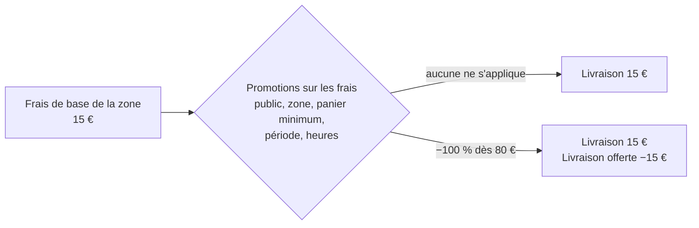

# Plan — la livraison offerte : un étage de promotions sur les frais

> 📍 **État au 2026-11-05 (soir).** ✅ **En production** (`962dda5`) : 0a,
> 0b (frais résolu zone → global → ancien, écran des zones, journal), 1a
> (tarif figé à la commande, colonnes du franco) et 1b (le calcul du franco).
> 🟦 **Sur `dev`** : la saisie du seuil à l'écran, la clientèle fermée
> grisée, les pastilles « Global », la révision sans seuil figé qui prend
> celui du jour, et **1c côté serveur** (le devis sert `freeDelivery` : offert,
> ou le manque HT), et **0c côté serveur** (`GET /delivery-zones?audience=b2b|b2c`
> sert le frais et le seuil résolus, en cache Cloudflare par audience).
> **À faire** : l'affichage de 1c en boutique, 0c côté fronts (boutique et
> saisie staff), 2 (promotions sur les frais). Ce qui est
> bâti, et les choix qui l'ont façonné, sont tenus à jour dans
> [`frais-et-livraison-offerte.md`](../livraisons/frais-et-livraison-offerte.md).

> 📝 **Plan, écrit le 2026-11-05**, demande de Hugo (« on me dit la livraison
> est gratuite au-delà d'une certaine somme… un système hyper souple à
> régler »). Rien n'est bâti. Il touche **l'argent** (un frais facturé, sa
> TVA, une ligne de facture) : `vitruve` avant le bâti. Partie 1 :
> comprendre. Partie 2 : le code. Voisin de [`promotions.md`](promotions.md).

# Partie 1 — Comprendre

## Le problème

Une zone de livraison porte **un seul frais**, le même pour tout le monde.
« Livraison offerte dès 80 € », « offerte pour les pros dès 50 € », « −5 €
pour telle société », « offerte pour Noël » ne se règlent nulle part : le
calcul applique le frais de la zone sans aucun seuil.

## La réponse

Deux choses distinctes, chacune à sa place :

1. **La zone dit ce que coûte la livraison** — un prix de base, le même dans
   toute la zone (une zone est une liste de préfixes postaux, pas une
   distance).
2. **Un étage de promotions dédié aux frais** le réduit ou l'annule, avec
   tout ce que les promotions savent déjà régler : le public (tout le monde,
   particuliers, inscrits, pros, une société ± ses sites), les zones, la
   période, les heures, le cumul, les libellés en trois langues — plus une
   condition neuve, **le panier minimum**.

| Ce qu'on veut                                     | La promotion                                 |
| ------------------------------------------------- | -------------------------------------------- |
| Offerte dès 80 € à Courchevel, pour tout le monde | Frais −100 %, zone Courchevel, panier ≥ 80 € |
| Offerte dès 50 € (pros), dès 120 € (particuliers) | Deux promotions, une par public              |
| −5 € de livraison pour une société                | Frais −5 €, public : cette société           |
| Offerte le week-end de Noël                       | Frais −100 %, période du 20 au 24            |

**Ce que voit le client** : sur la facture et le bon, « Livraison 15 € » puis
« Livraison offerte dès 80 € −15 € » — le cadeau se voit. Au panier, tant
que le seuil n'est pas atteint : « Plus que 12 € pour la livraison
offerte ».

## Les décisions qui reviennent à Hugo (défauts proposés)

1. **Sur quoi se compte le seuil** — défaut proposé : le **sous-total des
   marchandises après les remises sur les articles et sur le panier**, dans
   la base que le client lit (TTC pour un particulier, HT pour une société
   réglée au compte — la même règle que l'affichage). Ainsi « dès 80 € » se
   lit sur le chiffre que le client voit.
2. **Cumul** — défaut proposé : une promotion sur les frais **se cumule
   toujours** avec les remises sur les articles et le panier (ce n'est pas la
   même chose qui est réduite) ; entre promotions sur les frais, la règle
   habituelle (une seule, la plus précise, sauf cumulables).
3. **Le frais de zone en pourcentage** — défaut proposé : le garder tel quel
   (il existe et rien ne le casse), la réduction s'applique sur le frais
   calculé.

## Contredit par `vitruve` le 2026-11-05 — à ne pas bâtir en l'état

Quatre bloquants, vérifiés dans le code :

1. **La commande ne sait enregistrer qu'UN frais** (`deliveryFeeCents`,
   `deliveryFeeTtcCents`, `deliveryFeeAdjustment`, `orders.prisma` ; le BL et
   le soldé aussi, avec un CHECK). Une ligne « Livraison offerte −15 € » qui
   se relit demande des colonnes neuves et la checklist
   [`ajouter-un-terme-au-panier.md`](../pricing/boutique-et-panier/ajouter-un-terme-au-panier.md)
   entière (devis, bon, facture, découpage par taux, cohérence, soldé,
   golden master).
2. **Le seuil se compterait sur une base que le calcul ne produit pas** :
   `subtotalCents` est un HT avant remises ; le TTC remisé n'est connu
   qu'après la composition (`basket-terms.ts`) ; le bon de fidélité est
   imputé hors du calcul. Le « Plus que 12 € » doit venir du serveur.
3. **`min_basket` sur une remise au panier crée une boucle** (une remise
   conditionnée à un total qui dépend d'elle) : à réserver aux frais.
4. **Le frais par audience heurte la route publique `GET /delivery-zones`**,
   qui sert le frais à tout le monde (en cache Cloudflare) : servir les deux
   frais donne le tarif pro à un anonyme ; la rendre propre à l'appelant
   la sort du cache partagé. Trois écrans de la boutique lisent `zone.fee`.

Et des sérieux : la TVA d'une réduction de frais en mode `follows_goods`
(ventilée au prorata, jamais par le mécanisme des remises d'articles) et sa
forme dans Factur-X ; la révision (livraison offerte acquise ou rejugée) ;
un nouveau point d'application touche une dizaine de sites et le plafond
des cinq remises ; un pro en cours d'inscription paie le frais particulier.

**Sa recommandation** : d'abord le lot 0 (frais par audience, colonnes NOT
NULL recopiées, sort de la route publique décidé), puis un **franco sur la
zone** — un seuil par audience, livraison offerte au-delà — comme terme du
calcul, avec ses colonnes ; l'étage de promotions sur les frais ne vient
qu'après, pour les cas ciblés (une société, Noël).

**Décisions pour Hugo** :

- (a) franco sur la zone d'abord, ou l'étage de promotions directement ;
- (b) la base du seuil (HT ou TTC selon quel critère, avant ou après le bon) ;
- (c) `min_basket` réservé aux frais dans ce lot ;
- (d) en révision, livraison offerte acquise ou rejugée ;
- (e) ce qu'on enregistre : frais net, ou réduction à part (et Factur-X) ;
- (f) la route publique : frais selon l'audience (cache privé), ou frais
  retirés de la route ;
- (g) le pro en cours d'inscription au frais particulier.

## Décisions de Hugo (2026-11-05)

- **Un réglage global de livraison, par audience** (Hugo : « ajouter un
  réglage global pour toutes les zones ») : le frais de base et le **franco**
  (le seuil au-delà duquel la livraison est offerte), pour les pros et pour
  les particuliers. **Chaque zone hérite du global** et peut le remplacer
  (une zone plus loin, plus chère). Le lot 0 devient : réglage global +
  remplacement par zone, par audience.
- **(a) — à confirmer** : le franco est un réglage de livraison (global ou
  par zone), proposé en premier ; l'étage de promotions sur les frais vient
  après, pour les cas ponctuels (Noël, une société).
- **(b) Le seuil se compte en HT.** ⚠️ **Réserve de Hugo, à reprendre en
  concevant l'affichage** : un particulier lit ses prix en TTC ; « offerte
  dès 80 € » comparé à un panier de 82 € TTC (~77,7 € HT) lui dirait « plus
  que 2,30 € », ce qui n'a pas de sens visuel pour lui. Piste : afficher le
  seuil au particulier dans la base qu'il lit, en gardant le calcul en HT.
- **(c) Oui** : `min_basket` est réservé aux frais dans ce lot (pas de
  boucle avec les remises au panier).
- **(d) Rejugée** : en révision, la livraison offerte se recalcule ; si le
  panier repasse sous le franco, le frais revient (et le total monte).
- **(e) Une ligne de réduction** à part, sur le devis, le bon, la facture et
  l'e-mail — d'où les colonnes neuves et la checklist « ajouter un terme ».
- **(f) Le cache le plus rapide, même avec les audiences.** Le cache public
  ne connaît pas l'appelant : il faut une adresse par audience
  (`?audience=pro` / particulier), ce qui rend le tarif pro lisible par
  tout visiteur — comme les points de retrait de la vitrine pro (« publique
  par choix », 2026-10-19). **À confirmer par Hugo** ; sinon, le tarif pro ne
  passerait que par une route `/mine`, hors du cache partagé.
- **(g) Non : un pro en cours d'inscription est un pro** et paie le frais
  pro. ⚠️ Diverge des prix des articles, où une société en attente reçoit le
  tarif particulier (`standingOf`, `customer-audiences.service.ts`) — règle
  propre à la livraison, à écrire comme telle.
- **(a) Le franco d'abord, la promotion dans la foulée** (Hugo).
- **(f) La première** : une adresse par audience, toutes deux en cache
  Cloudflare ; le tarif de livraison pro est public, comme la vitrine pro.
- **(g) Un pending est un pro partout**, prix des articles compris — décision
  portée par [`../comptes-client/plan-pros-en-cours-d-inscription.md`](../comptes-client/plan-pros-en-cours-d-inscription.md) § 0.

## Les lots (après les décisions du 2026-11-05)

| Lot | Contenu                                                                                                                                                                                                              |
| --- | -------------------------------------------------------------------------------------------------------------------------------------------------------------------------------------------------------------------- |
| 0   | **Réglage global de livraison par audience** (frais de base) + remplacement par zone ; colonnes NOT NULL recopiées ; écran limité aux audiences ouvertes ; `GET /delivery-zones?audience=…` en cache Cloudflare      |
| 1   | **Franco** : seuil HT par audience (global, remplacé par zone) ; une ligne « Livraison offerte » à part (colonnes neuves, checklist « ajouter un terme ») ; rejugé en révision ; « Plus que … » servi par le serveur |
| 2   | **Promotions sur les frais** : point d'application `delivery_fee` et condition `min_basket` réservée aux frais ; plafond à part des cinq remises au panier                                                           |

## Lots 0 et 1 contredits par `vitruve` (2026-11-05, second passage)

**Corrections** :

- **Le remplacement par zone est NULLABLE** : `null` = la zone reprend le
  réglage global, une valeur = elle le remplace (geste « revenir au
  global »). Une colonne NOT NULL recopiée aurait fait remplacer le global
  par toutes les zones dès le premier jour. Un frais résolu (zone, sinon
  global) absent pour une audience ouverte = commande refusée par une erreur
  nommée, jamais gratuite.
- **Le réglage global vit dans une table neuve à clé naturelle** (sur le
  modèle d'`OrderOpening`), pas dans `delivery_settings` (dont la ligne peut
  manquer et que chaque geste réécrit en entier). Son écrivain purge
  `reglages-publics`.
- **Le frais est calculé à DEUX endroits** (`price-basket.ts` et
  `CartAdjustments.forDelivery`, retiré au 0b) : le second disparaît (« une seule
  arithmétique ») ; la résolution zone → global → ancien frais entre dans
  `deliveryRoute`, qui reçoit déjà l'audience.
- **La commande doit FIGER le franco** (« offerte, aurait coûté X », et le
  seuil appliqué) : la recomposition des remises et le bon partiel
  refabriquent aujourd'hui le frais depuis l'ajustement figé de la zone — une
  commande au franco se recomposerait au frais plein.
- **`GET /delivery-zones?audience=`** refuse en 400 une valeur inconnue ;
  la boutique ET la saisie du staff (quatrième lecteur de `zone.fee`)
  basculent dans le même déploiement ; le front déduit l'audience du même
  `audienceOf` que le serveur. Dépend de la bascule « pending = pro ».

**Proposition de `vitruve` sur la décision (e)**, plus légère et dans
l'esprit de « la ligne de réduction » : le franco est un **tarif** ; le
frais facturé vaut 0 et la commande fige « livraison offerte, aurait coûté
15 € » ; la ligne « Livraison offerte » s'**affiche** depuis ce figé (devis,
bon, facture, e-mail), sans terme comptable négatif. Facture, Factur-X et
TVA restent inchangés. Une vraie ligne négative comptable toucherait ~65
fichiers, la TVA par taux et Factur-X. **À trancher par Hugo.**

**Tranché par Hugo le 2026-11-05 (« ok pour tout avec tes
recommandations »)** :

- **(e) La ligne est AFFICHÉE, pas comptable** : frais facturé 0, la commande
  fige « livraison offerte, aurait coûté X » ; la ligne s'affiche sur le
  devis, le bon, la facture et l'e-mail. Facture, Factur-X et TVA inchangés.
- **La base du seuil** : HT, **après** les remises, **avant** le bon de
  fidélité (le bon est un moyen de paiement, il ne fait pas perdre le
  franco).
- **En révision** : le seuil **figé à la passation**, jamais le réglage du
  jour.
- **Le frais de base aussi est figé à la passation** (Hugo, 2026-11-05, en
  réponse au constat du 0b : la révision re-résolvait le barème au réglage
  du jour, si bien qu'un frais global relevé après la commande la renchérissait).
  Une commande garde le tarif de livraison du jour où elle a été passée ;
  la révision lit le barème figé. Bâti avec le lot 1a.
- **Une révision qui change de zone prend le barème ET le seuil du jour de
  la nouvelle zone** (Hugo, 2026-11-05, « garde le défaut ») : aucun tarif
  n'a été figé pour elle. Dans la même zone, barème et seuil figés.

~~**Encore à trancher**~~ (tranché ci-dessus) : la base du seuil (avant ou après les remises, avant
ou après le bon de fidélité) ; en révision, le seuil **figé** à la passation
(recommandé) ou le réglage du jour ; l'écart au seuil montré à un
particulier (TTC « environ », servi par le serveur).

**Sous-lots** :

| Lot | Contenu                                                                                                   | Seul ?                |
| --- | --------------------------------------------------------------------------------------------------------- | --------------------- |
| 0a  | 🟦 table du réglage global + colonnes de zone nullables ; rien ne change encore                           | oui                   |
| 0b  | 🟦 résolution zone → global dans `deliveryRoute`, double calcul supprimé, écran, purge                    | oui                   |
| 0c  | 🟦 serveur (`GET /delivery-zones?audience=`) ; boutique et saisie staff à faire                           | après « pending pro » |
| 1a  | 🟦 le franco figé sur la commande ; recomposition et bon partiel le lisent ; barème figé relu en révision | avant 1b              |
| 1b  | 🟦 le calcul du franco (`priceBasket`, `composeExactOrder`) ; révision contre le seuil figé               | après 1a              |
| 1c  | 🟦 serveur (devis `freeDelivery`) ; affichage boutique à faire — « Plus que… » servi par le serveur       | après 1b              |

**Ce que 1a a bâti (2026-11-05)** :

- **Le barème figé relu en révision** : `delivery_fee_adjustment` EST le
  barème résolu à la passation (0b) ; la révision le passe au chargement
  (`PricingRequest.frozenDeliveryFee`, `order-revising.service.ts`) au lieu de
  re-résoudre celui du jour. ⚠️ **Il ne vaut que dans SA zone** : une révision
  qui livre dans une autre zone prend le barème du jour de la nouvelle zone
  (aucun tarif n'a été figé pour elle) — confirmé par Hugo le 2026-11-05,
  seuil compris (cf. décisions).
- **Le franco figé** : trois colonnes nullables sur `orders`
  (`free_delivery_threshold_cents`, `free_delivery_waived_cents`,
  `free_delivery_waived_ttc_cents`, migration `20261105160000`, trois CHECK) ;
  au franco, `delivery_fee_cents` vaut 0 et `delivery_fee_adjustment` garde le
  barème offert. Rien ne les remplit encore (1b).
- **Le franco se juge sur le panier COMMANDÉ** : un départ incomplet ne le fait
  pas perdre — c'est le défaut qui suit « figé à la passation ». Le bon
  partiel (`line_ht` et `exact_ht`), le reliquat, le soldé (somme des bons) et
  la reprise des remises lisent le barème FACTURÉ (`billedDeliveryFeeOf` :
  aucun au franco), jamais le barème figé seul.
- **Pas encore** : le cas « franco figé » du golden master des paniers pro
  (`pro-baskets.frozen.ts`) — l'agrégat ne chiffre que par `priceBasket`
  (L7), qui ne sait pas encore produire un franco : le cas arrive avec 1b.

**Ce que 1b a bâti (2026-11-05)** :

- **Le seuil se résout comme le frais** : `resolvedFreeDeliveryThreshold`
  (`delivery-zones/domain/delivery-fee-resolution.ts`) — remplacement de la
  zone pour l'audience, sinon global ; `null` = pas de franco, sans repli sur
  l'ancien frais de zone (il n'a jamais eu de seuil). `deliveryRoute` et la
  route du chiffrage (`PricedRoute`) portent le barème ET le seuil.
- **La base du seuil, dans `basketTermsOf`** (`basket-terms.ts`), le seul
  endroit où elle existe dans les deux méthodes sans composer deux fois :
  `line_ht` = sous-total HT arrondi par ligne − remise HT (la base où le bon
  s'impute) ; `exact_ht` = Σ HT des lignes composées − remise HT composée,
  lus sur LA composition qui chiffre déjà la remise et le port (lignes et
  remises n'y dépendent pas du port). Le bon n'entre pas dans `priceBasket` :
  il ne peut pas faire perdre le franco. `subtotalCents` (HT avant remises)
  n'est jamais la base. Jugement pur : `judgedFreeDelivery` (« dès » le
  seuil ; un frais nul n'est pas offert).
- **L'agrégat** : `DraftOrderInput.freeDelivery` / `OrderToPlace.freeDelivery`,
  écrits par la passation et la révision (`freeDeliveryColumnsOf`). En
  `exact_ht`, la composition reçoit le barème FACTURÉ (`billedDeliveryFeeOf`).
  `ensureDeliveryFeeMatches` accepte un frais nul au franco quand le barème
  reproduit le montant offert ; `ensureFreeDeliveryHolds` revérifie la base
  contre le seuil et la forme (TTC offert en `exact_ht` seulement).
- **Révision** : le seuil figé (`free_delivery_threshold_cents`) accompagne le
  barème figé (`FrozenDeliveryFee`) dans la même zone. ⚠️ Une commande passée
  SANS franco n'a pas de seuil figé (la colonne n'existe qu'au franco, CHECK
  `orders_free_delivery_waives_fee`) : une révision dans la même zone prend
  alors le **seuil du jour**, et ne peut qu'y gagner (tranché le 2026-11-05,
  `16838b1e3` ; Hugo n'en fait pas un réglage). Un seuil figé reste celui de
  la passation.
- **1c, serveur (2026-11-05)** : le devis sert `freeDelivery` — `offered`
  (sans montant : « Coursier offert », Hugo) ou `short` avec le manque HT ;
  absent en retrait, sans seuil, à frais nul. Le front ne l'affiche pas
  encore. Détail dans la doc d'état.

# Partie 2 — Le code

## 0. Lot 0 — le frais de base par audience (Hugo, 2026-11-05)

Un prix de livraison différent pour les pros et pour les particuliers est un
**tarif**, pas un geste commercial : il vit sur la zone, avant tout l'étage
des promotions.

- La zone porte **un frais par audience** (pros, particuliers), chacun en
  montant ou en pourcentage — au lieu de `fee_mode` / `fee_value` uniques.
- L'écran **Réglages › Livraison › Zones** n'affiche que les audiences
  ouvertes dans la **disponibilité de la livraison**
  (`b2b/delivery-availability/`, `openToB2b` / `openToB2c`). Ouvrir une
  audience demande que chaque zone ait son frais pour elle.
- **Migration** : les zones existantes recopient leur frais actuel dans les
  deux audiences (le tarif d'aujourd'hui est le même pour tous) ; l'ancienne
  colonne reste en base, morte, selon la règle du dépôt.
- **À trancher par `vitruve`** : où l'audience de l'appelant entre dans le
  calcul du frais ; la route publique `GET /delivery-zones`, qui sert
  aujourd'hui `fee` à tout le monde (et en cache Cloudflare depuis le
  2026-11-05) — elle ne doit servir à chaque audience que son frais ; une
  zone sans frais pour une audience ouverte (refus à l'ouverture, ou refus à
  la commande — jamais gratuit par accident) ; le staff qui commande pour un
  client ; un pro en cours d'inscription, un particulier invité.

## 1. Ce qui existe (vérifié le 2026-11-05)

- `delivery_zones` (`prisma/schema/public/settings.prisma`) : `fee_mode`
  (`CartAdjustmentMode`) et `fee_value` ; aucun seuil, aucun public.
- Le frais s'applique dans `orders/domain/services/price-basket.ts`
  (`deliveryFeeOf(route, subtotalCents)`, `cartAdjustmentCents`), qui rend
  un `BasketDeliveryFee` (`basket-terms.ts`).
- Une promotion (`promotions` en base, `promotions/domain/`) a un point
  d'application `line` (dans le prix affiché) ou `basket` (au panier)
  (`promotion-fulfillment.ts`), un effet (`promotion-effect.ts`), un public,
  un acheminement (retrait / livraison, points / zones nommés), une portée et
  des conditions : `min_quantity` et `weekly_hours` (`promotion-condition.ts`).
- Les frais de livraison ont leur propre mode de TVA (`DeliveryVatMode`,
  `packages/contracts/src/order-delivery-vat.ts`) et leur ligne sur le
  devis (`deliveryFeeCents`, `shop-quote*`).

## 2. Ce qu'on ajoute

1. **Un troisième point d'application, `delivery_fee`** : l'effet porte sur
   le frais de la zone, plafonné à lui (jamais un frais négatif). Un
   acheminement « livraison » est obligatoire (toutes zones ou certaines) ;
   la portée sur le catalogue n'a pas de sens ici (refusée ou ignorée — à
   trancher par `vitruve`).
2. **Une condition `min_basket`** : `{ kind: "min_basket", cents }`, comptée
   selon la décision 1. Elle peut servir aussi aux remises au panier.
3. **Le calcul** : dans `price-basket.ts`, après le sous-total et les
   remises, le frais de la zone puis les promotions `delivery_fee` éligibles
   (mêmes règles de choix et de cumul que les autres), chacune avec sa ligne.
4. **La TVA** : la réduction suit la TVA du frais qu'elle réduit
   (`DeliveryVatMode`), sur le modèle d'une remise qui suit la TVA de ce
   qu'elle réduit — à vérifier par `vitruve` dans la recomposition des
   remises (`order-discount-recomposition.ts`) et les factures.
5. **L'affichage** : la ligne sur le devis, le bon, la facture et l'e-mail ;
   l'écart au seuil au panier (« Plus que … ») ; l'écran Promotions gagne le
   point d'application et la condition.
6. **La revalidation à la passation** : la passation relit tout et refuse un
   total qui a changé (`orders.total_changed`) — inchangé.

## 3. À trancher par `vitruve`

- La place de la promotion `delivery_fee` dans l'ordre du calcul et dans les
  cinq remises au panier qu'une commande peut porter (`promotions.md`).
- La TVA de la réduction et sa ventilation sur la facture (Factur-X).
- Les commandes déjà passées : aucune n'a de ligne de ce type ; la lecture
  des factures anciennes ne doit pas changer.
- La revalidation d'une commande révisée (le seuil franchi ou perdu).
- Les écrans du staff qui commandent à la place du client (mêmes règles).

## 4. Tests

- Seuil atteint / non atteint / atteint par la remise qui le fait perdre
  (après remises) ; pro HT et particulier TTC ; deux publics, deux seuils.
- Jamais de frais négatif ; zone à frais nul ; retrait (aucun effet).
- Facture : la ligne de réduction, sa TVA, le total ; e-mail et bon.
- Passation : un seuil perdu entre le devis et la commande est refusé
  (`orders.total_changed`).
