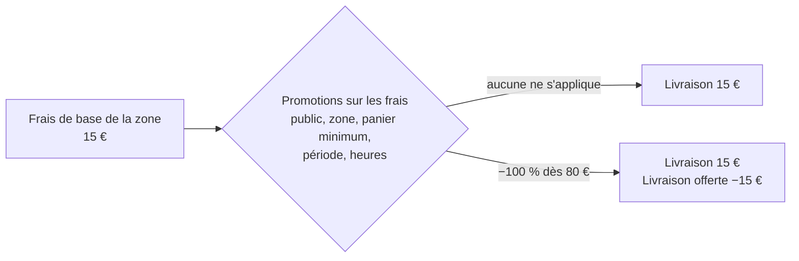

# Plan — la livraison offerte : un étage de promotions sur les frais

> 📝 **Plan, écrit le 2026-11-05**, demande de Hugo (« on me dit la livraison
> est gratuite au-delà d'une certaine somme… un système hyper souple à
> régler »). Rien n'est bâti. Il touche **l'argent** (un frais facturé, sa
> TVA, une ligne de facture) : `vitruve` avant le bâti. Partie 1 :
> comprendre. Partie 2 : le code. Voisin de [`promotions.md`](promotions.md).

# Partie 1 — Comprendre

## Le problème

Une zone de livraison porte **un seul frais**, le même pour tout le monde.
« Livraison offerte dès 80 € », « offerte pour les pros dès 50 € », « −5 €
pour telle société », « offerte pour Noël » ne se règlent nulle part : le
calcul applique le frais de la zone sans aucun seuil.

## La réponse

Deux choses distinctes, chacune à sa place :

1. **La zone dit ce que coûte la livraison** — un prix de base, le même dans
   toute la zone (une zone est une liste de préfixes postaux, pas une
   distance).
2. **Un étage de promotions dédié aux frais** le réduit ou l'annule, avec
   tout ce que les promotions savent déjà régler : le public (tout le monde,
   particuliers, inscrits, pros, une société ± ses sites), les zones, la
   période, les heures, le cumul, les libellés en trois langues — plus une
   condition neuve, **le panier minimum**.

| Ce qu'on veut                                     | La promotion                                 |
| ------------------------------------------------- | -------------------------------------------- |
| Offerte dès 80 € à Courchevel, pour tout le monde | Frais −100 %, zone Courchevel, panier ≥ 80 € |
| Offerte dès 50 € (pros), dès 120 € (particuliers) | Deux promotions, une par public              |
| −5 € de livraison pour une société                | Frais −5 €, public : cette société           |
| Offerte le week-end de Noël                       | Frais −100 %, période du 20 au 24            |

**Ce que voit le client** : sur la facture et le bon, « Livraison 15 € » puis
« Livraison offerte dès 80 € −15 € » — le cadeau se voit. Au panier, tant
que le seuil n'est pas atteint : « Plus que 12 € pour la livraison
offerte ».

## Les décisions qui reviennent à Hugo (défauts proposés)

1. **Sur quoi se compte le seuil** — défaut proposé : le **sous-total des
   marchandises après les remises sur les articles et sur le panier**, dans
   la base que le client lit (TTC pour un particulier, HT pour une société
   réglée au compte — la même règle que l'affichage). Ainsi « dès 80 € » se
   lit sur le chiffre que le client voit.
2. **Cumul** — défaut proposé : une promotion sur les frais **se cumule
   toujours** avec les remises sur les articles et le panier (ce n'est pas la
   même chose qui est réduite) ; entre promotions sur les frais, la règle
   habituelle (une seule, la plus précise, sauf cumulables).
3. **Le frais de zone en pourcentage** — défaut proposé : le garder tel quel
   (il existe et rien ne le casse), la réduction s'applique sur le frais
   calculé.

# Partie 2 — Le code

## 1. Ce qui existe (vérifié le 2026-11-05)

- `delivery_zones` (`prisma/schema/public/settings.prisma`) : `fee_mode`
  (`CartAdjustmentMode`) et `fee_value` ; aucun seuil, aucun public.
- Le frais s'applique dans `orders/domain/services/price-basket.ts`
  (`deliveryFeeOf(route, subtotalCents)`, `cartAdjustmentCents`), qui rend
  un `BasketDeliveryFee` (`basket-terms.ts`).
- Une promotion (`promotions` en base, `promotions/domain/`) a un point
  d'application `line` (dans le prix affiché) ou `basket` (au panier)
  (`promotion-fulfillment.ts`), un effet (`promotion-effect.ts`), un public,
  un acheminement (retrait / livraison, points / zones nommés), une portée et
  des conditions : `min_quantity` et `weekly_hours` (`promotion-condition.ts`).
- Les frais de livraison ont leur propre mode de TVA (`DeliveryVatMode`,
  `packages/contracts/src/order-delivery-vat.ts`) et leur ligne sur le
  devis (`deliveryFeeCents`, `shop-quote*`).

## 2. Ce qu'on ajoute

1. **Un troisième point d'application, `delivery_fee`** : l'effet porte sur
   le frais de la zone, plafonné à lui (jamais un frais négatif). Un
   acheminement « livraison » est obligatoire (toutes zones ou certaines) ;
   la portée sur le catalogue n'a pas de sens ici (refusée ou ignorée — à
   trancher par `vitruve`).
2. **Une condition `min_basket`** : `{ kind: "min_basket", cents }`, comptée
   selon la décision 1. Elle peut servir aussi aux remises au panier.
3. **Le calcul** : dans `price-basket.ts`, après le sous-total et les
   remises, le frais de la zone puis les promotions `delivery_fee` éligibles
   (mêmes règles de choix et de cumul que les autres), chacune avec sa ligne.
4. **La TVA** : la réduction suit la TVA du frais qu'elle réduit
   (`DeliveryVatMode`), sur le modèle d'une remise qui suit la TVA de ce
   qu'elle réduit — à vérifier par `vitruve` dans la recomposition des
   remises (`order-discount-recomposition.ts`) et les factures.
5. **L'affichage** : la ligne sur le devis, le bon, la facture et l'e-mail ;
   l'écart au seuil au panier (« Plus que … ») ; l'écran Promotions gagne le
   point d'application et la condition.
6. **La revalidation à la passation** : la passation relit tout et refuse un
   total qui a changé (`orders.total_changed`) — inchangé.

## 3. À trancher par `vitruve`

- La place de la promotion `delivery_fee` dans l'ordre du calcul et dans les
  cinq remises au panier qu'une commande peut porter (`promotions.md`).
- La TVA de la réduction et sa ventilation sur la facture (Factur-X).
- Les commandes déjà passées : aucune n'a de ligne de ce type ; la lecture
  des factures anciennes ne doit pas changer.
- La revalidation d'une commande révisée (le seuil franchi ou perdu).
- Les écrans du staff qui commandent à la place du client (mêmes règles).

## 4. Tests

- Seuil atteint / non atteint / atteint par la remise qui le fait perdre
  (après remises) ; pro HT et particulier TTC ; deux publics, deux seuils.
- Jamais de frais négatif ; zone à frais nul ; retrait (aucun effet).
- Facture : la ligne de réduction, sa TVA, le total ; e-mail et bon.
- Passation : un seuil perdu entre le devis et la commande est refusé
  (`orders.total_changed`).
