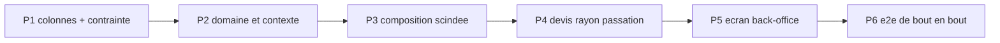
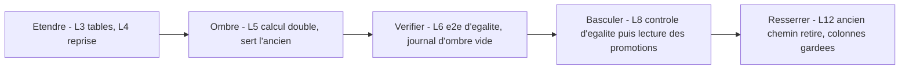
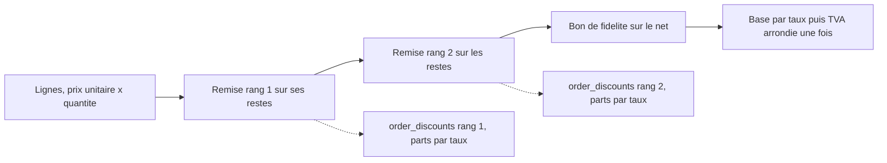
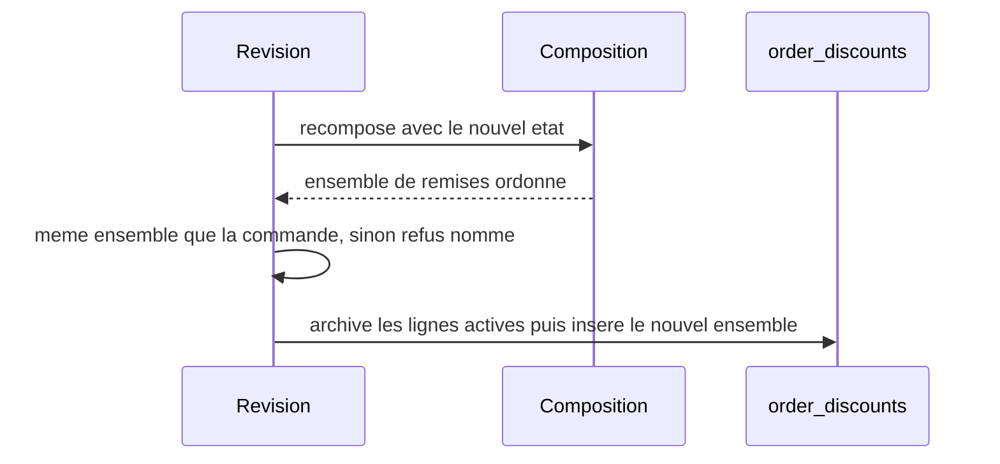

# Plan — les promotions par audience et par acheminement

**Ouvert le 2026-10-30**, à la demande de Hugo : « élargir le modèle de
promotion, qui n'était que B2B, pour paramétrer les audiences, les
acheminements et les segments d'audience ».

**Cas déclencheur** : une promotion de −20 % pour les **particuliers avec
compte** et pour **tous les pros**, sur **tous les acheminements**.

**État : doc-first, EXÉCUTABLE depuis le 2026-10-30.** Le modèle retenu est
le § 12 ; le **§ 13 est le plan à bâtir** (décisions par défaut, modèle de
données, reprise, lots L0 à L12). Les §§ 3 à 7 sont l'historique de la
discussion : là où ils divergent du § 12/13, ils portent la mention « dépassé ».
**L0 à L7 bâtis le 2026-10-30** (§ 13.10 ; L7 non commité à l'écriture de cette ligne) ; aucun prix servi n'a changé (source `legacy`). **L12 bâti en partie le 2026-10-30** : l'ancien chemin est retiré, la source ne vaut plus que `promotions`, le cumul (§ 16) est bâti au point ligne ; la multi-remise de panier ne l'est pas (§ 16.1). Le plan touche à l'argent et porte une
migration : `vitruve` est obligatoire avant Hugo (CLAUDE.md §9 bis) — **il a
tourné le 2026-10-30** ; ses objections et les réponses sont au §7, et les
sections qu'elles corrigent le disent.

Toutes les affirmations sur l'existant ci-dessous ont été **ouvertes le
2026-10-30** ; les citations `fichier:ligne` valent à cette date.

---

## 1. L'existant

### 1.1 Les étages et leur ordre

- Quatre étages, ordre déclaré une fois : `mercuriale → volume → promotion →
geste` (`apps/lfd-api/src/b2b/pricing/domain/price-rule.ts:23`).
- `volume` n'est plus écrit en règle, il vient du barème
  (`price-rule.ts:38`, type `AuthoredPriceStage`).
- Une mercuriale **scelle** la chaîne : les étages suivants sont transparents,
  sauf une règle qui porte `stacksOverMercuriale`
  (`apps/lfd-api/src/b2b/pricing/domain/resolve-price.ts:118` ; colonne
  `stacks_over_mercuriale`, `apps/lfd-api/prisma/schema/public/pricing.prisma:73`,
  `false` par défaut). L'option « ne pas cumuler avec une mercuriale »
  demandée **existe donc déjà**, à l'envers : c'est le comportement par défaut.
- Dans un étage, un seul gagnant : `winnerOf`
  (`apps/lfd-api/src/b2b/pricing/domain/specificity.ts:340`), après filtrage par
  `applies` (`specificity.ts:279`, qui teste portée, audience, fenêtre,
  suspension).

### 1.2 L'audience d'une règle

- `PriceAudienceType = "all" | "segment" | "company"` (`price-rule.ts:44`),
  `id` nul ssi `all` (`price-rule.ts:52-56`) ; colonnes `audience_type` /
  `audience_id` (`pricing.prisma:32-34`).
- Rang de spécificité `all 0 < segment 1 < company 2` (`specificity.ts:32-36`) ;
  l'audience prime la portée (commentaire de tête du même fichier).
- `matchesAudience` (`specificity.ts:157-166`) : une commande sans société ne
  peut satisfaire que `all`.
- 🔴 **`segment` est inatteignable** : `pricingContextFor` pose
  `segmentId: null` en dur (`apps/lfd-api/src/b2b/pricing/domain/pricing-context.ts:68`),
  et son JSDoc le dit (« aucune notion de segment n'existe sur `Company` »,
  `pricing-context.ts:35-38`). Aucun modèle `Segment` dans `prisma/schema`
  (grep du 2026-10-30 : seul `ProductAudienceCounter`, `growth.prisma:423`,
  qui est un compteur, pas un groupe).
- `src/b2b/audiences/` n'est **pas** un référentiel de segments : c'est le
  tableau qui décrit la clientèle à partir des commandes
  (`apps/lfd-api/src/b2b/audiences/domain/audience-scope.ts:1-3`, lot A1 de
  `recommandation-produit/plan-audiences.md`).

### 1.3 Ce que porte le contexte

- `PricingAudienceOf = { at, companyId, segmentId }`
  (`specificity.ts:215-219`).
- `PricingParties = { companyId, pricingCompanyId }`
  (`apps/lfd-api/src/b2b/pricing/domain/loaded-pricer.ts:34-37`) ;
  `NO_PARTIES` pour « aucune société » (`loaded-pricer.ts:40`), seule
  fabrique `PricingPartiesResolver.partiesAt`
  (`apps/lfd-api/src/b2b/pricing/application/pricing-parties.resolver.ts:20-25`).
- **Rien ne dit si un particulier est connecté.** Un particulier inscrit et un
  invité arrivent tous deux avec `companyId: null` : l'inscrit passe par
  `POST /orders` (`apps/lfd-api/src/b2b/orders/http/orders.controller.ts:80-83`,
  `@ActingCompany()` nul), l'invité par
  `apps/lfd-api/src/b2b/orders/application/commands/place-shop-order.handler.ts`.
  Et l'invité **a** un `placedByUserId` — une personne inscrite à la volée
  (`buyers.register`, `:149`) **avant** que la commande soit composée
  (`drafting.draft`, `:154` ; parties `{ companyId: null, placedByUserId:
buyerUserId, placedByStaffId: null }`, `:155`) — : la présence d'un user ne
  distingue donc **pas** les deux. `OrderParties` ne porte que ces trois champs
  (`apps/lfd-api/src/b2b/orders/application/services/order-parties.ts:9-13`). Seule la **route** le sait (devis
  anonyme `shop-quote.controller.ts:46` `@Public()` contre devis reconnu
  `my-shop-quote.controller.ts:51-55`, qui porte `buyerUserId`).
- **Rien ne dit l'acheminement.** `OrderComposition.resolve` tarifie les lignes
  (`apps/lfd-api/src/b2b/orders/application/services/order-composition.service.ts:145`)
  **avant** de résoudre l'acheminement (`:159`), et le tarif ne reçoit que
  `parties` (`:262`, `linePricing.resolve(requested, parties, "checkout")`).

### 1.4 La clientèle `pro` / `public` existe déjà ailleurs

- Enum `OrderClientele { pro, public }` (`prisma/schema/public/orders.prisma:59-64`).
- Les **limites** (planchers) ont gagné une clientèle le 2026-09-26, avec une
  contrainte d'exclusion élargie posée « créer puis supprimer »
  (`prisma/migrations/20260926130000_les_limites_ont_une_clientele/migration.sql:9-28`,
  colonne `pricing.prisma:143`). **C'est le précédent à copier.**
- La clientèle d'une requête : `CustomerAudiences.of`
  (`apps/lfd-api/src/b2b/orders/application/services/customer-audiences.service.ts:23-28`)
  → `audienceOf` (`packages/contracts/src/customer-audience.ts:23-25`) : `b2b`
  pour une société **active** seulement, sinon `b2c`. Partagée par devis et
  caisse.
- Le prix de base diffère déjà par clientèle : `servedPriceOf(row, audience)`
  (`apps/lfd-api/src/b2b/catalog/infrastructure/prisma-catalog.reader.ts:282`).

### 1.5 La contrainte d'exclusion

`price_rules_no_overlap`, dernière forme
(`prisma/migrations/20260817210000_cycle_de_vie_et_journal_tarifaire/migration.sql:32-45`,
revérifié le 2026-10-30 : `20260826090000`, `20260831090000` et
`20260908160000` ne la citent qu'en commentaire, aucune ne la redéfinit ;
`btree_gist` est créée par `20260817102602_regles_tarifaires/migration.sql:51`) :
`EXCLUDE USING gist (stage =, scope_type =, scope_id =, audience_type =,
audience_id =, min_quantity =, tstzrange && ) WHERE archived_at IS NULL`.
Elle refuse deux règles **identiques** sur la même fenêtre ; elle ne refuse pas
deux règles de publics **qui se recouvrent** (`all` et `company:X`) — c'est
`winnerOf` qui arbitre.

### 1.6 La remise du point de retrait

> Complété au § 13.1 (rouvert le 2026-10-30) : la remise est un **pourcentage
> OU un montant fixe en centimes** sur l'assiette (`cart-adjustment.ts:10-19`),
> et la clientèle qui la reçoit est `audienceOf` (société ACTIVE seulement),
> pas la décision « pro ou pas » du tarif (`company-service.ts:27-37`).

- Un `PickupDiscount` par point, **une par clientèle** `b2b` / `b2c`
  (`apps/lfd-api/src/b2b/pickup-addresses/domain/pickup-discount.ts:36-40`).
- C'est un **ajustement de panier**, pas un étage : montant en **centimes** sur
  les lignes couvertes, calculé par `CartAdjustments` après le prix des lignes
  (`cart-adjustments.service.ts:67-102`), partagé devis/caisse. Il cumule donc
  toujours avec une promotion (la promotion baisse le prix unitaire, la remise
  s'applique ensuite sur le sous-total couvert).

### 1.7 Le prix barré

- `unitPriceMillicents` est le prix **résolu** pour qui regarde
  (`packages/contracts/src/shop-catalogue.ts:131-141`) ;
  `catalogPriceMillicents` est le tarif à barrer, **vers le bas seulement**, et
  jamais la promo sous mercuriale (`shop-catalogue.ts:225-245`).

---

## 2. Ce qui manque, en une phrase par axe

| Axe                        | Aujourd'hui                                     | Manque                                |
| -------------------------- | ----------------------------------------------- | ------------------------------------- |
| particulier inscrit/invité | indiscernables (`companyId` nul dans les deux)  | un fait « connecté » dans le contexte |
| pro (tous)                 | aucun moyen : `all` vise aussi les particuliers | une audience `pro`                    |
| acheminement               | absent du contexte, résolu après le prix        | méthode + point dans le contexte      |
| segment                    | modélisé, inatteignable                         | ne PAS le bâtir ici (Q4)              |

---

## 3. Le modèle proposé

> ⚠️ **Dépassé par les §§ 12 et 13** (2026-10-30) : plus de colonnes
> `clientele` / `fulfillment` sur `price_rules`, plus de règles jumelles ni de
> `campaign_id`. Une promotion est un agrégat à part (§ 13.3) ; l'acheminement
> s'applique au point « panier », donc la scission de `OrderComposition.resolve`
> (§ 3.4) n'est plus nécessaire (§ 13.6). Gardé pour l'historique.

### 3.1 Deux axes orthogonaux, pas un axe élargi

On **n'ajoute pas** de valeurs à `PriceAudienceType`. On ajoute un axe
**clientèle**, porté à côté de l'audience nominative existante :

- `clientele` — `any | public_guest | public_registered | public | pro`
  (nouvelle colonne, `NOT NULL DEFAULT 'any'`).
- `audience_type / audience_id` — inchangés : `all | segment | company`.
  `segment` et `company` impliquent `pro` ; l'agrégat **refuse** une règle
  `company:X` avec une clientèle `public*` (combinaison inexprimable plutôt que
  vérifiée en aval).

Le cas déclencheur ne tient **pas** en une seule clientèle (`public_registered`
∪ `pro`). Deux options :

- **A — deux règles jumelles** posées d'un geste par l'écran (« Particuliers
  inscrits » + « Pros » cochés → deux lignes, même libellé, même fenêtre, un
  identifiant de lot `campaign_id`). Simple pour la contrainte et la
  spécificité ; le journal les lie par le lot.
- **B — un ensemble** `clienteles text[]`. Plus fidèle à l'intention, mais la
  contrainte d'exclusion devient un `&&` sur tableau (GiST `intarray`/`text[]`),
  et la spécificité d'un ensemble n'a pas de rang naturel.

**Recommandation : A** (Q1). Elle garde une règle = un public, ce que
`winnerOf` et la trace savent déjà expliquer.

### 3.2 L'acheminement

Colonnes additives :

- `fulfillment` — `any | pickup | delivery`, `NOT NULL DEFAULT 'any'` ;
- `fulfillment_pickup_id` — nul sauf `fulfillment = 'pickup'` ciblé sur un
  point (CHECK) ;
- **pas** de zone de livraison au premier lot (Q3).

### 3.3 La contrainte d'exclusion

Nouvelle `price_rules_no_overlap_by_public`, mêmes colonnes **plus**
`clientele =, fulfillment =, coalesce(fulfillment_pickup_id,'') =`, posée
**avant** de supprimer l'ancienne (précédent §1.4). Tant que toutes les lignes
valent `any/any`, les deux disent la même chose : la création ne peut échouer.

Elle reste une garantie **d'identité**, pas de disjonction : `public` et
`public_registered` se recouvrent sans se refuser. C'est voulu — la
spécificité les arbitre, comme `all` et `company` aujourd'hui.

### 3.4 Le contexte

`PricingAudienceOf` gagne deux champs, **déduits au serveur, jamais reçus** :

- `clientele: "pro" | "public_guest" | "public_registered"` — `pro` si
  `audienceOf` rend `b2b` (§1.4) ; sinon dérivée de `buyerKind`
  (**corrigé après vitruve, §7 B1** : la présence d'un user ne suffit pas).
  `buyerKind: "guest" | "registered"` est un champ explicite de
  `OrderParties` et du contexte de prix, **posé par le handler selon sa
  route**, jamais lu dans un payload. Une seule fabrique, à côté de
  `PricingPartiesResolver` (même raison que `pricing-parties.resolver.ts:6-14`).
  Le cas de la société non validée est une **question** (Q8), pas un acquis.
- `fulfillment: { method: "pickup" | "delivery"; pickupId: string | null } | null`
  — `null` = **inconnu** (rayon, fiche, tableau staff).

`matchesAudience` teste les trois axes. Règle pour `fulfillment === null` :
**une règle conditionnée à un acheminement ne s'applique pas** quand
l'acheminement est inconnu (Q2 : alternative « on montre le meilleur prix
possible avec la mention “en retrait” »).

🔴 Conséquence sur l'ordre de `OrderComposition.resolve` (§1.3) : l'acheminement
doit être connu **avant** le prix des lignes. Le point retenu se décide déjà
sans le prix (choix explicite ou `preselectedPickupId`, `cart-adjustments.service.ts:115-151` et `:195`) ;
seuls les **montants** de remise/frais dépendent du prix. Il faut donc scinder
`resolveFulfillment` en « quel acheminement » (avant) et « combien » (après).
C'est la seule refonte non additive du plan.

### 3.5 La spécificité

Rang lexicographique, du plus fort au plus faible :

1. audience nominative (`company > segment > all`) — **inchangé** ;
2. clientèle (`public_guest | public_registered | pro` > `public` > `any`) ;
3. acheminement (`point précis > pickup | delivery > any`) ;
4. portée, puis palier — inchangés.

Exemple : « −20 % particuliers inscrits » et « −10 % tous » courent ensemble →
l'inscrit prend −20 %, l'invité −10 %. Une promotion `company:X` bat toujours
une promotion de clientèle : la négociation nominative prime (Q5).

Pas de cumul de deux promotions : l'étage a **un** gagnant, ce qui reste vrai.

Confronté à `specificityOf` / `compare` / `winnerOf`
(`apps/lfd-api/src/b2b/pricing/domain/specificity.ts:79-97`, `:340`) : le tuple
`[audience, portée, proximité de famille, palier]` devient
`[audience, clientèle, acheminement, portée, proximité, palier]`. L'en-tête du
fichier (« l'audience prime sur la portée ») reste vrai et s'étend : **tout
critère de public prime la portée**. **Changement de comportement assumé** :
une promotion « inscrits · global » bat une promotion « tous · ce produit »,
là où aujourd'hui la portée produit l'emporterait entre deux règles `all`. Les
règles existantes valent `any/any` (rang 0) et gardent exactement leur ordre.
Une égalité stricte lève toujours `AmbiguousPriceRulesError` ; elle n'est
possible qu'entre deux règles identiques sur les six axes, que la contrainte
§3.3 refuse. Tests : §5 + §7 S-spécificité.

### 3.6 Le cumul

| Avec            | Comportement proposé                                                                |
| --------------- | ----------------------------------------------------------------------------------- |
| mercuriale      | inchangé : scellée, sauf `stacksOverMercuriale` (§1.1)                              |
| barème volume   | inchangé : l'étage volume précède, la promotion s'applique au résultat              |
| geste           | inchangé                                                                            |
| remise du point | cumule (ajustement de panier, §1.6) — Q6 : option « pas avec la remise du point » ? |
| plancher        | inchangé : la limite de la clientèle (`pro`/`public`, §1.4) borne le résultat       |

### 3.7 Prix barré, devis, passation

- Rayon : l'acheminement est inconnu → une promotion « retrait seulement » ne
  baisse pas `unitPriceMillicents` ; le rayon peut afficher une **mention**
  (« −20 % en retrait ») sans barrer (Q2). Le barré suit les règles existantes
  (`shop-catalogue.ts:225-245`).
- Route anonyme : clientèle `public_guest`. Une promotion « inscrits » n'y est
  **pas** appliquée ; mention « avec un compte » proposée (Q7).
- Devis et passation reçoivent le même contexte, construit par la même
  fabrique : le prix **change** si le client change d'acheminement ou se
  connecte, et le devis le montre avant le paiement. La passation fait foi
  (comme pour la TVA des frais, `shop-cart-quoting.service.ts` V4).
- Un invité qui se connecte au paiement : le panier est **re-chiffré** sur la
  route reconnue ; rien de figé côté client.

### 3.8 Journalisation et trace

- Les faits `price_rule.*` existants (`PricingEvent`, `pricing.prisma:579`)
  gagnent `clientele` et `fulfillment` dans leur charge ; un fait antérieur sans
  ces clés se lit `any/any` (valeur de donnée, pas renommage).
- La trace figée d'une ligne de commande nomme le public de la règle gagnante
  (« Particuliers inscrits · retrait ») : « pourquoi ce prix » doit rester
  répondable six mois plus tard.
- `lint:dated-decisions` : rien de neuf à dater — la règle porte déjà sa
  fenêtre (`pricing.prisma:60-61`) ; le gate est à relancer car `price-rule.ts`
  est dans son périmètre (`dev-toolbox/gates/dated-decisions.mjs:122`).

### 3.9 L'écran du back-office

Sur l'éditeur de promotion (cf. `ecrans-de-tarification.md`) :

- **Public** : cases « Particuliers sans compte », « Particuliers inscrits »,
  « Pros » (+ « Une société » existant). Plusieurs cases → plusieurs règles
  jumelles (§3.1 A).
- **Acheminement** : Tous / Retrait (tous points | un point) / Livraison.
- Case existante « S'applique aussi aux tarifs négociés » = `stacksOverMercuriale`.
- Résumé lu par le staff : « −20 % · particuliers inscrits et pros · tous
  acheminements · du … au … ».

### 3.10 Les segments

**Hors de ce plan.** Un segment de sociétés (et, a fortiori, de particuliers)
demande un référentiel de groupes, un écran et une règle d'appartenance datée ;
`segment` reste inatteignable comme aujourd'hui (§1.2). Q4.

---

## 4. Lots

> ⚠️ **Dépassé par le § 13.10** (lots L0 à L12).



| Lot | Contenu                                                                                                                                                  | Migration                |
| --- | -------------------------------------------------------------------------------------------------------------------------------------------------------- | ------------------------ |
| P1  | `clientele`, `fulfillment`, `fulfillment_pickup_id` (défauts `any`), CHECKs de nullité, contrainte élargie créée **puis** ancienne supprimée             | additive, un déploiement |
| P2  | VO `PriceClientele`, `PriceFulfillment` ; refus `company` × `public*` dans l'agrégat ; `matchesAudience` à trois axes ; rang §3.5 ; fabrique du contexte | —                        |
| P3  | `OrderComposition` : acheminement résolu avant le prix, montants après ; `linePricing.resolve` reçoit le contexte complet                                | —                        |
| P4  | devis anonyme/reconnu, rayon (mention sans barré), passation inscrit/invité ; trace et journal                                                           | —                        |
| P5  | éditeur (cases public, acheminement, lot de jumelles), résumé                                                                                            | —                        |
| P6  | e2e (§5)                                                                                                                                                 | —                        |

## 5. Tests

> ⚠️ **Dépassé par le § 13.11** ; les cas ci-dessous y sont repris quand ils
> valent encore.

- **Domaine** : `matchesAudience` sur la matrice clientèle × acheminement ×
  inconnu ; rang §3.5 (inscrit bat `public`, `company` bat `pro`, point bat
  retrait) ; refus `company` + `public_guest`.
- **Application** : la fabrique du contexte (société inactive → `public_*`,
  cf. `audienceOf`) ; `OrderComposition` appelle le tarif avec l'acheminement.
- **E2E** (vrai Postgres, fenêtres en `daysAgo`) — une promo −20 %
  `public_registered` + `pro`, tous acheminements :
  - invité, retrait → prix plein ; inscrit, retrait → −20 % ; pro actif → −20 % ;
  - promo « retrait au point A » : inscrit en livraison → plein, au point B →
    plein, au point A → −20 % ; devis et passation au même centime ;
  - pro sous mercuriale → promo ignorée sauf `stacksOverMercuriale` ;
  - remise du point cumulée après la promo ;
  - contrainte : deux jumelles identiques refusées, `public` et
    `public_registered` coexistent ;
  - rayon anonyme : pas de barré sur une promo réservée aux inscrits.

## 6. Questions à Hugo

> ⚠️ **Toutes tranchées** : Q1 (un public par promotion, § 12), Q2 (§ 13.2
> RAYON), Q3 (zones : variante prévue, non bâtie), Q4 (segments : hors plan),
> Q5 (la société prime, § 13.2), Q6 (cumul, § 13.2), Q7 (§ 8 : message à tout
> invité), Q8 (§ 10 et la variante « pros en cours d'inscription »), Q9
> (option b, § 13.2).

1. **Q1** — Un public multiple = règles jumelles posées d'un geste (A,
   recommandé) ou un ensemble dans une seule règle (B) ?
2. **Q2** — Acheminement inconnu (rayon, fiche) : n'appliquer **pas** une promo
   conditionnée (recommandé, + mention) ou montrer le meilleur prix possible ?
3. **Q3** — Les zones de livraison comme cible, dès maintenant ou plus tard ?
4. **Q4** — Les segments (sociétés, particuliers) : chantier séparé, d'accord ?
   Qu'est-ce qu'un segment de particuliers pour toi (fidélité, quartier,
   ancienneté) ?
5. **Q5** — Une promotion « tous les pros » et une promotion nominative
   `company:X` : la nominative gagne toujours, même moins généreuse ?
6. **Q6** — Faut-il une option « ne cumule pas avec la remise du point de
   retrait » ?
7. **Q7** — Le rayon anonyme doit-il annoncer « −20 % avec un compte » ?
8. **Q8** — Le membre d'une société **non validée** (que `audienceOf` traite
   en `b2c`, `customer-audiences.service.ts:23-28`) : `public_registered`,
   `pro`, ou aucune des deux promotions ? Le plan ne le présuppose plus.
9. **Q9 (B2)** — Changer d'acheminement en révision : (a) re-tarifer toutes
   les lignes (dérogation datée à R3) ou (b) refuser le changement s'il fait
   perdre ou gagner une promotion conditionnée ? Voir §7 B2.

---

## 7. Contradiction de vitruve (2026-10-30)

> ⚠️ Portait sur le modèle du § 3. **B1** (`buyerKind`) est repris tel quel au
> § 13.7. **B2** est tranché (option b, § 13.2) et sa mise en œuvre change de
> forme (§ 13.8). **B3** et « les lecteurs à adapter » visaient la contrainte
> élargie de `price_rules`, abandonnée (§ 13.4). Le reste est historique.

Chaque citation ci-dessous a été rouverte le 2026-10-30.

### B1 — « inscrit » n'est pas déductible à la passation

**Objection.** La passation invité crée `buyerUserId` avant de composer
(`place-shop-order.handler.ts:149`, draft `:154`) ; `OrderParties` =
`{companyId, placedByUserId, placedByStaffId}` (`order-parties.ts:9-13`).
« Un user existe » ne distingue pas l'invité de l'inscrit.

**Réponse.** `OrderParties` gagne `buyerKind: "guest" | "registered"`, et le
contexte de prix le reçoit. Il est posé **par le handler, selon la route**,
jamais par un payload. Poseurs, ouverts un par un :

| Poseur                                                                                                                       | Valeur                                                 |
| ---------------------------------------------------------------------------------------------------------------------------- | ------------------------------------------------------ |
| `place-shop-order.handler.ts:155` (`POST` boutique invité, `PlaceShopOrderCommand(payload)`, `shop-orders.controller.ts:67`) | `guest`, en dur                                        |
| `place-order.handler.ts:153` (`POST /orders`, `orders.controller.ts:82`, `@CurrentUser`)                                     | `registered`, en dur                                   |
| `place-order-for-customer.handler.ts:76` (saisie staff)                                                                      | `registered` (le client porté a un compte : sa fiche)  |
| `quote-order.handler.ts:58-64` (devis `/orders` et devis staff, `admin-orders.controller.ts:176`)                            | `registered`                                           |
| devis anonyme : `shop-quote.controller.ts:46` `@Public()` → `QuoteShopCartQuery` → `shop-cart-quoting.service.ts:133`        | `guest` (aujourd'hui `{ companyId }` seul)             |
| devis reconnu : `my-shop-quote.controller.ts:55` → `QuoteMyShopCartQuery(payload, companyId, user.userId)`                   | `registered`                                           |
| révision : `order-revising.service.ts:182-186` (et `:320`)                                                                   | **relu sur la commande** → colonne `orders.buyer_kind` |
| `document-specimens/specimen-data.ts:154`, `dev/seeding/order-placing.seed.ts`                                               | à poser explicitement (compilation l'exige)            |

La révision ne connaît pas la route d'origine : `buyerKind` doit donc être
**figé sur la commande** (colonne additive `buyer_kind`, `NOT NULL DEFAULT
'registered'` pour l'existant — Q à vérifier en P1 : les commandes boutique
invité existantes se reconnaissent par `placedByStaffId IS NULL AND company_id
IS NULL` + absence d'identité de connexion ; la reprise se fait en SQL dans la
même migration, relue par `lecteur-de-migrations`).

**Pourquoi le client ne peut pas le falsifier** : aucun schéma Zod ne porte le
champ ; la valeur `registered` n'est posée que derrière une route gardée qui a
résolu un `Principal` en base (le token n'atteste que le `sub`, CLAUDE.md §3) ;
la route `@Public()` pose `guest` en dur. Un invité qui envoie un jeton forgé
est refusé par le guard avant le handler. Le champ est obligatoire dans
`OrderParties` (pas `?:`) : un poseur oublié ne compile pas.

### B2 — la révision garde le prix figé des lignes gardées

**Objection.** `OrderComposition.priceLines` ne re-tarife que les lignes
fraîches ; les gardées reprennent leur prix figé (R3,
`order-composition.service.ts:250-275`, appelé par
`order-revising.service.ts:187`). Une promo conditionnée à l'acheminement ne
peut donc ni apparaître ni disparaître sur une ligne gardée.

**Options.**

- **(a)** Un changement d'**acheminement** en révision re-tarife **toutes**
  les lignes au contexte nouveau. Dérogation à R3, datée et bornée à ce seul
  cas (même forme que celle du 2026-10-29 sur les minimums). Coût : un
  client peut voir ses autres prix bouger (mercuriale expirée, prix catalogue
  changé) parce qu'il a changé de point.
- **(b)** Le changement d'acheminement qui ferait **gagner ou perdre** une
  promotion conditionnée sur une ligne gardée est **refusé** par une erreur
  nommée (`FulfillmentChangeAltersPromotionError`, `BusinessError` 409 :
  « Passer en livraison retire la promotion “−20 % en retrait” : annulez et
  recommandez, ou gardez le retrait »). R3 reste intacte.

**Recommandation : (b).** R3 est la promesse « le prix que vous avez payé ne
bouge pas » ; (a) la casse pour tout le panier afin de servir une seule
règle, et ferait bouger des prix sans lien avec l'acheminement. (b) ne coûte
qu'un refus rare, nomme le cas et le geste de sortie (CLAUDE.md §0). Le test
« ferait changer » se calcule en re-tarifant à blanc les lignes gardées au
nouveau contexte et en comparant l'identifiant de la règle gagnante de
l'étage promotion — lecture seule, rien n'est écrit.

**Tests e2e de révision** (les deux options en partagent la moitié) :

- retrait A (promo « retrait ») → livraison : (b) 409 nommé, commande
  inchangée ; (a) lignes re-tarifées au plein ;
- livraison → retrait A : (b) 409 ; (a) −20 % appliqué ;
- retrait A → retrait B, promo « tous retraits » : accepté, prix inchangés ;
- changement d'acheminement sans promo conditionnée : accepté, R3 tenue ;
- ajout d'une ligne fraîche après passage en retrait A : la fraîche prend la
  promo, les gardées gardent leur prix ;
- révision staff et révision client, même verdict.

### B3 — la contrainte

**Objection.** Vérifier la vraie dernière forme et le type de la colonne.

**Réponse.** Faite au §1.5 : la forme de `20260817210000:32-45` est la
dernière, les trois autres migrations ne la citent qu'en commentaire.
`btree_gist` existe (`20260817102602:51`). `pickup_addresses.id` est `TEXT`
(`20260803115432_pickup_addresses_table/migration.sql:12`) : la colonne
`fulfillment_pickup_id` est `TEXT`, et l'expression
`coalesce("fulfillment_pickup_id", '') WITH =` est du même type que
`coalesce("scope_id", '')`. `clientele` et `fulfillment` en `TEXT` + CHECK
(pas d'enum Postgres : `=` sur `text` est couvert par `btree_gist`). La
nouvelle contrainte reprend **toutes** les expressions existantes, `coalesce`
compris, et garde `WHERE ("archived_at" IS NULL)`. Pas de clé étrangère vers
`pickup_addresses` (archivage, pas de suppression) — le domaine valide
l'existence à la pose.

### S — les lecteurs à adapter

- `prisma-pricing-decisions.reader.ts:45`, `:108-113` (`audienceClause`) :
  l'écran par société liste `all` + `company:X`. Il doit lister aussi les
  règles de clientèle `pro`/`any` (celles qui peuvent jouer pour ce client)
  et **pas** les `public_*`. Le tableau général (`null`) reste sans filtre.
- `prisma-carried-decisions.reader.ts:46-52` : la clé `ruleCarryKey({stage,
audience, minQuantity})` doit gagner `clientele` et `fulfillment(+point)` —
  sinon deux jumelles (§3.1 A) ont la même clé et se heurtent à la reprise.
- Barème volume (`volume-ladder-rows.ts:24-25`,
  `prisma-volume-ladder.repository.ts:39-69`) : **ne prend pas les axes**. Le
  palier de volume est une condition commerciale pro, pas une campagne ; sa
  clé d'exclusion reste (portée, audience). `volume-ladder.ts:129` pose
  `stacksOverMercuriale: false` : il ne touche pas aux nouveaux axes ; les
  règles qu'il fabrique valent `any/any`.
- `partiesAt` / `NO_PARTIES`, 14 occurrences hors tests (grep du 2026-10-30) :
  `pricer.ts:142`, `company-pricing.query.ts:85`, `pricing-parties.resolver.ts:3,20,22`,
  `board-item.ts:5,73,76`, `board-category.ts:9,88`,
  `prisma-pricing-board.reader.ts:4,179`, `loaded-pricer.ts:31,40`.
  `PricingParties` gagne `buyerKind` et `fulfillment` ; `NO_PARTIES` devient
  « tableau staff » = `fulfillment: null`, `buyerKind` sans objet → le tableau
  montre ce que voit un `public_guest` (aucune promo conditionnée), et le dit.
  `partiesAt(companyId, at)` prend les deux nouveaux arguments, obligatoires.
- `exact-order-composition.ts` (domaine) et `exact-shop-quote.ts` ne lisent
  **aucun** parti (grep du 2026-10-30) : ils reçoivent des prix unitaires
  déjà résolus. Rien à changer, sauf à vérifier que l'ordre scindé (§3.4) les
  appelle après le prix.

### S — le rayon

`priced(companyId, language)` (`shop-catalogue-pricing.service.ts:111`)
devient `priced(companyId, buyerKind, language)` : le contrôleur reconnu
passe `registered`, le public `guest`. **Tranché** : l'aperçu
`pricedWithoutCompany("pro")` (`GET /shop/catalogue?audience=pro`, JSDoc
`:124-137`) tarife avec une clientèle **`any` stricte** — seules les règles
`clientele = any` y jouent. L'audience y
est **déclarée par le client** (paramètre de requête) ; montrer une promo
`pro` reviendrait à la publier à quiconque tape `?audience=pro`. Le prix pro
de base y reste (décision du 2026-10-19), les promotions pro non.

### S — `stacksOverMercuriale`

Le drapeau est porté par **chaque** règle (`price-rule.ts:189`) et lu au
moment du scellement (`resolve-price.ts:118`). Une promotion de clientèle est
une `PriceRule` de l'étage promotion : elle passe par ce drapeau sans rien de
neuf. Deux jumelles d'une campagne doivent porter la **même** valeur : c'est
l'écran qui pose le lot d'un geste ; l'agrégat ne voit qu'une règle, donc
l'égalité est tenue par la commande de pose (une seule valeur dans la
commande, recopiée), pas vérifiée après coup.

### S — la spécificité

Traité au §3.5 : changement de comportement nommé (tout critère de public
prime la portée). Tests domaine : « inscrits · global » bat « tous ·
produit » ; « `company:X` · global » bat « pro · produit » ; deux règles `any`
gardent leur ordre d'aujourd'hui (non-régression sur les fixtures
existantes de `specificity`) ; égalité stricte → `AmbiguousPriceRulesError`.

### S — ce qui devient irréversible au merge

- Les faits `price_rule.*` écrits avec `clientele`, `fulfillment` et
  `campaign_id` dans leur charge sont **permanents** (journal, pas de
  suppression) : le nom de ces clés est figé dès le premier fait. Les
  renommer ensuite = migration de données (CLAUDE.md §8).
- Le **libellé** du public sur la trace figée d'une ligne (« Particuliers
  inscrits · retrait ») est écrit dans la commande et ne se recalcule pas :
  un libellé mal choisi reste sur les commandes passées.
- `campaign_id` lie des jumelles pour toujours ; dissocier un lot plus tard
  ne réécrit pas les faits passés.
- `orders.buyer_kind` (B1) : la valeur de reprise des commandes existantes
  est un fait posé une fois.

### S — Q8

Ne plus présupposer : §3.4 renvoie à Q8.

### Mineurs

Lignes de `place-shop-order.handler.ts` réalignées au §1.3 (`:149` register,
`:154` draft, `:155` parties, ouvertes le 2026-10-30).

## 8. Questions en suspens (discussion avec Hugo, 2026-10-30)

Notées pour être tranchées ensemble ; rien n'est bâti tant qu'elles restent ouvertes.

- **B1 confirmé, avec un cas posé par Hugo** : un particulier qui a un compte
  passe commande « en invité », sans se connecter. Aujourd'hui la passation
  invité inscrit une NOUVELLE personne à chaque commande, sans la rattacher au
  compte existant de la même adresse (`place-shop-order.handler.ts:149`, D2 :
  « deux visiteurs d'une même adresse font deux lignes »). Il est donc `guest`
  et n'a pas la promotion « inscrits ». Accorder la promo sur la seule adresse
  e-mail serait falsifiable (n'importe qui peut taper l'adresse d'un autre).
  Piste recommandée : au panier, si l'adresse saisie correspond à un compte,
  proposer « Vous avez un compte : connectez-vous pour profiter de −20 % »,
  sans jamais l'appliquer sans connexion. **Tranché par Hugo le 2026-10-30** :
  le message s'affiche à TOUT invité tant qu'une promotion « inscrits » est en
  vigueur — « Vous avez un compte ? Connectez-vous pour profiter de −20 % » —
  SANS vérifier l'adresse saisie : la boutique ne révèle jamais qu'une adresse
  a un compte. La promotion ne s'applique qu'après connexion.
- **B3 / chevauchement** : Hugo reviendra sur la contrainte d'exclusion et la
  façon dont deux promotions se chevauchent.
- **Q1 à Q9** du § 7 : toutes ouvertes, avec la recommandation écrite.

## 9. Vocabulaire verrouillé (Hugo, 2026-10-30)

- **Audience** : particuliers ou pros (ou tout le monde).
- **Sous-audience** : ce que le serveur reconnaît seul, sans réglage —
  particuliers _invités_ (commande sans connexion) ou _inscrits_ (connectés,
  pour eux-mêmes) ; pros _actifs_ (société validée), _en cours d'inscription_
  (société en attente de validation — Hugo, 2026-10-30 : des pros, pas des
  particuliers), _tous_ (les deux), ou _une société_ (± ses sites).
- **Segment** : une liste que le staff crée et entretient — de sociétés
  (« Hôtels de la station ») ou de comptes inscrits (« Clients fidèles »,
  jamais d'invités). Chantier séparé ; dans le code actuel, `segment` ne
  désigne qu'un groupe de sociétés, et aucun n'existe en base.

Le public d'une promotion se choisit dans un seul menu : Tout le monde ·
Particuliers (tous / invités / inscrits / segment) · Pros (tous / une société /
segment). Les colonnes du § 3 (`clientele`) se renomment en conséquence au
bâti. Restent à trancher : la personne aux deux casquettes, la saisie staff, la
société et ses sites, et le PRIX DE BASE d'un pro en cours d'inscription
(aujourd'hui `audienceOf` le sert au prix public, `customer-audience.ts:23`).

## 10. Le pro en cours d'inscription voit le catalogue pro (Hugo, 2026-10-30)

Décision : **un membre d'une société en attente de validation voit le
catalogue pro quand il agit dans son espace pro** (au nom de sa société).
Pour lui-même, hors de l'espace pro, il reste un particulier inscrit.
Aujourd'hui c'est l'inverse : `audienceOf` (`customer-audience.ts:23`) ne
rend `b2b` que pour une société ACTIVE, et ses 13 lecteurs (catalogue, prix,
points de retrait, textes de la boutique, e-mails, contact…) servent donc le
public à une société en attente.

C'est un chantier à part, préalable aux promotions par sous-audience, qui
déplace une frontière de sécurité (qui voit les prix pros) et touche l'argent :
plan dédié et `vitruve` avant de bâtir. Questions ouvertes :

- Peut-il **commander** au prix pro avant validation, ou seulement voir ?
- Si oui : à quelles conditions de paiement (carte seulement, jamais « au
  compte » avant validation) ?
- Ses minimums, sa TVA affichée (HT), ses réservations sur mesure, sa
  mercuriale : tout ce qui suit « pro » le suit-il aussi ?

**Précision de Hugo (2026-10-30) : ces choix sont des RÉGLAGES d'admin**, pas
des décisions codées. Un écran « Pros en cours d'inscription » (Réglages)
porte la politique. Défauts : les plus souples (Hugo, 2026-10-30), sauf le paiement, réservé à la carte :

| Réglage                                               | Défaut proposé                         |
| ----------------------------------------------------- | -------------------------------------- |
| Voir le catalogue et les prix pros dans l'espace pro  | oui                                    |
| Commander au prix pro avant validation                | oui                                    |
| Moyens de paiement avant validation                   | carte seulement — jamais « au compte » |
| Minimums et affichage HT des pros                     | oui (suivent le catalogue pro)         |
| Mercuriale / réservations sur mesure avant validation | oui                                    |
| Remise pro du point de retrait                        | oui                                    |

Chaque changement est journalisé (qui, quand, avant / après). Le plan dédié
(préalable aux promotions par sous-audience) détaillera où chaque réglage est
lu, et passera par `vitruve`.

## 11. Un modèle global, tout de suite (Hugo, 2026-10-30)

Décision : **la remise d'un point de retrait devient une promotion comme une
autre**, pas un second système. Les points de retrait sont une
sous-catégorie de l'acheminement « retrait » (tous · retrait · retrait au
point X · livraison). Une promotion porte donc trois axes : **public**
(audience / sous-audience, § 9), **acheminement**, et **portée** reprise du
modèle de la remise de retrait (`settings.prisma`, `PickupDiscountScope`
`all_except | only` + règles par famille ou produit, produit > famille, par
clientèle) — une seule mécanique de portée, partagée.

Conséquences, à traiter dans la refonte du plan (avant `vitruve`) :

- reprise des remises de retrait existantes (taux par site et par clientèle,
  portées et exceptions) en promotions : **migration de données** — relue par
  `lecteur-de-migrations`, avec retour arrière ;
- ordre de calcul : aujourd'hui la remise de retrait est un ajustement de
  panier appliqué APRÈS la promotion, et elles se cumulent ; dans le modèle
  unique, dire comment deux promotions s'appliquent ensemble (cumul ou la
  meilleure) sans changer en silence les prix servis ;
- la contrainte anti-chevauchement ne sait pas lire des exceptions : règle de
  priorité ou refus à la pose ;
- écrans : la fiche d'un site (Réglages › Sites) garde-t-elle un raccourci
  vers « ses » promotions ?

## 12. Le modèle retenu (Hugo, 2026-10-30) — remplace les §§ 3 et suivants là où ils divergent

**Exigence de Hugo : le modèle est EXTENSIBLE** — un critère neuf s'ajoute
sans refaire ni l'agrégat ni ses lecteurs.

```
Promotion (agrégat)
├─ identité      nom interne · libellé client (FR/EN/IT) · motif
├─ effet         −X % ou −X € unitaire · plancher propre optionnel
├─ fenêtre       début obligatoire · fin optionnelle
├─ état          active · en pause · archivée
├─ public        Tout le monde | Particuliers (tous · invités · inscrits · segment*)
│                | Pros (tous · actifs · en cours d'inscription · une société ± ses sites · segment*)
├─ acheminement  Tous | Retrait (tous les points · un point) | Livraison (toute · zone*)
├─ portée        tout sauf | seulement + exceptions famille / produit, produit > famille
└─ conditions    liste vide par défaut — panier minimum*, quantité minimum*, jours/heures*,
                 première commande*, code promo*, limite d'usage*
                 (* = prévu, non bâti)
```

- **Trois objets** : la _portée d'éligibilité_ (partagée, `b2b/shared`, « cet
  article est-il concerné ? ») ; le _ciblage_ (« cette commande est-elle
  concernée ? », à partir de faits établis par le serveur : décision unique
  « pro ou pas », invité/inscrit, acheminement, point) ; la _promotion_
  (l'agrégat et ses invariants).
- **Extensibilité** : chaque axe est un type somme fermé côté domaine, un
  critère neuf = une variante + son évaluateur, sans toucher aux autres ; les
  conditions sont une LISTE de conditions typées (toutes doivent tenir), donc
  ajouter « code promo » n'est qu'une variante de plus.
- **L'existant** : chaque remise de point de retrait devient une promotion
  (public Particuliers tous ou Pros tous · acheminement Retrait · ce point ·
  portée reprise telle quelle · sans fin) ; une règle de prix d'étage
  « promotion » devient une promotion « seulement [sa portée] ». Mercuriale,
  volume et geste restent des règles de prix.
- **Laissé ouvert, à traiter ensuite** : cumul de deux promotions sur un même
  article, ordre face à la mercuriale et au volume (il doit reproduire au
  centime les prix d'aujourd'hui juste après la reprise), chevauchement à la
  pose, affichage au rayon d'une promo conditionnée par l'acheminement.

---

## 13. Le plan exécutable (2026-10-30, sur mandat de Hugo)

Hugo, le 2026-10-30 : « attaque le code, sans t'arrêter ». Ce qui restait ouvert
au § 12 est donc **décidé par défaut le 2026-10-30, sur mandat de Hugo** ;
chaque décision le dit. Toutes les citations `fichier:ligne` de ce § ont été
**ouvertes le 2026-10-30** (graphify d'abord, puis le fichier).

### 13.1 L'existant que la reprise doit reproduire, rouvert

**Les règles de prix d'étage « promotion »** :

- l'étage `promotion` est le troisième de `mercuriale → volume → promotion →
geste` (`apps/lfd-api/src/b2b/pricing/domain/price-rule.ts:23`) ; la chaîne
  reste **exacte** d'un étage à l'autre, arrondie une seule fois à la fin
  (`resolve-price.ts:130-139`, `:174`) ;
- un seul gagnant par étage, `winnerOf` (`specificity.ts:340-369`), sur le
  tuple `[audience, portée, proximité de famille, palier]`
  (`specificity.ts:72-86`, rangs `all 0 < segment 1 < company 2`, `:32-36`) ;
  une égalité stricte lève `AmbiguousPriceRulesError` (`:365-367`), que la
  contrainte d'exclusion rend impossible en base (§ 1.5) ;
- une mercuriale scelle les étages suivants, sauf `stacksOverMercuriale`
  (`resolve-price.ts:118`) ; la limite (plancher) s'applique après tous les
  étages (`resolve-price.ts:154-156`) ;
- une règle porte `replace` (prix posé) ou `alter` (`increase`/`decrease`,
  `percent`/`amount` en millicentimes) (`price-rule.ts:79-81`, `:190-193`),
  un `minQuantity` (`:154`), une portée `global | category | product | variant`
  (`:41`), une audience `all | segment | company` (`:44`), une pause
  (`pricing.prisma:83`) et un archivage (`:93`) ;
- 🔴 **`product` et `variant` visent le même identifiant** : le pricer pose
  `productSku: item.sku, variantSku: item.sku` (`loaded-pricer.ts:313`,
  `:391` ; `pricing-materials.loader.ts:209`), et `matchesScope` compare
  `scope.id` à l'un ou l'autre (`specificity.ts:128-131`). Seul le RANG les
  distingue (`SCOPE_RANK`, `specificity.ts:43-48`) ;
- une portée `global` ou `category` ne vise pas un article vendu au poids
  (`price-rule.ts:212-218`, `coversManyArticles`, `specificity.ts:126`) ;
- les colonnes `floor_mode` / `floor_value` de `price_rules`
  (`pricing.prisma:50-51`) n'ont **aucun lecteur** dans `apps/lfd-api/src`
  hors client Prisma généré (grep du 2026-10-30) : `PriceRule` ne les porte pas
  (`price-rule.ts:148-193`).

**La remise d'un point de retrait** :

- un **ajustement de panier** calculé après le prix des lignes, sur le hors
  taxe déjà arrondi par ligne (`order-composition.service.ts:145-163`), par
  `CartAdjustments.forPickup` (`cart-adjustments.service.ts:141-176`) ;
- deux remises par site, colonnes `discount_*` (pros) et `b2c_discount_*`
  (particuliers) (`settings.prisma:33-34`, `:50`, `:55-57`) + règles de portée
  `pickup_discount_rules` par clientèle, cible `category | product`
  (`settings.prisma:603-616`) ;
- 🔴 la clientèle est `audienceOf` (`packages/contracts/src/customer-audience.ts:23-25`) :
  **`b2b` pour une société ACTIVE seulement**. Un membre d'une société en
  attente reçoit donc la remise **des particuliers** — alors que le tarif le
  sert en pro (`company-service.ts:27-37`, `pending → pro`) ;
- effet : `percent` en points de base OU `amount` en **centimes sur
  l'assiette**, pas par unité (`cart-adjustment.ts:10-19`), borné à l'assiette
  (`discountCentsOf`, `cart-adjustment.ts:52-54`), assiette = somme des HT des
  lignes éligibles (`pickup-discount-eligibility.ts:45-61`) ;
- la portée « produit » vise `catalog_items.product_id` (toutes ses
  déclinaisons, `pickup-discount-scope.ts:76-94`,
  `prisma-order-line-classification.reader.ts:43`), pas le SKU ; elle couvre
  aussi les articles au poids (aucune lecture de l'unité de vente) ;
- invariants : « seulement » inclut quelque chose (`pickup-discount.ts:90-92`),
  une famille ne se règle que dans le sens du mode (`pickup-discount.ts:111-127`) ;
- pas de scellement par la mercuriale, pas de plancher : c'est un montant de
  panier ;
- la commande en fige `discount_cents`, `discount_adjustment` et le drapeau
  d'exclusion de chaque ligne (`order-composition.service.ts:213-243`) ; en
  `exact_ht`, `composeExactOrder` **reçoit UN seul `discountAdjustment`**
  (`order-composition.service.ts:384-400`) ;
- **en révision, la remise est recalculée** : `compose` repasse par
  `composition.resolve` (`order-revising.service.ts:181-186`), donc par
  `forPickup` ; seules les LIGNES gardées gardent leur prix (R3,
  `order-composition.service.ts:256-277`).

### 13.2 Les décisions par défaut (2026-10-30, sur mandat de Hugo)

**CUMUL — deux points d'application, et rien d'autre.**

| Promotion                   | Point d'application                                                                                                                         | Ce qu'elle reproduit                 |
| --------------------------- | ------------------------------------------------------------------------------------------------------------------------------------------- | ------------------------------------ |
| SANS critère d'acheminement | **ligne** : l'étage `promotion` de la chaîne, entre volume et geste, scellable par la mercuriale, bornée par la limite de prix              | les règles de prix d'étage promotion |
| AVEC critère d'acheminement | **panier** : après le prix des lignes, sur l'assiette des lignes qu'elle couvre, à l'endroit de `CartAdjustments.forPickup` / `forDelivery` | la remise de retrait                 |

- Entre les deux points : **cumul**, comme aujourd'hui (la promotion « ligne »
  baisse le prix unitaire, celle du panier s'applique ensuite sur le HT).
- Dans un même point : **une seule promotion par article**, la plus
  spécifique. Rang lexicographique : **public > acheminement > portée**, puis
  l'existant de `winnerOf` (proximité de famille, palier). Égalité stricte →
  **la plus avantageuse pour le client** (résultat le plus bas ; à résultat
  égal, l'identifiant le plus petit, pour rester déterministe).
- Au point panier, le scellement par la mercuriale **ne s'applique pas** et
  aucune limite de prix ne joue (c'est un montant, comme la remise d'aujourd'hui).
  `stacks_over_mercuriale` n'y est pas lu, et l'éditeur ne le propose pas.

**Vérification que ça reproduit l'existant** (§ 13.1) :

- règles d'étage promotion → promotions « ligne », présentées à `resolvePrice`
  comme des règles de l'étage `promotion` (§ 13.5) : même place dans la chaîne,
  même scellement, même limite, même arrondi unique. Les publics repris sont
  `everyone` (rang 0) et `company` (rang le plus haut) : l'ordre `all <
company` est conservé ; aucune n'a de critère d'acheminement (rang 0
  partout) ; la portée garde son rang (§ 13.3, cible `variant` rang 3 pour
  `variant`, rang 2 pour `product` — voir la colonne `target_rank`). Une
  égalité stricte n'existe pas aujourd'hui (contrainte d'exclusion) : la règle
  « la plus avantageuse » ne change donc aucun prix servi ;
- remises de retrait → promotions « panier », une par site et par clientèle :
  un seul point de retrait par commande et une seule remise par clientèle, donc
  **au plus une promotion panier par commande** après la reprise ; même
  assiette, même `discountCentsOf`, même arrondi unique, même figeage.

**Ce qui ne reproduirait PAS, et comment c'est traité :**

| Écart                                                                                             | Traitement                                                                                                                                           |
| ------------------------------------------------------------------------------------------------- | ---------------------------------------------------------------------------------------------------------------------------------------------------- |
| remise « particuliers » reçue par une société en attente ou suspendue (`audienceOf`)              | public de reprise **`everyone_but_active_pros`** (« Tous sauf les pros actifs »), et `pros_active` pour la remise des pros : exactement `audienceOf` |
| remise en montant fixe sur l'assiette                                                             | effet `basket_amount_off` (centimes), réservé au point panier                                                                                        |
| règle `replace` d'étage promotion                                                                 | effet `fixed_unit_price` (millicentimes), point ligne                                                                                                |
| règle `increase`, audience `segment`                                                              | **non exprimables** : la reprise s'arrête (`RAISE EXCEPTION`) et les nomme — L0 les compte avant                                                     |
| règle `minQuantity` d'étage promotion                                                             | condition `min_quantity` (la variante « quantité minimum » du § 12, bâtie ici), qui garde le 4ᵉ critère de `winnerOf`                                |
| `product` et `variant` sur le même SKU (rangs 2 et 3)                                             | cible `variant` + `target_rank` repris (2 ou 3) ; et L0 compte les paires qui se disputeraient                                                       |
| article au poids : `global`/`category` ne le visent pas au point ligne ; la remise de retrait, si | l'évaluateur de portée reçoit le point : au point ligne, une décision par mode ou par famille ne vise pas un article au poids ; au panier, si        |
| produit de la remise = `product_id`, produit du tarif = SKU                                       | la portée partagée garde **deux** cibles : `product` (product_id, toutes déclinaisons) et `variant` (SKU)                                            |
| `exact_ht` ne compose qu'UN `discountAdjustment`                                                  | jusqu'à L12, la pose **refuse** une promotion panier qui pourrait s'appliquer avec une autre sur une même commande (refus nommé)                     |
| `floor_mode` d'une règle (sans lecteur)                                                           | non repris comme plancher propre (il n'agit pas aujourd'hui) ; copié dans `origin` pour mémoire                                                      |
| révision : la remise de retrait est recalculée aujourd'hui                                        | la reprise garde ce recalcul ; le refus RÉVISION (ci-dessous) est un **changement de comportement**, livré APRÈS la bascule (L9)                     |

**CHEVAUCHEMENT.** Pas de contrainte d'exclusion sur les promotions (elle ne
lit pas les exceptions de portée). À la pose (création, modification, reprise
d'une pause), refus nommé `OverlappingPromotionError` (`BusinessError`, 409)
si une autre promotion **non archivée** (active ou en pause — une pause garde
sa place, comme une règle de prix, `pricing.prisma:80-83`) a **même point
d'application, même public, même acheminement**, une fenêtre qui chevauche, et
une portée qui couvre **au moins un article du catalogue vendable** en commun.
Le message nomme l'autre promotion et l'article témoin : « “−20 % retrait
Cœur de station” couvre déjà le Pain de campagne du 01/11 au 30/11 :
raccourcissez l'une des deux ou excluez l'article ». Sinon, la spécificité
tranche au calcul. Le test se fait sur la projection du catalogue
(`catalog_items`), pas en base par contrainte.

**RAYON.** Une promotion conditionnée par l'acheminement ne baisse jamais
`unitPriceMillicents` (l'acheminement y est inconnu) ; la fiche porte une
mention « −20 % avec retrait à Cœur de station » (un point) ou « −20 % en
retrait » (tous les points). Pas de barré.

**RÉVISION.** Changer d'acheminement (méthode ou point) en révision quand ça
**ajoute ou retire** une promotion conditionnée par l'acheminement sur la
commande → refus nommé `FulfillmentChangeAltersPromotionError` (409) avec le
geste de sortie : « Passer en livraison retire la promotion “−20 % en
retrait” : annulez et recommandez, ou gardez le retrait » (option b du § 7 B2).
« Ajoute ou retire » se juge sur l'**identifiant** de la promotion panier
gagnante avant/après, à blanc. Un changement qui garde la même promotion
(retrait A → retrait B, promotion « tous retraits ») passe, et son montant est
recalculé comme aujourd'hui.

**SOCIÉTÉ TERMINÉE.** Révision refusée aussi : comportement actuel de P0
(`companyServiceOf` → `closed`, `company-service.ts:32-33`), gardé tel quel.

**Égalité sur le public (Q5).** `company` bat tous les publics de clientèle,
même moins généreuse : la négociation nominative prime.

### 13.3 Le modèle de données

Un contexte neuf, **`src/b2b/promotions/`** (domaine, application,
infrastructure, http), propriétaire de ses tables pour
`lint:prisma-model-ownership`. Fichier de schéma
`apps/lfd-api/prisma/schema/public/promotions.prisma` (`@@schema("public")`). La portée,
partagée avec rien d'autre une fois la remise de retrait reprise, vit **dans le
contexte** et non dans `b2b/shared` : `b2b/shared` n'admet qu'une règle commune
à deux contextes vivants (CLAUDE.md §3), et après L12 il n'en reste qu'un.
_(Décidé par défaut le 2026-10-30 ; le § 12 disait `b2b/shared` quand la remise
de retrait restait un second lecteur.)_ Pendant la coexistence, la remise de
retrait **délègue** à la même fonction pure (L2).

**`promotions`** — l'agrégat :

| Colonne                                          | Type                      | Nullité / invariant                                                                                                                                                                               |
| ------------------------------------------------ | ------------------------- | ------------------------------------------------------------------------------------------------------------------------------------------------------------------------------------------------- |
| `id`                                             | text PK                   | ULID (`IdGenerator`) ; **= l'id de la règle** pour une reprise de `price_rules` (la trace figée garde son `ruleId`)                                                                               |
| `internal_name`                                  | text                      | NOT NULL, non vide                                                                                                                                                                                |
| `label_fr` / `label_en` / `label_it`             | text                      | `label_fr` NOT NULL ; les deux autres NULL = repli sur le français                                                                                                                                |
| `reason`                                         | text                      | NULL = aucun motif                                                                                                                                                                                |
| `application_point`                              | text                      | `line` \| `basket` ; CHECK `basket` ⇔ `fulfillment_kind <> 'any'`                                                                                                                                 |
| `effect_kind`                                    | text                      | `percent_off` \| `unit_amount_off` \| `fixed_unit_price` \| `basket_amount_off` ; CHECK de compatibilité avec le point : ligne = les trois premiers ; panier = `percent_off`, `basket_amount_off` |
| `effect_value`                                   | int                       | NOT NULL ; bp 1–10 000 (`percent_off`), millicentimes > 0 (`unit_amount_off`), ≥ 0 (`fixed_unit_price`), centimes > 0 (`basket_amount_off`)                                                       |
| `own_floor_mode` / `own_floor_value`             | text / int                | les deux NULL ou les deux posés ; point ligne seulement ; NULL pour toute reprise                                                                                                                 |
| `stacks_over_mercuriale`                         | boolean                   | NOT NULL DEFAULT false ; CHECK `false` si point panier                                                                                                                                            |
| `valid_from` / `valid_to`                        | timestamptz(3)            | `valid_from` NOT NULL ; `valid_to` NULL = sans fin ; CHECK `valid_to > valid_from`                                                                                                                |
| `paused_at` / `paused_by`                        | timestamptz / text        | les deux NULL ou les deux posés                                                                                                                                                                   |
| `archived_at` / `archived_by` / `archive_reason` | timestamptz / text / text | les trois NULL ou les trois posés ; terminal                                                                                                                                                      |
| `audience_kind`                                  | text                      | `everyone` \| `individuals` \| `individuals_guest` \| `individuals_registered` \| `pros` \| `pros_active` \| `pros_pending` \| `company` \| `company_and_sites` \| `everyone_but_active_pros`     |
| `audience_company_id`                            | text                      | NOT NULL ⇔ `audience_kind IN ('company','company_and_sites')` (CHECK)                                                                                                                             |
| `fulfillment_kind`                               | text                      | `any` \| `pickup` \| `pickup_point` \| `delivery`                                                                                                                                                 |
| `fulfillment_pickup_id`                          | text                      | NOT NULL ⇔ `fulfillment_kind = 'pickup_point'` (CHECK) ; pas de clé étrangère (archivage, cf. § 7 B3)                                                                                             |
| `scope_mode`                                     | text                      | `all_except` \| `only`                                                                                                                                                                            |
| `conditions`                                     | jsonb                     | NOT NULL DEFAULT `'[]'` ; liste typée, toutes doivent tenir                                                                                                                                       |
| `origin`                                         | jsonb                     | NULL = saisie ; sinon `{kind:"price_rule", ruleId, floor?}`, `{kind:"pickup_discount", siteId, clientele}` ou `{kind:"detached", …}`                                                              |
| `legacy_source`                                  | text UNIQUE               | NULL = saisie ; `price_rule:<id>` ou `pickup_discount:<siteId>:<b2b\|b2c>` — la clé qui rend la reprise rejouable                                                                                 |
| `created_by` / `created_at`                      | text / timestamptz        | NOT NULL ; `created_by` = id de fiche staff ou `system`                                                                                                                                           |

Index : `(archived_at)`, `(application_point, archived_at)`,
`(audience_company_id)`, `(fulfillment_pickup_id)`.

`segment` (Pros/Particuliers) et la zone de livraison sont des variantes
**prévues, non bâties** : elles n'entrent pas dans les CHECK tant qu'elles
n'ont pas d'évaluateur (une valeur sans lecteur serait une promesse).

**`promotion_scope_rules`** — la portée :

| Colonne        | Type    | Invariant                                                                                                                            |
| -------------- | ------- | ------------------------------------------------------------------------------------------------------------------------------------ |
| `id`           | text PK | ULID                                                                                                                                 |
| `promotion_id` | text FK | → `promotions.id`, `ON DELETE RESTRICT`                                                                                              |
| `target`       | text    | `category` \| `product` (product_id) \| `variant` (SKU)                                                                              |
| `target_id`    | text    | NOT NULL, identifiant opaque, sans clé étrangère (comme `settings.prisma:597-599`)                                                   |
| `target_rank`  | int     | NULL sauf `variant` repris d'une portée `product` de règle (vaut 2) ; sinon le rang naturel (`variant` 3, `product` 2, `category` 1) |
| `eligible`     | boolean | NOT NULL                                                                                                                             |

UNIQUE `(promotion_id, target, target_id)`. Invariants tenus par l'agrégat
(repris de `pickup-discount.ts`) : « seulement » inclut au moins une cible ;
une famille ne se règle que dans le sens du mode ; pas de doublon.

**Les conditions** (`conditions` jsonb, type somme fermé côté domaine) :
`{ kind: "min_quantity", value: n }` bâtie (reprise de `minQuantity`, jugée
sur `context.quantity`, `specificity.ts:280-288`). Prévues, non bâties :
`basket_minimum`, `days_hours`, `first_order`, `promo_code`, `usage_limit`. Une
variante = un type + son évaluateur ; `[]` = aucune condition. La spécificité
lit `min_quantity` comme le 4ᵉ critère de `winnerOf` ; les autres n'y entrent
pas.

**Le ciblage** (domaine, pur) : `PromotionAudienceFacts = { companyId,
principalCompanyId, companyStatus, customerAudience, buyerKind, fulfillment }`,
**construits au serveur, jamais reçus** — une fabrique unique à côté de
`PricingPartiesResolver` (`pricing-parties.resolver.ts:16-25`). `buyerKind` :
`guest | registered | unknown` (tableau staff) ; `fulfillment` : `null` =
inconnu. Un public qui demande un fait inconnu ne s'applique pas.

Rang du public (du plus fort au plus faible) : `company` 4 >
`company_and_sites` 3 > `individuals_guest` = `individuals_registered` =
`pros_active` = `pros_pending` 2 > `individuals` = `pros` =
`everyone_but_active_pros` 1 > `everyone` 0. Rang de l'acheminement :
`pickup_point` 2 > `pickup` = `delivery` 1 > `any` 0.

### 13.4 La reprise (migration de données)

Une **fonction SQL** `public.reprise_des_promotions()` créée par la migration
de L4 et **appelée** par elle. Elle reste rejouable (`INSERT … ON CONFLICT
(legacy_source) DO UPDATE`, `archived_at` compris : une re-reprise désarchive
une promotion archivée par un retour arrière, ou la recrée si elle manque), et
remplace en bloc les règles de portée des promotions reprises. Elle ne touche
**jamais** une promotion sans `legacy_source`. _(Révisé le 2026-10-30 après la
contradiction n° 2, § 14 B2 : dès L4, les sources sont **gelées** — l'éditeur
des règles d'étage promotion et la carte de remise des sites refusent
l'écriture —, donc L8 ne rejoue plus la reprise : il **contrôle** l'égalité
sources ↔ promotions et s'arrête en nommant tout écart.)_

**Identifiants** : la reprise des règles garde l'id de la règle ; celle des
remises de site prend un id **calculé**, `'pd_' || site.id || '_' || clientèle`
— stable d'un appel à l'autre, sans générateur en SQL (Postgres n'a pas d'ULID
natif et la base n'a pas d'extension pour cela ; un `cuid` côté application
n'existe pas dans une migration). Ces ids ne sont pas des ULID : `promotions.id`
est un `text` opaque, et seule la saisie à l'écran passe par `IdGenerator`.
Même règle pour `promotion_scope_rules.id` : `promotion_id || ':' || target ||
':' || target_id`, unique par la contrainte UNIQUE de la table.

**Pré-contrôle** (en tête, `RAISE EXCEPTION` qui nomme les ids) : aucune
règle non archivée d'étage `promotion` en `increase` ou en audience `segment` ;
aucune paire `product`/`variant` sur le même SKU et la même audience à
fenêtres chevauchantes ; tout `product_id` d'une règle de remise de retrait
existe dans `catalog_items` (sinon la ligne orpheline est reprise telle
quelle, la cible `product` n'a pas besoin du SKU — contrôle d'**information**
seulement, `RAISE NOTICE`).

**1. Règles de prix** (`price_rules` d'étage `promotion`, **archivées
comprises**, § 14 B1) — une règle archivée devient une promotion archivée avec
le même `archived_at`, la même fenêtre et le même motif, pour qu'une lecture
datée (`pricer.ts:136` décide l'époque, `pricing-materials.loader.ts:121-125`
lit `inScopesAt` en `replay`, clause `unarchivedAt(at)` de `price-epoch.ts:27`)
trouve les mêmes promotions qu'elle trouvait de règles. Le chargeur des
promotions porte donc les deux lectures, `inScopes` et `inScopesAt`, sur le
même patron. Colonnes ajoutées au `SELECT` ci-dessous : `archived_at`,
`archived_by`, `archive_reason` recopiés de la règle.

```sql
INSERT INTO promotions (id, internal_name, label_fr, application_point,
  effect_kind, effect_value, stacks_over_mercuriale, valid_from, valid_to,
  paused_at, paused_by, archived_at, archived_by, archive_reason,
  audience_kind, audience_company_id,
  fulfillment_kind, scope_mode, conditions, origin, legacy_source,
  created_by, created_at)
SELECT r.id, r.label, r.label, 'line',
  CASE WHEN r.nature = 'replace' THEN 'fixed_unit_price'
       WHEN r.mode = 'percent' THEN 'percent_off' ELSE 'unit_amount_off' END,
  CASE WHEN r.nature = 'replace' THEN r.amount_millicents ELSE r.value END,
  r.stacks_over_mercuriale, r.valid_from, r.valid_to, r.paused_at, r.paused_by,
  r.archived_at, r.archived_by, r.archive_reason,
  CASE r.audience_type WHEN 'all' THEN 'everyone' ELSE 'company' END,
  r.audience_id, 'any',
  CASE WHEN r.scope_type = 'global' THEN 'all_except' ELSE 'only' END,
  CASE WHEN r.min_quantity IS NULL THEN '[]'::jsonb
       ELSE jsonb_build_array(jsonb_build_object('kind','min_quantity','value',r.min_quantity)) END,
  jsonb_strip_nulls(jsonb_build_object('kind','price_rule','ruleId',r.id,
    'floor', CASE WHEN r.floor_mode IS NULL THEN NULL
                  ELSE jsonb_build_object('mode',r.floor_mode,'value',r.floor_value) END,
    'detached', r.origin)),
  'price_rule:' || r.id, r.created_by, r.created_at
FROM price_rules r
WHERE r.stage = 'promotion'           -- archivées comprises (§ 14 B1)
ON CONFLICT (legacy_source) DO UPDATE SET … -- toutes les colonnes ci-dessus sauf id,
                                            -- archived_at compris (désarchive au rejeu)
```

Portée : `global` → aucune règle ; `category X` → `(category, X, eligible)` ;
`product S` → `(variant, S, target_rank 2, eligible)` ; `variant S` →
`(variant, S, eligible)`.

**2. Remises de retrait** (une ligne par site et par clientèle remisée). La
table est **`pickup_addresses`** (`@@map("pickup_addresses")`,
`settings.prisma:142`) — il n'y a pas de table `sites` ; le prédicat est
**celui du lecteur d'aujourd'hui**, `discountsOf` (`site-row.ts:110-121`) qui
passe par `fromAdjustmentColumns` (`cart-adjustment.mapper.ts:28-36` : mode ET
valeur non nuls), plus `valeur > 0` :

- pros : `p.discount_for_b2b AND p.discount_mode IS NOT NULL AND
p.discount_value IS NOT NULL AND p.discount_value > 0` → public `pros_active` ;
- particuliers : `p.b2c_discount_mode IS NOT NULL AND p.b2c_discount_value IS
NOT NULL AND p.b2c_discount_value > 0` → public `everyone_but_active_pros` ;
- sites **archivés** exclus (`p.archived_at IS NULL`, `settings.prisma:96`) :
  un site archivé ne se choisit plus, sa remise n'est servie à personne.

`fromAdjustmentColumns` ne refuse pas une valeur nulle à zéro : elle rend un
ajustement de 0, donc **aucun effet** au calcul ; ne pas la reprendre ne change
aucun prix et respecte le CHECK `effect_value > 0`. Une colonne posée sans sa
sœur (mode sans valeur ou l'inverse) n'est servie par personne aujourd'hui :
non reprise non plus. **L0 compte** ces deux cas (incomplets, à zéro) et les
sites archivés remisés, pour information.

(`settings.prisma:45-57` : `discount_for_b2c` n'a plus de lecteur et n'est pas
lu). Point `basket`, acheminement `pickup_point` = `p.id`, effet
`percent_off` (bp) ou `basket_amount_off` (centimes), `valid_from` =
**`p.created_at`** (§ 14 S-fenêtre : la remise vaut depuis que le site existe,
et une lecture datée d'une commande passée la retrouve ; l'instant de la
reprise aurait fait disparaître la remise de toute question antérieure),
`valid_to` NULL, `scope_mode` =
`discount_scope` / `b2c_discount_scope`, règles depuis `pickup_discount_rules`
de la clientèle (`category` → `category`, `product` → `product`), libellé
« Remise de retrait — <libellé du site> », `created_by = 'system:reprise-promotions'`.
Les sources étant gelées dès L4 (§ 14 B2), le cas « remise retirée depuis la
reprise précédente » ne peut plus naître ; si le contrôle de L8 le trouvait
quand même, il s'arrête en le nommant.

**3. Contrôle de fin** (même transaction, `RAISE EXCEPTION` si faux) :
nombre de règles d'étage promotion (toutes, archivées comprises) = nombre de
promotions `legacy_source LIKE 'price_rule:%'`, et même nombre d'archivées des
deux côtés ; nombre de (site non archivé, clientèle) remisés selon le prédicat
ci-dessus = promotions `pickup_discount:%` non archivées ; pour chacune,
nombre de règles de portée égal à la source ; aucune promotion reprise sans
portée en `only`. **Les invariants de l'agrégat que le SQL contourne**
(« seulement » non vide, famille dans le sens du mode, cohérences de
§ 13.3 que les CHECK ne voient pas) sont éprouvés par l'**e2e de la
migration** : il recharge **chaque** promotion reprise par le mapper du dépôt
(`toDomain`, qui revalide par les VO) et échoue en nommant toute ligne
refusée (§ 14 S-invariants).

**4. Journal** : un acte `posed` par promotion créée, `actor =
'system:reprise-promotions'` (acteur système **nommé** : le journal dit qui a
écrit, et « system » seul ne distinguerait pas la reprise d'un autre geste
automatique), `reason = 'reprise des promotions'`, `summary` figé (§ 13.9).
Une promotion reprise **archivée** reçoit `posed` puis `archived` à son
`archived_at`. Le contrôle de L8 n'écrit rien, donc aucun acte.

**Retour arrière.** Avant la bascule : rien à défaire pour les prix — le
code lit l'ancien chemin ; défaire la reprise = **archiver** les promotions
reprises (`UPDATE promotions SET archived_at = now(), archived_by =
'system:reprise-promotions', archive_reason = 'retour arrière de la reprise'
WHERE legacy_source IS NOT NULL AND archived_at IS NULL`), jamais de
`DELETE`, et rouvrir l'éditeur des sources (même lot que le gel). Rejouer la
reprise ensuite **désarchive** (le `DO UPDATE` recopie `archived_at` de la
source, `NULL` pour une source vivante) ou recrée ce qui manque. Après la
bascule : remettre la ligne de config `promotions_source` à `legacy` (§ 13.5) ;
les anciennes tables n'ont pas été touchées, mais toute promotion **posée ou
modifiée** depuis la bascule est perdue pour l'ancien chemin — le journal
(`pricing_events`, sujet `promotion`) les liste, à reposer à la main. Fenêtre
de retour arrière gratuite : jusqu'à la première modification à l'écran.

**Ordre de déploiement — aucun prix servi ne change avant la bascule** :



Les colonnes de `sites` et `price_rules` **restent en base** après L12
(CLAUDE.md §0 : une colonne morte reste) ; les règles d'étage promotion sont
archivées par la migration de L12 avec le motif « reprise en promotion
<id> », pour que l'écran des règles ne les montre plus.

### 13.5 Les deux évaluateurs, et le mode ombre

- **Point ligne** : `PriceInputs` gagne `promotions: readonly
LinePromotion[]`, **obligatoire** (un tableau vide est une déclaration, même
  raison que `ladders`, `resolve-price.ts:217-227`). `assembled` les présente
  comme des règles de l'étage `promotion` (`promotionAsRule`, sur le patron de
  `ladderAsRule`, `resolve-price.ts:247-263`) : `resolvePrice` ne change pas.
  `specificityOf` gagne le rang du public et de l'acheminement en tête ; une
  règle de prix non reprise y vaut le rang de son audience (`all` → 0,
  `company` → 4). L'égalité stricte entre deux **promotions** se résout par la
  plus avantageuse ; entre deux règles de prix, l'erreur reste.
- **Point panier** : `BasketPromotions.resolve(lines, facts, known)` dans
  `b2b/orders/application/services/`, appelé par `resolveFulfillment` pour le
  retrait **et** la livraison, rend `{ discountCents, discountAdjustment,
ineligibleSkus, promotionId }` — la forme de `ResolvedPickup`
  (`cart-adjustments.service.ts:37-46`), donc rien en aval ne change. La
  fenêtre d'une promotion panier se juge à l'**instant de la question** —
  `now` du `Clock`, ou `at` en lecture datée —, exactement comme les règles
  (`pricer.ts:136`) : une seule horloge pour les deux points d'application,
  sans quoi un devis daté appliquerait la remise d'aujourd'hui.
- _(Depuis L12, 2026-10-30 : seule `promotions` est admise — CHECK de la
  migration `20261031150000` ; `legacy` et `shadow` ne sont plus servis, la
  ligne est un garde-fou. Le texte d'origine suit.)_
- **La source** (`legacy | shadow | promotions`) est une **ligne de
  configuration en base** (`promotions_source`, table du contexte, lue par
  le chargeur), **pas une variable d'environnement** (§ 14 S-bascule) : la
  migration de L8 la passe à `promotions` **dans la même transaction** que le
  contrôle d'égalité, donc la bascule n'existe que si le contrôle a tenu, et
  aucun déploiement ne peut servir le nouveau chemin sans la reprise. Retour
  arrière = remettre la ligne. `shadow` se pose à la main sur dev. `legacy` : l'existant. `shadow` : on sert l'existant ET on calcule
  le nouveau sur le devis et la passation ; une différence au centime (prix
  unitaire résolu d'une ligne, ou montant de remise) est journalisée
  (`promotions.shadow_divergence`, sans donnée personnelle : SKU, ids de
  règles, deux montants). `promotions` : le nouveau seul — le chargeur ne lit
  plus les règles d'étage promotion, `forPickup` ne lit plus la remise du site.

### 13.6 L'acheminement connu avant le prix — pas de scission

Décidé par défaut le 2026-10-30 : **le chemin minimal suffit**. Une promotion
qui dépend de l'acheminement s'applique au point panier, et le point panier
est **déjà** calculé après la résolution de l'acheminement
(`order-composition.service.ts:158-162`). Aucune promotion « ligne » ne lit
l'acheminement (CHECK `basket ⇔ fulfillment_kind <> 'any'`, § 13.3) : la
scission de `OrderComposition.resolve` (§ 3.4) n'a plus d'objet. Ce qu'il faut
seulement : que `resolveFulfillment` passe à `BasketPromotions` le **point
retenu** (y compris présélectionné, `cart-adjustments.service.ts:148-151`) et
la méthode.

### 13.7 `buyerKind` (invité / inscrit)

Repris du § 7 B1, inchangé sur le fond :

- `OrderParties` gagne `buyerKind: "guest" | "registered"`, **obligatoire**
  (`order-parties.ts:9-13`) ; posé par chaque handler selon sa route (table du
  § 7 B1) ; jamais dans un schéma Zod ;
- colonne `orders.buyer_kind` text NOT NULL DEFAULT `'registered'` + CHECK,
  remplie dans la même migration selon l'état **à la date de la commande**,
  pas d'aujourd'hui (§ 14 S-buyerKind) : `guest` si la personne n'avait pas
  d'identité de connexion quand elle a commandé — `users.auth0_sub IS NULL`,
  ou `users.became_account_at > orders.created_at` (un invité devenu compte
  APRÈS, `guest-account-claim.ts:77` pose `becameAccountAt`) ; les commandes
  passées par le staff pour un client suivent ce même client à la date ; la
  révision la relit (§ 7 B1) ;
  `lint:auth0-id-readers` ne lit que `apps/lfd-api/src`
  (`dev-toolbox/gates/auth0-id-readers.mjs:45`) et la migration ne lit que la
  nullité ;
- le contexte de prix (`PricingParties`, `NO_PARTIES` →
  `buyerKind: "unknown"`) et `PromotionAudienceFacts` le reçoivent ; le rayon
  passe `registered` sur la route reconnue, `guest` sur la publique (§ 7 S —
  le rayon) ; l'aperçu `?audience=pro` ne joue que `everyone`.

### 13.8 La révision

Dans `OrderRevising.compose` (`order-revising.service.ts:181-186`), après
`composition.resolve` : si la méthode ou le point a changé, comparer
`promotionId` de la promotion panier d'avant (figé sur la commande, colonne
`orders.discount_promotion_id` text NULL ajoutée en L8) et d'après ; différents
→ `FulfillmentChangeAltersPromotionError`. Rien n'est écrit avant le refus. La
société terminée reste refusée en amont (P0). Livré en **L9**, après la
bascule : c'est le seul changement de comportement assumé du plan.

✅ **Bâti le 2026-10-30 (L9, non commité à l'écriture de cette ligne).** Ce
qui a été tranché en bâtissant :

- **Où.** La règle est dans le domaine, jugée par `revisionOf`
  (`apps/lfd-api/src/b2b/orders/domain/services/fulfillment-promotion.ts`),
  donc aussi par le DEVIS de révision : le devis et le geste disent la même
  chose. Le renvoi `order-revising.service.ts:181-186` était périmé ; c'est
  `OrderRevising.compose` → `Order.revise` / `Order.recompose`.
- **Quand.** Seulement si le changement `method` ou `pickup_point` figure dans
  la révision ; une révision qui garde l'acheminement se recompose comme
  avant (la promotion est re-résolue, pas figée : tant qu'elle vit, elle est
  la même).
- **« Inconnu ».** Une commande d'avant L9 a `discount_promotion_id` NULL. Le
  plan ne le tranchait pas ; décision du bâtisseur, sur mandat : on compare
  alors l'**ajustement figé** (`discount_adjustment`, mode et valeur) à celui
  que le nouvel acheminement produirait — même effet, ou aucun des deux,
  accepté ; sinon refusé. Le libellé figé n'entre pas en compte (absent avant
  L8b). Une commande d'après L9 sans promotion a aussi un ajustement NULL :
  les deux règles s'accordent. Conséquence : sous la source `legacy`, changer
  pour un point d'une autre remise est refusé aussi.
- **Le refus.** `FulfillmentChangeAltersPromotionError` (409,
  `orders.revise.fulfillment_alters_promotion`) dit si la promotion serait
  ajoutée, retirée ou remplacée, et le geste : « Gardez le même acheminement,
  ou annulez la commande et repassez-la avec le nouveau. »
- **Écrit.** `orders.discount_promotion_id` à la passation et à chaque
  révision (la promotion panier retenue, NULL sinon).
- **Changement de comportement**, dit aux tests qui l'éprouvaient : le passage
  retrait → livraison d'une commande remisée est refusé
  (`test/order-revision.e2e-spec.ts`, `revise-order.handler.spec.ts`) ; la
  révision du contrôle d'égalité garde désormais son point
  (e2e `promotions-equality`, retirée en L12). E2E :
  `apps/lfd-api/test/promotions-revision.e2e-spec.ts`.

### 13.9 L'écran Promotions et le journal

> ✂️ **Rayé le 2026-10-31** pour les permissions et le raccourci de la fiche
> d'un site : une promotion se règle à un seul endroit, l'écran Promotions,
> sous `b2b_pricing` seul — plus de surface, plus de route de site, plus de
> remise sur la fiche. Voir [`plan-un-seul-endroit.md`](plan-un-seul-endroit.md).

- Back-office, entrée **Tarification › Promotions** : liste (filtres état,
  public, acheminement, point), éditeur à sept blocs du § 12 (identité, effet,
  fenêtre, public — un seul menu, § 9 —, acheminement, portée familles/
  produits/déclinaisons avec le mode, conditions). Le résumé lu par le staff :
  « −20 % · particuliers inscrits · retrait à Cœur de station · du … au … ».
  Pause, reprise, archivage (motif obligatoire). ~~Permissions (§ 14 S-droits) :
  une promotion dont l'acheminement est `pickup_point` s'écrit sous
  **`b2b_settings`**, la ressource qui garde aujourd'hui la remise sur la fiche
  du site (`admin-sites.controller.ts:58`) ; toutes les autres sous
  **`b2b_pricing`**, celle des règles de prix. Aucune ressource neuve, aucun
  droit écrit en migration (`lint:no-role-grants-in-migrations`) : qui réglait
  la remise d'un site la règle encore, qui posait une règle promotion la pose
  encore — rien ne se perd à la bascule, rien ne s'ouvre non plus.~~ (rayé le
  2026-10-31, [`plan-un-seul-endroit.md`](plan-un-seul-endroit.md) : toutes
  sous `b2b_pricing`)
- ~~**Raccourci depuis la fiche d'un site** (Réglages › Sites,
  `apps/lfd-backoffice-frontend/src/app/reglages/sites/site-page/audience-discount-card/`) :
  dès L4 (gel des sources), la carte de remise devient un résumé en lecture des
  promotions dont l'acheminement vise ce point, avec « Gérer dans Promotions »
  (liste pré-filtrée sur le point) et « Nouvelle promotion pour ce site »
  (éditeur pré-rempli : Retrait · ce point).~~ (rayé le 2026-10-31 : la fiche
  d'un site ne parle plus de remises, [`plan-un-seul-endroit.md`](plan-un-seul-endroit.md))
- **Journal** : `pricing_events` (`pricing.prisma:579-591`) gagne le sujet
  `promotion` (`subject_type` est du texte, pas d'enum : aucune migration de
  schéma), actes existants `posed | paused | resumed | archived | replaced`,
  `summary` figé à l'écriture. La trace figée d'une ligne garde `ruleId` = id
  de promotion (identique à l'id de règle pour une reprise) et le libellé du
  public. Les clés écrites dans le journal sont figées dès le premier fait (§ 7
  S — irréversible).
- **Portes à armer** (avant de bâtir, mémoire « armer une porte ») :
  `lint:dated-decisions` (liste en dur, `dev-toolbox/gates/dated-decisions.mjs:121-127`)
  ajoute le fichier de l'agrégat ; `lint:rgpd-staff` : `promotions.created_by`,
  `paused_by`, `archived_by` au registre comme leurs sœurs de `price_rules`
  (`documentation/legal/rgpd-registre.json:1920-1929`) ;
  `lint:prisma-model-ownership` : propriétaire `b2b/promotions` ;
  `lint:prisma-schema-layout` : le fichier sous `public/`.

### 13.10 Les lots

Chaque lot est livrable seul ; **aucun prix servi ne change avant L8**.
`vitruve` obligatoire avant L4 et L8 (argent + migration de données), et
`lecteur-de-migrations` sur chaque migration.

| Lot        | Contenu                                                                                                                                                                                                                                                                                                                                                                                                                                                                                                                                                                                                                                                                                                                                                                                                                                                                                                                                                                                                                                                                                                                                                                                                                                                                                                                                                                                                                                                                                                                                                                                                                                                                                                                                                                                                                                                                                                                                                                                                                                                                                                                                                                                    | Migration                     | Prix servis                 |
| ---------- | ------------------------------------------------------------------------------------------------------------------------------------------------------------------------------------------------------------------------------------------------------------------------------------------------------------------------------------------------------------------------------------------------------------------------------------------------------------------------------------------------------------------------------------------------------------------------------------------------------------------------------------------------------------------------------------------------------------------------------------------------------------------------------------------------------------------------------------------------------------------------------------------------------------------------------------------------------------------------------------------------------------------------------------------------------------------------------------------------------------------------------------------------------------------------------------------------------------------------------------------------------------------------------------------------------------------------------------------------------------------------------------------------------------------------------------------------------------------------------------------------------------------------------------------------------------------------------------------------------------------------------------------------------------------------------------------------------------------------------------------------------------------------------------------------------------------------------------------------------------------------------------------------------------------------------------------------------------------------------------------------------------------------------------------------------------------------------------------------------------------------------------------------------------------------------------------ | ----------------------------- | --------------------------- |
| **L0**     | ✅ **bâti le 2026-10-30** (non commité) — `dev-toolbox/audits/promotions-reprise-precheck.mjs` (script `pg` en `BEGIN READ ONLY`, comme ses voisins ; le plan disait `.sql`). Pré-contrôle en lecture seule (les comptes du § 13.4) ; Hugo le lance en production ; un compte non nul arrête le chantier jusqu'à décision                                                                                                                                                                                                                                                                                                                                                                                                                                                                                                                                                                                                                                                                                                                                                                                                                                                                                                                                                                                                                                                                                                                                                                                                                                                                                                                                                                                                                                                                                                                                                                                                                                                                                                                                                                                                                                                                  | —                             | inchangés                   |
| **L1**     | ✅ **bâti le 2026-10-30** (non commité, migration `20261031100000_la_porte_de_passation`) — reprise : `guest` ⇔ sans société, sans saisie de l'équipe, et fiche sans `sub` OU devenue compte (`became_account_at`) APRÈS la commande (« `auth0_sub IS NULL` » seul aurait rendu `registered` les commandes d'un invité rattaché ensuite). Devis boutique (`shop-cart-quoting`, `my-shop-quote`) non touchés : ils ne passent pas par `OrderParties` (L5). `buyerKind` : `OrderParties`, poseurs, `orders.buyer_kind` + remplissage, lecture en révision ; pas encore lu par le tarif                                                                                                                                                                                                                                                                                                                                                                                                                                                                                                                                                                                                                                                                                                                                                                                                                                                                                                                                                                                                                                                                                                                                                                                                                                                                                                                                                                                                                                                                                                                                                                                                       | additive                      | inchangés                   |
| **L2** ✅  | ~~Portée : fonction pure `promotionScopeCovers(scope, facts, point)` (cibles `category`/`product`/`variant`, rang, unité de vente par point) ; `pickupDiscountCovers` y délègue (`pickup-discount-scope.ts:76-94`) et `matchesScope` reste tel quel~~ — **bâti le 2026-10-30** : `apps/lfd-api/src/b2b/promotions/domain/promotion-scope.ts`. ⚠️ `pickupDiscountCovers` vit dans `@lfd/contracts`, qui ne peut pas importer le backend : c'est son lecteur serveur, `ineligibleSkusOf` (`pickup-discount-eligibility.ts`), qui délègue ; la fonction des contrats reste, et `apps/lfd-api/src/b2b/promotions/domain/__tests__/promotion-scope-parity.spec.ts` prouve l'égalité des deux, et celle avec `matchesScope`                                                                                                                                                                                                                                                                                                                                                                                                                                                                                                                                                                                                                                                                                                                                                                                                                                                                                                                                                                                                                                                                                                                                                                                                                                                                                                                                                                                                                                                                      | —                             | inchangés                   |
| **L3** ✅  | ~~Tables `promotions` + `promotion_scope_rules` (CHECK du § 13.3) ; agrégat `Promotion` (factory `Promotion.pose`, `pause`, `resume`, `archive`, `revise`), VO effet / public / acheminement / conditions, dépôt `load`/`save`, actes au journal ; portes armées (§ 13.9) ; aucun lecteur au calcul~~ — **bâti le 2026-10-30** : migration `20261031110000_les_promotions`, contexte `src/b2b/promotions/` (agrégat, dépôt, cinq gestes sans contrôleur), faits `promotion.*`, e2e `apps/lfd-api/test/promotions-persistence.e2e-spec.ts`                                                                                                                                                                                                                                                                                                                                                                                                                                                                                                                                                                                                                                                                                                                                                                                                                                                                                                                                                                                                                                                                                                                                                                                                                                                                                                                                                                                                                                                                                                                                                                                                                                                  | additive                      | inchangés                   |
| **L4** ✅  | ~~Fonction `reprise_des_promotions()` + premier appel, pré-contrôle, contrôle de fin, gel des sources~~ — **bâti le 2026-10-30** (non commité) : migration `20261031120000_la_reprise_des_promotions` (table `promotion_settings`, ligne `promotions_source = legacy`, fonction rejouable, premier appel), retour arrière `apps/lfd-api/prisma/rollback/20261031120000_la_reprise_des_promotions.sql`, e2e `promotions-reprise-migration` (retirée en L12), ligne ressemée par le harnais e2e après chaque `reset()`. Plus strict que le § 13.4 : hausse/segment refusés archivés compris ; « seulement » vide et famille à contre-sens arrêtent la reprise (L0 les compte). Le rejeu ARCHIVE la promotion d'une remise disparue (site archivé, remise retirée, nulle ou incomplète) et la désarchive si elle revient ; une règle remplacée donne une promotion archivée et une neuve. **Pas de gel** (abandonné le 2026-10-30, § 14 B2)                                                                                                                                                                                                                                                                                                                                                                                                                                                                                                                                                                                                                                                                                                                                                                                                                                                                                                                                                                                                                                                                                                                                                                                                                                                   | données, additive             | inchangés                   |
| **L5** ✅  | ~~Évaluateurs ligne (`promotionAsRule`, rang du public) et panier (`BasketPromotions`), fabrique `PromotionAudienceFacts`, ligne `promotions_source` = `legacy` (créée à `legacy` par la migration de L4), mode `shadow`~~ — **bâti le 2026-10-30** (non commité) : point ligne `apps/lfd-api/src/b2b/pricing/domain/promotion-as-rule.ts` (rang du public et de l'acheminement en tête de `specificityOf`, égalité entre deux promotions → la plus avantageuse puis le plus petit id), point panier `apps/lfd-api/src/b2b/orders/application/services/basket-promotions.service.ts` + `apps/lfd-api/src/b2b/orders/domain/services/basket-promotion-choice.ts` appelé par `CartAdjustments.forPickup`, ciblage `apps/lfd-api/src/b2b/promotions/domain/promotion-targeting.ts`, fabrique `PromotionAudienceFactsResolver`, source lue par `PrismaPromotionsSourceReader` sous le cache des matériaux, ombre journalisée `promotions.shadow_divergence` (`PricedLot` au point ligne, `BasketPromotions` au panier). Écarts : une cible `product` (product_id) au point ligne rend la promotion inapplicable (la chaîne ne connaît que le SKU) ; `buyerKind` vaut `unknown` au point ligne et le principal de `company_and_sites` n'est pas lu (L10/L7) ; promotions de livraison non branchées (L10) ; une seule promotion panier par commande (L12). Budget du devis à froid 7 → 8 (la source), épinglé daté dans `pricing-budget.e2e-spec.ts`                                                                                                                                                                                                                                                                                                                                                                                                                                                                                                                                                                                                                                                                                                                                            | —                             | inchangés                   |
| **L6** ✅  | ~~E2E d'**égalité** (§ 13.11) en `legacy` puis en `promotions` ; passage de dev en `shadow`~~ — **bâti le 2026-10-30** (non commité) : e2e `promotions-equality` (retirée en L12) — rayon public et pro, devis anonyme et reconnu (particulier, société en attente, suspendue, active), passations client, invité et équipe, révision qui change de point, lecture datée d'une règle archivée : identiques au centime en `legacy` puis en `promotions` après la reprise ; le cas réel (un site, 20 % aux pros, « tout sauf » une exception) ; ombre muette sur le corpus repris, et bavarde sur une promotion qui diverge. **Le passage de dev en `shadow` n'est PAS fait** : c'est une écriture sur la base de dev, laissée à Hugo (`UPDATE promotion_settings SET value = 'shadow'`, puis redémarrer l'API — la source est gardée sous le cache)                                                                                                                                                                                                                                                                                                                                                                                                                                                                                                                                                                                                                                                                                                                                                                                                                                                                                                                                                                                                                                                                                                                                                                                                                                                                                                                                         | —                             | inchangés                   |
| **L7** ✅  | ~~Écran Promotions (back + front), refus de chevauchement, refus « deux promotions panier possibles », raccourci du site — **en lecture seule** tant que la ligne `promotions_source` vaut `legacy`/`shadow` (l'API d'écriture rend 409 « Les promotions s'éditent après la bascule »)~~ — **bâti le 2026-10-30** (non commité) : API `admin/promotions` (`b2b_pricing`, lecture sous `b2b_pricing` OU `b2b_settings`) et `admin/pickup-addresses/:pickupId/promotions` (`b2b_settings`, promotions « retrait à ce point » seulement — `PromotionWriteGuard`, surface du geste) ; verrou de la bascule (`PromotionsNotEditableYetError`, 409), chevauchement (`OverlappingPromotionError`, autre promotion + article témoin + période) et « une promotion panier par commande » (`BasketPromotionsWouldCombineError`, publics et acheminements jugés par la règle même du calcul) dans `apps/lfd-api/src/b2b/promotions/domain/promotion-overlap.ts`, sur le catalogue vendable (`PromotionCatalogueReader`, implémenté par le catalogue) ; **décision du 2026-10-30 (mandat de Hugo) : une cible `product` est REFUSÉE au point ligne** (`PromotionProductTargetAtLineError`, « visez la famille ou la déclinaison ») plutôt que de porter `product_id` jusqu'au contexte de prix — le tarif est à plat (`pricing-context.ts`), et le porter aurait touché `PricedItem`, `CatalogArticle` et `PricingContext` pour réintroduire « toutes les déclinaisons » là où Hugo l'a retiré le 2026-10-29 ; au panier, `product` reste. Front : `/promotions-ciblees` (liste par état, filtre `?pickupId=`) et `/promotions-ciblees/:id` (fiche en lecture, public dans son arbre), entrée « Promotions ciblées » aux deux arbres, carte « Promotions de retrait ici » sur la fiche du site ; callout « s'appliqueront à la bascule ». E2E `apps/lfd-api/test/promotions-admin.e2e-spec.ts`. ⚠️ La fiche d'un site s'écrit sous `lfc_site_settings` (`admin/sites`), pas `b2b_settings` : § 13.9 et § 14 S-droits sont à trancher avant L8                                                                                                                                                          | —                             | inchangés                   |
| **L8** ✅  | ~~Bascule : rejeu de la reprise, contrôle d'égalité, source à `promotions`, `orders.discount_promotion_id`, contrat `discounts` alimenté par les promotions, écran ouvert en écriture~~ — **bâti le 2026-10-30** (non commité) : migration `20261031130000_la_bascule_des_promotions` (`controle_des_promotions()` champ par champ, `bascule_des_promotions()` = reprise → contrôle → source, colonne `discount_promotion_id` ajoutée mais **écrite par personne avant L9**), retour arrière `apps/lfd-api/prisma/rollback/20261031130000_la_bascule_des_promotions.sql` ; annonce d'un point tirée des promotions panier (`apps/lfd-api/src/b2b/promotions/domain/pickup-discount-announcement.ts`, décorateur `AnnouncedPickupAddressRepository`) — exacte pour les publics de clientèle, une cible déclinaison ou une quantité minimum au panier n'est pas annoncée ; anciens éditeurs fermés après la bascule (`LegacyPromotionEditorClosedError`, règles d'étage promotion et remise d'un site), le harnais e2e garde la source à `legacy` pour leurs suites jusqu'à L12 ; **décision de Hugo du 2026-10-30 : les promotions d'un point s'écrivent sous `lfc_site_settings`** (`admin/sites/:id/promotions`, corrige L7 et § 14 S-droits) ; tableau de tarification sur la même bascule (`boardDecisions`) ; éditeur au back-office (`/promotions-ciblees/nouvelle`, `/:id/modifier`, gestes pause/reprise/archivage), « Nouvelle promotion pour ce site », entrées renommées « Règles de prix » et « Promotions ». Défauts trouvés et corrigés : base e2e migrée sur un brouillon (`apps/lfd-api/test/migration-drift.ts`), estampille du cache figée par les actes `reprise:*` (`pricing-materials.cache.ts`), cache non vidé à l'écriture d'une promotion. E2E `promotions-bascule` (retirée en L12)                                                                                                                                                                                                                                                                                                                                                                               | données, additive             | **identiques au centime**   |
| **L9** ✅  | ~~Refus de révision (§ 13.8)~~ — **bâti le 2026-10-30** (non commité)                                                                                                                                                                                                                                                                                                                                                                                                                                                                                                                                                                                                                                                                                                                                                                                                                                                                                                                                                                                                                                                                                                                                                                                                                                                                                                                                                                                                                                                                                                                                                                                                                                                                                                                                                                                                                                                                                                                                                                                                                                                                                                                      | —                             | inchangés ; refus nouveau   |
| **L10** ✅ | ~~Publics invités/inscrits/pros en cours actifs dans l'éditeur ; rayon : `buyerKind`, mention « avec retrait à … », message « Vous avez un compte ? Connectez-vous pour profiter de −20 % » à tout invité (§ 8) ; promotions de livraison~~ — **bâti le 2026-10-30** (non commité) : `PricingParties.buyerKind` (porte de la ROUTE : `guest` route publique, `registered` route reconnue et commande, `unknown` staff, `previewed` pour `?audience=pro`, où seul « tout le monde » joue, `PREVIEWED_FACTS`) jusqu'à `LinePromotionSupply.forLot` — rayon, devis anonyme/reconnu, passation, révision (relue sur la commande) ; « une société et ses sites » lit le principal = `companies.parent_company_id` (`PromotionPrincipalReader`, lu seulement si une candidate le demande) ; promotions de LIVRAISON servies par `CartAdjustments.forDelivery` (même source que le retrait, caisse et devis) — ⚠️ l'invariant `MisplacedPickupDiscountError` (V5) admet désormais une remise sur une commande livrée **si et seulement si** elle porte `discountPromotionId` ; mention au rayon : `ShopItemView.fulfillmentOffers` (`promotion-offers.ts`, `ShelfPromotionOffers`, seulement sous la source `promotions`, jamais au prix), le nom du point lu par la boutique dans `ServicePoints` (une offre d'un point inconnu ne se dit pas) ; message aux invités : `ShopQuoteView.signInOffer` au seul devis anonyme (`GuestSignInOffer` : promotion admise pour un inscrit et pas pour un invité, en vigueur, qui touche une ligne ; acheminement jugé s'il est choisi), callout `sign-in-offer-callout` du panier ; textes `product.offer*`, `product.discount*`, `cart.signInOffer*` (fr/en/it, `pnpm copy:digest`, glossaire) ; libellé d'étape dans la langue du lecteur : `priceStepLabels(line, locale)` de `@lfd/b2b-ui` (par le baril, comme ses voisins), `OrderDetail.locale` passé par la page de commande de la boutique. L'éditeur proposait déjà invités / inscrits / en cours d'inscription depuis L8b : rien à changer. Budget du devis anonyme à froid 8 → 9 (l'estampille relue par `GuestSignInOffer`), épinglé daté. E2E `apps/lfd-api/test/promotions-l10.e2e-spec.ts` | —                             | nouveaux seulement si posés |
| **L11**    | Documentation d'état (`architecture-resolution-de-prix.md`, `architecture-prix-boutique.md`, l'index), ce plan devient une doc d'état                                                                                                                                                                                                                                                                                                                                                                                                                                                                                                                                                                                                                                                                                                                                                                                                                                                                                                                                                                                                                                                                                                                                                                                                                                                                                                                                                                                                                                                                                                                                                                                                                                                                                                                                                                                                                                                                                                                                                                                                                                                      | —                             | —                           |
| **L12** ◐  | ~~**Resserrer** : chemin `legacy` retiré, règles d'étage promotion archivées (motif daté), colonnes gardées~~ — **bâti le 2026-10-30** (non commité) : migration `20261031150000_le_resserrement_des_promotions` (garde-fou : refuse une base dont la source ≠ `promotions` ; CHECK de `promotions_source` resserré sur `promotions` — la ligne reste lisible, c'est un garde-fou, plus un interrupteur ; `reprise_des_promotions()` neutralisée ; règles d'étage promotion vivantes archivées, acte `archived` au journal des prix) ; code : `servesLegacy`/`computesPromotions`/ombre (`PromotionShadowJournal`, `PricedLot` à deux tarificateurs) retirés, `CartAdjustments` ne lit plus la remise du site, l'annonce d'un point ne retombe plus sur les colonnes (`NO_PICKUP_DISCOUNTS`), anciens éditeurs refusés sans condition ; `PickupDiscount` reste (lecture de la fiche, journal du lieu). Harnais e2e sur `promotions` ; suites réécrites (`apps/lfd-api/test/promotion-fixtures.ts`), `promotions-equality`, `promotions-bascule`, `promotions-reprise-migration` retirées (elles éprouvaient le passage `legacy` → `promotions`), cas survivants dans `apps/lfd-api/test/promotions-l12.e2e-spec.ts`. **Cumul (§ 16) bâti au point ligne** (migration `20261031160000_les_promotions_cumulables`, § 16.1). **NON bâti : la multi-remise de panier** (`composeExactOrder` à plusieurs remises, refus « deux promotions panier » levé, cumul au panier) — § 16.1, modèle de persistance à écrire                                                                                                                                                                                                                                                                                                                                                                                                                                                                                                                                                                                                                                                                              | données (archivage), additive | inchangés                   |

### 13.11 Les tests

- **Domaine** (sans Nest ni mock) : agrégat (CHECK miroir : point ⇔
  acheminement, effet ⇔ point, public ⇔ société, fenêtre, « seulement » vide,
  famille à contre-sens) ; portée (matrice cible × mode × unité de vente ×
  point, rang) ; ciblage (chaque public × `companyStatus` × `customerAudience`
  × `buyerKind`, fait inconnu → ne s'applique pas) ; spécificité (public >
  acheminement > portée > palier ; `company` bat `pros_active` ; égalité →
  la plus avantageuse, puis l'id).
- **Application** (ports doublés) : `BasketPromotions` rend la forme de
  `ResolvedPickup` ; refus de chevauchement (témoin nommé) ; refus de révision
  (avant/après, rien d'écrit) ; mode ombre journalise une divergence et sert
  l'ancien.
- **E2E d'égalité** (vrai Postgres, fenêtres en `daysAgo`, données posées
  **par les vrais gestes** : `CreatePriceRuleCommand`, `PausePriceRuleCommand`,
  `UpdatePickupAddressCommand` avec remises et règles de portée, pose de
  mercuriale, barème) : un même corpus est devisé et passé en
  source `legacy`, puis `reprise_des_promotions()` est appelée, puis
  le même corpus en `promotions` ; on compare **au centime** le prix unitaire
  de chaque ligne, `discount_cents`, le total, la trace (`ruleId`) — sur :
  règle promotion `all` globale / famille / produit / déclinaison, en
  pourcentage, en montant et en prix posé ; règle `company:X` contre `all` ;
  règle en pause ; règle avec `minQuantity` sous et au-dessus du seuil ;
  client sous mercuriale avec et sans `stacksOverMercuriale` ; article au
  poids sous une promotion de famille ; remise de retrait pros (société
  active) et particuliers (invité, inscrit, **société en attente**, société
  suspendue) ; remise en montant fixe supérieure à l'assiette ; portée « tout
  sauf » avec famille exclue et produit réinclus, « seulement » ; commandes
  `line_ht` et `exact_ht` ; révision qui change de point (montant recalculé
  comme avant) ; **règle archivée, question datée** (une règle promotion
  archivée hier, devis daté d'avant-hier : même prix des deux côtés, § 14 B1) ;
  remise de site posée avant une commande relue à sa date. Le rejeu de la
  reprise est idempotent (deuxième appel : zéro changement, zéro acte) ; après
  un retour arrière (archivage), il désarchive.
- **E2E de la migration** (L4) : chaque promotion reprise se recharge par
  `toDomain` ; cas refusés nommés : famille à contre-sens du mode, « seulement »
  vide ; remise de site incomplète (mode sans valeur), à zéro, ou site archivé :
  non reprises ; `buyer_kind` d'une commande passée en invité par une personne
  devenue compte depuis = `guest`.
- **E2E d'annonce** (L8) : pour chaque point de retrait et chaque clientèle,
  `discounts` servi par la liste des points = la remise que la caisse applique
  au même panier (annonce = caisse) ; et le gel de L4 : écrire une règle
  promotion ou une remise de site rend le refus nommé.
- **E2E de comportement** (après L8) : chevauchement refusé et nommé ;
  promotions de publics différents qui coexistent ; révision retrait →
  livraison refusée quand elle retire une promotion, acceptée sinon ; rayon
  sans barré et avec mention ; invité sans la promotion « inscrits ».

## 14. Contradiction de vitruve n° 2 (2026-10-30)

`vitruve` a relu le § 13 le 2026-10-30. Ses objections, et ce qui en a été
fait — **décidé par défaut, sur mandat de Hugo (« sans t'arrêter »)**. Le corps
du § 13 est corrigé en conséquence ; chaque citation ci-dessous a été ouverte
le 2026-10-30.

**B1 (bloquant) — la reprise ne prenait que les règles non archivées.**
Une lecture datée lit les rangées : `pricer.ts:136` décide l'époque,
`pricing-materials.loader.ts:121-125` passe à `inScopesAt` en `replay`, et
`price-epoch.ts:27` remplace `archived_at IS NULL` par `unarchivedAt(at)`.
Sans les archivées, un devis relu à sa date aurait perdu ses promotions.
→ La reprise prend **toutes** les règles d'étage promotion, avec leur
`archived_at`/`archived_by`/`archive_reason` et leur fenêtre ; le chargeur des
promotions a ses deux lectures (`inScopes`, `inScopesAt`) ; l'e2e d'égalité
ajoute « règle archivée, question datée » (§ 13.4, § 13.11).

**B2 (bloquant) — dérive des sources entre L4 et L8.** _(Révisé le
2026-10-30, mandat de Hugo — il n'a jamais posé de promotion en production :
**le gel est abandonné**. Le geler faisait tomber une vingtaine de suites qui
posent ces sources par les vrais gestes, dont l'e2e d'égalité de L6. La
reprise prenant les archivées et le rejeu mettant tout à jour, `archived_at`
compris, la dérive se rattrape : L8 rejoue la reprise, PUIS contrôle, PUIS
bascule, dans la même migration. Le rejeu archive la promotion d'une remise
disparue et suit une règle remplacée. Le texte d'origine suit.)_ Une règle modifiée
entre la reprise et la bascule aurait obligé le rejeu à réécrire, journaliser
et archiver en production, au moment le plus risqué.
→ **Gel dès L4** : l'éditeur des règles refuse l'étage `promotion` et la carte
de remise des sites passe en lecture seule, refus nommé « Les promotions se
règlent désormais dans l'écran Promotions ». L8 ne rejoue plus : il
**contrôle** l'égalité (aucune écriture attendue) et s'arrête en nommant tout
écart. Coût assumé : entre L4 et L8, aucune promotion ne se modifie — à
garder court.

**B3 (bloquant) — la table `sites` n'existe pas.** Le modèle des sites se
range dans `pickup_addresses` (`settings.prisma:142`). → SQL corrigé (§ 13.4).

**B4 (sérieux) — prédicat de reprise des sites plus large que le lecteur.**
`discountsOf` (`site-row.ts:110-121`) passe par `fromAdjustmentColumns`
(`cart-adjustment.mapper.ts:28-36`), qui exige mode ET valeur. → Même prédicat,
plus `valeur > 0` (une valeur nulle n'a aucun effet aujourd'hui, et le CHECK
la refuserait) ; sites archivés exclus ; L0 compte les incomplets, les zéros et
les sites archivés remisés.

**B5 (bloquant) — l'annonce de la boutique lit l'ancienne remise.** La
boutique reçoit `PickupAddressView.discounts` (`packages/contracts/src/pickup.ts:179`,
construit par `discountsOf`), lu par `pickup-discount.ts` côté contrats et par
les écrans (neuf fichiers non-spec de `lfc-ecommerce-frontend` lisent
`PickupDiscount`, compte du 2026-10-30). Après la bascule, l'annonce aurait
dit l'ancienne remise et la caisse la nouvelle. → À L8, le contrat `discounts`
du point de retrait est **alimenté par les promotions** de retrait de ce point
(même forme, lu côté serveur) ; la boutique ne change pas ; e2e « annonce =
caisse ».

**S — droits.** Promotions de retrait d'un point sous `b2b_settings` (comme la
fiche du site, `admin-sites.controller.ts:58`), les autres sous
`b2b_pricing` ; rien ne se perd ni ne s'ouvre à la bascule (§ 13.9).

**S — journal au rejeu.** Sans objet avec B2 : L8 n'écrit pas. La reprise
initiale écrit un `posed` par promotion créée (plus `archived` pour une
archivée), acteur `system:reprise-promotions`.

**S — retour arrière avant bascule.** Défaire = archiver (jamais `DELETE`) et
rouvrir l'éditeur des sources ; rejouer la reprise désarchive (`DO UPDATE`
recopie `archived_at`) ou recrée.

**S — invariants contournés par le SQL.** L'e2e de la migration recharge
chaque promotion reprise par `toDomain` et échoue sur toute ligne invalide ;
cas ajoutés : famille à contre-sens, « seulement » vide.

**S — instant de la fenêtre panier.** L'instant de la **question** (`now`, ou
`at` en lecture datée), comme les règles. La reprise pose `valid_from` = celui
de la règle ; pour une remise de site, **`pickup_addresses.created_at`** :
la remise n'a pas de date de pose en base, et le site est la borne la plus
ancienne **vraie** (`-infinity` aurait affirmé une remise avant l'existence
du site ; l'instant de reprise l'aurait effacée de toute relecture passée).

**S — bascule par variable d'environnement.** Un déploiement aurait pu servir
`promotions` sans reprise contrôlée. → Ligne de config `promotions_source` en
base, créée à `legacy` en L4, passée à `promotions` par la migration de L8
dans la transaction du contrôle d'égalité ; retour arrière = remettre la ligne.

**S — `buyer_kind` rempli selon l'état d'aujourd'hui.** → Selon l'état à la
date de la commande : `auth0_sub IS NULL` ou `became_account_at >
orders.created_at` (`guest-account-claim.ts:77`, `account.prisma:438`) ;
commandes du staff selon le client à la date.

**Mineurs.** Identifiants : pas de générateur en SQL — id de règle repris,
`pd_<site>_<clientèle>` pour un site, id composé pour les règles de portée ;
`IdGenerator` seulement à la saisie. Sites archivés exclus (B4). Lecture de
direction : le corps du § 13 garde ses décisions, ce § dit ce qui a changé et
pourquoi ; en cas de divergence, le corps corrigé fait foi.

## 15. L8b — une promotion, plusieurs publics, des libellés par audience (Hugo, 2026-10-30) — ✅ BÂTI le 2026-10-30 (non commité à l'écriture de cette ligne)

Décidé par Hugo le 2026-10-30, après L8 (`109b6fd38`) ; **bâti le même jour**
(migration `20261031140000_les_publics_et_libelles`). Écarts au texte ci-dessous,
tranchés au bâti : la fonction SQL `cibles_des_promotions_reprises()` porte la
synchronisation des cibles après une reprise (la bascule l'appelle) ;
`minimalAudiences` vit dans `apps/lfd-backoffice-frontend/src/app/targeted-promotions/promotion-audience-tree/audience-selection.ts`, pas
dans `promotion-draft.ts` ; le chevauchement par couvertures REFUSE aussi
`{inscrits, pros}` contre `{pros_active}` (§ 15.10 disait « accepté », ce qui
contredisait § 15.6 — c'est § 15.6 qui a été suivi). Lot d'**argent** et de **migration** : `vitruve`
obligatoire avant de bâtir, `lecteur-de-migrations` sur la migration. Chaque
affirmation sur l'existant ci-dessous a été ouverte le 2026-10-30.

### 15.1 Les trois décisions

1. **Un ENSEMBLE non vide de publics** par promotion, pris dans l'arbre du § 9 :
   « particuliers inscrits » + « tous les pros » en une promotion, fini les
   jumelles. « Tout le monde » est **exclusif** ; une cible et son ancêtre ne
   coexistent pas ; la valeur stockée est l'**ensemble minimal** (tous les
   enfants d'un parent ⇒ le parent).
2. **Le nom interne est séparé des libellés.** Le nom interne (staff, une
   langue) identifie la promotion au back-office, dans les refus et le
   journal. Les **libellés client** dépendent de l'**audience** et servent
   l'affichage (boutique, devis, panier, trace de ligne) : au minimum un
   libellé **Particuliers** et un libellé **Pros**, chacun FR/EN/IT, repli sur
   le libellé **commun** (l'actuel). Le client lit celui de son audience.
3. **L'éditeur** : public en **cases à cocher en étages** ; sous chaque branche
   cochée (Particuliers / Pros), ses libellés.

### 15.2 L'existant, rouvert

| Sujet                | Aujourd'hui                                                                                                                                 | Où                                                                                                                                     |
| -------------------- | ------------------------------------------------------------------------------------------------------------------------------------------- | -------------------------------------------------------------------------------------------------------------------------------------- |
| Public               | UNE cible : union de 10 `kind`, dont `company` / `company_and_sites` avec `companyId`                                                       | `promotions/domain/promotion-audience.ts:15-25`                                                                                        |
| Lecture d'une ligne  | `audienceOf(kind, companyId)` ; `null` ⇒ `UnreadablePromotionRowError`                                                                      | `promotion-audience.ts:55-75`, `infrastructure/promotion-rows.ts:80-84`                                                                |
| Colonnes             | `audience_kind` NOT NULL, `audience_company_id` nullable, `internal_name`, `label_fr` NOT NULL, `label_en` / `label_it` nullables           | `prisma/schema/public/promotions.prisma:14-18, 39-41`                                                                                  |
| Libellé              | un seul `PromotionLabel { fr, en, it }`, `fr` obligatoire                                                                                   | `domain/promotion-terms.ts:27, 50-51, 78-81`                                                                                           |
| Ciblage              | `audienceAdmits(audience, facts)` sur une cible                                                                                             | `domain/promotion-targeting.ts:53-67` ; appelé par `live-promotion.ts:77`                                                              |
| Rang                 | `PUBLIC_RANK[promotion.audience.kind]`                                                                                                      | `promotion-targeting.ts:134-145`, `live-promotion.ts:96-101`                                                                           |
| Rang lu par          | la caisse panier, la règle de ligne, l'annonce                                                                                              | `orders/domain/services/basket-promotion-choice.ts:64`, `pricing/domain/promotion-as-rule.ts:76`, `pickup-discount-announcement.ts:98` |
| Chevauchement        | `sameTargeting` = même `kind` + même `companyId` + même acheminement                                                                        | `domain/promotion-overlap.ts:109-116`, appelé `:56`                                                                                    |
| Une promotion panier | `audiencesMeet(left, right)` : un acheteur possible admis par les deux                                                                      | `promotion-overlap.ts:89-107, 161-169`                                                                                                 |
| Libellé du calcul    | `label: state.label.fr` — **toujours le français commun**                                                                                   | `domain/live-promotion.ts:29, 49`                                                                                                      |
| Libellé figé         | la règle de ligne recopie `promotion.label` ; `resolvePrice` le fige dans l'étape (`label: winner.label`)                                   | `pricing/domain/promotion-as-rule.ts:74`, `pricing/domain/resolve-price.ts:137-139`, `price-rule.ts:281-284`                           |
| Faits d'un lot       | `forLot(companyId, …)` résout les faits avant `promotionsAdmitted`                                                                          | `promotions/application/line-promotion-supply.ts:45-57`                                                                                |
| Annonce d'un point   | `b2b` / `b2c` par un acheteur type ; aucun libellé dans `AudiencePickupDiscount`                                                            | `pickup-discount-announcement.ts:43-58, 72-87, 123-145` ; `packages/contracts/src/pickup-discount-scope.ts:35-40`                      |
| Contrôle d'égalité   | `controle_des_promotions()` compare `p.audience_kind` aux sources reprises (règles, puis remises de retrait)                                | `prisma/migrations/20261031130000_la_bascule_des_promotions/migration.sql:40, 78, 112`                                                 |
| Reprise rejouée      | écrit `audience_kind` / `label_fr` en upsert                                                                                                | `…/20261031120000_la_reprise_des_promotions/migration.sql:167-203, 212-241`                                                            |
| Contrat              | `audience: { kind, companyId }`, `label: { fr, en, it }`, `internalName`                                                                    | `packages/contracts/src/promotions.ts:66-67, 76-79`                                                                                    |
| Éditeur              | un `fold-select` « Public » sur `EDITABLE_AUDIENCES` (7 kinds, sans invités / inscrits / en cours d'inscription) ; un bloc libellé FR/EN/IT | `promotion-editor-page.html:47-68, 84-86`, `promotion-draft.ts:63-71`                                                                  |
| Case à trois états   | `FoldCheckboxComponent.indeterminate` (signal, propriété native)                                                                            | `apps/lfd-backoffice-frontend/node_modules/fold-ng/types/fold-ng.d.ts:6813-6814`                                                       |

### 15.3 Le modèle de données — migration `2026103114xxxx_les_publics_et_libelles`

Additive pour les données (aucune valeur existante réécrite, aucune colonne
supprimée), **mais elle modifie une contrainte** : c'est dit plutôt que tu.

- **Contrainte `promotions_audience_known`** (posée par
  `20261031110000_les_promotions/migration.sql:93-97`, liste fermée des 10
  `kind`) : la migration la **SUPPRIME puis la RECRÉE** avec la même liste
  **plus `'several'`** (`ALTER TABLE … DROP CONSTRAINT … ; ADD CONSTRAINT …`,
  dans la même transaction). Sans ce geste, la première promotion à plusieurs
  publics serait refusée en base. Le `migration.sql` de L3 n'est pas touché.
- **Table `public.promotion_audience_targets`** : `id` text **PK** (ULID,
  `IdGenerator`), `promotion_id` text FK → `promotions.id`, `kind` text,
  `company_id` text nullable ;
  `CHECK ((kind IN ('company','company_and_sites')) = (company_id IS NOT NULL))` ;
  `CHECK (kind IN (…les 10…))` (jamais `several` ici) ; index `(company_id)`.
  **Unicité** : `CREATE UNIQUE INDEX promotion_audience_targets_unique ON …
(promotion_id, kind, company_id) NULLS NOT DISTINCT`, **écrit à la main**
  dans le SQL. **Prisma ne sait pas l'exprimer** : précédent
  `prisma/schema/public/orders.prisma:1073-1076` (« un `@@unique` ordinaire
  laisserait passer » deux `NULL`). On suit ce précédent : **pas de
  `@@unique` dans le schéma**, un `///` qui nomme l'index et la migration ;
  déclarer un `@@unique` sans `NULLS NOT DISTINCT` créerait un second index
  plus faible au prochain `migrate dev`. La cible de conflit de la reprise
  (§ 15.7) est **cet index** (`ON CONFLICT (promotion_id, kind, company_id)`,
  que Postgres apparie à l'index `NULLS NOT DISTINCT`).
- **Colonnes `promotions`** : `label_individuals_fr/en/it`,
  `label_pros_fr/en/it`, toutes nullables. `label_fr/en/it` deviennent le
  libellé **commun** (sens inchangé : c'est ce que lit tout le code actuel).
- **`audience_kind` / `audience_company_id` gardés, NOT NULL inchangé** :
  une cible ⇒ cette cible (comme aujourd'hui) ; plusieurs ⇒ `'several'` et
  `NULL`. `CHECK (audience_kind <> 'several' OR audience_company_id IS NULL)`.
- **Colonne `orders.discount_label` jsonb nullable** `{fr, en, it}` : le
  libellé de la remise panier **figé à la passation** (§ 15.8).
- **Remplissage** : une ligne de cible par promotion existante, recopiée de
  `audience_kind` / `audience_company_id`. Après elle, **la table fait foi** ;
  les deux colonnes en sont une projection écrite par l'adaptateur dans la
  même transaction.

### 15.4 Le domaine — agrégat et invariants

- `PromotionAudience` (une cible) **reste** ; s'ajoute `PromotionAudienceSet`
  (`apps/lfd-api/src/b2b/promotions/domain/promotion-audience-set.ts`), value-object immuable.
- **La partition** (écrite une fois, dans ce value-object) : feuilles
  `individuals_guest`, `individuals_registered`, `pros_active`,
  `pros_pending` ; `individuals` = {invités, inscrits} ; `pros` = {actifs, en
  cours d'inscription} ; `everyone` = {Particuliers, Pros} ;
  `everyone_but_active_pros` = {Particuliers, Pros en cours d'inscription}.
  `company` et `company_and_sites` sont **hors partition** (une société n'est
  pas une feuille : elle peut être active ou en attente, § 9).
- **Factory `PromotionAudienceSet.of(targets)` NORMALISE** vers une forme
  canonique : calcule la couverture en feuilles, remonte au parent tout
  groupe complet (invités + inscrits ⇒ Particuliers ; Particuliers + Pros ⇒
  Tout le monde), et **refuse** (`DomainError` nommé) : l'ensemble vide ; un
  doublon de société. `company(X)` avec `company_and_sites(X)` ⇒
  `company_and_sites(X)`. Une société avec `pros` (ou `everyone`) reste
  distincte : son rang (4/3) n'est pas celui de `pros` (1), et le staff qui
  l'a cochée veut ce rang. Deux écritures du même public donnent donc **la
  même valeur stockée** — c'est ce qui rend les comparaisons sûres.
  `everyone_but_active_pros` se normalise en `{individuals, pros_pending}` à
  l'écriture d'une promotion **neuve** ; une reprise qui le porte le garde
  (le contrôle d'égalité le compare tel quel, § 15.7).
- `PromotionTerms.audience` devient `audiences: PromotionAudienceSet`
  (`promotion-terms.ts:59`) ; `assertTargets` (`:110-117`) itère.
- **Libellés** : `PromotionTerms.label` reste le **commun** (`fr` obligatoire,
  `promotion-terms.ts:78-81`) ; s'ajoute `audienceLabels: { individuals:
PromotionLabel | null, pros: PromotionLabel | null }`. Invariant : un
  libellé d'audience n'existe que si la couverture touche cette audience ;
  un libellé d'audience présent a son `fr` non vide.
- `labelFor(audience, lang)` : libellé d'audience dans la langue, sinon son
  FR, sinon commun dans la langue, sinon commun FR. Pure, testée en table.

### 15.5 Le mapper et l'adaptateur

- `toDomain(row, rules, targets)` (`promotion-rows.ts:77`) lit **la table** ;
  `audienceOf` (`promotion-audience.ts:55`) sert par cible. Une promotion sans
  ligne de cible ⇒ `UnreadablePromotionRowError` (jamais de repli sur
  `audience_kind` : pas de valeur inventée).
- `save` : `deleteMany` + `createMany` des cibles de CETTE promotion dans la
  transaction de l'écriture (ce sont des lignes de valeur, pas un agrégat :
  même geste que les règles de portée), puis la projection `audience_kind`.
- Lecteurs à adapter (tous chargent par `toDomain`) :
  `prisma-promotion.repository.ts`, `prisma-live-promotion.readers.ts`,
  `prisma-promotion-browser.readers.ts` — un `include` de plus ; le filtre
  « par société » de l'écran passe par la table.

### 15.6 Ciblage, rang, chevauchement

- `LivePromotion.audience` → `audiences: readonly PromotionAudience[]`
  (`live-promotion.ts:38`). `promotionsAdmitted` (`:77`) : **au moins une**
  cible admet.
- **Rang** : `admittingRankOf(promotion, facts)` = le **plus haut**
  `PUBLIC_RANK` parmi les cibles qui admettent — remplace `targetingRankOf`
  (`live-promotion.ts:96`) aux trois appelants
  (`basket-promotion-choice.ts:64`, `promotion-as-rule.ts:76`,
  `pickup-discount-announcement.ts:98`). Une cible seule garde son rang.
- **Égalité de rang** : la plus **avantageuse pour le client**, puis l'id —
  le départage existant (`basket-promotion-choice.ts:65` met déjà
  `discountCents` après les rangs, puis l'id ; l'annonce départage par l'id,
  `pickup-discount-announcement.ts:107-120`, et gagne le critère de montant).
- **Chevauchement** (`promotion-overlap.ts:109-116`) : `sameTargeting` est
  remplacé par « même acheminement **et COUVERTURES qui se croisent** » : la
  couverture d'un ensemble = ses feuilles de la partition, plus ses sociétés
  nommées (une société croise une autre société seulement si c'est la même,
  ou si l'une est `company_and_sites`). Deux promotions dont les couvertures
  se croisent, sur le même point, le même acheminement, une fenêtre et un
  article communs, sont **refusées** ; le refus nomme la feuille commune.
  Conséquence voulue : `{pros}` contre `{pros_active}` est désormais
  **refusé** (aujourd'hui accepté, rangs différents) — vitruve n° 3, S4.
- **Une promotion panier par commande** (`:89-107`) : `audiencesMeet` sur
  ensembles = une paire de cibles qui se rencontre ; `possibleBuyers`
  (`:171-184`) prend les sociétés nommées des **deux ensembles** (sans quoi
  un acheteur de la société de droite n'est jamais énuméré).

### 15.7 Contrôle d'égalité et reprise : figés à la bascule

- La bascule de L8 a rejoué la reprise, contrôlé, basculé
  (`20261031130000…/migration.sql:152-167`). **Après la bascule, la reprise
  ne réécrit plus rien** : une promotion reprise puis éditée appartient au
  staff, et un rejeu qui écraserait l'édition serait une perte silencieuse.
  La migration de L8b fait un **`CREATE OR REPLACE FUNCTION
public.bascule_des_promotions()`** (le `migration.sql` de L8 n'est pas
  touché) qui **sort sans effet** si `promotion_settings.promotions_source`
  vaut déjà `'promotions'` (`RAISE NOTICE` qui le dit).
- `controle_des_promotions()` (`migration.sql:40`, comparaisons `:78, :112`)
  ne porte donc que sur **l'avant-bascule** ; elle n'est plus appelée après.
  Elle n'est pas modifiée. Sur une base où la bascule n'a pas encore eu lieu
  (base neuve), la reprise n'écrit que des publics simples
  (`20261031120000…/migration.sql:167-241`) et le remplissage du § 15.3 leur
  donne leur cible unique.
- Si un rejeu avant bascule devait écrire une cible, sa cible de conflit est
  l'index `promotion_audience_targets_unique` (§ 15.3).

### 15.8 Le libellé figé : trace, remise panier, annonce

- **Format de la trace — ADDITIF.** `PriceStep.label: string`
  (`pricing/domain/price-rule.ts:284`, contrat
  `packages/contracts/src/pricing.ts:686`) **reste** : français, lu par
  tous les lecteurs actuels. S'ajoute `labels?: { fr, en, it }`, **écrit
  seulement par les promotions** ; les anciennes traces gardent la chaîne
  seule, et rien ne se réécrit dans les commandes existantes. Pour une
  promotion, `label` = `labels.fr` de l'audience de l'acheteur.
- **L'audience du lot** : `forLot` (`line-promotion-supply.ts:45-57`) a le
  statut par `factsFor` ; audience = `companyServiceOf(status) === "pro"`
  (comme `promotion-targeting.ts:76`) ; statut `unknown` ⇒ commun.
  `LivePromotion.label` (`live-promotion.ts:29, 49`) devient `labels` ;
  `promotionAsRule` (`promotion-as-rule.ts:74`) recopie le libellé de
  l'audience ; `resolvePrice` (`resolve-price.ts:137-139`) recopie `labels`
  à côté de `label`.
- **Lecteurs à adapter** (repli sur `label` quand `labels` manque) : le
  schéma de contrat (`pricing.ts:686`, `:747` et `:760` — `supersedes`
  reste `{ruleId, label}`) ; le front boutique et le back-office là où ils
  affichent une étape ; `orders/application/queries/reconstruct-line-rules.handler.ts` ;
  `catalog/infrastructure/prisma-catalog-price-retracer.ts` ; le PDF.
- **Remise panier — FIGÉE à la passation** : colonne
  `orders.discount_label` (§ 15.3), écrite avec `discount_promotion_id` par
  le libellé de l'audience de l'acheteur ; lue par le PDF, les bons et la
  facture (`orders/domain/services/order-sheet-pdf-totals.ts`,
  `pickup-discount-label.ts`, `platform/mailer/pickup-discount-mail-label.ts`),
  **repli** sur `pickupDiscountLabel` pour les commandes d'avant.
- **Annonce d'un point** : `AudiencePickupDiscount`
  (`contracts/src/pickup-discount-scope.ts:35-40`) gagne
  `label?: { fr, en, it }` ; `announcedFor`
  (`pickup-discount-announcement.ts:72-87`) : `b2b` ⇒ Pros, `b2c` ⇒
  Particuliers, repli commun.

### 15.9 Contrats et éditeur

- `packages/contracts/src/promotions.ts:76-79` : `audiences: z.array({kind,
companyId}).min(1)` **à côté** de `audience` (gardé, rempli de la première
  cible ou de `several`, lu par personne de neuf) ; `audienceLabels:
{ individuals, pros }` nullables. Pré-release (§ 0) : `audience` pourra
  disparaître au lot suivant sur décision de Hugo.
- **Éditeur** (`promotion-draft.ts`, `promotion-editor-page.*`) : un
  composant `promotion-audience-tree/` (dossier propre, fold d'abord) qui
  remplace le `fold-select` (`promotion-editor-page.html:84-86`) :
  - Tout le monde · Particuliers (Invités, Inscrits) · Pros (Actifs, En cours
    d'inscription, Une société + sélecteur, ± ses sites) ; « Tous sauf les
    pros actifs » n'est **pas** dans l'arbre (affiché en lecture seule si une
    reprise le porte).
  - parent coché ⇒ enfants cochés **et grisés** ; tous les enfants cochés ⇒
    le parent se coche ; certains ⇒ parent `[indeterminate]="true"` ;
    « Tout le monde » coché ⇒ tout le reste grisé.
  - la valeur envoyée est l'**ensemble minimal** — fonction pure
    `minimalAudiences(checked)` dans `promotion-draft.ts`, testée.
  - sous Particuliers coché (ou partiel, ou Tout le monde) : libellé
    Particuliers FR/EN/IT ; idem Pros. Le bloc actuel
    (`promotion-editor-page.html:53-68`) devient « Libellé commun ».
  - `EDITABLE_AUDIENCES` (`promotion-draft.ts:63-71`) disparaît au profit de
    l'arbre ; les autres lecteurs de `audienceKind` à basculer sur
    `audiences` : `promotion-draft.ts:46, 100, 145-146, 187, 206` et
    `promotion-editor-page.ts:145-148`.
- Liste et fiche : le public se lit « Particuliers inscrits · Tous les pros ».

### 15.10 Tests

- **Domaine** : `PromotionAudienceSet.of` — vide, `everyone` + autre,
  ancêtre + enfant (les trois branches de l'arbre), doublon,
  `company(X)` + `pros_active` admis ; `labelFor` en table (16 cas de repli).
- **Ciblage/rang** : une cible admet ⇒ admise ; rang = max des cibles qui
  admettent ; singleton = rang d'aujourd'hui (tests existants inchangés).
- **Chevauchement** : `{inscrits, pros}` contre `{pros}` refusé ;
  contre `{pros_active}` accepté ; panier `{invités}` contre `{inscrits}`
  accepté, `{individuals}` contre `{inscrits, pros}` refusé.
- **Mapper** : aller-retour 1 et 3 cibles ; promotion sans cible ⇒
  `UnreadablePromotionRowError`.
- **E2E (vrai Postgres)** :
  1. au point **PANIER** (`buyerKind` connu à la passation) : une promotion
     `{individuals_registered, pros}` donne la même remise et le même total
     qu'une paire de jumelles, pour un inscrit et un pro actif ; un invité
     n'est pas touché. Au point **ligne**, l'égalité pour une cible
     « inscrits » est **en attente de L10** (`forLot` passe
     `buyerKind: "unknown"`, `forLot` de `line-promotion-supply.ts`, vérifié le 2026-10-30 avant L10) ; le test ligne
     se fait sur `{pros_active, individuals}` ;
  2. `labels` de la trace et `orders.discount_label` = Particuliers pour
     l'inscrit, Pros pour le pro, commun sinon ; une commande d'avant L8b
     relue garde sa chaîne ;
  3. l'annonce d'un point porte le libellé de chaque clientèle ;
  4. `bascule_des_promotions()` rappelée après la bascule ⇒ aucune ligne
     changée, une promotion reprise éditée reste éditée ;
  5. le mur : l'écran filtré par société ne montre que les promotions qui la
     désignent ;
  6. la contrainte recréée accepte `several` et refuse une valeur inconnue ;
     l'index refuse deux fois `(p, pros, NULL)`.
- **Front** : `minimalAudiences` (tous les enfants ⇒ parent, exclusivité),
  et le rendu de l'arbre (grisé, indéterminé) dans le spec du composant.

### 15.11 Ordre, portes, irréversibilité

Une migration, puis domaine + adaptateur + calcul dans un commit (aucun prix
ne change pour une promotion à une cible : les tests de L5-L8 restent verts
sans modification, sauf le chevauchement `{pros}`/`{pros_active}` désormais
refusé — test réécrit et nommé), puis contrat + éditeur.

**Irréversible dès la première promotion à plusieurs publics.** Un retour
arrière du **code** relit `audience_kind = 'several'` par `audienceOf`
(`promotion-rows.ts:80`), qui rend `null` ⇒ `UnreadablePromotionRowError`
(`:82-83`) : toute lecture des promotions casse, caisse comprise. Le lot
livre donc `apps/lfd-api/prisma/rollback/20261031140000_les_publics_et_libelles.sql`
(dossier existant, précédent `rollback/20261031130000_…`) qui, **avant** le
retour du code : pour chaque promotion `several` **active**, la ramène à sa
première cible (ordre canonique) et l'**archive** avec le motif « retour
arrière L8b : publics réduits à <cible> », ou **refuse** en la nommant si
cette réduction changerait un prix servi sans archive possible. Il recrée
ensuite l'ancienne contrainte. La table et les colonnes restent.

Portes : `lint:prisma-model-ownership` (la table appartient à
`b2b/promotions`), `lint:prisma-schema-layout` (`public/promotions.prisma`),
`lint:code-language`. **`lint:dated-decisions` n'a rien à armer** : une
cible n'a pas de fenêtre propre, elle vit dans celle de sa promotion ; la
porte (`dev-toolbox/gates/dated-decisions.mjs:121-137`) ne vérifie que les
types des `PricingMaterials`, et `LivePromotion` y porte déjà `validFrom`.

### 15.12 Questions à Hugo

- **Q1** : la trace figée garde le libellé **français** de l'audience (comme
  aujourd'hui `label.fr`) ; l'affichage dans la langue du client se fait à la
  lecture. D'accord, ou figer les trois langues ?
- **Q2** : une promotion `everyone` sans libellé Particuliers/Pros sert le
  commun aux deux — l'éditeur doit-il **exiger** les deux libellés dès que les
  deux audiences sont touchées, ou le commun suffit-il ?

**Arbitrages (mandat de Hugo, 2026-10-30)** — appliqués au bâti :

- **Q1** : la trace d'une ligne fige le libellé de l'audience de l'acheteur
  dans les TROIS langues (`labels?: {fr, en, it}`, additif, sans trou — chaque
  langue déjà résolue par son repli) ; `orders.discount_label` de même.
- **Q2** : le libellé commun suffit ; les libellés Particuliers / Pros sont
  facultatifs et le remplacent quand ils sont posés.

### 15.13 Contradiction de vitruve n° 3 (2026-10-30) — objection → réponse

Décisions par mandat de Hugo ; le corps ci-dessus est corrigé.

- **B1** — « additive » était faux : `promotions_audience_known`
  (`20261031110000:93-97`) refuse `'several'`. → La migration la supprime et
  la recrée avec `'several'` (§ 15.3).
- **B2** — PK composite sur `coalesce(company_id, '')` : inexprimable en
  Prisma, conflit de reprise sans cible. → `id` PK + index unique
  `NULLS NOT DISTINCT` écrit en SQL, non déclaré en Prisma
  (`orders.prisma:1073`), cible de conflit (§ 15.3).
- **B3** — remplacer le libellé de la trace casse les lecteurs. → Additif :
  `label` reste, `labels?` à côté, repli ; lecteurs listés (§ 15.8).
- **S4** — refus « non minimal » et identité des cibles laissaient passer
  des publics équivalents. → Normalisation canonique sur la partition,
  chevauchement par couvertures (§§ 15.4, 15.6).
- **S5** — l'égalité jumelles n'est démontrable qu'où `buyerKind` est connu.
  → Au point panier ; la ligne attend L10 (§ 15.10).
- **S6** — le libellé panier n'était figé nulle part. →
  `orders.discount_label`, repli `pickupDiscountLabel` (§ 15.8).
- **S7** — le rejeu écraserait une promotion reprise puis éditée. →
  `bascule_des_promotions()` sans effet après la bascule ; contrôle
  d'avant-bascule seulement (§ 15.7).
- **S8** — retour arrière du code après une `several` : lecture cassée. →
  Écrit, et `prisma/rollback/` fourni (§ 15.11).
- **S9** — égalité de rang non dite. → Avantage client, puis id (§ 15.6).
- **Mineurs** — lecteurs front de `audienceKind` listés (§ 15.9) ;
  `possibleBuyers` prend les sociétés des deux ensembles (§ 15.6) ; le
  contrôle `migration.sql:40` n'est pas modifié (§ 15.7) ; cible non datée,
  porte vérifiée (§ 15.11).

## 16. Le cumul sur demande (Hugo, 2026-10-30) — ◐ bâti au point ligne le 2026-10-30 (non commité) ; au panier, en attente du § 16.1

- **Par défaut, non cumulatif** : à un même point d'application, une seule
  promotion par article — la plus spécifique, puis la plus avantageuse, puis
  l'id (comportement actuel, qui reproduit l'existant).
- **Case « Cumulable »** sur la promotion : cochée, elle s'ajoute aux autres
  promotions CUMULABLES qui touchent le même article et le même client (par
  audience et par produit). Combinaison **successive** (20 % puis 15 % sur le
  reste = −32 %, jamais l'addition des taux), ordre déterministe (rang puis
  id), et le **plancher** arrête toujours la descente.
- Une cumulable et une non cumulable sur le même article : la non cumulable
  est comparée au résultat cumulé, et la plus avantageuse pour le client
  l'emporte ; à égalité, la non cumulable (confirmé au bâti, § 16.1).
- Prérequis : L12 lève la limite « une seule remise de panier »
  (`composeExactOrder`). Le refus de chevauchement à la pose ne s'applique pas
  entre deux promotions cumulables.

### 16.1 La forme exacte (écrite au bâti de L12, 2026-10-30) — avant tout code

Chaque affirmation sur l'existant ci-dessous a été ouverte le 2026-10-30.

**Point LIGNE** (`resolvePrice`, `pricing/domain/resolve-price.ts`) — la
chaîne travaille déjà en rationnel exact et n'arrondit qu'une fois, en fin
de chaîne ; le cumul s'y glisse sans arrondi nouveau.

1. À l'étage `promotion`, les règles applicables se partagent en deux :
   non cumulables (toutes les règles de prix, et les promotions sans la
   case) et cumulables.
2. Les non cumulables désignent leur gagnant **comme aujourd'hui**
   (`winnerOf` : spécificité, puis la plus avantageuse, puis l'id) — sans
   les cumulables, qui n'y concourent pas.
3. Les cumulables forment une **chaîne** triée par rang (le plus spécifique
   d'abord : public, acheminement, portée, proximité de famille, seuil —
   l'ordre de `compareSpecificity`), puis par id croissant. Chacune
   s'applique au prix sortant de la précédente (20 % puis 15 % = −32 %), en
   exact.
4. Gagnant et chaîne se comparent sur le prix exact sortant : **le plus bas
   l'emporte** ; à égalité, le gagnant non cumulable (l'existant). Ce qui
   perd est consigné `superseded`.
5. Le scellement par la mercuriale se juge **par règle** : une cumulable
   sans `stacksOverMercuriale` est écartée `sealed` et la chaîne continue
   sans elle.
6. Une **étape de trace par promotion appliquée** (`PriceStep`, résultat
   arrondi pour l'affichage seulement, `running` reste exact).
7. Le **plancher** s'applique au prix final, comme aujourd'hui : il arrête la
   descente quel que soit le nombre d'étapes (`floored` consigné).

**Égalité au centime des prix existants : intacte.** Sans aucune promotion
cumulable, l'étape 3 est vide et l'étape 4 rend le gagnant de l'étape 2,
c'est-à-dire exactement `winnerOf` d'aujourd'hui. La colonne naît à `false`
pour toutes les promotions.

**Point PANIER — plusieurs remises, forme arithmétique.**

_Précisé au bâti de M7 (2026-10-31, mandat) : plafond et unité de comparaison des plans — § 18.6, « Décisions sur le rapport de M7 »._

1. Sélection : les candidates admises (fenêtre, public, acheminement) ont
   chacune leur ensemble de lignes couvertes `E_p` (portée + seuil, comme
   `outcomeOf`). Les non cumulables sont triées par le rang de
   `chooseBasketPromotion` (public, acheminement, montant, id) et retenues
   tant que leur `E_p` est disjoint de celles déjà retenues — **une par
   article**. Les cumulables forment une chaîne triée par (public,
   acheminement, id).
2. Deux plans, comparés au montant total de remise : « non cumulable »
   (les non cumulables retenues, plus les cumulables dont `E` ne croise
   aucune d'elles) et « cumulé » (la chaîne entière, plus les non
   cumulables dont `E` ne croise aucune cumulable). Le plus fort l'emporte ;
   à égalité, « non cumulable ».
3. Application, dans l'ordre : non cumulables (rang, id), puis cumulables
   (rang, id). Chaque ligne garde un **reste exact** (rationnel, initialisé à
   son montant — HT au chemin `line_ht`, TTC au chemin `exact_ht`).
   L'assiette d'une étape est la somme des restes de ses lignes ; son
   montant est `discountCentsOf` (pourcentage : arrondi au centime, la
   moitié vers le haut ; montant fixe : borné à l'assiette) — **un arrondi
   par étape**, sur la seule valeur qui s'affiche. Puis chaque reste couvert
   est réduit au prorata du montant APPLIQUÉ : `reste × (1 − montant /
assiette)`, en exact. Ainsi « le reste » est exactement ce qui n'a pas
   encore été remisé, et la somme des étapes affichées est la remise totale.
4. Ventilation par taux : chaque étape est découpée par `splitCents` sur les
   restes de ses lignes groupés par taux (mis au dénominateur commun) ; la
   remise d'un taux est la somme des parts des étapes ; le bon de fidélité
   s'applique ensuite au net, comme aujourd'hui.
5. **Égalité au centime : intacte.** Avec une seule remise, l'assiette est
   l'assiette éligible d'aujourd'hui, le montant `discountCentsOf` /
   `percentOf` d'aujourd'hui et la ventilation `splitCents` sur les mêmes
   poids entiers. Aujourd'hui, au plus une promotion panier s'applique à une
   commande (`assertSingleBasketPromotion`, L7) : la sélection de l'étape 1
   rend donc la même.

**Ce que la multi-remise touche au-delà de l'arithmétique — NON TRANCHÉ ici,
et c'est pourquoi elle n'est pas bâtie dans ce passage (2026-10-30).** La
commande ne sait porter qu'UNE remise de panier : `orders.discount_cents`,
`discount_adjustment`, `discount_promotion_id`, `discount_label`,
`discount_ttc_cents`, et UN drapeau d'éligibilité par ligne
(`order_lines.pickup_discount_eligible`). Le relisent : l'agrégat
(`order-exact-amounts.ts`), le bon de livraison partiel
(`delivery-notes/domain/services/exact-departure.ts`, colonnes
`delivery_notes.discount_cents`/`discount_ttc_cents` et
`delivery_note_lines.pickup_discount_eligible`), la facturation
(`billable_discount_cents`, `splitOrderByRate`, Factur-X), le PDF, les
e-mails, le dépôt d'avoir, la révision (L9 compare `discount_promotion_id`)
et les fronts. Plusieurs remises demandent un **modèle de persistance** —
une table des remises de la commande, une éligibilité par remise et par
ligne, une remise de document par promotion et par taux sur la facture — que
ce plan n'a pas écrit. C'est de l'argent, une migration et un document
légal : `vitruve` d'abord (CLAUDE.md §9 bis), puis Hugo. Tant que ce modèle
n'existe pas : la limite « une promotion panier par commande » et son refus
restent, et **la case « Cumulable » est refusée sur une promotion panier**
(refus nommé). Le cumul est bâti au point LIGNE.

## 17. Option documentée, non bâtie — remise par ligne, vérifiable par le client (Hugo, 2026-10-30)

**Exigence de Hugo** : une méthode **fiscalement juste** et **vérifiable par
le client à peu de décimales** — qu'il puisse refaire le calcul de sa facture
avec une calculatrice, au centime.

**Aujourd'hui** : une promotion de retrait (point panier) en pourcentage est
calculée sur l'assiette des lignes éligibles et arrondie UNE fois sur le
total. Le client voit la remise globale, pas sa répartition : il ne peut pas
la refaire ligne par ligne, et aucun prix barré par article n'est exact.

**Deux méthodes, comparées** :

|                          | A — arrondi unique (millicentimes)                          | B — arrondi par ligne (centimes affichés)                     |
| ------------------------ | ----------------------------------------------------------- | ------------------------------------------------------------- |
| Remise d'une ligne       | calculée en millicentimes, non arrondie                     | arrondie au centime sur la ligne, affichée                    |
| Total                    | somme des lignes, arrondie une fois                         | somme EXACTE des lignes affichées                             |
| Égalité avec aujourd'hui | identique au centime                                        | peut différer d'un centime par ligne                          |
| Vérifiable par le client | non : la somme des lignes affichées peut s'écarter du total | **oui** : tout ce qui s'additionne est affiché, à 2 décimales |
| Prix barré par article   | indicatif (± 1 ct)                                          | exact                                                         |

**Recommandation : B**, parce qu'elle répond à l'exigence (rien de caché sous
le centime) :

1. remise de chaque ligne = HT de la ligne × taux, **arrondie au centime
   (demi au-dessus)**, affichée sur la ligne ;
2. HT net de la ligne = HT − remise, affiché ;
3. **total HT par taux de TVA = somme des HT nets affichés** de ce taux ;
4. TVA = total HT du taux × taux, arrondie une fois par taux ; TTC = HT + TVA ;
5. chaque montant d'une étape est la somme ou le produit, arrondi au centime,
   de montants **déjà affichés** — le client refait tout à 2 décimales.

**Conséquences, à trancher avant de bâtir** : B change certains totaux d'un
centime par rapport au calcul actuel (fin de l'égalité au centime avec
l'existant, voulue) ; elle touche le calcul exact du hors taxes
(`composeExactOrder`), la trace des lignes, le bon, la facture et le PDF ; une
remise en **montant fixe** sur le panier reste globale (pas de répartition par
ligne sans règle arbitraire) — à afficher comme telle. À confronter aux
règles de facturation (mentions des réductions par ligne, totaux par taux) et
à `vitruve` (argent) avant tout bâti.

### 17.1 Conditions de Hugo (2026-10-30) — elles priment sur toute méthode

1. **Prix unitaire × quantité = montant de la ligne**, au centime, tel que le
   client le refait : le prix unitaire affiché (TTC pour un particulier, HT
   pour un pro), multiplié par le nombre d'articles, donne le montant affiché
   de la ligne.
2. **Règles fiscales françaises et Factur-X (EN 16931) respectées
   absolument** — calculs de ligne, remises, totaux par taux de TVA.

**Ce que ces conditions écartent** : la répartition au plus fort reste (C)
telle quelle — elle donne à une ligne une remise qui n'est pas forcément un
multiple de sa quantité, donc un prix unitaire net qui ne retombe pas juste
(ex. 3 articles, remise de ligne 0,73 € ⇒ 0,2433… € l'unité). Elle ne reste
valable que comme **remise de pied de document**, ventilée par taux (voir 2).

**Méthode recommandée, sous ces conditions** :

1. **Promotion en pourcentage sur des articles** (ligne OU retrait) : remise
   appliquée au **prix unitaire**, arrondie au centime **sur l'unité** ⇒ prix
   unitaire net ; montant de ligne = prix unitaire net × quantité. Condition 1
   tenue par construction, et c'est la forme Factur-X d'une ligne (montant net
   de ligne = quantité × prix net de l'article). Prix barré exact.
2. **Remise en montant fixe sur le panier** : remise de **pied de document**,
   ventilée par taux de TVA (une remise par taux, au prorata des bases, plus
   fort reste pour le dernier centime) — forme Factur-X d'une remise au niveau
   du document ; les lignes gardent leur prix plein.
3. **TVA** : totale par taux = base du taux × taux, arrondie une fois par taux
   (règle de calcul Factur-X).

**À VÉRIFIER avant de bâtir (non vérifié ici)** : les règles de calcul exactes
d'EN 16931 / Factur-X (ligne, remises de document, arrondis) dans le texte de
la norme ; ce que fait aujourd'hui le dépôt pour un particulier (prix de
référence TTC ou HT, `composeExactOrder`, `exact_ht`) — si le prix public est
TTC, la condition 1 s'écrit en TTC et l'extraction de la TVA se fait par taux
sur le total TTC ; l'écart d'un centime par unité avec le calcul actuel
(remise globale) est assumé. `vitruve` obligatoire.

## 18. Plusieurs remises de panier par commande, et le cumul au panier — plan, non bâti (2026-10-30)

Le § 16.1 a fixé la **forme arithmétique** (une remise par article, reste
exact par ligne, un arrondi par étape, ventilation `splitCents` par taux). Ce
paragraphe écrit ce qui manquait : la **persistance**, et chacun de ses
lecteurs. C'est de l'argent, une migration de données et un document légal :
**`vitruve` avant Hugo** (CLAUDE.md § 9 bis). Rien n'est bâti.

### 18.1 L'existant, rouvert (2026-10-30, après L12 `32e205d4b`)

| Ce qui porte UNE remise                                                                                                            | Où (fichier:ligne)                                                                                                                                                                                                  |
| ---------------------------------------------------------------------------------------------------------------------------------- | ------------------------------------------------------------------------------------------------------------------------------------------------------------------------------------------------------------------- |
| Colonnes de la commande : `discount_cents`, `discount_adjustment`, `discount_promotion_id`, `discount_label`, `discount_ttc_cents` | `apps/lfd-api/prisma/schema/public/orders.prisma:254-290`                                                                                                                                                           |
| Assiette par ligne : un booléen `pickup_discount_eligible`                                                                         | `orders.prisma:744` ; bon : `delivery-notes.prisma:115`                                                                                                                                                             |
| Montants facturables en ombre : `billable_discount_cents`                                                                          | `orders.prisma:387`                                                                                                                                                                                                 |
| Composition exacte : UN `pickupDiscount` passé à `composeTtcOrder`                                                                 | `src/b2b/orders/domain/services/exact-order-composition.ts:42-50` ; `packages/money/src/ttc-order.ts:109-116` (`pickupDiscountParts`, l. 140)                                                                       |
| Chemin `line_ht` (pros) : définition du TTC                                                                                        | `packages/money/src/vat.ts:139` (`ventilateVat`)                                                                                                                                                                    |
| Passation : le libellé et l'ajustement d'UNE promotion                                                                             | `src/b2b/orders/application/services/order-composition.service.ts:62, 253, 353, 376` ; `cart-adjustments.service.ts:144`                                                                                            |
| Refus de pose « une promotion panier par commande »                                                                                | `src/b2b/promotions/domain/promotion-overlap.ts:104` (`assertSingleBasketPromotion`), appelé `promotion-write-guard.ts:49`                                                                                          |
| Révision (L9) : compare UNE promotion                                                                                              | `src/b2b/orders/domain/services/fulfillment-promotion.ts:24-48` (`discountPromotionId` ou `sameAdjustment`)                                                                                                         |
| Écriture de la révision                                                                                                            | `src/b2b/orders/infrastructure/prisma-order-revision.repository.ts:88-94` ; passation : `prisma-order.repository.ts:154`                                                                                            |
| Bon partiel exact                                                                                                                  | `src/b2b/delivery-notes/domain/services/exact-departure.ts:59, 112, 125` ; colonnes `delivery-notes.prisma:50, 64`                                                                                                  |
| Bon : feuille et PDF                                                                                                               | `delivery-notes/domain/services/delivery-note-sheet.ts:58, 148` ; `delivery-note-pdf.ts`                                                                                                                            |
| Facture : une remise de document par taux, clé unique `COMPANY_DISCOUNT`                                                           | `src/b2b/accounting/domain/services/invoice-dossier.ts:90-92` ; `invoice-order-split.ts:29-76`                                                                                                                      |
| Factur-X : un BG-20 **par taux et par clé**, `Reason` tiré de la clé                                                               | `accounting/domain/services/facturx-settlement.ts:39-44, 100-130` ; contrôle `facturx-arithmetic.ts:27, 92-144`                                                                                                     |
| E-mail : UN libellé figé                                                                                                           | `src/platform/mailer/pickup-discount-mail-label.ts:55-68` ; `mail-templates.ts:524`                                                                                                                                 |
| Lecture de commande : UN `discountLabel`                                                                                           | `src/b2b/orders/infrastructure/prisma-order.reader.ts:70, 124, 530, 581`                                                                                                                                            |
| Boutique : récapitulatifs                                                                                                          | `lfc-ecommerce-frontend/src/app/client/mes-commandes/order-detail/order-detail.ts`, `order-rows.ts`, `order-ticket-rows.ts`, `commande/confirmation-page/confirmation-page.ts`, `cart/cart-summary/cart-summary.ts` |

**Ce que le dépôt sait DÉJÀ émettre en Factur-X** : plusieurs remises de
document par taux (BG-20, une par clé et par taux — aujourd'hui « Remise
client » et « Bon de fidélité ») ; le contrôle arithmétique relit leur somme
(`AllowanceTotalAmount`). Plusieurs remises de panier n'ajoutent donc **aucune
forme** au XML : seulement des clés de plus, dont le `Reason` (BT-97) doit
porter le libellé figé au lieu d'une table de clés fixes (une clé inconnue
s'écrit aujourd'hui telle quelle, l. 128-131 — un id de promotion n'est pas un
motif lisible).

**Journal** : aucun fait de `packages/contracts/src/journal-facts/` ne porte
la remise d'une commande (grep du 2026-10-30 ; seul `orders-production.ts`
parle de remise, et c'est le réglage du point de retrait). Rien à migrer ; un
fait neuf n'est pas demandé par ce plan.

**Non vérifié ici** : le back-office (détail de commande, dossier de
facturation) — le grep n'y trouve que des exemples et des fixtures, à rouvrir
au lot M6 ; le dépôt d'avoir (`refund-credit-note.ts:145` émet `allowances: []`,
à confirmer qu'il ne relit pas la remise).

### 18.2 Le modèle — additif

Table `order_discounts` (schéma `public`), **une ligne par remise de panier
appliquée** :

| Colonne                                           | Sens                                                                                                                                                                                                                                                                                                            |
| ------------------------------------------------- | --------------------------------------------------------------------------------------------------------------------------------------------------------------------------------------------------------------------------------------------------------------------------------------------------------------- |
| `id` (ULID), `order_id` (FK `orders`, `RESTRICT`) | —                                                                                                                                                                                                                                                                                                               |
| `origin` text NOT NULL, `computed` \| `frozen`    | `frozen` = recopiée des colonnes figées par la reprise, sans recalcul                                                                                                                                                                                                                                           |
| `rank` int, unique `(order_id, rank)`             | **ordre d'application** (§ 16.1, étape 3), à partir de 1                                                                                                                                                                                                                                                        |
| `promotion_id` text NULL                          | opaque, sans FK ; `NULL` = remise reprise d'avant L9                                                                                                                                                                                                                                                            |
| `adjustment` jsonb                                | `%` (bp) ou montant fixe, figé                                                                                                                                                                                                                                                                                  |
| `label` jsonb NULL                                | `{fr, en, it}`, figé dans l'audience de l'acheteur                                                                                                                                                                                                                                                              |
| `base_cents` int                                  | l'assiette de l'étape (somme des restes), HT ou TTC selon `vat_method`, **arrondie au centime le plus proche, moitié vers le haut** (`roundToCents`) — information seulement, **jamais relue pour calculer** (décidé le 2026-10-30, faille rapportée par M1 : l'assiette exacte d'un rang ≥ 2 est un rationnel) |
| `amount_cents` int                                | le montant de l'étape, HT                                                                                                                                                                                                                                                                                       |
| `amount_ttc_cents` int NULL                       | `exact_ht` seulement (même CHECK que `orders`)                                                                                                                                                                                                                                                                  |
| `vat_shares` jsonb                                | `[{rate, htCents, vatCents?, ttcCents?}]` — la ventilation de l'étape                                                                                                                                                                                                                                           |

Et `order_line_discounts(order_line_id, order_discount_id)` — **l'éligibilité
par remise et par ligne**, qui remplace le booléen unique pour les lecteurs
neufs. Une ligne absente = ligne non couverte par cette remise.

Colonne de plus, **`archived_at` timestamptz NULL** : une révision n'efface
jamais une remise, elle l'archive (CLAUDE.md § 3, pas de DELETE physique) ;
l'unicité devient un index partiel `(order_id, rank) WHERE archived_at IS
NULL`. C'est aussi ce qui garde valide la FK de `delivery_note_discounts`
vers `order_discounts` (`RESTRICT`) : un bon déjà parti pointe une remise
archivée, jamais une ligne disparue.

Invariants, **en base** (interdire plutôt que vérifier) :

- somme des `amount_cents` **non archivés** = `orders.discount_cents`, et
  `discount_cents > 0` ⇒ au moins une ligne non archivée :
  **déclencheur de contrainte différé** (`CREATE CONSTRAINT TRIGGER …
DEFERRABLE INITIALLY DEFERRED`), sur `order_discounts` (insert/update) et
  sur `orders` (**`INSERT`** et `UPDATE OF discount_cents`). Le dépôt en a
  déjà un, de la même forme (`invoice_number_counter_has_invoice`, migration
  `20261022160000_le_prefixe_de_numero`, ouverte le 2026-10-30). Coût : une
  somme indexée par `order_id`, au commit, sur quelques lignes par commande
  — raisonnable. Ce qui remplace l'arbitrage n° 2 ci-dessous ;
- par remise : somme des `htCents` de `vat_shares` = `amount_cents`, et, si
  les parts portent `ttcCents` (`exact_ht`), leur somme =
  `amount_ttc_cents`. Même fonction.

**Le déclencheur naît strict, en M3 — aucun en M2** (seconde passe de
vitruve, 2026-10-30). Un déclencheur tolérant (« contrôler seulement les
commandes qui ont des lignes ») casserait la révision d'une commande reprise
entre M2 et M3 : `prisma-order-revision.repository.ts:82` réécrit
`discount_cents` (ouvert le 2026-10-30) sans encore écrire
`order_discounts`, et la somme ne tiendrait plus. Il est donc posé par la
migration de M3, dans le déploiement où passation et révision écrivent la
table, et **après** la seconde passe de reprise à zéro écart (§ 18.3).

```sql
CREATE FUNCTION order_discounts_match_order() RETURNS trigger
LANGUAGE plpgsql AS $$
DECLARE
  target text;
  expected int;
  total int;
  active int;
  bad text;
BEGIN
  -- Deux branches : un CASE résoudrait NEW.order_id sur `orders` et échouerait.
  IF TG_TABLE_NAME = 'orders' THEN
    target := NEW.id;
  ELSE
    target := NEW.order_id;
  END IF;
  SELECT discount_cents INTO expected FROM orders WHERE id = target;
  SELECT coalesce(sum(amount_cents), 0), count(*) INTO total, active
    FROM order_discounts WHERE order_id = target AND archived_at IS NULL;
  IF total <> expected OR (expected > 0 AND active = 0) THEN
    RAISE EXCEPTION 'commande % : remises % c, discount_cents % c', target, total, expected
      USING ERRCODE = 'check_violation';
  END IF;
  -- Parts par taux : htCents toujours présent ; ttcCents seulement en exact_ht.
  -- Une part sans htCents compte pour NULL et fait échouer l'égalité.
  SELECT d.id INTO bad
    FROM order_discounts d
    CROSS JOIN LATERAL (
      SELECT sum((p->>'htCents')::int) AS ht,
             sum((p->>'ttcCents')::int) AS ttc,
             count(*) FILTER (WHERE p ? 'ttcCents') AS with_ttc,
             count(*) AS parts
        FROM jsonb_array_elements(d.vat_shares) AS p
    ) s
   WHERE d.order_id = target AND d.archived_at IS NULL
     AND (s.ht IS DISTINCT FROM d.amount_cents
          OR (d.amount_ttc_cents IS NULL AND s.with_ttc > 0)
          OR (d.amount_ttc_cents IS NOT NULL
              AND (s.with_ttc <> s.parts OR s.ttc IS DISTINCT FROM d.amount_ttc_cents)))
   LIMIT 1;
  IF bad IS NOT NULL THEN
    RAISE EXCEPTION 'remise % : parts par taux incohérentes', bad
      USING ERRCODE = 'check_violation';
  END IF;
  RETURN NULL;
END $$;

CREATE CONSTRAINT TRIGGER order_discounts_match_order_on_discounts
  AFTER INSERT OR UPDATE ON order_discounts
  DEFERRABLE INITIALLY DEFERRED FOR EACH ROW
  EXECUTE FUNCTION order_discounts_match_order();
CREATE CONSTRAINT TRIGGER order_discounts_match_order_on_orders
  AFTER INSERT OR UPDATE OF discount_cents ON orders
  DEFERRABLE INITIALLY DEFERRED FOR EACH ROW
  EXECUTE FUNCTION order_discounts_match_order();
```

`vatCents` absent n'est pas contrôlé : la TVA d'une remise ne s'additionne
pas (elle est arrondie une fois par taux sur la base, § 18.4) ; `ttcCents`
absent n'est admis que si la remise n'a pas de `amount_ttc_cents`
(`line_ht`), et alors aucune part ne doit en porter. Un `vat_shares` vide
donne `ht` NULL et échoue, sauf `amount_cents = 0` — qui n'a pas de ligne.
**Texte non exécuté à l'écriture** : il sera compilé et exécuté sur
`lfd-dev-postgres` au lot, avec le test e2e du déclencheur (§ 18.7) à
l'appui. Contraintes de ligne en plus : `rank` et `amount_cents` `NOT NULL`,
`CHECK (jsonb_typeof(vat_shares) = 'array')`.

**Coût à la passation** : deux lectures par clé (la commande par sa clé
primaire, les remises par l'index `order_id`) au commit de chaque
`INSERT` de commande — de l'ordre de la dizaine de microsecondes à côté
des dizaines d'écritures de lignes que la passation fait déjà.

**Qui écrit `orders.discount_cents`** (grep du 2026-10-30, client Prisma
généré exclu) : `prisma-order.repository.ts:148` (passation) et
`prisma-order-revision.repository.ts:82` (révision), seulement — en
production. La passation est **une seule écriture imbriquée**
(`this.prisma.order.create`, l. 99) : M3 y ajoute les remises en
`create` imbriqué, donc dans la même instruction. La révision enchaîne
plusieurs requêtes sur le client Prisma (`save`, l. 58-62) ; qu'une
transaction les englobe **n'est pas vérifié ici** — M3 doit mettre
`updateMany`, archivage et insertion dans une seule transaction, et le
démontrer.

**Fixtures e2e (même lot que le déclencheur)** : elles écrivent des
commandes par Prisma, hors agrégat, et ne connaissent pas `order_discounts`.
`test/cycle-statements.e2e-spec.ts:133-141` (`discountCents: seed.discountCents
?? 0`) et `:212` (`discountCents: 500`) sèment des commandes remisées : le
déclencheur strict les refuserait. Une aide de fixture qui écrit aussi la
remise les remplace. Le grep du 2026-10-30 des `test/*.ts` qui font
`order.create`/`order.update` et nomment `discountCents` en trouve six à
trier au lot : `cycle-statements`, `loyalty-partial-order`,
`loyalty-earning`, `order-exact-ht`, `remainder-settlement`,
`promotions-revision` (un nommage n'est pas une écriture non nulle : le
lot les ouvre un par un).

**Retour arrière du déclencheur** :

```sql
DROP TRIGGER order_discounts_match_order_on_orders ON orders;
DROP TRIGGER order_discounts_match_order_on_discounts ON order_discounts;
DROP FUNCTION order_discounts_match_order();
```

Redéployer le code de M2 (qui n'écrit pas `order_discounts`) **sous** le
déclencheur ferait refuser chaque passation remisée : on retire le
déclencheur d'abord, on redéploie ensuite.

**Les colonnes actuelles restent lisibles et écrites** : `discount_cents` =
le total, `discount_ttc_cents` = le total TTC, `pickup_discount_eligible` = OU
des couvertures ; `discount_promotion_id`, `discount_adjustment`,
`discount_label` = la remise unique ; **plusieurs remises → les trois à
`NULL`**, `discount_label` compris remplacé par le libellé générique de
l'arbitrage n° 1. `discount_adjustment` est tranché comme les deux autres :
`NULL` si plusieurs, parce qu'un ajustement de rang 1 seul ferait recomposer
par un lecteur ancien une remise fausse — un `NULL` ne peut être lu que comme
« inconnu ». Ce `NULL` n'existe qu'après M7 : tout lecteur de
`discount_adjustment` est donc basculé **avant** M7 (table du § 18.6), et
`prisma-shortfall-decision.repository.ts:55`, qui en fait un booléen
`hasAdjustment` (ouvert le 2026-10-30), est l'un d'eux. Aucune colonne
retirée (CLAUDE.md § 0 : une colonne morte reste en base).

Même forme pour le bon : `delivery_note_discounts` (montants **du bon**, par
remise, FK vers la remise de commande), car un bon partiel ne remet pas au
prorata simple (`exact-departure.ts` recompose). **Règle du reliquat, reprise
de l'existant** : `remainderAdjustmentsOf`
(`delivery-notes/domain/services/remainder-decision-source.ts:17-27`, ouvert
le 2026-10-30) ne transmet au reliquat qu'une remise **en pourcentage** ; un
montant fixe est compté entier sur le BL-1. Chaque remise suit la même
règle : un % est recomposé sur les lignes de chaque envoi, un montant fixe
n'a qu'un `delivery_note_discounts` (celui du BL-1), et n'est jamais comptée
deux fois. **Dette existante, non aggravée** : sur le BL-1, le fixe est
borné à l'assiette éligible des lignes qui partent (`discountCentsOf`,
`delivery-notes/domain/value-objects/delivery-note-terms.ts:206` ; même
borne dans `composeExactOrder` appelé par `exact-departure.ts:55`, ouverts
le 2026-10-30). Si le BL-1 part avec une assiette inférieure au fixe, la
somme des bons est **inférieure** au montant de la commande. C'est le
comportement d'aujourd'hui pour la remise unique ; le plan le garde tel quel
pour chaque remise fixe, sans le corriger ni l'étendre.

### 18.3 La reprise (migration de données additive, exécutée par un script)

**La migration SQL ne fait que créer** les trois tables, les index et le
déclencheur (§ 18.2). Elle ne remplit rien : reproduire `splitCents` et
`convertedWeights` en PL/pgSQL serait écrire une seconde arithmétique, que
rien ne garderait égale à `@lfd/money`.

**Le remplissage est un script TypeScript** du back,
le script backfill-order-discounts, à créer sous `apps/lfd-api/prisma/` (commande
`pnpm --filter lfd-api backfill:order-discounts`), de la forme de
`backfill-naf.ts` (ouvert le 2026-10-30) : il démarre l'`AppModule`, et
compose chaque remise par **la même fonction de domaine que M1** (donc par
`@lfd/money`). Il :

1. prend les commandes dont `discount_cents > 0` et sans ligne non archivée
   dans `order_discounts` (idempotent : rejouable, une commande reprise est
   sautée) ;
2. écrit une ligne `rank = 1` : `promotion_id`, `adjustment`, `label`
   recopiés ; `amount_cents = discount_cents` ;
   `amount_ttc_cents = discount_ttc_cents` ; `base_cents` = somme des lignes
   `pickup_discount_eligible` ; `vat_shares` recomposés ; puis les
   `order_line_discounts` des lignes éligibles ; puis les
   `delivery_note_discounts` de ses bons (règle du reliquat du § 18.2) ;
3. **compare** avant d'écrire, une commande à la fois, dans sa transaction :
   - `exact_ht` — c'est le seul figé **par commande** qui existe : la
     recomposition doit redonner `discount_ttc_cents` et `ttc_by_rate`
     (`orders.prisma:290, 296`, ouvert le 2026-10-30) à l'identique ;
   - `line_ht` — rien n'est figé par commande et par taux pour la remise
     (`vat_shares` est la TVA de la commande, et la facture recompose la
     remise à chaque bon par `splitInvoiceOrder` depuis `discountCents`,
     `invoice-order-split.ts:46-58`, ouvert le 2026-10-30 ; `invoice.vat_breakdown`
     agrège plusieurs bons par taux et par clé) : on exige seulement
     **somme des `vat_shares` = `discount_cents`**, et, pour un bon, somme
     de ses remises = son `discount_cents` ;
   - on ne compare **pas** à la facture : elle n'est pas un figé par
     commande (objection BLOQUANT 1, acceptée) ;
4. **en cas d'écart — décidé (mandat 2026-10-30)** : le script n'invente
   rien et ne recalcule rien. Il écrit une ligne `origin = 'frozen'` qui
   recopie les valeurs **figées** : `amount_cents = discount_cents`,
   `amount_ttc_cents = discount_ttc_cents`, promotion, ajustement et libellé
   figés, et des parts tirées des colonnes figées existantes (`ttc_by_rate`
   en `exact_ht` ; en `line_ht`, une seule part au taux unique si la
   commande n'en a qu'un, sinon la question est rendue à Hugo pour CETTE
   commande). Chaque ligne `frozen` est listée dans le rapport (numéro,
   attendu, obtenu). Le temps 5 du runbook n'est donc jamais bloqué
   indéfiniment ; une ligne `computed` est la seule qui prouve l'égalité. Corriger un écart est une décision de Hugo, commande par
   commande — le script ne force jamais.

**Exécution — décidé (mandat 2026-10-30, ex-Q-M1)** : le script refuse une
cible non locale comme `backfill-naf.ts`, sauf avec le drapeau
`--production` **et** le nom de la base retapé en argument. Il tourne à
blanc par défaut ; `--write` n'est passé qu'après lecture du compte par
Hugo. Il vit sous `apps/lfd-api/prisma/`, déjà dans l'allowlist de
`lint:no-direct-env` (`ALLOWED_DIRECTORIES`,
`dev-toolbox/gates/no-direct-env.mjs:45`, ouvert le 2026-10-30) : il lit
`DATABASE_LFD_URL` comme `backfill-naf.ts`, sans entrée de plus.

**Runbook, dans cet ordre** :

1. déployer M2 (tables seules) ;
2. première passe : à blanc, compte lu par Hugo, puis `--write` ;
3. déployer M3 **sans** le déclencheur (passation et révision écrivent
   désormais la table) ;
4. **seconde passe** : rattrape les commandes passées ou révisées entre 2
   et 3 par l'ancien code ; à blanc, puis `--write` ;
5. seulement si cette passe rend **zéro commande sans ligne** (les écarts
   sont devenus des lignes `frozen`, lues par Hugo), déployer la migration
   du déclencheur (fin de M3).

### 18.4 Ordre et arrondis

**Montant fixe, chemin TTC** : `pickupDiscountParts`
(`packages/money/src/ttc-order.ts:140-152`, ouvert le 2026-10-30) ne ventile
pas un montant fixe sur les poids éligibles, mais convertit le HT en TTC
(`ttcOfHtAmount`) et découpe sur `convertedWeights`. L'étape d'une remise
fixe reprend **ce chemin-là**, pas celui du pourcentage ; la phrase « mêmes
poids entiers » ci-dessous ne vaut que pour un %. La table de cas de M1
contient les deux branches.

Ordre : non cumulables (rang de `chooseBasketPromotion`, puis id), puis
cumulables (rang, id) — § 16.1, étape 3. Il est **figé** dans `rank` : un
lecteur ne le recalcule jamais. Un arrondi par étape (demi vers le haut),
ventilation par `splitCents` sur les restes de l'étape. **Une seule remise =
au centime près aujourd'hui** : l'étape 1 est l'assiette éligible actuelle,
son montant `discountCentsOf` actuel, sa ventilation `splitCents` sur les
mêmes poids entiers (§ 16.1, point 5) ; un test d'égalité le tient (M1).

**Conditions du § 17.1** : une remise de panier reste une remise **de pied
de document** ventilée par taux — les lignes gardent leur prix unitaire ×
quantité intact, condition 1 tenue par construction. Factur-X : une BG-20
par remise et par taux (BT-92 montant, BT-97 libellé figé, BT-95/96 taux),
base de TVA = lignes − remises + frais par taux, TVA arrondie une fois par
taux — forme déjà émise (§ 18.1). **À vérifier dans le texte d'EN 16931**
avant M5 : qu'aucune règle ne borne le nombre de BG-20 par taux, et la
longueur de BT-97.

**Clé de remise sur une facture de plusieurs bons** : aujourd'hui une seule
clé `COMPANY_DISCOUNT` agrège tous les bons (`invoice-dossier.ts:84-93`,
ouvert le 2026-10-30). M5 la remplace par la clé **(promotion, taux)** : les
parts d'une même promotion se somment sur tous les bons de la facture, une
BG-20 par promotion et par taux. Une remise reprise sans `promotion_id`
garde la clé `COMPANY_DISCOUNT`. `Reason` (BT-97) = le libellé figé **en
français** (la facture est en français) ; repli « Remise » si le libellé est
`NULL` ; jamais un identifiant (aujourd'hui une clé inconnue s'écrit telle
quelle, `facturx-settlement.ts:127-133`). **Pas de BT-93 ni BT-94** : le
dépôt n'émet que `ActualAmount` (grep du 2026-10-30 : aucun
`CalculationPercent`, `BasisAmount` n'est que la base de TVA, l. 94) et
c'est voulu — après un départ partiel le % d'un bon n'est plus celui de la
facture, et une base agrégée sur plusieurs bons ne serait pas l'assiette
d'aucune remise.

**Décision (2026-10-31, sur le rapport de M5)** : la clé (promotion, taux)
ne s'applique qu'aux factures dont au moins une commande porte plusieurs
remises. Tant qu'aucune n'en a plusieurs, la facture garde la clé unique
`company_discount` et le motif « Remise client » : sa ventilation figée et
son XML restent ceux d'avant M5, octet pour octet (la règle du papier du bon,
M4). Dans une facture mixte, une commande d'une seule remise passe sous la
clé de sa promotion, avec ses parts d'avant. **Q-M2 précisée** : le libellé
retenu est celui de la commande la plus ancienne (`createdAt`) dont le
libellé n'est pas nul. Le libellé est figé dans `vat_breakdown` (champ
`label` d'une part, absent sans libellé ; `@lfd/money` l'admet).



### 18.5 La révision (L9 étendu)

`ensureFulfillmentKeepsPromotion` compare un **ensemble** : la liste
ordonnée des `promotion_id` (ou, pour une remise reprise sans id,
`sameAdjustment`) avant et après. Un changement d'acheminement qui ajoute,
retire ou remplace une remise de l'ensemble est refusé, en nommant laquelle
(`FulfillmentChangeAltersPromotionError` gagne la promotion en cause). Un
changement de quantité recalcule les montants de chaque étape (l'ensemble
reste) : dans la transaction de la révision, les lignes non archivées de
la commande reçoivent `archived_at`, puis le nouvel ensemble est inséré
(aucun DELETE, § 18.2).



### 18.6 Les lots

**M2 bâti le 2026-10-30 (non commité à l'écriture de cette ligne)** —
migration `20261031170000_les_remises_de_panier` (trois tables, index partiel,
CHECK, sans déclencheur) ; reprise `apps/lfd-api/prisma/backfill-order-discounts.ts`
(`pnpm --filter lfd-api backfill:order-discounts`), sur l'adaptateur
`apps/lfd-api/src/b2b/orders/infrastructure/prisma-order-discount-backfill.ts` et le
domaine `apps/lfd-api/src/b2b/orders/domain/services/order-discount-recovery.ts`. Écarts au texte, faits au bâti :
`adjustment` nullable (commande d'avant la colonne, reprise `frozen`) ;
`order_line_discounts` → `order_lines` en `CASCADE` (la révision supprime et
recrée les lignes) ; le script ne démarre pas l'`AppModule` (ses tâches de
fond tourneraient contre la base visée) ; une commande en écart à plusieurs
taux, `exact_ht` compris, n'est pas écrite et est listée « à trancher » ;
une commande dont les remises actives ne somment plus `discount_cents`
(révisée par l'ancien code entre deux passes) est listée, jamais réécrite.

**M3 bâti le 2026-10-31 (non commité à l'écriture de cette ligne)** — la
passation (`prisma-order.repository.ts`) écrit ses remises en `create`
imbriqué et leurs couvertures dans la même transaction ; l'agrégat les calcule
(`apps/lfd-api/src/b2b/orders/domain/entities/order-basket-discounts.ts`, par la chaîne de M1) et les rend
dans `OrderToPlace.basketDiscounts`. La révision
(`prisma-order-revision.repository.ts`) archive l'ensemble actif et insère le
neuf dans UNE transaction, l'historique écrit en dernier (l'e2e
`apps/lfd-api/test/order-discounts-control.e2e-spec.ts` démontre qu'un échec en fin de
révision défait l'archivage). L9 compare une liste ordonnée, l'« avant » lu
dans `order_discounts` s'il y a des lignes actives, sinon dans les colonnes
(`fulfillment-promotion.ts`) ; le refus nomme le libellé figé. Le script gagne
`--refresh-drifted`. Migration SÉPARÉE du déclencheur strict :
`20261031180000_le_controle_des_remises` (compilée et éprouvée sur le Postgres
jetable), à ne déployer qu'au temps 5 du runbook. Fixtures : seule
`cycle-statements` semait une commande remisée à la main (aide
`apps/lfd-api/test/order-discount-fixtures.ts`) ; les cinq autres du § 18.2 nommaient
`discountCents` sans l'écrire. Écarts au texte, faits au bâti : une remise de
montant nul n'a pas de ligne, et L9 garde donc la lecture par colonnes après
le déclencheur (une commande à remise arrondie à zéro n'a pas de ligne) ; les
lignes de commande reçoivent leur identifiant de l'`IdGenerator` (la
couverture doit les citer dans la même transaction) ; la décision « parts
d'une `frozen` tirées des seules lignes éligibles » est appliquée à la reprise.

**M4 bâti le 2026-10-31 (`c3f1bb9cf`, complété ensuite, non commité à
l'écriture de cette ligne)** — le repli UNIQUE `frozenBasketDiscountsOf`
(`apps/lfd-api/src/b2b/orders/domain/services/frozen-basket-discounts.ts`) : la table si la commande y a des
remises actives, sinon les colonnes comme une remise de rang 1. L9, la
décision d'un départ incomplet, les manquants, le bon partiel (`line_ht` par
`chainLineHtBasketDiscounts`, `exact_ht` par la liste de `composeExactOrder`)
et le reliquat (les % restent, les fixes sortent) passent tous par lui. Au
départ d'un bon (`handed_over`), ses parts par remise s'écrivent dans
`delivery_note_discounts` (`apps/lfd-api/src/b2b/delivery-notes/application/services/delivery-note-departure-recorder.ts`) ;
une commande non reprise n'en a pas, la reprise les écrira. Le papier du bon
porte une ligne par remise s'il en a plusieurs (libellé figé fr, repli
« Remise ») ; une seule remise rend le bon d'aujourd'hui au caractère près.
`prisma/clone-dev.ts` recopie `order_discounts` et `order_line_discounts`
(pas `delivery_note_discounts` : les bons ne sont pas recopiés). Écarts au
texte, faits au bâti :

- **la reprise n'écrit une part que pour un bon PARTI** (décision du
  2026-10-31) : un bon prévu peut être réécrit par une révision, qui archive
  la remise que sa part citerait ; c'était une part orpheline ;
- **la couverture d'une remise sur un bon se lit par SKU** — un bon ne garde
  pas l'identifiant de la ligne de commande. C'est juste si toutes les lignes
  d'un même SKU sont couvertes ensemble ; une garde de domaine
  (`SplitSkuCoverageError`) refuse le cas contraire au lieu de recomposer un
  bon faux. **Condition de M7** : avant de lever le refus, s'assurer qu'une
  promotion ne peut pas couvrir une ligne d'un SKU et pas une autre du même ;
- le contrôle des termes (`delivery-note-terms-control.ts`) n'a pas changé :
  il compare le total et l'éligibilité par ligne, qui restent écrits ;
- un bon dont les remises rejouées ne redonnent pas l'en-tête n'a pas de part
  (journalisé) ; sa remise reste lisible dans ses colonnes ;
- `SheetMoney.discountLines` (contrat, additif) porte les lignes de remise ;
  le pavé de totaux partagé (`order-sheet-pdf-totals.ts`) les lit — le bon de
  commande ne les remplit pas encore (M6).

**M5 bâti le 2026-10-31 (non commité à l'écriture de cette ligne)** — la
facture lit chaque remise par le repli unique
(`apps/lfd-api/src/b2b/accounting/infrastructure/invoice-basket-discounts.columns.ts`) ;
les parts viennent de `delivery_note_discounts` des bons remis quand ils en
portent, sinon de `order_discounts.vat_shares`. Les clés et le motif suivent
la décision du § 18.4 (`apps/lfd-api/src/b2b/accounting/domain/services/invoice-discount-allowances.ts`, `facturx-settlement.ts`).
Une commande à plusieurs remises dont les parts ne tombent pas juste (non
figées, somme ≠ remise, taux dépassé) est facturée au bon montant sous
`company_discount`, sans détail, et l'écart est **journalisé**
(`apps/lfd-api/src/b2b/accounting/infrastructure/invoice-basket-discount-fallback.warning.ts`). CSV et dossier ne lisent que
des totaux, inchangés. L'avoir n'est pas touché.

**M6 bâti le 2026-10-31 (non commité à l'écriture de cette ligne)** — la
lecture d'une commande sert `discounts[]` (`OrderDiscountView`, contrat additif,
types seuls) **seulement quand elle porte plusieurs remises** ; avec une seule,
la clé est absente et chaque surface rend ce qu'elle rendait (même convention
que `SheetMoney.discountLines`). Le repli est celui du domaine
(`frozenDiscountAmountsOf`, à côté de `frozenBasketDiscountsOf`), lu par
`apps/lfd-api/src/b2b/orders/infrastructure/order-discount-amounts.columns.ts`.
Le bon de commande remplit `discountLines`
(`apps/lfd-api/src/b2b/orders/domain/services/order-sheet-discount-lines.ts`),
l'e-mail écrit une ligne par remise dans la langue du destinataire
(`discountMailRows`), le récapitulatif partagé du back-office
(`packages/b2b-ui`, `orderTotalRows`) et le bon texte une ligne par remise,
le ticket de la boutique aussi (TTC figés). E2E
`apps/lfd-api/test/order-discounts-read.e2e-spec.ts`. **Non fait, faute de
donnée** : le panier et la confirmation de la boutique lisent le DEVIS
(`ShopQuoteView`), qui ne porte qu'une remise tant que M7 n'a pas ouvert le
cumul au panier.

**M7 bâti le 2026-10-31 (non commité à l'écriture de cette ligne) —
IRRÉVERSIBLE une fois en production, à ne déployer que sur ordre exprès de
Hugo**, et seulement après la seconde passe de reprise à zéro écart et zéro
désaccord (condition du runbook, non vérifiable depuis le code). La case
« Cumulable » est admise au panier (agrégat, éditeur, mapper ; migration
`20261031190000_le_cumul_au_panier` qui retire le CHECK
`promotions_cumulative_line_only`) ; `assertSingleBasketPromotion` laisse
passer deux cumulables ; le choix (`apps/lfd-api/src/b2b/orders/domain/services/basket-promotion-plan.ts`)
suit le § 16.1, étapes 1 et 2, sur le chemin `line_ht` du panier, et retire
une étape ramenée à zéro. À partir de deux remises, la composition passe
`DraftOrderInput.basketDiscounts` (couverture par SKU) et l'agrégat rejoue la
chaîne (`apps/lfd-api/src/b2b/orders/domain/entities/order-cumulated-discounts.ts`) ; les colonnes uniques valent `NULL`,
le libellé « Remises / Discounts / Sconti ». Le devis porte `discounts[]`
(`ShopQuoteView`, additif, types seuls), le panier et la confirmation de la
boutique une ligne par remise. E2E `apps/lfd-api/test/promotions-basket-cumul.e2e-spec.ts`
et second tirage de `shop-quote-placement-property.e2e-spec.ts`.

**Décisions sur le rapport de M7 (mandat, 2026-10-31)** :

- **Plafond de cinq — une caisse ne tombe jamais.** À la POSE, une sixième
  promotion panier cumulable qui pourrait s'appliquer avec cinq autres
  (publics, acheminements et fenêtres qui se recoupent, jugés deux à deux
  avec elle) est refusée, en nommant les cinq et le geste de sortie
  (`TooManyCumulativeBasketPromotionsError`, garde de chevauchement). À la
  SÉLECTION, défense en profondeur : au-delà de cinq, les cinq premières dans
  l'ordre du § 16.1 sont gardées, les autres écartées et journalisées par
  `BasketPromotions` ; le devis et la passation ne lèvent jamais. Le plafond
  a une seule source (`MAX_BASKET_DISCOUNTS_PER_ORDER`, relu par la commande).
- **Les deux plans du § 16.1 (étape 2) se comparent dans l'unité de la
  commande** : en TTC pour une commande `exact_ht` (ce que le particulier
  paie, TTC de ligne de `composeExactOrder`), en HT pour `line_ht`. Le
  départage des non cumulables entre elles reste au montant HT (le rang de
  la caisse, inchangé). Un cas où les deux unités départagent différemment
  existe et est tenu par un test : deux lignes de 10,00 € HT à 5,5 % et
  20 %, un fixe de 1,00 € sur tout contre 10 % de la seule ligne à 20 % —
  jeu égal en HT (non cumulable), chaîne plus forte en TTC.
- **Assumé** : l'annonce d'un point (`PickupDiscounts`) et l'offre de
  connexion (`signInOffer`) n'annoncent qu'UNE remise, la plus spécifique ;
  la caisse peut en retirer davantage. Le contrat n'est pas étendu.
- **Assumé** : une cumulable visant un point nommé est plus spécifique
  qu'une cumulable « au retrait » et s'applique avant elle ; changer de point
  peut donc changer le rang 1, et L9 refuse alors la révision
  (« remplacerait »), conformément au § 18.5.

Chaque lecteur de la remise unique est inscrit dans un lot (fichiers ouverts
le 2026-10-30). Un lecteur de `discount_adjustment` / `discount_promotion_id`
/ `discount_label` doit être basculé **avant M7**, seul lot qui peut les
mettre à `NULL` avec une remise non nulle.

| Lot    | Contenu                                                                                                                                                                                                                | Lecteurs inscrits                                                                                                                                                                                                                                                    | Prérequis    |
| ------ | ---------------------------------------------------------------------------------------------------------------------------------------------------------------------------------------------------------------------- | -------------------------------------------------------------------------------------------------------------------------------------------------------------------------------------------------------------------------------------------------------------------- | ------------ |
| **M1** | Domaine : `composeTtcOrder` et le chemin `line_ht` prennent une **liste** de remises (une liste à un élément = aujourd'hui, % ET fixe) ; test d'égalité au centime                                                     | `exact-order-composition.ts`, `ttc-order.ts`, `vat.ts`, devis boutique `exact-shop-quote.ts` (composition)                                                                                                                                                           | —            |
| **M2** | Migration additive (tables, index partiels, **sans déclencheur**) + script de reprise (§ 18.3) ; `lecteur-de-migrations`                                                                                               | —                                                                                                                                                                                                                                                                    | M1           |
| **M3** | Passation et révision écrivent la table ET les colonnes actuelles ; révision = archiver + insérer ; L9 sur un ensemble ; seconde passe de reprise, puis migration du déclencheur strict si zéro écart (runbook § 18.3) | `order-composition.service.ts`, `cart-adjustments.service.ts`, `prisma-order.repository.ts`, `prisma-order-revision.repository.ts`, `fulfillment-promotion.ts`, `revision-quote-view.ts`, `prisma-order-revision-history.reader.ts`, `quote-my-shop-cart.handler.ts` | M2 + reprise |
| **M4** | Bons : complet, partiel, reliquat, manquants, contrôle des termes ; PDF une ligne par remise                                                                                                                           | `exact-departure.ts`, `remainder-decision-source.ts`, `prisma-shortfall-decision.repository.ts`, `delivery-note-terms-control.ts`, `delivery-note-sheet.ts`, `delivery-note-pdf.ts`                                                                                  | M3           |
| **M5** | Facture et Factur-X : clé (promotion, taux), `Reason` = libellé fr figé, repli « Remise », pas de BT-93/94 ; `billable_*` inchangés en total                                                                           | `invoice-order-split.ts`, `invoice-dossier.ts`, `frozen-invoice-order.mapper.ts`, `billable-invoice-order.mapper.ts`, `get-invoice-dossier.handler.ts`, `invoice-dossier-csv.ts`, `facturx-settlement.ts`, `facturx-arithmetic.ts`                                   | M4           |
| **M6** | Lecteurs : `discounts[]` (`discountLabel` reste, déprécié), bon de commande PDF, e-mails, boutique, back-office                                                                                                        | `prisma-order.reader.ts`, `order-sheet.ts`, `order-sheet-pdf-totals.ts`, `pickup-discount-mail-label.ts`, `mail-templates.ts`, les cinq écrans boutique du § 18.1 ; back-office **à rouvrir** au début du lot (non ouvert ici)                                       | M3           |
| **M7** | Lever `assertSingleBasketPromotion` pour les cumulables et le refus de la case « Cumulable » au panier — **irréversible**                                                                                              | —                                                                                                                                                                                                                                                                    | M3 à M6      |

Chaque lot est vert seul ; M7 est le seul qui change un comportement visible.

**M7 est irréversible** : dès qu'une commande porte deux remises, elle les
porte pour toujours (facture, Factur-X, bons). Revenir en arrière ne pourrait
que rétablir le refus **pour l'avenir** ; aucun lecteur de M3 à M6 ne pourra
être retiré, et aucun code antérieur à M6 ne pourra être redéployé sans
afficher des libellés `NULL`. M7 se déploie donc sur l'ordre exprès de Hugo.

### 18.7 Les tests

- **Domaine** : une remise = mêmes montants qu'avant (table de cas reprise des
  specs de `ttc-order` et `vat`) ; deux remises %, % + fixe, fixe bornée à
  l'assiette, assiettes qui se recouvrent partiellement ; somme des parts
  par taux = montant de l'étape ; plancher.
- **Reprise** (e2e) : une commande `exact_ht` d'avant reprise donne une
  ligne qui redonne `discount_ttc_cents` et `ttc_by_rate` à l'identique ; une
  commande `line_ht`, une ligne dont les parts somment `discount_cents` ; un
  écart injecté = commande sautée et listée ; seconde passe sans effet sur
  une commande déjà reprise.
- **Déclencheur** (e2e) : insertion d'une commande avec `discount_cents > 0`
  sans ligne → refus au commit ; parts `ttcCents` partielles → refus.
- **Couvertures actives** : `order_line_discounts` se lit **par jointure sur
  la remise parente non archivée** (`JOIN order_discounts d … AND
d.archived_at IS NULL`) — une couverture d'une remise archivée n'est
  jamais lue comme active ; un test le tient après une révision.
- **E2E** : deux remises de panier sur un panier à deux taux — totaux par taux
  justes, bon complet et partiel, facture et XML Factur-X (deux BG-20 par
  taux, `AllowanceTotalAmount` = somme, contrôle `facturx-arithmetic`
  vert) ; **une seule remise = prix identique à aujourd'hui** (même
  `total`, mêmes parts) ; révision qui change l'acheminement et perdrait une
  remise → refus nommé ; mur tenant sur la lecture de `order_discounts`.

### 18.8 Questions ouvertes

1. Les colonnes uniques (`discount_promotion_id`, `discount_label`) avec
   plusieurs remises : rang 1, ou `NULL` (un lecteur ancien afficherait un
   libellé partiel) ? Proposition : `NULL` + libellé générique.
2. L'invariant « somme = `discount_cents` » : déclencheur différé en base, ou
   tenu par l'agrégat seul ?
3. Le bon partiel : recompose-t-on chaque remise sur les lignes parties
   (proposition, comme aujourd'hui), ou ventile-t-on la remise de commande ?
4. Un montant fixe cumulé après un % : borné au reste (proposé), ou refusé ?
5. Plafond du nombre de remises par commande (lisibilité du papier) ?
6. Faut-il un fait de journal par remise appliquée, ou la commande suffit-elle ?

**Arbitrages du § 18.8 (mandat de Hugo « finis tout le plan », 2026-10-30)** :

1. Plusieurs remises : `discount_promotion_id` = NULL et `discount_label` =
   libellé générique (« Remises ») ; le détail fait foi dans `order_discounts`.
   Une seule remise : les deux colonnes restent écrites comme aujourd'hui.
2. ~~L'égalité « somme des remises = `discount_cents` » est tenue par l'agrégat
   et éprouvée en e2e — pas de déclencheur en base (règle inter-lignes, hors de
   portée d'un CHECK).~~ **Révisé le 2026-10-30** (objection de vitruve : écarté
   sans raison) : hors de portée d'un CHECK, mais pas d'un déclencheur de
   contrainte différé, que le dépôt pratique déjà — § 18.2.
3. Bon partiel : chaque remise est recomposée sur les lignes parties.
4. Un montant fixe appliqué après un pourcentage est borné au reste.
5. Plafond de **5 remises** par commande, refus nommé au-delà (garde-fou).
6. Pas de fait de journal par remise : le fait de la commande porte déjà le
   total ; le détail se relit dans `order_discounts`.

**Contradiction de vitruve sur le § 18 (2026-10-30) — à résoudre AVANT tout lot M** :

- BLOQUANT 1 : la reprise compare à une ventilation que la facture ne fige pas
  par commande (`invoice.vat_breakdown` agrège par taux et par clé, sur
  plusieurs bons) ; seul figé par commande : les parts `exact_ht` des commandes.
- BLOQUANT 2 : la reprise ne peut pas vivre dans un `migration.sql` (ce serait
  réécrire `splitCents` en PL/pgSQL) ; dire qui l'exécute et que faire si elle refuse.
- BLOQUANT 3 : lecteurs de la remise unique absents des lots — reliquat
  (`remainder-decision-source.ts`), manquants (`prisma-shortfall-decision.repository.ts`),
  `delivery-note-terms-control.ts`, bon de commande PDF, devis boutique,
  mappers de facture, révision ; et `discount_adjustment` non tranché (rang 1 ou NULL).
- SÉRIEUX : montant fixe au chemin TTC (`ttc-order.ts:140-152`) hors de
  l'égalité promise ; clé Factur-X par remise sur plusieurs bons, repli de BT-97,
  langue du libellé ; ne pas émettre BT-93/BT-94 ; DELETE physique à la révision
  et FK du bon ; somme des bons partiels pour un montant fixe ; déclencheur
  différé écarté sans raison ; M7 irréversible.

### 18.9 Réponse aux objections de vitruve (2026-10-30)

| Objection                                      | Réponse                                                                                                                                                       | Où             |
| ---------------------------------------------- | ------------------------------------------------------------------------------------------------------------------------------------------------------------- | -------------- |
| BLOQUANT 1 — comparer à la facture             | Acceptée. Comparaison à `discount_ttc_cents` + `ttc_by_rate` en `exact_ht` ; égalité des totaux par commande en `line_ht` ; jamais à la facture               | § 18.3         |
| BLOQUANT 2 — reprise en SQL                    | Migration additive seule ; script TS du back sur `@lfd/money`, à blanc par défaut, écart = commande sautée et listée, resserrement bloqué tant qu'il en reste | § 18.3, Q-M1   |
| BLOQUANT 3 — lecteurs oubliés                  | Chacun inscrit dans un lot, colonne « Lecteurs inscrits » ; `discount_adjustment` = `NULL` si plusieurs, lecteurs basculés avant M7                           | § 18.2, § 18.6 |
| Montant fixe au chemin TTC                     | Étape fixe = branche `ttcOfHtAmount` / `convertedWeights` ; cas dans la table de M1                                                                           | § 18.4         |
| Clé Factur-X sur plusieurs bons, repli, langue | Clé (promotion, taux), `Reason` fr figé, repli « Remise », reprise sans id = `COMPANY_DISCOUNT`                                                               | § 18.4, Q-M2   |
| BT-93 / BT-94                                  | Non émis, et pourquoi                                                                                                                                         | § 18.4         |
| DELETE à la révision, FK du bon                | Archivage (`archived_at`), index partiel, FK `RESTRICT` toujours valide                                                                                       | § 18.2, § 18.5 |
| Somme des bons partiels, montant fixe          | Fixe tout au BL-1, % recomposé ; somme < commande possible : dette existante écrite                                                                           | § 18.2         |
| Déclencheur écarté sans raison                 | Adopté, strict, né en M3 (seconde passe) ; arbitrage n° 2 révisé                                                                                              | § 18.2         |
| M7 irréversible                                | Écrit, avec ce qu'un retour arrière peut et ne peut pas faire                                                                                                 | § 18.6         |

**L'« avant » de la révision (L9)** : il se lit dans `order_discounts` si la
commande a des lignes actives ; sinon il est dérivé des colonnes
`discount_*` figées, comme UNE remise de rang 1 (aujourd'hui
`fulfillment-promotion.ts:32-42` lit `discountAdjustment` et
`discountPromotionId`, ouvert le 2026-10-30). La lecture par colonnes
disparaît au lot du déclencheur strict (fin de M3) : à partir de là toute
commande remisée a des lignes.

Le § 18.5 se lit avec cette correction : la révision **archive** les lignes
non archivées de la commande et en insère de nouvelles, dans sa transaction ;
« remplace » n'y veut plus dire « supprime ».

### 18.10 Questions ouvertes à Hugo (2026-10-30)

- ~~**Q-M1**~~ — **décidé (mandat 2026-10-30)** : `--production` + nom de
  la base retapé, à blanc, puis `--write` après lecture du compte par Hugo
  (§ 18.3).
- **Q-M2** — Une même promotion figée sous deux libellés dans deux bons d'une
  facture (renommée entre deux commandes) : une BG-20 par (promotion, taux)
  impose un seul `Reason`. Proposition : le libellé du bon le plus ancien de
  la facture ; l'alternative est une clé (promotion, libellé, taux).
- **Q-M3** — Le texte d'EN 16931 (nombre de BG-20 par taux, longueur de
  BT-97) n'a pas été ouvert : à lire avant M5, pas avant M1.

**Seconde passe de vitruve (2026-10-30), sur `f2dfc02b1`** — reprise :
aucun déclencheur en M2, il naît strict en M3 après la seconde passe
(BLOQUANT 1) ; il écoute aussi `INSERT` sur `orders` (BLOQUANT 2) ; « par
construction » retiré, la somme des bons inférieure au fixe écrite comme
dette existante (SÉRIEUX 1) ; runbook en cinq temps (SÉRIEUX 2) ; texte SQL
de la fonction (SÉRIEUX 3) ; Q-M1 décidée (SÉRIEUX 4) ; tests de reprise,
couvertures par jointure, allowlist `no-direct-env` (MINEURS) — § 18.2,
§ 18.3, § 18.6, § 18.7, § 18.10.

**Troisième passe de vitruve (2026-10-30), sur `24b14a5a8`** — SQL en
`IF/ELSE`, compilé au lot sur `lfd-dev-postgres` ; fixtures e2e basculées
dans le lot du déclencheur ; « avant » de L9 lu dans la table, sinon dans
les colonnes, jusqu'à fin M3 ; commande en écart = ligne `origin = 'frozen'`
(décidé) ; retour arrière écrit ; écrivains de `discount_cents` et
transaction de passation vérifiés, celle de la révision à démontrer en M3 ;
`NOT NULL`, `CHECK jsonb_typeof`, coût chiffré — § 18.2, § 18.3, § 18.9.

**Décisions sur le rapport du lot M2 (mandat, 2026-10-30)** :

- Une commande en écart est **écrite `frozen`** (§ 18.3 point 4) ; les phrases
  du § 18.7 et du § 18.9 qui disent « sautée » sont périmées par cette décision.
- Les parts d'une `frozen` multi-taux se tirent des **seules lignes éligibles** :
  si elles sont d'un seul taux, la ligne s'écrit ; sinon elle reste « à trancher ».
- `order_line_discounts → order_lines` en `ON DELETE CASCADE` (la révision recrée
  ses lignes) : M3 réécrit les couvertures à chaque révision.
- Runbook, temps 5 : exiger **zéro écart ET zéro désaccord** (`drifted`). M3
  ajoute au script `--refresh-drifted`, qui archive la ligne périmée et reprend la
  commande ; à blanc d'abord, comme le reste.
- Le script n'amorce pas l'`AppModule` (ses tâches de fond tourneraient contre la
  base visée) : client Prisma nu, même arithmétique du domaine.

**Décision sur le rapport de M3 (mandat, 2026-10-31) — le déclencheur part AVEC M3** :
le déclencheur ne contrôle qu'à l'écriture (INSERT d'une commande, UPDATE de
`discount_cents`, écriture d'une remise) ; il ne parcourt jamais les commandes
existantes. Depuis M3, les deux seuls écrivains de `discount_cents` (passation,
révision) écrivent leurs remises dans la même transaction, et une révision d'une
commande non reprise réécrit son ensemble. Le retenir jusqu'au temps 5 ne
protégeait donc que contre l'ANCIEN code, qui n'est plus déployé en même temps
que lui. Runbook révisé : (1) M2, (2) passe de reprise, (3) M3 + déclencheur,
(4) seconde passe et `--refresh-drifted` jusqu'à zéro écart et zéro désaccord,
condition de M7 et non plus du déclencheur. Retour arrière : retirer le
déclencheur AVANT de redéployer le code de M2 (inchangé). Écart connu :
`prisma/clone-dev.ts` recopie `orders` sans `order_discounts` et échouera sous le
déclencheur sur une commande remisée (outil de dev, à basculer).

**Rectification de la décision précédente (vitruve, 2026-10-31)** — sa
justification était **fausse** : `deploy_lfd_api.yml` lance `prisma migrate
deploy` (l. 351) AVANT `wrangler deploy`, donc le conteneur de M2 sert encore
sous le déclencheur pendant la bascule, et chaque passation ou révision remisée
qu'il écrit est refusée au COMMIT ; si le déploiement échoue après la migration,
ce refus dure jusqu'au `DROP TRIGGER` manuel. Ce qui reste vrai et décide :

- **En pré-release** (§ 0 de CLAUDE.md, aucune commande réelle), la fenêtre est
  acceptée telle quelle : M3 et son déclencheur partent ensemble vers `main`.
- **Au lancement commercial**, ce schéma (code et déclencheur dans un même
  déploiement) est interdit pour tout contrôle à venir : deux déploiements.
- L'en-tête de `20261031180000_le_controle_des_remises/migration.sql` (« ne se
  déploie qu'après la seconde passe ») est **périmé par cette décision** et ne
  peut plus être corrigé (checksum). Le runbook fait foi.
- Entre M3 et la seconde passe, une commande non reprise se lit par le **repli
  sur les colonnes** (une remise de rang 1) : M4, M5 et M6 doivent passer par
  ce même repli, jamais lire `order_discounts` seul. Condition inscrite à chacun.
- `prisma/clone-dev.ts` : à basculer en M4 (recopier `order_discounts`).

**Q-M3 répondue (2026-10-31, schematron CEN `ConnectingEurope/eInvoicing-EN16931`
lu ; texte EN 16931-1 et spécification Factur-X NON lus)** :

- Aucune règle CEN n'interdit plusieurs BG-20 au même taux : BR-S-08 et
  BR-CO-11 additionnent tous les BT-92. La clé (promotion, taux) est donc admise.
- Fatales : BR-31 (BT-92), BR-32 (BT-95), BR-33 / BR-CO-21 (BT-97 ou BT-98),
  BR-CO-11, BR-S-08, BR-DEC-01 (2 décimales) ; égalités strictes, sans tolérance.
- Le lien montant = base × % n'existe que chez Peppol (R040), absent du CEN : ne
  pas émettre BT-93/BT-94 reste sans risque.
- **Décision** : BT-97 seul (libellé figé fr, repli « Remise ») ; **pas de
  BT-98** — BR-CO-5 exigerait qu'il dise la même chose que BT-97, et le code de
  la liste UNTDID 5189 n'a pas été lu dans le texte officiel.
  **Q-M2 décidée (mandat)** : une même promotion figée sous deux libellés sur une
  même facture prend le libellé du bon le plus ancien.

**Décisions sur le rapport de M6 (mandat, 2026-10-31)** : le contrat du DEVIS
(`ShopQuoteView`, panier et confirmation) s'étend en **M7**, avec le cumul au
panier qui seul y fait naître plusieurs remises. `discounts[]` n'est servi qu'à
partir de deux remises ; `discountLabel` reste donc servi. L'assiette propre de
chaque remise (« sur X € éligibles ») n'est pas affichée : une seule mention,
celle d'aujourd'hui — à rouvrir avec Hugo si le cumul au panier la rend trompeuse.
