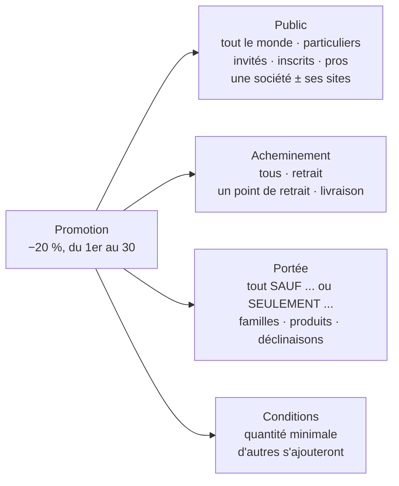
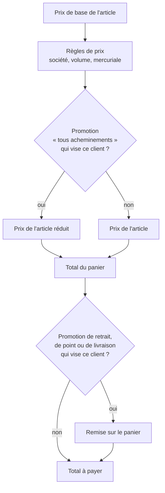
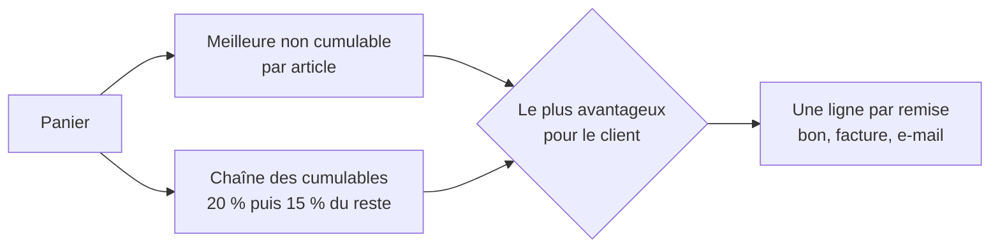
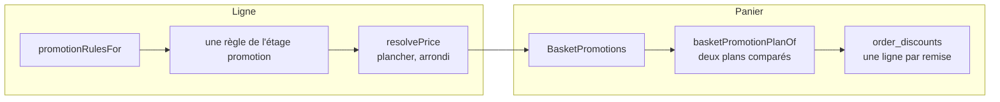
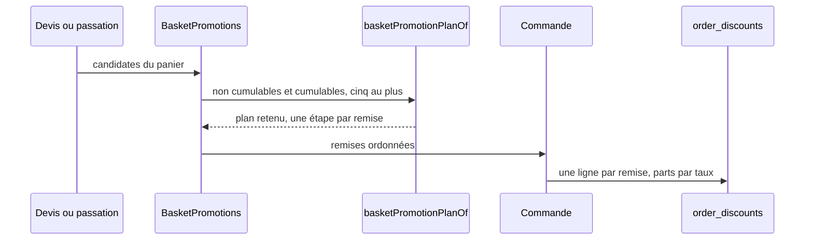
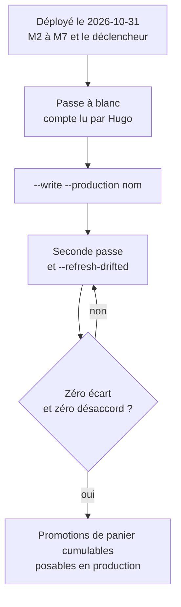

# Les promotions

> 🟧 **Doc d'état en cours de chantier — le plan fait foi pour la suite.**
> Décrit le code **tel qu'il est sur `dev`** au 2026-10-31 : lots L0 à L10,
> L8b et L12, le cumul au point ligne puis au panier, la multi-remise de
> panier M1 à M7, et les correctifs de justesse du même soir (§ 2.13). Ce qui est décidé et pas
> encore bâti vit dans le plan
> [`plan-promotions-par-audience-et-acheminement.md`](plan-promotions-par-audience-et-acheminement.md).
>
> **En production depuis le 2026-10-31** (`main` = `282c4e22b`, ordre exprès
> de Hugo, cinq déploiements verts) : L0 à M7, déclencheur compris. Les
> correctifs du § 2.13 sont sur `dev` seulement. La reprise des commandes
> existantes (§ 2.12) **reste à jouer** ; tant qu'elle n'a pas rendu zéro écart,
> aucune promotion de panier cumulable ne se pose en production.

---

## Partie 1 — en deux minutes

### Une promotion, en une phrase

Une promotion est **une réduction, pour un public, sur un mode
d'acheminement, sur une partie du catalogue, pendant une période**.

### Les quatre axes

Une promotion a aussi :

- un **nom interne** (pour l'équipe) et un **libellé client**, en français,
  anglais et italien, qui peut différer pour les particuliers et pour les pros ;
- un **état** : active, en pause, archivée ;
- un **plancher** facultatif, sous lequel elle ne fait pas descendre le prix.

### D'une commande à son prix

Une promotion agit à **un seul** des deux endroits, selon son acheminement :

- **« tous les acheminements »** → sur le **prix de chaque article** ;
- **un retrait, un point, une livraison** → sur le **total du panier**, une
  fois l'acheminement connu.

Par défaut, une promotion **ne se cumule pas** : si plusieurs visent le même
article, une seule s'applique — la plus précise sur le public (une société bat
« les pros », qui bat « tout le monde »), puis sur l'acheminement (un point bat
« le retrait »), puis la plus avantageuse.

Une promotion **cochée « Cumulable »** s'enchaîne avec les autres cumulables :
20 % puis 15 % du reste font −32 %, jamais −35 %. La meilleure des deux
formules (la non cumulable seule, ou la chaîne des cumulables) l'emporte pour
le client. Au panier, une commande peut ainsi porter **jusqu'à cinq remises**,
chacune avec sa ligne sur le bon, la facture et l'e-mail.

### Trois exemples

| Ce qu'on veut                                                    | Public                       | Acheminement               | Portée                           | Où elle agit      |
| ---------------------------------------------------------------- | ---------------------------- | -------------------------- | -------------------------------- | ----------------- |
| −20 % pour les pros au retrait La Folie Bakery, sauf les gâteaux | Pros                         | Un point : La Folie Bakery | Tout **sauf** la famille Gâteaux | Total du panier   |
| −20 % pour les particuliers inscrits et tous les pros            | Particuliers inscrits + Pros | Tous                       | Tout                             | Prix de l'article |
| −5 € sur toute commande livrée                                   | Tout le monde                | Livraison                  | Tout                             | Total du panier   |

Le premier cas est celui des anciennes « remises du point de retrait » : elles
sont **devenues des promotions** à la bascule. Le troisième se pose aujourd'hui
dans le modèle, et la boutique l'affiche depuis L10.

### Où on les règle

- **Tarification › Promotions**, et là seulement : toutes les promotions,
  « retrait à un point » compris (droit « tarifs B2B »). Un seul endroit
  depuis le 2026-10-31 (décision de Hugo, [`plan-un-seul-endroit.md`](plan-un-seul-endroit.md)) :
  la fiche d'un site ne parle plus de remises, elle décrit le lieu. L'écran
  Promotions se filtre par point, et un passage « un point » → « tous
  acheminements » y est une révision comme une autre (elle change de
  mécanique : du panier aux lignes, et l'annonce du point disparaît).
- L'ancienne grille s'appelle désormais **Règles de prix** ; elle ne pose plus
  de promotion (L12).

### Ce que voit le client

- **Au rayon** : le prix tient compte des promotions « tous acheminements »
  qui le visent ; une promotion de retrait ou de livraison est **mentionnée**
  (« −X % avec retrait à … ») sans changer le prix affiché.
- **Invité** : s'il existe une promotion réservée aux inscrits, il lit
  « Vous avez un compte ? Connectez-vous pour profiter de −X % ».
- **Panier, confirmation, e-mail, bons, facture** : une ligne par remise.
- **Remise d'un point de retrait** : une annonce par acheteur type —
  société active (`b2b`), société **en attente** (`b2bPending`),
  particulier (`b2c`). La boutique lit celle du statut de la société
  agissante (`pickupAnnouncementOf`). Une société en attente est `b2c` pour
  tout le reste (CGV, contact, livraison) mais la caisse la sert en pro :
  jusqu'au 2026-10-31 elle lisait l'annonce `b2c` et se voyait promettre une
  promotion « particuliers » que la caisse ne lui retirait pas.

---

## Partie 2 — pour aller plus loin

Le contexte est `apps/lfd-api/src/b2b/promotions/` (domain, application,
infrastructure, http). Les citations `fichier:ligne` des §§ 2.1 à 2.10 ont
été ouvertes le 2026-10-30 ; celles des ajouts du 2026-10-31 (L10, L12, cumul,
multi-remise) l'ont été le 2026-10-31.

### 2.1 Le modèle

| Axe                   | Code                                           | Valeurs                                                                                                                                                                                |
| --------------------- | ---------------------------------------------- | -------------------------------------------------------------------------------------------------------------------------------------------------------------------------------------- |
| Effet                 | `domain/promotion-effect.ts:20-24`             | `percent_off`, `unit_amount_off`, `fixed_unit_price`, `basket_amount_off` ; effets admis par point `:31-36` (ligne : les trois premiers ; panier : `percent_off`, `basket_amount_off`) |
| Public                | `domain/promotion-audience.ts:15-25`           | `everyone`, `individuals`, `individuals_guest`, `individuals_registered`, `pros`, `pros_active`, `pros_pending`, `company`, `company_and_sites`, `everyone_but_active_pros`            |
| Public multiple (L8b) | `domain/promotion-audience-set.ts`             | un **ensemble normalisé** de cibles de l'arbre ; refus : vide, société en double, libellé d'audience sans audience (`errors/promotion-audience-errors.ts`)                             |
| Acheminement          | `domain/promotion-fulfillment.ts:15-19`        | `any`, `pickup`, `pickup_point`, `delivery`                                                                                                                                            |
| Point d'application   | `domain/promotion-fulfillment.ts:34-36`        | `any` → `line`, sinon `basket`                                                                                                                                                         |
| Portée                | `domain/promotion-scope.ts:19-26`              | mode `all_except` / `only`, cibles `category` / `product` / `variant`                                                                                                                  |
| Conditions            | `domain/promotion-condition.ts:15`             | `min_quantity` seule ; union extensible                                                                                                                                                |
| Libellés              | `prisma/schema/public/promotions.prisma:15-27` | `label_*` (commun) + `label_individuals_*` + `label_pros_*`, FR/EN/IT                                                                                                                  |

Tables : `promotions`, `promotion_scope_rules`, `promotion_audience_targets`,
`promotion_settings` (`promotions.prisma`). La case « Cumulable » est la
colonne `promotions.cumulative` (`promotions.prisma:41`, défaut `false` ;
migration `20261031160000_les_promotions_cumulables`, et
`20261031190000_le_cumul_au_panier` qui retire le CHECK qui la bornait au
point ligne).

L'agrégat `domain/promotion.ts` : `pose` (`:76`), `revise` (`:133`), `pause`
(`:146`), `resume` (`:160`), `archive` avec motif obligatoire (`:176`). Une
promotion archivée est scellée (`ArchivedPromotionIsSealedError`). Une
promotion en pause garde sa place au refus de chevauchement.

### 2.2 Les deux points d'application

**Pourquoi « dans le prix affiché » ne se limite pas à un acheminement**
(Hugo l'a demandé le 2026-10-31). Le prix d'un article au catalogue est
calculé **avant** que le client choisisse son acheminement, et il est le même
pour tous ceux qui le regardent. Une remise limitée au retrait à un point,
mise dans ce prix, afficherait à un client qui choisira la livraison un prix
qu'il ne paiera pas. D'où les deux formes :

| Forme                | Où la remise agit                  | Ce que voit le client au catalogue           | Limitable à un acheminement  |
| -------------------- | ---------------------------------- | -------------------------------------------- | ---------------------------- |
| Dans le prix affiché | le prix de chaque ligne (`line`)   | le prix déjà remisé                          | non : elle vaut partout      |
| En remise au panier  | le panier, une fois le mode choisi | une **annonce** (« −20 % avec retrait à … ») | oui : retrait, points, zones |

Piste notée, non bâtie : quand le client a déjà choisi son mode et son
point dans le contexte de commande de la boutique, le catalogue pourrait
afficher le prix remisé pour CE mode, et garder l'annonce tant qu'il ne l'a
pas choisi. Elle touche le calcul du prix affiché (argent) : plan et
`vitruve` avant tout bâti.

- **Ligne** : `pricing/domain/promotion-as-rule.ts` présente la promotion
  comme une règle de l'étage `promotion` ; `resolve-price.ts:262` l'ajoute aux
  règles. Même place, même scellement par la mercuriale, même plancher que les
  anciennes règles de promotion. Les cumulables passent par
  `resolveCumulativeStage` (`pricing/domain/cumulative-promotions.ts:40`).
- **Panier** : `orders/application/services/basket-promotions.service.ts`
  (`BasketPromotions`, `:41`), `basket-promotion-choice.ts`
  (`chooseBasketPromotion`, `:107`) et `basket-promotion-plan.ts`
  (`basketPromotionPlanOf`, `:71`) — § 2.11.
- **Spécificité et départage** : `domain/promotion-targeting.ts:184-205`
  (`PUBLIC_RANK` : société 4, société et sites 3, sous-publics 2, publics 1,
  tout le monde 0 ; `FULFILLMENT_RANK` : point 2, mode 1, tous 0). Au panier,
  le rang est `[public, acheminement, remise]` puis l'id
  (`basket-promotion-choice.ts:75`).

### 2.3 La source, la bascule, et l'ancien calcul retiré (L12)

`domain/promotions-source.ts:15` : la ligne `promotions_source`
(`promotion_settings`) n'a plus qu'**une** valeur admise, `promotions`. Ce
n'est plus un interrupteur mais un garde-fou : la migration
`20261031150000_le_resserrement_des_promotions` refuse une base qui n'a pas
basculé et resserre le CHECK. L'ancien chemin (`legacy`) et l'ombre
(`shadow`) sont **retirés du code** ; la promotion est la source unique du
prix promotionnel.

- La bascule reste la migration `20261031130000_la_bascule_des_promotions` :
  `bascule_des_promotions()` rejoue la reprise, contrôle chaque source champ
  par champ, s'arrête en nommant tout écart, puis passe la source à
  `promotions`, dans une transaction. Ses retours arrière (et celui de la
  reprise) sont marqués **périmés** depuis L12 : il n'y a plus d'ancien code
  vers lequel revenir.
- Les anciens éditeurs refusent sans condition
  (`LegacyPromotionEditorClosedError`) ; les règles d'étage promotion encore
  vivantes ont été archivées avec leur acte.

### 2.4 La reprise

Migration `20261031120000_la_reprise_des_promotions` : les **remises de
retrait** des sites et les **règles d'étage promotion** deviennent des
promotions, par une fonction rejouable. Pré-contrôle en lecture seule :
`dev-toolbox/audits/promotions-reprise-precheck.mjs`. L'égalité des prix avant
et après a été prouvée par l'e2e d'égalité de L6 (`promotions-equality`, retirée en L12 avec
l'ancien chemin qu'elle comparait, 2026-10-30).

### 2.5 Les refus à la pose

| Refus                                                                                     | Erreur (`domain/errors/promotion-errors.ts`)                                                                                                     |
| ----------------------------------------------------------------------------------------- | ------------------------------------------------------------------------------------------------------------------------------------------------ |
| Deux promotions du même point qui se recouvrent (public, acheminement, portée, période)   | `OverlappingPromotionError` (`domain/promotion-overlap.ts:54`)                                                                                   |
| Deux promotions panier possibles pour une même commande, sauf si les deux sont cumulables | `BasketPromotionsWouldCombineError` (`assertSingleBasketPromotion`, `promotion-overlap.ts:110`)                                                  |
| Une sixième cumulable de panier qui pourrait s'appliquer avec cinq autres                 | `TooManyCumulativeBasketPromotionsError` (`promotion-errors.ts:325`) ; plafond `MAX_BASKET_DISCOUNTS_PER_ORDER = 5` (`promotion-overlap.ts:138`) |
| Un produit entier ciblé au point ligne                                                    | `PromotionProductTargetAtLineError` (`domain/promotion-terms.ts:108`)                                                                            |
| Effet non admis à ce point                                                                | `PromotionEffectPointMismatchError`                                                                                                              |
| Portée vide, fenêtre inversée, texte vide, effet hors bornes                              | `PromotionScopeIncludesNothingError`, `PromotionReversedWindowError`, `PromotionBlankTextError`, `PromotionInvalidEffectError`                   |

Le refus de chevauchement ne s'applique pas entre deux promotions
**cumulables**, ni au point ligne ni au panier. Le plafond de cinq est jugé
**à la pose**, deux à deux avec la candidate (publics, acheminements,
fenêtres) ; à la caisse, au-delà de cinq, les cinq premières dans l'ordre sont
gardées et les autres écartées et journalisées par `BasketPromotions` — le
devis et la passation ne lèvent jamais.

**Une révision identique n'écrit rien** (`95679aeed`) : reposer une promotion
sans changement ne trace plus d'acte « remplacée », et le bouton Enregistrer
reste inactif sur une fiche intacte (`domain/promotion-terms-equality.ts`).

### 2.6 La révision d'une commande (L9)

La commande garde la promotion panier appliquée
(`orders.discount_promotion_id`, `orders.prisma:262`). En révision, changer
d'acheminement ou de point d'une façon qui **ajoute, retire ou remplace**
cette promotion est refusé (409, `FulfillmentChangeAltersPromotionError`,
`orders/domain/services/fulfillment-promotion.ts:24`) : « Gardez le même
acheminement, ou annulez la commande et repassez-la ». Une commande d'avant
(id inconnu) est jugée sur sa remise figée. Avant L9, la remise était
recalculée au changement de point.

Depuis M3, L9 compare une **liste ordonnée** de remises : l'« avant » est lu
dans `order_discounts` si la commande y a des lignes actives, sinon dans les
colonnes (`fulfillment-promotion.ts`) ; le refus nomme le libellé figé de la
remise en cause. Un changement de quantité recompose les montants : dans une
seule transaction, les remises actives sont **archivées** (`archived_at`,
jamais supprimées) et le nouvel ensemble est inséré. Une cumulable visant un
point nommé passe avant une cumulable « au retrait » : changer de point peut
donc changer la remise de rang 1, et la révision est alors refusée (assumé,
plan § 18.6).

### 2.7 Invité ou inscrit

`orders.buyer_kind` (`orders.prisma:130`, défaut `registered`) dit si la
commande vient d'un invité ou d'un inscrit ; reprise des commandes
existantes par la migration `20261031100000_la_porte_de_passation`. Côté
calcul : `PromotionBuyerKind` (`domain/promotion-targeting.ts:20`). Depuis
L10, cette porte d'entrée va jusqu'au **prix de chaque article** : les
publics invités / inscrits / pros en cours s'appliquent au point ligne, et
« une société et ses sites » lit le principal.

**Correctif d'horloge** (`db3efaa81`) : hors d'une requête HTTP (tâche de
fond, semis, handler appelé directement), le calcul du prix lisait
l'horloge deux fois ; la seconde lecture tombait une milliseconde plus tard,
passait en relecture datée et rendait **le prix pro à un invité**.
« Maintenant » est désormais lu une seule fois par la porte du prix, et une
relecture datée pour un lecteur public est refusée
(`DatedPublicPriceUnsupportedError`,
`orders/domain/errors/dated-public-price.error.ts:14`).

### 2.8 Libellés figés

Le libellé de la promotion panier, dans l'audience de l'acheteur, est **figé
à la passation** dans `orders.discount_label` (`orders.prisma:263-268`) : un
document relu plus tard ne dépend pas d'une promotion modifiée depuis.
L'audience du libellé : `labelAudienceOf` (`promotion-targeting.ts:142`).
Avec plusieurs remises, chaque libellé est figé dans sa ligne
`order_discounts.label`, et `orders.discount_label` vaut le libellé générique
« Remises / Discounts / Sconti » (§ 2.11).

### 2.9 Écrans et droits

| Écran                                                       | Front                                                       | API                                   | Droit                                                               |
| ----------------------------------------------------------- | ----------------------------------------------------------- | ------------------------------------- | ------------------------------------------------------------------- |
| Promotions (liste, page d'une promotion, arbre des publics) | `apps/lfd-backoffice-frontend/src/app/targeted-promotions/` | `http/admin-promotions.controller.ts` | `b2b_pricing` (`:61`) ; lecture aussi sous `lfc_site_settings:read` |
| Règles de prix (ancienne grille)                            | —                                                           | `b2b/pricing/http/`                   | `b2b_pricing`                                                       |

Il n'y a plus de **surface** (d'où une promotion est réglée) depuis le
2026-10-31 : la route `admin/sites/:pickupId/promotions` (sous
`lfc_site_settings`), le fichier de la surface (retiré), `PromotionWrongSurfaceError` et
les cartes de remise de la fiche d'un site sont retirés
([`plan-un-seul-endroit.md`](plan-un-seul-endroit.md)). Qui tenait
`lfc_site_settings:write` sans `b2b_pricing:write` ne règle plus la remise de
son point : le droit des prix s'accorde à l'écran (`/admin/staff-roles`).
Depuis le 2026-10-31 (décision de Hugo : « un seul layout avec les champs »),
une promotion n'a plus qu'**une page**, `promotions-ciblees/:id`
(`targeted-promotions/promotion-page/`) : ses champs directement éditables,
dans l'ordre où l'on pense une promotion — que reçoit le client, pour qui,
sur quel mode d’acheminement et de consommation (et ce que ça change : prix baissé au catalogue, ou
remise au panier), sur quels articles, quand et à quelles conditions — puis
« Où en est-elle ? » (état, pause, reprise, archivage). Un résumé en une
phrase, en tête, suit la saisie (`apps/lfd-backoffice-frontend/src/app/targeted-promotions/promotion-summary.ts`). Lue sous
`b2b_pricing:read` ou `lfc_site_settings:read` ; sans `b2b_pricing:write`,
avant la bascule de la source ou une fois archivée, les mêmes champs sont
désactivés et rien ne s'enregistre. `nouvelle` (même composant) est gardée par
`b2b_pricing:write` seul ; l'ancienne adresse `:id/modifier` redirige vers
`:id`.

**L'acheminement se coche** (2026-10-31,
[`plan-acheminements-a-cocher.md`](plan-acheminements-a-cocher.md) § 5). La
carte « Sur quel mode d’acheminement et de consommation ? » s'ouvre sur un
choix, « Où joue la promotion » : **Dans le prix affiché** (le prix de
l'article baisse au catalogue, pour tous les acheminements) ou **En remise au
panier** (la remise s'applique au panier selon l'acheminement coché). Au
panier viennent deux cases, **Retrait** et **Livraison** ; sous chaque case
cochée, « Tous les points » / « Certains points » (ou « Toutes les zones » /
« Certaines zones ») et, pour « certains », un `fold-multiselect` des sites
actifs ou des zones (`GET /delivery-zones`). Un point archivé que la
promotion garde reste dans la liste, suffixé « (archivé) » — son nom vient de
la palette des sites ; sans la liste des points actifs, rien n'est dit
archivé. Rien de coché, ou une sélection vide, est une saisie incomplète (le
serveur refuse aussi). Le brouillon porte l'ensemble entier
(`promotion-draft.ts`, `DraftReach` par côté — une case décochée garde sa
sélection) ; le résumé le dit (« au retrait à L'adroit et en livraison dans
la zone Centre »), la liste aussi (« Retrait · … + Livraison · … »), et
« Dupliquer pour un autre public » le recopie. Le filtre de la liste par
point est tenu par le serveur (`?pickupId=`).

### 2.10 Journal

Actes `posed`, `paused`, `resumed`, `archived`, `replaced`
(`domain/promotion-act.ts:17`), sujets `promotion.*`. En mode `shadow`, un
écart est journalisé `promotions.shadow_divergence`.

---

### 2.11 Le cumul, et plusieurs remises de panier (§ 16, M1 à M7)

**Au point ligne** (L12, `32e205d4b`) : les non cumulables désignent leur
gagnant comme avant ; les cumulables forment une chaîne triée par rang puis
par id, chacune sur le prix sortant de la précédente, en exact ; le plus bas
des deux l'emporte (à égalité, la non cumulable) ; le plancher arrête la
descente. Une étape de trace par promotion appliquée.

**Au panier** (M7, `31d15f3ee`) : `basketPromotionPlanOf` retient une non
cumulable par article (rangs disjoints) et la chaîne des cumulables, puis
compare deux plans **dans l'unité de la commande** — en TTC pour une commande
`exact_ht` (le particulier), en HT pour `line_ht` (le pro). À égalité, le plan
non cumulable. Chaque étape remise le **reste exact** des lignes qu'elle
couvre, arrondie une fois au centime ; la somme des étapes affichées est la
remise totale. Une seule remise donne le prix d'hier au centime.

**Une promotion qui ne retire rien ne concourt pas** (`0c43647b9`) : une
promotion plus spécifique mais sans article commun avec le panier (ou dont le
seuil n'est pas atteint) gagnait sur son rang et figeait une remise de 0 c à
la place d'une vraie (`basket-promotion-choice.ts:102-116`).

**La persistance** — migration `20261031170000_les_remises_de_panier` :

| Table                     | Ce qu'elle porte                                                                                                                                                        |
| ------------------------- | ----------------------------------------------------------------------------------------------------------------------------------------------------------------------- |
| `order_discounts`         | une ligne par remise : `rank` (ordre d'application figé), promotion, ajustement, libellé figé, montant, parts par taux, `origin` (`computed` / `frozen`), `archived_at` |
| `order_line_discounts`    | quelles lignes chaque remise couvre                                                                                                                                     |
| `delivery_note_discounts` | les parts de chaque remise **sur un bon parti**                                                                                                                         |

Les colonnes d'avant restent écrites : `discount_cents` est le total ; avec
plusieurs remises, `discount_promotion_id`, `discount_adjustment` valent
`NULL` et `discount_label` le libellé générique. Le repli unique
`frozenBasketDiscountsOf` (`orders/domain/services/frozen-basket-discounts.ts:60`)
lit la table si la commande y a des remises actives, sinon les colonnes comme
une remise de rang 1.

**Le déclencheur** — migration `20261031180000_le_controle_des_remises` : un
déclencheur de contrainte différé refuse au commit une commande dont la somme
des remises actives ≠ `discount_cents`, ou dont les parts par taux ne somment
pas le montant. Il ne se déploie qu'au **temps 5 du runbook** (§ 2.12).

**Les lecteurs** :

- **Bons** (M4) : bon complet, partiel, reliquat (un % se recompose sur chaque
  envoi, un montant fixe compte entier sur le premier bon), manquants ; le
  papier porte une ligne par remise s'il en a plusieurs. La couverture se lit
  par SKU ; `SplitSkuCoverageError` refuse un SKU couvert à moitié.
- **Facture et Factur-X** (M5) : une remise de document (BG-20) **par
  promotion et par taux**, motif = libellé figé en français, repli « Remise »,
  sans BT-93/94. Tant qu'aucune commande de la facture n'a plusieurs remises,
  la facture garde la clé unique et le motif « Remise client », octet pour
  octet. Des parts qui ne tombent pas juste : facturée au bon montant sous la
  clé unique, et journalisé.
- **Affichage** (M6, M7) : la commande sert `discounts[]` seulement quand
  elle en porte plusieurs ; bon de commande, e-mail (langue du destinataire),
  récapitulatif du back-office, ticket, panier et confirmation de la boutique
  (`ShopQuoteView.discounts`) écrivent une ligne par remise.
- **Assumé** : l'annonce d'un point et l'offre de connexion n'annoncent
  qu'**une** remise, la plus spécifique ; la caisse peut en retirer davantage.
  L'annonce d'un point est faite à un acheteur type sans identité ni porte
  d'entrée (`domain/pickup-discount-announcement.ts`) : un public « société »,
  « invités » ou « inscrits » n'y est pas annoncé (sous-annonce). Les publics
  qui ne dépendent que du statut de la société sont exacts pour les trois
  acheteurs types, société en attente comprise (`b2bPending`, 2026-10-31).

### 2.12 La reprise des remises existantes, et son runbook

Le script `apps/lfd-api/prisma/backfill-order-discounts.ts`
(`pnpm --filter lfd-api backfill:order-discounts`) remplit `order_discounts`
pour les commandes d'avant M3 par la même arithmétique que la passation. Il
tourne **à blanc** par défaut, `--write` après lecture du compte par Hugo ;
une cible non locale demande `--production` et le nom de la base retapé.
Une commande dont la recomposition ne redonne pas le figé est écrite
`origin = 'frozen'` (valeurs figées recopiées, listée au rapport) ou, à
plusieurs taux, listée « à trancher » sans être écrite. `--refresh-drifted`
traite les commandes révisées entre deux passes.

Le plan (§ 18.3) prévoyait M2, une passe, M3–M6, une seconde passe, le
déclencheur, puis M7. **Ce qui a été joué** (2026-10-31, pré-release, aucune
activité commerciale) : tout d'un coup, déclencheur et M7 compris. Ce qui
reste :

M7 est irréversible : dès qu'une commande porte deux remises, sa facture, son
Factur-X et ses bons les portent pour toujours.

### 2.13 La justesse, éprouvée le 2026-10-31

- **Factur-X à plusieurs promotions** : la pièce témoin
  `promotions-cumulees-deux-taux` (`facturx-samples.ts`) passe au Schematron
  EN 16931 officiel des specs, à veraPDF (`verify:facturx-pdf`) et, une fois
  à la main, à **Mustang** 2.26.0, validateur tiers : les dix pièces témoins
  `valid`, un total falsifié refusé (BR-CO-15, BR-CO-16). Mustang n'est pas
  dans la CI.
- **De bout en bout** : `test/promotions-basket-cumul-two-rates.e2e-spec.ts`
  — commande pro à deux taux, deux cumulables, de la passation à la facture.
- **Annonce contre caisse** :
  `orders/domain/services/__tests__/announcement-vs-checkout.spec.ts` — le
  retiré est toujours au moins l'annoncé. Il a trouvé une sur-annonce : le
  membre d'une société en attente lisait l'annonce des particuliers ; un
  point annonce désormais `b2bPending` (contrat `AnnouncedPickupDiscounts`).
- **Offre de connexion** : elle n'est plus faite quand la quantité minimum de
  la promotion n'est atteinte par aucune ligne (`promotion-offers.ts`).
- **« Mes commandes »** : à plusieurs remises, une ligne par remise sans
  assiette (`order-discount-lines.ts`) — l'ancienne mention écrivait la somme
  sur une base qui n'était celle d'aucune.

---

## Limites connues et reste à faire

- **Production** : déployée le 2026-10-31 ; la reprise du § 2.12 reste à
  jouer, et les correctifs du § 2.13 attendent le prochain « pousse main ».
- **L11** : docs d'état de la résolution de prix et du prix boutique mises à
  jour ; le plan devient doc d'état (celle-ci l'absorbera).
- **Remise par ligne vérifiable par le client** (plan § 17) : option
  documentée, non bâtie.
- **Annonce et offre de connexion** : une seule remise annoncée, même quand
  la caisse en cumule plusieurs (assumé : sous-annonce, jamais sur-annonce —
  § 2.13).
- **Dette du bon partiel, non aggravée** : un montant fixe est borné à
  l'assiette du premier bon ; si elle est plus petite, la somme des bons est
  inférieure à la remise de la commande.
- **Améliorations notées** : prix affiché remisé pour le mode déjà choisi
  dans le contexte de commande (§ 2.2) ; onglets dans Tarification ; promotions affichées
  dans la grille des règles de prix.
- **Limite actuelle** : cinq remises de panier au plus par commande ; une
  seule condition (`min_quantity`).
