# Le réassort des boutiques

> **État : 🟡 partiel, 2026-10-21.** La **réception** au comptoir est bâtie
> (commit `558b376c8`), et se fait en **un geste par réassort** depuis le lot
> R2 (2026-10-21) ; la **commande** au fournil aussi (lot R1, 2026-10-21),
> et elle entre au plan figé (R3a), au colisage (R3b) et au transfert du point
> (R3c, 2026-10-21) ; Prod manager montre les réassorts dans un onglet et les
> compte au prévisionnel, le dossier du jour (écran et PDF) les imprime, le
> poste du colisage tient leurs fiches (R3d, 2026-10-21). Les **ruptures et stocks faibles** du
> comptoir aussi (lot R1b, 2026-10-21), sans effet encore sur la boutique. La
> **demande en cours** est enregistrée depuis le lot R1c (2026-10-21). Un
> réassort **arrivé** (transfert reçu, ou « Monté » au fournil) sonne au
> comptoir depuis le lot R3e (2026-10-22). La **Supervision** a un onglet
> **Stock** en lecture depuis le lot S1 (2026-10-22). Le
> **fournil envoie ses propres réassorts**, à part, depuis le lot R1d
> (2026-10-21). L'écran du comptoir est **une table de tous les produits**
> depuis le lot R1e (2026-10-21). Ce document décrit ce qui existe, vérifié
> dans le code le 2026-10-21. La conception
> complète, lots et questions ouvertes compris, est dans
> [`plan-reapprovisionnement.md`](plan-reapprovisionnement.md).

Le réassort, c'est ce qu'une vitrine (un point de retrait approvisionné) reçoit
du fournil pour vendre au comptoir dans la journée.

## Le modèle : B, un `SiteResupply` à part

Décidé par Hugo le 2026-10-21. Le réassort d'un site n'est **jamais une
commande** : il ne porte ni prix, ni TVA, ni chiffre d'affaires. C'est un
agrégat à part, `SiteResupply`, qui demandera au fournil ; ce qui arrive en
vitrine est un second agrégat, la **réception**, parce que demander et
recevoir ont deux auteurs et deux moments — ce qui arrive n'est pas toujours
ce qui a été demandé, et le comptoir corrige ce qu'il voit.

Les deux existent depuis le 2026-10-21, liés depuis le lot R2 : un réassort
envoyé attend son reçu, pré-rempli de la quantité demandée.

## Ce qui est bâti : commander le réassort (lot R1, 2026-10-21)

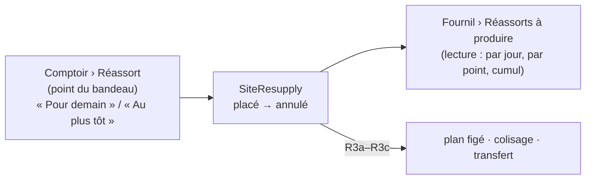

- **Le code** : `apps/lfd-api/src/b2b/resupply/`, à côté de la réception.
  L'agrégat `SiteResupply` (`apps/lfd-api/src/b2b/resupply/domain/site-resupply.ts`) : un point, une
  **visée** — `tomorrow` (le soir pour demain, journée = demain) ou `asap`
  (« au plus tôt », journée = aujourd'hui), journée déduite de l'instant du
  geste à l'heure de Paris, jamais saisie —, des lignes (SKU, libellé figé du
  catalogue publié, quantité entière > 0, un article une fois, au moins une),
  l'état brouillon → passé → annulé, l'auteur et l'instant de chaque geste.
  Aucun prix, aucune dépendance à `Order`.
- **La demande en cours** (lot R1c, 2026-10-21) : le brouillon se
  persiste — voir la section suivante. `PlaceSiteResupplyHandler`, le geste
  d'un seul tenant de R1, passe désormais par elle.
- **L'heure limite** (révisée au lot R3a, 2026-10-21) : `place()` refuse une
  visée `tomorrow` après **l'heure du réassort** (« la veille, HH:MM »,
  `order_cutoff_settings.resupply_cutoff_time`, 20:00 par défaut ; borne
  incluse), ou sur un plan déjà arrêté. `asap` n'en a jamais. Lue par le port
  `ResupplyCutoff` (`apps/lfd-api/src/b2b/resupply/infrastructure/settings-resupply-cutoff.ts`).
  L'ancien interrupteur `resupply_subject_to_cutoff` reste en base, mort.
- **Le plan figé** (lot R3a) : l'envoi et l'annulation « pour demain » passent
  par le guichet d'admission du plan sous le verrou de la journée
  (`ResupplyPlanGate`) ; l'arrêt du fournil fige les réassorts envoyés
  (`DayResuppliesReader`, implémenté par `ProductionDayResupplies`) et les
  compte au total. Détail : [`../production/arret-du-plan.md`](../production/arret-du-plan.md).
- **Annuler** : un réassort passé s'annule, une fois — sauf réceptionné (R1d)
  ou, pour demain, figé dans un plan arrêté (R3a, 409 « réceptionnez avec un
  écart »). Une annulation est un état, jamais une suppression.
- **Réassorts à produire** : depuis R3a, un « pour demain » d'un plan arrêté
  n'y est plus (il est dans la feuille du fournil).
- **Les tables** : `site_resupply` et `site_resupply_line` (unique par
  réassort et SKU, quantité > 0 en CHECK), schéma `public`, migration
  `20261021170000_le_reassort_commande_par_un_point` (additive), puis
  `20261021210000_la_demande_de_reassort_en_cours` (R1c, additive).
- **Les routes** : `admin/site-resupplies/sites/:siteId` sous
  `handover_counter` — lecture (les réassorts du point pour aujourd'hui et
  demain, et jusqu'à quand « Pour demain » passe), écriture (passer,
  `…/:resupplyId/cancel`) ; depuis R1c, les gestes de la demande en cours
  (section suivante). Le point est dans chaque `where` : un réassort
  d'un autre point est introuvable (404).
  `admin/site-resupplies/to-produce` sous `production_worksheet:read` **ou**
  `production_plan:read` : aujourd'hui puis demain, par point, les réassorts
  passés et le cumul par article.
- **Les écrans** : au comptoir, la carte « Commander au fournil »
  (`comptoir/reassort-boutique-page/resupply-order-card/`) au-dessus de la
  réception, qui n'a pas changé ; au fournil, **Réassorts à produire**
  (`production/reassorts-a-produire/`, route `/reassorts-a-produire`, au rail
  et aux tuiles sous le Fournil), en lecture, distinct des commandes client.
  Depuis R3d, c'est l'onglet « Réassorts » de Prod manager (section dédiée
  plus bas) ; l'ancienne adresse y redirige.
- **Pourquoi pas de canal du fournil en R1** : l'écran du fournil lit la route
  du commerce depuis le navigateur ; aucun bloc serveur ne traverse
  (`production → b2b` reste interdit). Le canal viendra quand le réassort
  entrera au plan figé (R3).

## Ce qui est bâti : la demande en cours, enregistrée (lot R1c, 2026-10-21)

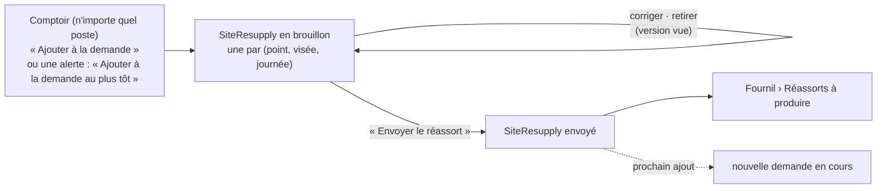

- **Le modèle** : la demande en cours est l'état `draft` de `SiteResupply`,
  persisté. Une seule par (point, visée, journée) : index unique PARTIEL
  `site_resupply_open_draft_key (site_id, target, service_day) WHERE
placed_at IS NULL` ; deux postes qui l'ouvrent au même instant, le second
  est refusé en 409 (`resupply.order.draft_opened_meanwhile`) et refait son
  geste. Les colonnes `placed_*` sont nullables depuis la migration
  `20261021210000_la_demande_de_reassort_en_cours` (CHECK : un envoi est
  entier ; seul un réassort envoyé s'annule).
- **Les gestes** : ajouter (`addLine`) — un article déjà présent voit sa
  quantité **s'additionner** ; corriger (`correctLine`, entier ≥ 1) ;
  retirer (`withdrawLine`, la demande peut rester vide) ; envoyer
  (`place`, les règles de R1 : heure limite pour « pour demain » si le
  réassort y est soumis). Une demande vide ne part pas (400).
- **Le verrou de version** : corriger, retirer et envoyer portent la
  version que le poste a vue ; un poste qui ne l'a plus est refusé en 409
  (`resupply.order.changed_meanwhile`) plutôt que d'écraser l'autre. Ajouter
  n'en porte pas : deux ajouts se cumulent, ils ne s'écrasent jamais.
- **Une journée passée** : une demande « pour demain » restée sans envoi
  garde sa journée. Le matin de cette journée, elle s'affiche encore et
  part si l'heure limite ne s'y oppose pas ; une fois la journée passée,
  elle **quitte l'écran** (le comptoir ne lit que aujourd'hui et demain) et
  son envoi est refusé (409, `resupply.order.day_passed`). Elle reste en
  base, jamais supprimée ; le prochain ajout ouvre la demande de la journée
  en cours, à côté. Même règle pour « au plus tôt » de la veille.
- **Les routes**, sous `admin/site-resupplies/sites/:siteId`,
  `handover_counter:write` : `POST drafts/:target/lines` (ajouter),
  `PATCH :resupplyId/lines/:sku` (corriger), `POST
:resupplyId/lines/:sku/withdraw` (retirer), `POST :resupplyId/send`
  (envoyer). La lecture sert `drafts` à côté de `resupplies` (envoyés).
- **Le `POST :siteId` de R1 est retiré** (lot R1d, 2026-10-21) : il
  ajoutait ses lignes à la demande « au plus tôt » DU COMPTOIR et l'envoyait
  entière ; son seul appelant, le bouton « Lancer un réassort au plus tôt »
  du fournil, est retiré avec lui.
- **L'écran** : la carte « Commander au fournil » montre la demande en
  cours de chaque visée, quantités corrigibles, « Envoyer le réassort » ;
  elle relit après chaque geste, toutes les 15 s onglet visible, et dès
  qu'on revient sur l'onglet (`refreshWhileVisible`). L'état est partagé par
  `SiteResuppliesStore` (fourni par la page) avec la proposition « Ajouter à
  la demande au plus tôt » de chaque alerte de stock
  (`comptoir/reassort-boutique-page/asap-draft-adder/`).
- **Le fournil ne voit jamais une demande non envoyée.**

## Ce qui est bâti : rupture et stock faible au comptoir (lot R1b, 2026-10-21)

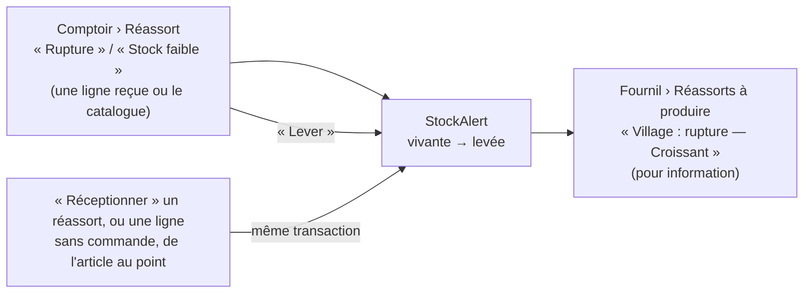

- **Le code** : `apps/lfd-api/src/b2b/resupply/domain/stock-alert.ts`. Une
  alerte par (point, SKU) : niveau `out_of_stock` (rupture) ou `low` (stock
  faible), libellé figé du catalogue publié, auteur et instant de la DERNIÈRE
  déclaration. Redéclarer l'alerte vivante change son niveau (le handler la
  recharge plutôt que d'en ouvrir une seconde). Une alerte levée ne se rouvre
  ni ne se relève : on en déclare une nouvelle.
- **Sa durée** : aucune échéance. Elle tient jusqu'à ce que le comptoir la
  lève (`manual`) ou qu'une ligne de l'article soit reçue au point avec une
  quantité > 0 (`receipt`) — jamais d'elle-même le lendemain.
- **La levée par la réception** : `liftStockAlertOnReceipt`
  (`apps/lfd-api/src/b2b/resupply/application/lift-stock-alert-on-receipt.ts`), appelé dans
  l'unité de travail de la réception par `ReceiveSiteResupplyHandler`
  (« Réceptionner », une fois par ligne reçue > 0, lot R2) et par
  `ReceiveResupplyLineHandler` (le réassort sans commande). C'est le seul
  chemin. Corriger ou retirer une ligne ne lève rien.
- **La table** : `site_stock_alert`, schéma `public`, migration
  `20261021190000_les_alertes_de_stock_du_comptoir` (additive). Index unique
  PARTIEL `(site_id, sku) WHERE lifted_at IS NULL` : une seule alerte vivante,
  la course entre deux postes est refusée en 409. Pas de suppression : une
  levée garde qui, quand et pourquoi (`lift_reason`).
- **Les routes** : `admin/site-stock-alerts/sites/:siteId` sous
  `handover_counter` — lecture (les alertes vivantes du point), déclarer
  (`POST`, `{ sku, level }`), lever (`…/:alertId/lift`) ; le point est dans
  chaque `where`. `admin/site-stock-alerts/live` sous
  `production_worksheet:read` **ou** `production_plan:read` : les alertes
  vivantes de tous les points.
- **Les écrans** : au comptoir, la carte « Ruptures et stocks faibles » en
  tête de la page Réassort (`comptoir/reassort-boutique-page/stock-alerts-card/`),
  et les gestes sur chaque ligne reçue ; au fournil, « Alertes des points » en
  tête de « Réassorts à produire » (depuis R3d : en marque sur les lignes de
  l'onglet Réassorts de Prod manager), **pour
  information** depuis le lot R1d : le bouton « Lancer un réassort au plus
  tôt », qui envoyait la demande du comptoir, est retiré. Pour répondre, le
  fournil envoie son propre réassort (section suivante).
- **Aucun effet sur la boutique ni sur la passation** : une rupture ne bloque
  encore rien, un stock faible n'avertit aucun client (lot J2). L'écran du
  comptoir le dit.

## Ce qui est bâti : le fournil envoie un réassort (lot R1d, 2026-10-21)

« Je t'envoie ça » — quand un point le demande au téléphone, le fournil
entre la demande lui-même, à part de celle du comptoir.

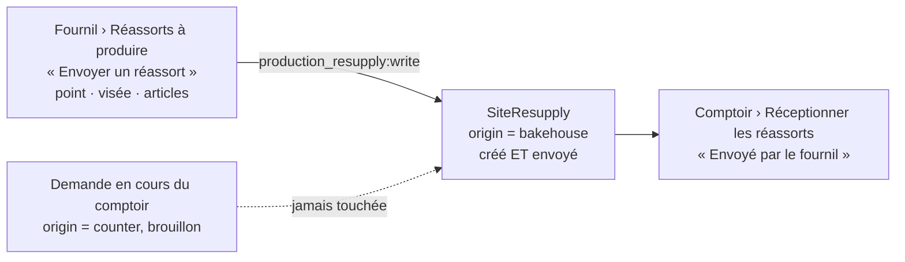

- **L'origine** : `SiteResupply.origin` — `counter` (le comptoir, par sa
  demande en cours) ou `bakehouse` (le fournil). `SiteResupply.sentByBakehouse`
  crée le réassort avec ses lignes (un article donné deux fois s'additionne)
  et l'envoie d'un geste, avec les règles du comptoir : au moins une ligne,
  libellés lus au catalogue publié, l'heure limite de sa journée pour « pour
  demain » si le réassort y est soumis, jamais pour « au plus tôt ». Il n'a
  jamais de brouillon : `SendBakehouseResupplyHandler` ne consulte pas la
  demande en cours.
- **La table** : `site_resupply.origin` (`TEXT NOT NULL DEFAULT 'counter'`),
  migration additive `20261022000100_l_origine_du_reassort` ; CHECK
  `site_resupply_origin_known` et `site_resupply_bakehouse_placed` (un
  réassort du fournil a toujours un `placed_at`). L'index unique partiel des
  demandes en cours (`WHERE placed_at IS NULL`) ne change pas : un réassort
  du fournil n'y entre jamais.
- **Le droit** : `production_resupply` (« Production — Envoi de réassort »),
  ajouté à `StaffResource` par `20261022000000_le_droit_du_reassort_du_fournil`
  sans être accordé à personne ; il s'accorde à l'écran des rôles (la graine
  le donne au seul administrateur). Distinct de `handover_counter` : ni le
  comptoir ni la fournée n'envoient au nom du fournil.
- **Les routes** : `admin/bakehouse-resupplies` sous `production_resupply` —
  `GET articles` (le catalogue publié, `:read`) et `POST sites/:siteId`
  (`{ target, lines }`, `:write`, rend `{ id }`). Les points proposés se
  lisent sur `GET /admin/pickup-addresses`, ouvert à
  `production_resupply:read`.
- **Les écrans** : au fournil, la carte « Envoyer un réassort »
  (`production/reassorts-a-produire/bakehouse-resupply-card/`), composée à
  l'écran puis envoyée, sous `production_resupply:write` ; dans la liste du
  jour, « Envoyé par le fournil ». Au comptoir, la carte « Réceptionner les
  réassorts » le marque de même ; il se réceptionne en un geste comme les
  autres, et le comptoir peut l'annuler tant qu'il n'est pas réceptionné.

## Ce qui est bâti : la réception au comptoir (refaite au lot R2, 2026-10-21)

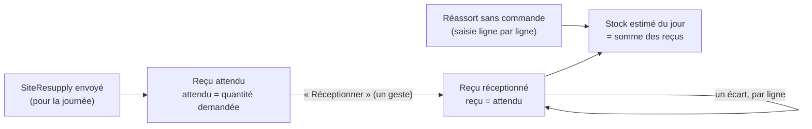

Décisions de Hugo (2026-10-21) : « personne ne fera du ligne par ligne en
plein service » ; un reçu par réassort ; la saisie de secours devient un
« réassort sans commande » ; le stock du jour additionne les reçus.

- **Le code** : `apps/lfd-api/src/b2b/resupply/`. L'agrégat
  `ResupplyReceipt` (`domain/resupply-receipt.ts`) a deux sortes, un seul
  modèle — la règle qui compte au stock est la même (seul le reçu compte) :
  - **le reçu d'un réassort envoyé** (`resupplyId`) : `expecting` le fait
    naître attendu des lignes du réassort (attendu = quantité DEMANDÉE ; R3 y
    mettra la quantité emballée), `receiveAll` recopie l'attendu en reçu, d'un
    geste. Une ligne ne se corrige (`correct`) qu'**après** ; on n'y ajoute ni
    n'en retire d'article. Un second « Réceptionner » est refusé (409), il
    n'est jamais rejoué en silence. Seul un réassort envoyé et non annulé se
    réceptionne, et pas avant sa journée à l'heure de Paris (409
    `resupply.receipt.day_not_yet_come`, lot R1d) ;
  - **le réassort sans commande** (`resupplyId` nul) : `receive`, `correct`,
    `withdraw`, ligne par ligne, chaque ligne reçue dès sa saisie ; un même
    article deux fois est refusé (« corrigez sa quantité »).
- **Le reçu n'est écrit qu'une fois reçu** : avant « Réceptionner », l'attendu
  se lit du réassort lui-même. Le stock ne monte qu'à la réception, jamais à
  l'envoi.
- **Un réassort réceptionné ne s'annule plus** (lot R1d) : l'annulation lit
  sa réception par le port `ResupplyReceptions` et `SiteResupply.cancel` la
  refuse (409 `resupply.order.already_received`, « déjà réceptionné par X à
  HH:MM »).
- **Le verrou optimiste** : un reçu porte une `version` ; deux postes qui
  corrigent en même temps font refuser le second
  (`ResupplyReceiptChangedMeanwhileError`).
- **Les tables** : `resupply_receipt` (`resupply_id` unique et clé vers
  `site_resupply` ; au plus un sans commande par (point, journée), index
  unique partiel `resupply_receipt_unordered_key` ; `received_*` : le geste)
  et `resupply_receipt_line` (`expected_quantity` nul sans commande,
  `quantity` = le reçu), schéma `public`. Migration
  `20261021230000_un_recu_par_reassort`, **non additive** (elle retire
  l'unicité (site, journée) d'une table jamais déployée).
- **Les routes** : `admin/resupply-receipts` sous `handover_counter` —
  lecture `:read` (`GET :siteId/:day` : les réassorts envoyés de la journée
  avec leur réception, le sans commande, le stock), écriture `:write` :
  `POST :siteId/resupplies/:resupplyId/receive` (« Réceptionner »),
  `PATCH :siteId/resupplies/:resupplyId/lines/:sku` (un écart),
  `POST|PATCH|DELETE :siteId/:day/lines…` (le sans commande). Le point est
  dans chaque `where` : un réassort d'un autre point est introuvable (404).
- **L'écran** (refait au lot R1e, 2026-10-21, « pense comptoir, un clic ») :
  `apps/lfd-backoffice-frontend/src/app/comptoir/reassort-boutique-page/`,
  pour le point et la journée du bandeau, sans titre propre (l'onglet le
  dit). En tête, seulement s'il y en a, « Réceptionner les réassorts »
  (`resupply-receptions-card/` : les réassorts envoyés qui visent la journée,
  un bouton chacun, puis « Réceptionné par X à HH:MM » et l'écart par ligne).
  Puis UNE table de tous les produits publiés (`resupply-stock-table/`) :
  stock du jour (somme des reçus réceptionnés), état OK · Faible · Rupture
  en un clic (ligne rouge ou orange, en tête du tri, une rupture place le
  curseur dans « Au plus tôt »), « Au plus tôt » et « Pour demain » saisis
  dans la case (la demande en cours de R1c) avec des pas +1/+5/+10,
  « Envoyer au plus tôt (N) » / « Envoyer pour demain (N) », et le reçu sans
  commande dans le menu de la ligne. Au-dessus, des puces de famille
  (« Tout » par défaut, une par famille présente au catalogue publié, un
  clic filtre), combinées à la recherche ; la famille (`categoryId`,
  `categoryName`) arrive avec chaque article de
  `admin/resupply-receipts/articles`.

### Le stock estimé

`estimateStock` (`domain/estimated-stock.ts`) additionne, à la lecture, les
reçus **réceptionnés** du jour au point — réassorts et sans commande —, moins
ce que les commandes « jour même sur stock » ont pris. Ce circuit n'existe pas
(lot J2), donc **le stock estimé est la somme des reçus**. Les commandes déjà
passées pour ce jour ne se soustraient pas : passées la veille avant l'heure
limite, elles sont dans le plan du fournil et ne puisent pas dans la vitrine.

## Le réglage : « réassort soumis à l'heure limite / sans limite »

`order_cutoff_settings.resupply_subject_to_cutoff` (oui par défaut), sur la
page de l'heure limite du back-office (`resupply-cutoff-card`). Depuis le lot
R1 (2026-10-21), il s'applique à la commande « Pour demain » ; « Au plus tôt »
n'y est jamais soumis. Voir
[`../limites-de-commande/schema-des-reglages.md`](../limites-de-commande/schema-des-reglages.md).

## Ce qui est bâti : le réassort au colisage (lot R3b, 2026-10-21)

- **Seul un point servi par transfert** (`supply = transfer`) passe au
  colisage : le fournil le fige à l'arrêt (`served_by_transfer`) et publie
  `production.resupply_list_drawn` pour lui seul. Le Labo n'a pas de fiche.
- **La fiche « Réassort <point> »** au colisage, à part des commandes : saisie
  de l'emballé par ligne (0 ≤ q ≤ demandée), clôture. Détail :
  [`../colisage/colisage.md`](../colisage/colisage.md) §2.2.
- **La réception se pré-remplit de l'emballé** d'une fiche close
  (`PackedResuppliesReader`, `packing/channels/commerce/`), sinon du demandé.
  Le compte du comptoir fait foi (décision C) : un emballé connu après la
  réception ne change rien.
- **Le refus d'un arrêt anticipé** nomme sa cause : l'heure limite générale,
  ou l'heure du réassort quand c'est elle qui fixe l'arrêt.

## Ce qui est bâti : le réassort dans le transfert (lot R3c, 2026-10-21)

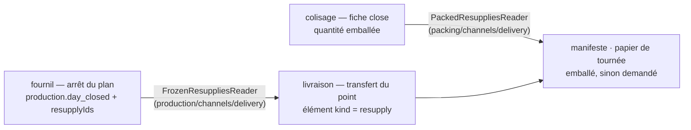

- **L'attache** : à `production.day_closed`, la livraison (`LearnArrestedPlan`
  → `TransferAttachment.attachResupplies`) range chaque réassort figé d'un
  point servi par transfert dans le transfert prévu de ce point, ouvert au
  besoin — un point sans commande ce jour-là reçoit le sien. La liste vient
  des `resupplyIds` DU FAIT ; le point et les lignes, de la copie figée du
  fournil (`FrozenResuppliesReader`, déclaré et implémenté par la
  production), jamais du commerce vivant. Le Labo n'a aucun transfert.
- **Le contenu** : manifeste, « Ma tournée » et papier de tournée lisent
  l'emballé d'une fiche close (`PackedResuppliesReader`, réexporté par
  `packing/channels/delivery/`), sinon le demandé ; une ligne emballée à zéro
  ne part pas. Figé au départ comme les commandes.
- **La réouverture** détache les réassorts du plan défait de leur transfert
  encore prévu (`ForgetReopenedPlan`) ; le transfert reste, même vide.
- **Les bacs** : ceux du transfert (`delivery_bin`, sujet `transfer`,
  déclarés au chargement) portent aussi le réassort. Aucune migration : un
  réassort n'a pas de contenant au colisage, il part dans les bacs du
  transfert.
- **La part du Labo ne descend pas au colisage** : une fournée cochée sur le
  total ne remet que la part du colisage (commandes + points servis par
  transfert) ; la part d'un réassort servi sur place monte directement
  (`apps/lfd-api/src/production/domain/services/on-site-share.ts` — le colisage d'abord, puis
  le point sur place, puis le surplus au colisage). Une demande de retour ne
  porte que ce qui a été remis.

## Ce qui est bâti : les réassorts dans Prod manager (lot R3d, 2026-10-21)

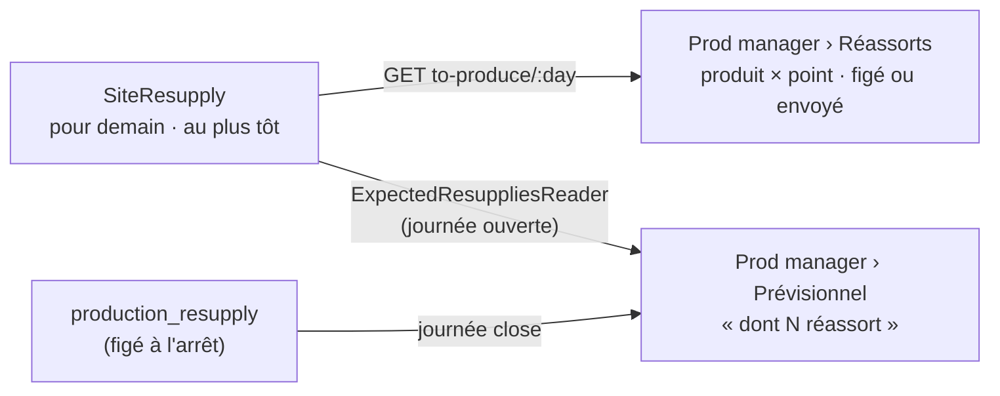

- **Prod manager est un espace à onglets**, comme le comptoir :
  `/prod-manager/previsionnel` (`production_plan:read`) et
  `/prod-manager/reassorts` (fournée OU prévisionnel), le premier permis à
  l'ouverture (`apps/lfd-backoffice-frontend/src/app/production/prod-manager/`).
  `/reassorts-a-produire` y redirige ; l'entrée « Réassorts » du menu est
  retirée.
- **L'onglet Réassorts** : la table de la demande du comptoir vue du fournil —
  une ligne par produit, une colonne par point (« pour demain · envoyé » ou
  « · figé », « au plus tôt »), ruptures et stocks faibles en marque, total par
  produit ; la journée dans l'URL, demain par défaut ; « Envoyer un
  réassort » en tête. Route `GET admin/site-resupplies/to-produce/:day`, qui
  montre les « pour demain » figés avec `planStopped`.
- **Le prévisionnel** compte les réassorts pour demain à part : envoyés pour
  une journée ouverte (ajoutés), figés pour une journée close (déjà dans le
  compte, seule la part est dite) — `resupplyUnits`, `resupplyQuantities`.
  Le compte de commandes n'en dit rien.

- **Le dossier du jour** (`/prod-manager/previsionnel`, et son PDF figé) —
  depuis R3d-bis (2026-10-21) : **les fiches de poste par rayon comptent
  commandes + réassorts**, le total d'abord, la part ensuite (« 42 — dont 18
  réassort ») ; **un bon de réassort par réassort** suit les bons de commande
  (le point, ses lignes, ses quantités, sans prix ni QR, marqué « Réassort »).
  La section « Réassorts » par point de R3d est retirée, à l'écran comme au
  PDF : elle disait deux fois la même chose. Route
  `GET admin/production/batch/:date/resupplies` (`GetDayResuppliesQuery`,
  `ProductionDayResuppliesView`) : la copie figée (`production_resupply`)
  d'une journée arrêtée, l'envoyé « pour demain » (`DayResuppliesReader`)
  d'une journée ouverte — l'écran le dit « envoyés », le PDF reste refusé tant
  que le plan n'est pas arrêté. Le compte du lot dit « N commandes · M
  réassorts · P pièces dont Q de réassort » ; le nombre de commandes ne bouge
  pas. PDF en mise en page `v7`
  (`apps/lfd-api/src/production/domain/services/day-dossier.ts`,
  `apps/lfd-api/src/production/domain/services/day-dossier-recap-pdf.ts`,
  `apps/lfd-api/src/production/domain/services/day-dossier-resupplies-pdf.ts`) ; à l'écran,
  le bon est `previsionnel/dossier-du-jour/bon-reassort/`, dans la vue
  « Bons ». Une journée à réassorts seuls se tire.
- **« Arrêter le plan »** propose une journée sans commande mais à réassorts
  (`resupplyUnits > 0`), comme le serveur l'accepte depuis R3a.
- **Les fiches de réassort au poste du colisage** : bouton « Fiches de
  réassort » dans la bande (journée arrêtée), et d'office sous « Aucune
  commande » pour une journée à réassorts seuls
  (`apps/lfd-backoffice-frontend/src/app/production/colisage/packing-resupplies/`) :
  demandé, emballé saisi par ligne (« Enregistrer »), « Clore la fiche » une
  fois toutes les lignes saisies ; les refus du serveur s'affichent tels quels.
- **Le manifeste du transfert à l'écran** montrait déjà la section
  « Réapprovisionnement » dès que le serveur la remplit (R3c) ; l'avis d'un
  transfert vide nomme désormais les réassorts.

## Ce qui est bâti : le réassort arrivé (lot R3e, 2026-10-22)

« Un seul signal, deux gestes » : un réassort envoyé passe d'**attendu** à
**arrivé** (`site_resupply.arrived_*`, instant et auteur figés, migration
`20261022130000_le_reassort_arrive`), et la cloche sonne au comptoir.

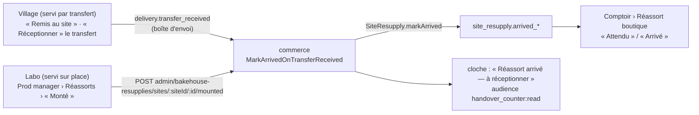

- **Le domaine** : `SiteResupply.markArrived(trace, reception)` refuse une
  demande en cours ou un réassort annulé (409) ; déjà arrivé ou déjà
  réceptionné, rien ne change et rien ne sonne. Réceptionner n'attend
  jamais le signal : le comptoir fait foi.
- **Village** : les DEUX chemins de la réception d'un transfert (« Remis au
  site » du livreur, « Réceptionner » au comptoir) écrivent le fait durable
  `delivery.transfer_received` (`apps/lfd-api/src/delivery/channels/commerce/transfer-received.fact.ts`,
  déclaré et écrit par la livraison) ; le commerce l'écoute en
  `@DurableHandler` et marque arrivés les réassorts que le transfert porte —
  à l'instant et sous l'auteur de la réception.
- **Labo** : « Monté », carte « À monter » de l'onglet Réassorts
  (`production/reassorts-a-produire/resupply-mount-card/`), sous
  `production_resupply:write` — le droit de l'envoi du fournil. La vue de
  l'onglet porte `transferSiteIds` : la carte ne liste que les points servis
  sur place.
- **La cloche** ne sait adresser qu'un droit, pas un point
  (`StaffNotice.audience`) : elle sonne pour tout `handover_counter:read`, le
  point est dans le titre (« … : Vitrine du matin — Le Labo »). Une clé par
  réassort.
- **Au comptoir** : la liste à réceptionner dit « Attendu » ou « Arrivé »
  (`arrivedAt`, `arrivedBy` sur `ResupplyReceptionView`) ; `SiteResupplyView`
  les porte aussi.
- e2e : `apps/lfd-api/test/resupply-arrived.e2e-spec.ts`.

## Ce qui est bâti : l'onglet Stock de la Supervision (lot S1, 2026-10-22)

`/supervision` porte une bascule **« Journée · Stock »** dans son bandeau, à
côté du choix du jour, en large comme en étroit. « Journée » est le tableau à
trois colonnes, inchangé ; « Stock » montre, pour le jour regardé, une
`fold-card` par point. Lecture seule.

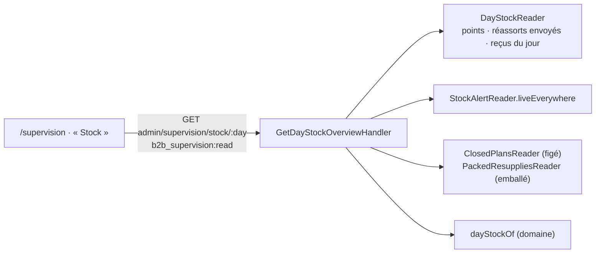

- **Serveur** : `GetDayStockOverviewQuery` + handler (`b2b/resupply/application/`),
  port de lecture dédié `DayStockReader` (tous points, la journée : points
  non archivés dans l'ordre de création, réassorts envoyés annulés compris,
  reçus), contrôleur `AdminSupervisionStockController` sous
  `b2b_supervision` — le droit de la page. Contrat `DayStockOverviewView`
  (`packages/contracts/src/day-stock-overview.ts`).
- **Le calcul** (`domain/day-stock.ts`, `dayStockOf`) : l'état d'un réassort
  est le plus avancé de **réceptionné** › **arrivé** › **figé** (« pour
  demain » d'un plan arrêté) › **envoyé** ; un annulé n'y est que s'il avait
  été réceptionné. Par produit : le **stock du jour** (`estimateStock`, la
  somme des reçus réceptionnés), l'**alerte vivante**, l'**attendu** (l'emballé
  au colisage, sinon le demandé, des réassorts ni annulés ni réceptionnés).
  Seuls les produits qu'un reçu, une alerte ou un attendu nomment ; tri :
  alertes, attendus, le reste, par libellé.
- **Tous les points non archivés** ont leur carte, même vide (« Aucun
  réassort, aucun reçu ni alerte ») ; un point archivé n'apparaît, après les
  autres, que s'il porte quelque chose ce jour-là.
- **Front** : `supervision/stock-board/` ; lu avec les colonnes, au même
  rythme (`SupervisionReads.stock`). Un réassort envoyé, figé, emballé ou
  reçu fait bouger la version du jour (déclencheurs `day_change`, migration
  `20261022140000`, 2026-10-22) ; une alerte de stock non — elle ne porte
  pas de jour, et ne se voit qu'au prochain mouvement ou au rechargement.
  En « Stock », la recherche et les
  onglets du téléphone sont masqués. Le renvoi « Ouvrir le réassort » mène à
  `/prod-manager/reassorts`, montré à qui a `production_worksheet:read` ou
  `production_plan:read`.
- e2e : `apps/lfd-api/test/supervision-stock.e2e-spec.ts`.

## Ce qui est bâti : le transfert de réassort seul, au tableau et au comptoir (2026-10-22, non commité)

- **Le tableau des tournées** : la carte d'arrêt de transfert dit
  « N commandes · M réassorts », ou « M réassorts » seul
  (`DeliveryRoundTransferStopView.resupplyCount`, ajout ; éléments PORTÉS
  comptés par genre dans `prisma-delivery-rounds.reader.ts` — le compte des
  commandes y ignore désormais aussi un élément sorti, comme celui du livreur).
- **Le comptoir** : la file (`HandoverQueueView.resupplyTransfers`, ajout) rend
  les transferts de la journée qui ne portent que des réassorts
  (`ResupplyTransfersReader`, `delivery/channels/handover/`, déclaré et
  implémenté par la livraison) ; la bande « Réceptionner » de l'onglet du site
  les montre (« 0 bac · 2 réassorts ») et les réceptionne par le transfert
  lui-même : `POST admin/handover/transfers/:transferId/reception`
  (`TransferReceptionDesk.receiveTransfer`, même règle, même journal, même
  fait `delivery.transfer_received` — donc « arrivé » sans tournée). La route
  par commande reste servie ; l'écran passe désormais par le transfert pour
  tous.
- e2e : `apps/lfd-api/test/resupply-transfer-reception.e2e-spec.ts`.

## Le parcours du Village, de bout en bout (2026-10-22)

Le parcours du Village est joué de bout en bout par
`apps/lfd-api/test/resupply-village-flow.e2e-spec.ts` : envoi nommé et
commande la veille, arrêt automatique à la plus tardive des heures, fiche du
colisage et transfert qui porte commande et réassort, fournée et emballé
(18 sur 20), départ et manifeste figé, « Remis au site » (arrivé, cloche,
commande retirée), réception pré-remplie et stock lu par la Supervision — une
seule horloge figée qui saute d'une étape à l'autre.

Son pendant sur place, le Labo, l'est par
`apps/lfd-api/test/resupply-labo-flow.e2e-spec.ts` : envoi nommé et commande la
veille, arrêt automatique (bon « Servi sur place »), ni fiche au colisage ni
transfert, fournée dont seule la part des commandes descend au colisage,
« Monté » (arrivé, cloche, idempotent), réception pré-remplie au demandé (20)
et stock lu par la Supervision.

## Ce qui est bâti : « Lancer » un réassort « au plus tôt » (lot R4a, 2026-10-22, `babc1ccbd`)

Plan : [`plan-au-plus-tot.md`](plan-au-plus-tot.md) §2. Le fournil **lance** un
réassort « au plus tôt » envoyé : il entre au plan du jour et compte dans les
fournées ; le comptoir ne peut plus l'annuler.

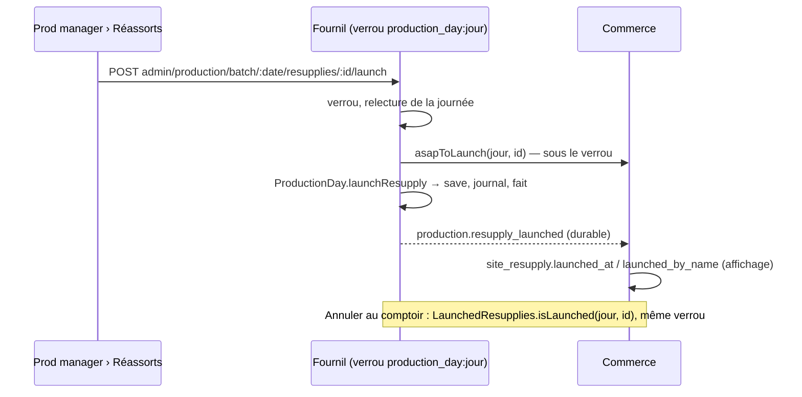

- **L'agrégat** : `ProductionDay.launchResupply`
  (`apps/lfd-api/src/production/domain/entities/production-day.ts`, règles dans
  `production-day.launch.ts`) — un geste à part du retirage. Le réassort est
  rangé à part des réassorts du soir (`launchedResupplies`), ajouté au compte
  par la même fonction que l'arrêt ; refus : déjà lancé. La réouverture le
  **garde**, le ré-arrêt le recompte ; il compte aussi dans la part « sur
  place » d'une fournée (un « au plus tôt » du Labo lancé ne descend pas au
  colisage).
- **La journée jamais arrêtée** (Q5) : « Lancer » l'ouvre arrêtée, signée de qui
  lance, avec ce seul réassort — journal `production_day.resupply_launched`,
  `openedPlan: true`. **Garde ajoutée au lot** : si l'arrêt avait encore des
  commandes (hors retraits) ou des réassorts du soir à figer, le lancement est
  refusé (409 « arrêtez d'abord le plan du jour ») — sinon elles sortiraient du
  plan. Ni `production.day_closed`, ni dossier du jour (Q6).
- **Les ports** : `DayResuppliesReader.asapToLaunch` (le commerce, lu sous le
  verrou ; `placedFor` reste « pour demain ») ; `LaunchedResupplies.isLaunched`
  (`production/channels/commerce/`, déclaré et implémenté par le fournil), que
  l'annulation lit par `ResupplyPlanGate.launched` sous le même verrou — refus
  `ResupplyLaunchedNotCancellableError` (409).
- **Le fait** `production.resupply_launched:<jour>:<resupplyId>`
  (+ `:after-reopening:<instant>`) : lignes, point, `servedByTransfer`, nom,
  instant et auteur. Abonnés : le commerce
  (`RecordLaunchOnResupplyLaunched`, durable) — l'affichage ; le colisage
  (R4b, ci-dessous) ; la livraison (R4c, ci-dessous). Depuis R4c, il porte
  aussi `openedPlan` : ce lancement a ouvert la journée (Q5).
- **Les tables** : migration `20261022150000_le_reassort_lance` (additive) —
  `production_resupply.kind` (`evening` par défaut, CHECK), `launched_at`,
  `launched_by` (CHECK « asap ⇔ lancé ») ; `site_resupply.launched_at`,
  `launched_by_name` (nullables, affichage).
- **L'écran** : carte « Au plus tôt » de l'onglet Réassorts
  (`apps/lfd-backoffice-frontend/src/app/production/reassorts-a-produire/resupply-launch-card/`),
  « Lancer » sous `production_resupply:write`, « Lancé par X à HH:MM ».
  « Réassorts à produire » ne montre plus un lancé. Au comptoir, le refus
  d'annuler s'affiche avec le message du serveur.
- e2e : `apps/lfd-api/test/resupply-launch.e2e-spec.ts` (Q5, refus, course
  lancer/annuler, réouverture).

## Ce qui est bâti : la fiche « au plus tôt » au colisage, et sa réserve (lot R4b, 2026-10-22, non commité)

Plan : [`plan-au-plus-tot.md`](plan-au-plus-tot.md) §2 ③, Q7. Le colisage
écoute `production.resupply_launched` ; un réassort lancé d'un point servi par
transfert y ouvre sa fiche et **réserve** ses pièces sur la réserve du jour.

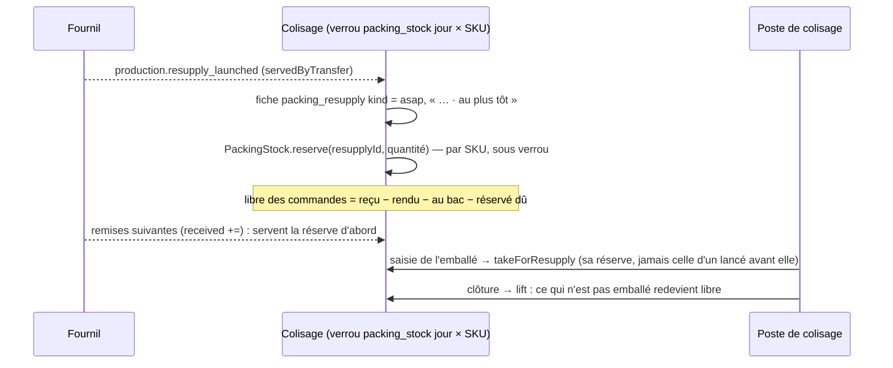

- **L'abonné** : `OnResupplyLaunched`
  (`apps/lfd-api/src/packing/application/handlers/on-resupply-launched.handler.ts`),
  `@DurableHandler`, nom `packing.draw-launched-resupply`. Rien pour un point
  servi sur place (Labo). Le fait est relu par `production/channels/packing/`,
  qui le réexporte. Rejeu sans effet (fiche inscrite si absente, réservation
  posée si absente, même levée).
- **La réserve** : `PackingStock` porte ses réservations
  (`apps/lfd-api/src/packing/domain/entities/packing-stock.ts`, règle pure
  dans `apps/lfd-api/src/packing/domain/services/stock-reservations.ts`). Le reste dû d'une réservation
  = sa quantité − l'emballé de sa ligne, déduit, pas stocké. `free` (mise au
  bac d'une commande, « Proposer », retour au fournil) retire tout le reste
  dû ; une fiche « au plus tôt » prend sur le sien, et les réservations se
  servent **dans l'ordre du lancement** (deux lancés sur une remise courte ne
  se bloquent pas). Une réservation ne prend **jamais** une pièce au bac : si
  le four n'a pas remis assez, la fiche est « en attente du four ». La clôture
  la lève (`released_at`).
- **Le poste** : `GET admin/packing/:date/resupplies` porte `kind`,
  `awaitingOven` (fiche) et `awaitingOven` par ligne ; les « au plus tôt » en
  tête, dans l'ordre du lancement. Le compteur « en attente de la prod » des
  commandes retire aussi le réservé (`BoardStock.reserved`).
- **Réouverture** : la fiche « au plus tôt » d'un réassort lancé n'est jamais
  retirée (`withdrawUntouched` ne vise que `kind = evening`).
- **Les tables** : migration `20261022170000_la_reserve_du_reassort`
  (additive) — `packing_resupply.kind` (`evening` par défaut, CHECK) ;
  `packing_stock_reservation` `(service_day, resupply_id, sku)`, `quantity > 0`,
  `reserved_at`, `released_at`, clé étrangère vers la ligne de la fiche,
  déclencheurs `day_change`. Aucune colonne ne nomme une personne.
- **L'écran** : la fiche au poste de colisage
  (`apps/lfd-backoffice-frontend/src/app/production/colisage/packing-resupplies/`)
  dit « En attente du four » et « N attendus du four » par ligne.
- **Correctif R4a/Q4** : au Labo, la carte « À monter » ne propose « Monté »
  sur un « au plus tôt » qu'une fois lancé (« À lancer d'abord » sinon) — les
  réassorts du soir sont inchangés. Le serveur le refuse depuis R4c.
- e2e : `apps/lfd-api/test/resupply-asap-packing.e2e-spec.ts` (fiche, attente
  du four, clôture ; deux saisies concurrentes ; commande qui alloue pendant
  le lancement ; Labo sans fiche).

## Ce qui est bâti : le transport du « au plus tôt » (lot R4c, 2026-10-22, non commité)

Plan : [`plan-au-plus-tot.md`](plan-au-plus-tot.md) §2 ④. La livraison écoute
le même fait que le colisage, en même temps, et emprunte les mécanismes du
soir sans en écrire de nouveaux.

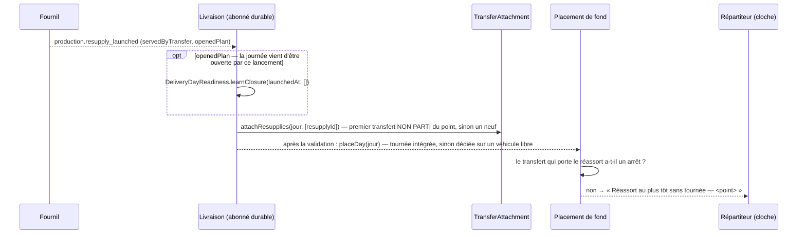

- **L'abonné** : `AttachLaunchedResupply`
  (`apps/lfd-api/src/delivery/application/handlers/attach-launched-resupply.handler.ts`),
  `@DurableHandler`, nom `delivery.attach-launched-resupply`, fait relu par
  `production/channels/delivery/`. Rien pour un point servi sur place
  (Labo) — sauf apprendre l'arrêt d'une journée ouverte. Rejeu sans effet.
- **La journée ouverte par un lancement** (Q5) : le fournil ne publie pas
  `production.day_closed` (il renverrait le dossier, Q6). Choix : le fait
  `resupply_launched` porte `openedPlan` (absent des faits d'avant : `false`),
  et la livraison pose l'arrêt (`delivery_day_readiness.closed_at` = instant
  du lancement), sans livraison à annoncer, donc sans cloche du plan arrêté.
  La composition voit ainsi la journée arrêtée.
- **Le placement** : `AsapTransferDispatch`
  (`apps/lfd-api/src/delivery/application/asap-transfer-dispatch.ts`) diffère
  après la validation `TransferPlacer.placeDay` — ce que `placeDaySoon`
  diffère — puis demande si le transfert du réassort est resté sans arrêt.
  Si oui, `AsapTransferUnplacedBell` sonne sous `delivery_rounds:write`
  (`delivery.asap_transfer_unplaced`, clé par réassort).
- **La copie figée** : `FrozenResuppliesReader` rendait déjà les lancés (même
  table, `kind = asap`) ; il porte désormais `launchedAt` (`null` pour un
  réassort du soir).
- **Un transfert chargé mais pas parti** : vérifié — `InternalTransfer.attach`
  ne refuse qu'un transfert parti ou reçu, et des bacs se déclarent tant
  qu'il est prévu. Le réassort y entre donc ; la vue du chargement porte
  `resuppliesAfterLoading` (réassorts entrés après le dernier bac chargé), et
  la carte des bacs du transfert
  (`apps/lfd-backoffice-frontend/src/app/livraison/transfer-bins-card/`) dit
  « déclarez et chargez un bac de plus avant « Partir » ». Un bac chargé
  ensuite efface le signal.
- **« Monté »** sur un « au plus tôt » non lancé : refusé
  (`ResupplyNotLaunchedNotMountableError`, 409 `resupply.order.not_launched`),
  la question posée au fournil par `ResupplyPlanGate.launched`, sous le verrou
  de la journée, comme l'annulation.
- Aucune migration.
- e2e : `apps/lfd-api/test/resupply-asap-transfer.e2e-spec.ts` (transfert
  neuf placé ; journée ouverte ; transfert parti → neuf ; aucun véhicule →
  cloche ; transfert chargé → signal ; « Monté » avant « Lancer ») et le
  parcours `apps/lfd-api/test/resupply-asap-village-flow.e2e-spec.ts` (du
  lancement à la réception, horloge qui saute).

## Ce qui est bâti : le suivi, « lancé » et « parti » (lot R4d, 2026-10-22, non commité)

Plan : [`plan-au-plus-tot.md`](plan-au-plus-tot.md) §1 « Les états ». Un
**affichage** seulement : aucun refus ne lit « parti », et « Réceptionner »
reste permis à tout moment (le comptoir fait foi).

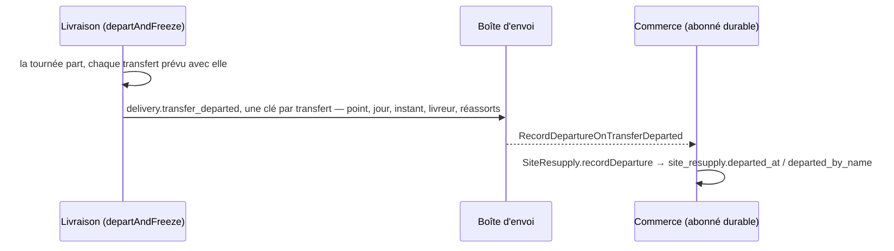

- **Le fait** `delivery.transfer_departed`
  (`apps/lfd-api/src/delivery/channels/commerce/transfer-departed.fact.ts`),
  déclaré ET écrit par la livraison, réexporté par `channels/commerce/`. Écrit
  par `departAndFreeze` dans la transaction du départ, pour chaque transfert
  qui part vraiment (`InternalTransfer.depart` rend `true`) : un transfert
  déjà reçu à la main n'en écrit pas. Distinct de `delivery.round_departed`,
  qui ne nomme que les commandes livrées. Le livreur est celui de la
  tournée (`null` sans livreur).
- **L'abonné** : `RecordDepartureOnTransferDeparted`
  (`apps/lfd-api/src/b2b/resupply/application/record-departure-on-transfer-departed.handler.ts`),
  `@DurableHandler`, nom `b2b.resupply-departure-on-transfer-departed`. Le
  nom du livreur est lu à l'annuaire et figé. Rejoué, rien ne change
  (`recordDeparture` rend `false`) ; un réassort introuvable sous le point
  est écarté et journalisé. Vaut aussi pour un réassort du soir porté par un
  transfert.
- **Migration** `20261022190000_le_reassort_parti` : `site_resupply.departed_at`,
  `departed_by_name`, nullables (registre RGPD : `departed_by_name`).
- **Les contrats** : `ResupplyReceptionView` gagne `launchedAt/By` et
  `departedAt/By` ; `SiteResupplyView` gagne `departedAt/By` ;
  `DayStockResupplyState` gagne `launched` et `departed` (réceptionné ›
  arrivé › parti › lancé › figé › envoyé).
- **Au comptoir** (`resupply-receptions-card`) : un réassort attendu montre
  ses étapes atteintes, Envoyé → Lancé → Parti → Arrivé, chacune avec son
  heure et son auteur quand on les a (`apps/lfd-backoffice-frontend/src/app/shared/resupply-steps.ts`).
- **À l'onglet Stock** de la Supervision : « Lancé », « Parti ».
- **Prod manager › Réassorts, carte « Au plus tôt »** : un réassort lancé dit
  aussi « Parti » (Village) puis « Arrivé » (transfert reçu, ou « Monté »).
- e2e : le parcours `apps/lfd-api/test/resupply-asap-village-flow.e2e-spec.ts`
  (étape 4 bis : « parti » au comptoir et à la Supervision, rejeu du fait
  sans effet).

## Ce qui est bâti : la sortie de réserve, origine `reserve` (lot A1.4, 2026-10-25, non commité)

Troisième origine d'un réassort : `reserve` — le pain rendu à la réserve du
colisage par une annulation, envoyé en boutique depuis la Supervision
(« Envoyer en boutique », `production_resupply:write`, `POST
admin/reserve-shop-releases/:serviceDay`). Il naît envoyé « au plus tôt »
(CHECK `site_resupply_reserve_placed_asap`), ne se lance jamais et ne
s'annule pas. Il n'est ni dans « Réassorts à produire », ni dans l'onglet de
Prod manager, ni lançable (`isProducedByBakehouse`) ; le comptoir le
réceptionne comme les autres, marqué « Pain rendu, envoyé par la réserve ».
Seule la réserve du jour sort. Plan :
[`plan-a1-4-envoyer-en-boutique.md`](../commandes/annulation/plan-a1-4-envoyer-en-boutique.md).

## Ce qui reste

- **« Réceptionné » à Prod manager** : la carte « Au plus tôt » lit
  `SiteResupplyView`, qui ne porte pas la réception ; elle s'arrête à
  « Arrivé ».
- **Un « au plus tôt » sans véhicule libre** : la cloche sonne une fois ; le
  placement ne se rejoue qu'à la composition ou à l'affectation à la main.
- **La réserve naît au traitement du fait**, pas à l'instant du lancement : une
  commande mise au bac entre les deux garde ses pièces, et la fiche attend le
  four.
- **La cloche ne cible pas le point** : tout le comptoir l'entend.

- **La course annuler / réceptionner** : l'annulation lit la réception puis
  écrit le réassort ; « Réceptionner » ne touche pas la version du réassort.
  Deux postes qui annulent et réceptionnent à la même seconde peuvent encore
  laisser un réassort annulé ET réceptionné (le reçu reste et compte au
  stock). Fermé seulement si la réception passe un jour par l'agrégat.
- **Un transfert vidé par la réouverture** garde son arrêt dans la tournée
  s'il était placé ; il n'est pas retiré (comme un transfert vidé par
  l'annulation de ses commandes).
- **Le jour même sur stock** (J2) : les commandes qui puisent dans la vitrine,
  leur décompte dans le stock estimé, et l'effet des alertes de R1b (une
  rupture bloque la vente en ligne du jour, un stock faible avertit) —
  [`../limites-de-commande/plan-jour-meme-sur-stock.md`](../limites-de-commande/plan-jour-meme-sur-stock.md).
