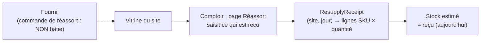

# Le réassort des boutiques

> **État : 🟡 partiel, 2026-10-21.** La **réception** au comptoir est bâtie
> (commit `558b376c8`) ; la **commande au fournil** ne l'est pas. Ce document
> décrit ce qui existe, vérifié dans le code le 2026-10-21. La conception
> complète, lots et questions ouvertes compris, est dans
> [`plan-reapprovisionnement.md`](plan-reapprovisionnement.md).

Le réassort, c'est ce qu'une vitrine (un point de retrait approvisionné) reçoit
du fournil pour vendre au comptoir dans la journée.

## Le modèle : B, un `SiteResupply` à part

Décidé par Hugo le 2026-10-21. Le réassort d'un site n'est **jamais une
commande** : il ne porte ni prix, ni TVA, ni chiffre d'affaires. C'est un
agrégat à part, `SiteResupply`, qui demandera au fournil ; ce qui arrive en
vitrine est un second agrégat, la **réception**, parce que demander et
recevoir ont deux auteurs et deux moments — ce qui arrive n'est pas toujours
ce qui a été demandé, et le comptoir corrige ce qu'il voit.

Aujourd'hui, **seule la réception existe**. Le `SiteResupply` (la demande)
n'est pas bâti ; le jour où il le sera, il pré-remplira la réception.

## Ce qui est bâti : la réception au comptoir

- **Le code** : `apps/lfd-api/src/b2b/resupply/`. L'agrégat
  `ResupplyReceipt` (`domain/resupply-receipt.ts`) tient, pour **un site et
  une journée**, la liste des articles reçus : `receive`, `correct`,
  `withdraw`. Il ne connaît ni prix ni commande.
- **Les invariants** : un article au plus une fois — une seconde saisie du
  même SKU est **refusée** (`ReceiptLineAlreadyPresentError`, « corrigez sa
  quantité ») plutôt qu'additionnée ; des quantités entières ≥ 0 ; une journée
  `AAAA-MM-JJ` ; un auteur sur chaque geste.
- **Le verrou optimiste** : la réception porte une `version` ; l'adaptateur
  réécrit sous la version lue, et deux postes qui corrigent en même temps
  font refuser le second (`ResupplyReceiptChangedMeanwhileError`).
- **Les articles proposés** : le catalogue publié aux particuliers, lu par
  `CatalogReader` (SKU produit, aucun prix).
- **Les tables** : `resupply_receipt` (unique par site et jour) et
  `resupply_receipt_line` (unique par réception et SKU), schéma `public`
  (`apps/lfd-api/prisma/schema/public/resupply.prisma`).
- **Les routes** : `admin/resupply-receipts` sous la surface
  `handover_counter` — lecture `handover_counter:read` (articles, liste du
  jour), écriture `handover_counter:write` (ajouter, corriger, retirer une
  ligne).
- **L'écran** : `apps/lfd-backoffice-frontend/src/app/comptoir/reassort-boutique-page/`,
  route `reassort` de l'espace comptoir.

### Le stock estimé

`estimateStock` (`domain/estimated-stock.ts`) calcule, à la lecture, reçu −
ce que les commandes « jour même sur stock » ont pris. Ce circuit n'existe pas
(lot J2), donc **le stock estimé est le reçu**. Les commandes déjà passées
pour ce jour ne se soustraient pas : passées la veille avant l'heure limite,
elles sont dans le plan du fournil et ne puisent pas dans la vitrine.

## Le réglage : « réassort soumis à l'heure limite / sans limite »

`order_cutoff_settings.resupply_subject_to_cutoff` (oui par défaut), sur la
page de l'heure limite du back-office (`resupply-cutoff-card`). **Il est sans
effet** tant que le réassort n'est pas commandé au fournil. Voir
[`../limites-de-commande/schema-des-reglages.md`](../limites-de-commande/schema-des-reglages.md).

## Ce qui reste

- **La commande au fournil** (`SiteResupply`) et son branchement : produite
  par le fournil, colisée, portée par le transfert interne
  ([`../livraisons/transferts/plan-transfert-interne.md`](../livraisons/transferts/plan-transfert-interne.md)) —
  lots du [plan](plan-reapprovisionnement.md).
- **Le jour même sur stock** (J2) : les commandes qui puisent dans la vitrine,
  et leur décompte dans le stock estimé —
  [`../limites-de-commande/plan-jour-meme-sur-stock.md`](../limites-de-commande/plan-jour-meme-sur-stock.md).
