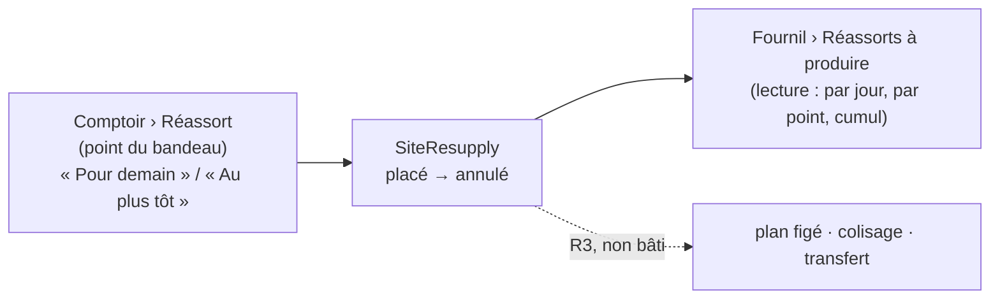
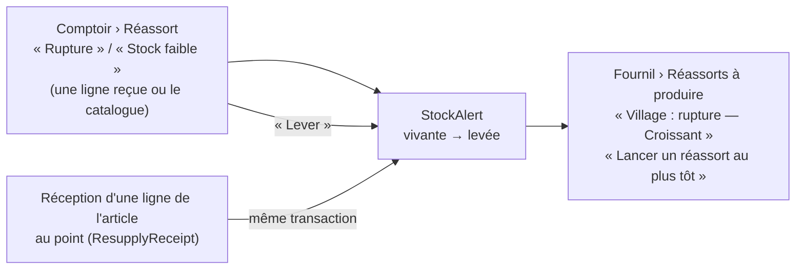
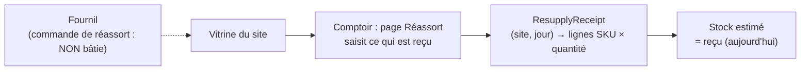

# Le réassort des boutiques

> **État : 🟡 partiel, 2026-10-21.** La **réception** au comptoir est bâtie
> (commit `558b376c8`) ; la **commande** au fournil aussi (lot R1, 2026-10-21),
> mais le fournil ne fait encore que la LIRE : elle n'entre ni au plan figé, ni
> au colisage, ni au transfert (R3). Les **ruptures et stocks faibles** du
> comptoir aussi (lot R1b, 2026-10-21), sans effet encore sur la boutique. Ce document décrit ce qui existe, vérifié
> dans le code le 2026-10-21. La conception
> complète, lots et questions ouvertes compris, est dans
> [`plan-reapprovisionnement.md`](plan-reapprovisionnement.md).

Le réassort, c'est ce qu'une vitrine (un point de retrait approvisionné) reçoit
du fournil pour vendre au comptoir dans la journée.

## Le modèle : B, un `SiteResupply` à part

Décidé par Hugo le 2026-10-21. Le réassort d'un site n'est **jamais une
commande** : il ne porte ni prix, ni TVA, ni chiffre d'affaires. C'est un
agrégat à part, `SiteResupply`, qui demandera au fournil ; ce qui arrive en
vitrine est un second agrégat, la **réception**, parce que demander et
recevoir ont deux auteurs et deux moments — ce qui arrive n'est pas toujours
ce qui a été demandé, et le comptoir corrige ce qu'il voit.

Les deux existent depuis le 2026-10-21, sans lien encore : la demande ne
pré-remplit pas la réception (lot R2).

## Ce qui est bâti : commander le réassort (lot R1, 2026-10-21)

- **Le code** : `apps/lfd-api/src/b2b/resupply/`, à côté de la réception.
  L'agrégat `SiteResupply` (`apps/lfd-api/src/b2b/resupply/domain/site-resupply.ts`) : un point, une
  **visée** — `tomorrow` (le soir pour demain, journée = demain) ou `asap`
  (« au plus tôt », journée = aujourd'hui), journée déduite de l'instant du
  geste à l'heure de Paris, jamais saisie —, des lignes (SKU, libellé figé du
  catalogue publié, quantité entière > 0, un article une fois, au moins une),
  l'état brouillon → passé → annulé, l'auteur et l'instant de chaque geste.
  Aucun prix, aucune dépendance à `Order`.
- **Le brouillon ne se persiste pas** : il vit à l'écran, et le serveur
  reçoit un réassort entier qu'il compose et passe d'un geste
  (`PlaceSiteResupplyHandler`). La base ne porte que des réassorts passés ou
  annulés.
- **L'heure limite** : `place()` refuse une visée `tomorrow` après l'heure
  limite générale de sa journée (borne incluse, rattrapage non compris) quand
  `resupply_subject_to_cutoff` est vrai — **le réglage a désormais un
  effet**. `asap` n'en a jamais. La règle est celle du commerce
  (`OrderCutoffsInForce` + `orderCutoffInstant`), lue par le port
  `ResupplyCutoff` (`apps/lfd-api/src/b2b/resupply/infrastructure/general-resupply-cutoff.ts`).
- **Annuler** : un réassort passé s'annule, une fois ; rien en aval ne le
  tient encore. Une annulation est un état, jamais une suppression.
- **Les tables** : `site_resupply` et `site_resupply_line` (unique par
  réassort et SKU, quantité > 0 en CHECK), schéma `public`, migration
  `20261021170000_le_reassort_commande_par_un_point` (additive).
- **Les routes** : `admin/site-resupplies/sites/:siteId` sous
  `handover_counter` — lecture (les réassorts du point pour aujourd'hui et
  demain, et jusqu'à quand « Pour demain » passe), écriture (passer,
  `…/:resupplyId/cancel`). Le point est dans chaque `where` : un réassort
  d'un autre point est introuvable (404).
  `admin/site-resupplies/to-produce` sous `production_worksheet:read` **ou**
  `production_plan:read` : aujourd'hui puis demain, par point, les réassorts
  passés et le cumul par article.
- **Les écrans** : au comptoir, la carte « Commander au fournil »
  (`comptoir/reassort-boutique-page/resupply-order-card/`) au-dessus de la
  réception, qui n'a pas changé ; au fournil, **Réassorts à produire**
  (`production/reassorts-a-produire/`, route `/reassorts-a-produire`, au rail
  et aux tuiles sous le Fournil), en lecture, distinct des commandes client.
- **Pourquoi pas de canal du fournil en R1** : l'écran du fournil lit la route
  du commerce depuis le navigateur ; aucun bloc serveur ne traverse
  (`production → b2b` reste interdit). Le canal viendra quand le réassort
  entrera au plan figé (R3).

## Ce qui est bâti : rupture et stock faible au comptoir (lot R1b, 2026-10-21)

- **Le code** : `apps/lfd-api/src/b2b/resupply/domain/stock-alert.ts`. Une
  alerte par (point, SKU) : niveau `out_of_stock` (rupture) ou `low` (stock
  faible), libellé figé du catalogue publié, auteur et instant de la DERNIÈRE
  déclaration. Redéclarer l'alerte vivante change son niveau (le handler la
  recharge plutôt que d'en ouvrir une seconde). Une alerte levée ne se rouvre
  ni ne se relève : on en déclare une nouvelle.
- **Sa durée** : aucune échéance. Elle tient jusqu'à ce que le comptoir la
  lève (`manual`) ou qu'une ligne de l'article soit reçue au point avec une
  quantité > 0 (`receipt`) — jamais d'elle-même le lendemain.
- **La levée par la réception** : `liftStockAlertOnReceipt`
  (`apps/lfd-api/src/b2b/resupply/application/lift-stock-alert-on-receipt.ts`), appelé par
  `ReceiveResupplyLineHandler` dans l'unité de travail de la réception. C'est
  le seul chemin ; R2 (la réception en un geste) s'y branchera. Corriger ou
  retirer une ligne ne lève rien.
- **La table** : `site_stock_alert`, schéma `public`, migration
  `20261021190000_les_alertes_de_stock_du_comptoir` (additive). Index unique
  PARTIEL `(site_id, sku) WHERE lifted_at IS NULL` : une seule alerte vivante,
  la course entre deux postes est refusée en 409. Pas de suppression : une
  levée garde qui, quand et pourquoi (`lift_reason`).
- **Les routes** : `admin/site-stock-alerts/sites/:siteId` sous
  `handover_counter` — lecture (les alertes vivantes du point), déclarer
  (`POST`, `{ sku, level }`), lever (`…/:alertId/lift`) ; le point est dans
  chaque `where`. `admin/site-stock-alerts/live` sous
  `production_worksheet:read` **ou** `production_plan:read` : les alertes
  vivantes de tous les points.
- **Les écrans** : au comptoir, la carte « Ruptures et stocks faibles » en
  tête de la page Réassort (`comptoir/reassort-boutique-page/stock-alerts-card/`),
  et les gestes sur chaque ligne reçue ; au fournil, « Alertes des points » en
  tête de « Réassorts à produire »
  (`production/reassorts-a-produire/live-stock-alerts-card/`). « Lancer un
  réassort au plus tôt » passe un réassort `asap` de l'article pour le point
  par la route du comptoir : il n'apparaît qu'à qui tient
  `handover_counter:write` — aucun droit du fournil ne couvre cette route.
- **Aucun effet sur la boutique ni sur la passation** : une rupture ne bloque
  encore rien, un stock faible n'avertit aucun client (lot J2). L'écran du
  comptoir le dit.

## Ce qui est bâti : la réception au comptoir

- **Le code** : `apps/lfd-api/src/b2b/resupply/`. L'agrégat
  `ResupplyReceipt` (`domain/resupply-receipt.ts`) tient, pour **un site et
  une journée**, la liste des articles reçus : `receive`, `correct`,
  `withdraw`. Il ne connaît ni prix ni commande.
- **Les invariants** : un article au plus une fois — une seconde saisie du
  même SKU est **refusée** (`ReceiptLineAlreadyPresentError`, « corrigez sa
  quantité ») plutôt qu'additionnée ; des quantités entières ≥ 0 ; une journée
  `AAAA-MM-JJ` ; un auteur sur chaque geste.
- **Le verrou optimiste** : la réception porte une `version` ; l'adaptateur
  réécrit sous la version lue, et deux postes qui corrigent en même temps
  font refuser le second (`ResupplyReceiptChangedMeanwhileError`).
- **Les articles proposés** : le catalogue publié aux particuliers, lu par
  `CatalogReader` (SKU produit, aucun prix).
- **Les tables** : `resupply_receipt` (unique par site et jour) et
  `resupply_receipt_line` (unique par réception et SKU), schéma `public`
  (`apps/lfd-api/prisma/schema/public/resupply.prisma`).
- **Les routes** : `admin/resupply-receipts` sous la surface
  `handover_counter` — lecture `handover_counter:read` (articles, liste du
  jour), écriture `handover_counter:write` (ajouter, corriger, retirer une
  ligne).
- **L'écran** : `apps/lfd-backoffice-frontend/src/app/comptoir/reassort-boutique-page/`,
  route `reassort` de l'espace comptoir.

### Le stock estimé

`estimateStock` (`domain/estimated-stock.ts`) calcule, à la lecture, reçu −
ce que les commandes « jour même sur stock » ont pris. Ce circuit n'existe pas
(lot J2), donc **le stock estimé est le reçu**. Les commandes déjà passées
pour ce jour ne se soustraient pas : passées la veille avant l'heure limite,
elles sont dans le plan du fournil et ne puisent pas dans la vitrine.

## Le réglage : « réassort soumis à l'heure limite / sans limite »

`order_cutoff_settings.resupply_subject_to_cutoff` (oui par défaut), sur la
page de l'heure limite du back-office (`resupply-cutoff-card`). Depuis le lot
R1 (2026-10-21), il s'applique à la commande « Pour demain » ; « Au plus tôt »
n'y est jamais soumis. Voir
[`../limites-de-commande/schema-des-reglages.md`](../limites-de-commande/schema-des-reglages.md).

## Ce qui reste

- **La réception en un geste** (R2) : un reçu par réassort, pré-rempli de la
  quantité demandée.
- **Le branchement de la commande** (R3, R4) : produite au plan figé, colisée,
  portée par le transfert interne
  ([`../livraisons/transferts/plan-transfert-interne.md`](../livraisons/transferts/plan-transfert-interne.md)) —
  lots du [plan](plan-reapprovisionnement.md).
- **Le jour même sur stock** (J2) : les commandes qui puisent dans la vitrine,
  leur décompte dans le stock estimé, et l'effet des alertes de R1b (une
  rupture bloque la vente en ligne du jour, un stock faible avertit) —
  [`../limites-de-commande/plan-jour-meme-sur-stock.md`](../limites-de-commande/plan-jour-meme-sur-stock.md).
