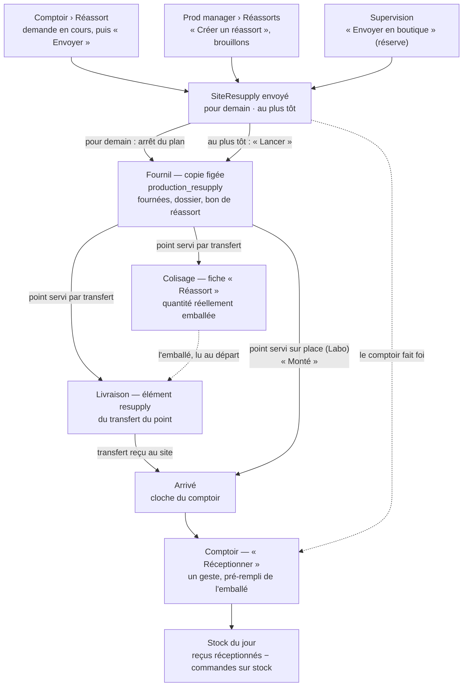

# Le réassort des boutiques

> **Doc d'état, au présent.** Elle remplace l'ancien README (état « partiel »
> du 2026-10-21) et les trois plans du dossier — le plan du
> réapprovisionnement (2026-10-14 → 2026-10-22), le plan du réassort « au plus
> tôt » (R4, 2026-10-22) et celui des brouillons du fournil (2026-10-28) —,
> supprimés le 2026-11-02 une fois bâtis. Leurs versions successives, leurs
> contradictions par `vitruve` et leurs lots restent dans l'historique git.
> Chaque chemin `fichier:ligne` a été ouvert le 2026-11-02.
>
> **État : implémenté.** Ce qui reste est dans
> [`reste-a-faire.md`](reste-a-faire.md), et nulle part ailleurs.

Le réassort, c'est ce qu'une **vitrine** — un point de retrait approvisionné
(le Labo, le Village…) — reçoit du fournil pour vendre au comptoir. Ce qu'il
a reçu et réceptionné **est** le stock du jour, dans lequel puisent les
commandes passées pour aujourd'hui
([`../limites-de-commande/jour-meme-sur-stock.md`](../limites-de-commande/jour-meme-sur-stock.md)).

## 1. Le modèle — un agrégat à part, jamais une commande

Décidé par Hugo le 2026-10-21 (« pas de prix, part sur B ») : le réassort d'un
site est `SiteResupply`, un agrégat du contexte `b2b/resupply/`, **sans prix,
sans TVA, sans règlement, sans chiffre d'affaires**. L'option « une `Order`
dont le client est un site » a été mesurée et écartée le 2026-10-14 : elle
touchait l'argent à une vingtaine d'endroits, dont dix où un oubli aurait
compté un faux revenu, facturé ou prélevé une société.

Demander et recevoir ont deux auteurs et deux moments, donc **deux
agrégats** : `SiteResupply` (la demande, ce que le fournil produit) et
`ResupplyReceipt` (ce que le comptoir atteste avoir reçu). Ce qui arrive
n'est pas toujours ce qui a été demandé, et **le compte du comptoir fait
foi** (décision C, Hugo, 2026-10-21).

Un réassort a une **visée** : `tomorrow` (le soir pour demain, il entre au
plan figé du fournil) ou `asap` (« au plus tôt », aujourd'hui, il entre au
plan du jour quand le fournil le **lance**). Et une **origine** :
`counter` (la demande en cours du comptoir), `bakehouse` (le fournil envoie
de lui-même) ou `reserve` (le pain rendu par une annulation, envoyé en
boutique par la Supervision).

## 2. Le parcours

| Étape                                                   | Doc d'état                                       |
| ------------------------------------------------------- | ------------------------------------------------ |
| Demander, envoyer, nommer, brouillons                   | [`commander.md`](commander.md)                   |
| Le soir pour demain : plan, colisage, transfert, arrivé | [`au-plan-du-fournil.md`](au-plan-du-fournil.md) |
| « Au plus tôt » : lancer, réserver, transporter, suivre | [`au-plus-tot.md`](au-plus-tot.md)               |
| Réceptionner, alertes, stock du jour, Supervision       | [`reception-et-stock.md`](reception-et-stock.md) |
| Ce qui n'est pas bâti                                   | [`reste-a-faire.md`](reste-a-faire.md)           |

## 3. Où vit le code

| Bloc        | Ce qu'il tient                                                                   | Chemins                                                                                                                                                                                                  |
| ----------- | -------------------------------------------------------------------------------- | -------------------------------------------------------------------------------------------------------------------------------------------------------------------------------------------------------- |
| commerce    | demande, envoi, brouillons, réception, alertes, stock du jour, Supervision Stock | `apps/lfd-api/src/b2b/resupply/` (module `resupply.module.ts`)                                                                                                                                           |
| fournil     | copie figée, « Lancer », dossier du jour, part sur place                         | `apps/lfd-api/src/production/` — `domain/entities/production-day.ts` (`launchResupply`), `domain/services/on-site-share.ts:37`                                                                           |
| colisage    | fiche de réassort, emballé, réserve d'un lancé                                   | `apps/lfd-api/src/packing/domain/entities/packing-resupply.ts:76`, `packing-stock.ts:139` (`reserve`)                                                                                                    |
| livraison   | élément `resupply` du transfert, placement, départ, réception                    | `apps/lfd-api/src/delivery/application/transfer-attachment.ts:62` (`attachResupplies`)                                                                                                                   |
| back-office | comptoir, Prod manager, colisage, Supervision                                    | `comptoir/reassort-boutique-page/`, `production/reassorts-a-produire/`, `production/colisage/packing-resupplies/`, `supervision/stock-board/`                                                            |
| contrats    | vues et charges                                                                  | `packages/contracts/src/site-resupply.ts`, `resupply-receipt.ts`, `bakehouse-resupply-draft.ts`, `site-stock-alert.ts`, `day-stock-overview.ts`, `production-day-resupplies.ts`, `packing-resupplies.ts` |

**La démonstration** : le scénario du jour (`placeToday`) sème un réassort
« au plus tôt » du Village, « Vitrine de l'après-midi », envoyé à 15 h par
les vrais handlers du comptoir (`apps/lfd-api/src/dev/seeding/village-resupply.seed.ts`) ;
il attend « Lancer » au fournil.

**Les canaux entre blocs** (aucun bloc ne lit les tables d'un autre) :

| Port                       | Déclaré par                                                             | Implémenté par                           | Pour                                                  |
| -------------------------- | ----------------------------------------------------------------------- | ---------------------------------------- | ----------------------------------------------------- |
| `DayResuppliesReader`      | fournil, `production/channels/commerce/day-resupplies.reader.ts:54`     | commerce, `ProductionDayResupplies`      | l'arrêt fige les « pour demain » ; `asapToLaunch`     |
| `ExpectedResuppliesReader` | fournil, `channels/commerce/expected-resupplies.reader.ts:26`           | commerce, `ProductionRangeResupplies`    | le prévisionnel d'une journée ouverte                 |
| `ResupplyCutoffTimeReader` | fournil, `channels/commerce/resupply-cutoff-time.reader.ts:12`          | commerce                                 | l'arrêt à la plus tardive des heures                  |
| `LaunchedResupplies`       | fournil, `channels/commerce/launched-resupplies.ts:22`                  | fournil, `ProductionLaunchedResupplies`  | refuser d'annuler un lancé, sous le verrou            |
| `FrozenResuppliesReader`   | fournil, `channels/delivery/frozen-resupplies.reader.ts:49`             | fournil, `PrismaFrozenResuppliesReader`  | la livraison lit la copie figée                       |
| `PackedResuppliesReader`   | colisage, `packing/channels/commerce/packed-resupplies.reader.ts:28`    | colisage, `PrismaPackedResuppliesReader` | réception et manifeste lisent l'emballé               |
| `ResupplyTransfersReader`  | livraison, `delivery/channels/handover/resupply-transfers.reader.ts:12` | livraison, `ResupplyTransfersAtCounter`  | le comptoir réceptionne un transfert de réassort seul |

**Les faits durables** : `production.resupply_list_drawn` (fournil →
colisage), `production.resupply_launched` (fournil → commerce, colisage,
livraison), `delivery.transfer_received` et `delivery.transfer_departed`
(livraison → commerce). Abonnés : `OnResupplyListDrawn`, `OnResupplyLaunched`
(colisage), `AttachLaunchedResupply` (livraison),
`RecordLaunchOnResupplyLaunched`, `MarkArrivedOnTransferReceived`,
`RecordDepartureOnTransferDeparted` (commerce), tous `@DurableHandler`.

## 4. Les droits

| Ressource             | Geste                                                                                                                                                                                                       |
| --------------------- | ----------------------------------------------------------------------------------------------------------------------------------------------------------------------------------------------------------- |
| `handover_counter`    | le comptoir : demande en cours, envoi, annulation, nom, réception, réassort sans commande, alertes du point                                                                                                 |
| `production_resupply` | « Production — Réassorts » : l'onglet Réassorts de Prod manager, ses lectures (à produire, alertes vivantes), l'envoi du fournil, ses brouillons, « Lancer », « Monté », « Envoyer en boutique » la réserve |
| `production_packing`  | le poste du colisage : fiches de réassort                                                                                                                                                                   |
| `b2b_supervision`     | l'onglet Stock de la Supervision                                                                                                                                                                            |
| `lfc_order_settings`  | l'heure du réassort (Réglages › Commandes)                                                                                                                                                                  |

`production_resupply` a été ajoutée à `StaffResource` le 2026-10-22
(`20261022000000_le_droit_du_reassort_du_fournil`) sans être accordée à
personne ; depuis le 2026-10-28 (`4a816502e`, Hugo : « un rôle fournil ne doit
avoir que la fiche d'atelier »), elle seule ouvre l'onglet Réassorts — la
fiche d'atelier et le prévisionnel ne l'ouvrent plus. Les droits s'accordent
à l'écran des rôles, jamais par migration.

Le point est dans chaque `where` du comptoir : un réassort, un reçu ou une
alerte d'un autre point est introuvable (404). Il n'y a **pas** de
cloisonnement par site d'un membre du staff : qui tient `handover_counter`
agit pour tout point.

## 5. Les tables

Schéma `public` (commerce) : `site_resupply`, `site_resupply_line`,
`resupply_receipt`, `resupply_receipt_line`, `site_stock_alert`,
`bakehouse_resupply_drafts` (`prisma/schema/public/resupply.prisma`) ;
`pickup_addresses.resupply_color` (teinte du réassort du site). Schéma
`production` : `production_resupply`, `production_resupply_line`. Schéma
`packing` : `packing_resupply`, `packing_resupply_line`,
`packing_stock_reservation`. La livraison n'a aucune table à elle : un
réassort est un élément `kind = resupply` de
`delivery_internal_transfer_item`, à `resupply_id` opaque.

Migrations, toutes additives sauf deux : `20261021150000_la_reception_du_reapprovisionnement`,
`20261021170000_le_reassort_commande_par_un_point`,
`20261021190000_les_alertes_de_stock_du_comptoir`,
`20261021210000_la_demande_de_reassort_en_cours`,
`20261021230000_un_recu_par_reassort` (**non additive** : elle retire
l'unicité (site, journée) d'une table jamais déployée),
`20261022000000_le_droit_du_reassort_du_fournil`,
`20261022000100_l_origine_du_reassort`, `20261022100000_le_reassort_au_plan_fige`,
`20261022110000_le_reassort_au_colisage`, `20261022120000_le_nom_du_reassort`,
`20261022130000_le_reassort_arrive`,
`20261022140000_le_reassort_fait_bouger_la_journee`,
`20261022150000_le_reassort_lance`, `20261022170000_la_reserve_du_reassort`,
`20261022190000_le_reassort_parti`, `20261022240000_la_teinte_du_reassort`,
`20261028120000_les_brouillons_du_fournil`,
`20261102210000_le_reassort_au_poids`,
`20261102220000_le_reassort_au_poids_au_fournil`,
`20261102230000_le_reassort_au_poids_au_colisage`,
`20261102250000_le_reassort_sans_interrupteur` (**non additive** : un
`DROP COLUMN` de `order_cutoff_settings.resupply_subject_to_cutoff`, colonne
morte retirée sur ordre de Hugo du 2026-11-02, retour dans
`prisma/rollback/`), `20261102260000_le_reassort_lu_par_index` (deux index),
`20261102270000_la_fiche_de_reassort_retiree` (`packing_resupply.withdrawn_at` :
la réouverture retire une fiche par un statut, elle ne l'efface plus),
`20261102280000_les_noms_du_reassort_par_index` (index `(site_id, name)`),
`20261102290000_la_fiche_retiree_jamais_emballee` (deux déclencheurs : une
fiche retirée n'a aucune ligne emballée).

## 6. Les lots, pour lire les commentaires du code

Le code cite ses lots ; voici ce qu'ils désignent et où ils sont décrits.

| Lot          | Ce qu'il a bâti                                                                      | Commit                                             | Doc                                              |
| ------------ | ------------------------------------------------------------------------------------ | -------------------------------------------------- | ------------------------------------------------ |
| —            | la page Réassort boutique, première réception                                        | `558b376c8`                                        | [`reception-et-stock.md`](reception-et-stock.md) |
| R1           | `SiteResupply`, commander pour demain ou au plus tôt, annuler                        | `140c70d45`                                        | [`commander.md`](commander.md)                   |
| R1b          | rupture et stock faible au comptoir                                                  | `b7fbf34ee`                                        | [`reception-et-stock.md`](reception-et-stock.md) |
| R1c          | la demande en cours, enregistrée et partagée                                         | `df9692ee5`                                        | [`commander.md`](commander.md)                   |
| R2           | réceptionner en un geste, un reçu par réassort                                       | `ea2a0549b`                                        | [`reception-et-stock.md`](reception-et-stock.md) |
| R1d          | le fournil envoie son propre réassort, origine `bakehouse`                           | `961283ae1`                                        | [`commander.md`](commander.md)                   |
| R1e, R1f     | une table de tous les produits, une seule colonne de quantité                        | `704c008cb`, `3a0339bdb`                           | [`commander.md`](commander.md)                   |
| R3a          | le « pour demain » au plan figé, l'heure du réassort                                 | `1b231fadd`                                        | [`au-plan-du-fournil.md`](au-plan-du-fournil.md) |
| R3b          | la fiche au colisage, l'emballé, `PackedResuppliesReader`                            | `5192ec009`                                        | [`au-plan-du-fournil.md`](au-plan-du-fournil.md) |
| R3c          | l'élément `resupply` du transfert, la part sur place ; le transfert de réassort seul | `b9b09cfe5`, `3787adac4`                           | [`au-plan-du-fournil.md`](au-plan-du-fournil.md) |
| R3d, R3d-bis | Prod manager à onglets, dossier du jour et bon de réassort                           | `7849c011c`                                        | [`au-plan-du-fournil.md`](au-plan-du-fournil.md) |
| R1g          | nommer un réassort (« Vitrine du matin »)                                            | `e5172e835`                                        | [`commander.md`](commander.md)                   |
| R3e          | « arrivé » : transfert reçu ou « Monté », la cloche                                  | `5edbd651c`                                        | [`au-plan-du-fournil.md`](au-plan-du-fournil.md) |
| S1           | l'onglet Stock de la Supervision                                                     | `32030adf6`                                        | [`reception-et-stock.md`](reception-et-stock.md) |
| R4a–R4d      | « au plus tôt » : lancer, réserver, transporter, suivre                              | `babc1ccbd`, `17a856bd6`, `9e586ddda`, `2d67b4994` | [`au-plus-tot.md`](au-plus-tot.md)               |
| A1.4         | la sortie de réserve, origine `reserve`                                              | `a362a3823`                                        | [`commander.md`](commander.md)                   |
| brouillons   | les brouillons du fournil, au serveur                                                | `a1dfdc980`, `8065d7c9c`                           | [`commander.md`](commander.md)                   |
| L2, L2b      | le stock du jour décompte les commandes sur stock ; le réassort au poids             | `6fc29c23a`, `c1e016e66`…`15fc8a475`               | [`reception-et-stock.md`](reception-et-stock.md) |
| audit        | l'audit du 2026-11-02 : dette, courses, clés d'envoi, index, écrans, cinq tranches   | `ae8a79414`…`2b6ff7197`                            | [`reste-a-faire.md`](reste-a-faire.md) §3–4      |

## 7. Les e2e

`apps/lfd-api/test/` : `site-resupply`, `site-resupply-draft`,
`bakehouse-resupply-drafts`, `site-stock-alert`, `resupply-receipt`,
`resupply-name`, `resupply-frozen-plan`, `resupply-packing`,
`resupply-transfer`, `resupply-transfer-reception`, `resupply-arrived`,
`supervision-stock`, `resupply-launch`, `resupply-asap-packing`,
`resupply-asap-transfer`, `reserve-sent-to-shop`, `shelf-stock`,
`shelf-stock-weight` (`.e2e-spec.ts`). Deux parcours de bout en bout, chacun
sous une horloge figée qui saute d'une étape à l'autre :
`resupply-village-flow` (envoi la veille, arrêt automatique, colisage,
transfert, « Remis au site », réception pré-remplie de l'emballé, Supervision ;
ses étapes de la veille vivent dans `test/resupply-village-scene.ts`)
et `resupply-labo-flow` (le même au Labo, sans colisage ni transfert,
« Monté ») ; et `resupply-asap-village-flow` pour le « au plus tôt ».

## 8. Les documents voisins

- [`comparaison-systemes-du-marche.md`](comparaison-systemes-du-marche.md) — ce que font
  les systèmes de réassort du marché, et ce qu'on peut en tirer (étude du
  2026-11-02).
- [`../limites-de-commande/jour-meme-sur-stock.md`](../limites-de-commande/jour-meme-sur-stock.md)
  — les commandes qui puisent dans le stock du jour.
- [`../pricing/vente-au-poids.md`](../pricing/vente-au-poids.md) — le
  réassort au poids.
- [`../fournil/arret-du-plan.md`](../fournil/arret-du-plan.md) — l'arrêt qui
  fige le « pour demain ».
- [`../colisage/colisage.md`](../colisage/colisage.md) §2.2 — la fiche de
  réassort au poste.
- [`../livraisons/transferts/plan-transfert-interne.md`](../livraisons/transferts/plan-transfert-interne.md)
  — le transfert interne qui porte le réassort du Village.
- [`../commandes/annulation/plan-a1-4-envoyer-en-boutique.md`](../commandes/annulation/plan-a1-4-envoyer-en-boutique.md)
  — la sortie de réserve.
- [`../limites-de-commande/schema-des-reglages.md`](../limites-de-commande/schema-des-reglages.md)
  — l'heure du réassort parmi les réglages de commande.
