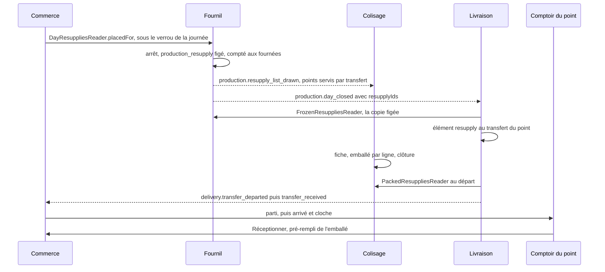

# Le soir pour demain — du plan figé à la vitrine

> **Doc d'état**, ouverte dans le code le 2026-11-02. Entrée du dossier :
> [`README.md`](README.md). Le chemin « au plus tôt », qui emprunte les
> mêmes mécanismes en cours de journée, est dans
> [`au-plus-tot.md`](au-plus-tot.md).

Décision de Hugo du 2026-10-21 : la commande du soir pour demain **entre
dans le plan figé** du lendemain, mais **distinguée** — jamais mêlée aux
commandes client, sans `fulfillmentMethod` ni clientèle.

## 1. Le plan figé — fournil

- **L'arrêt** lit les « pour demain » envoyés et non annulés **sous le verrou
  de la journée** (`DayResuppliesReader.placedFor`,
  `apps/lfd-api/src/production/channels/commerce/day-resupplies.reader.ts:54`,
  implémenté par `ProductionDayResupplies`,
  `b2b/resupply/application/production-day-resupplies.ts:25`) et les fige
  dans `production.production_resupply` + `_line` (clé (journée, réassort),
  aucune clé étrangère vers `public`) — avec le point, le nom, l'unité et
  `served_by_transfer`. Le « au plus tôt » n'y entre pas.
- **L'arrêt automatique** a lieu à la plus tardive de l'heure limite client
  et de l'heure du réassort (`production/domain/services/latest-order-cutoff.ts`).
  Le refus d'un arrêt anticipé nomme celle qui le fixe. Sans heure limite
  client, l'heure du réassort seule n'arrête pas le plan.
- **L'envoi et l'annulation d'un « pour demain »** passent par le même
  guichet, sous le même verrou (`ResupplyPlanGate`) : ce qui part avant
  l'arrêt est figé, ce qui arrive après est refusé, et un réassort figé ne
  s'annule plus.
- **Une journée** à réassorts seuls n'est pas vide : elle s'arrête, se tire et
  s'imprime ; « Arrêter le plan » la propose (`resupplyUnits > 0`).
- **Les fournées** se cochent sur le **total** commandes + réassorts
  (décision B, 2026-10-21). Le retirage n'absorbe aucun réassort : aucun ne
  peut arriver après l'arrêt.
- **La réouverture** est symétrique des commandes : les réassorts du soir
  sont dégelés, leurs fiches retirées, les faits suivants portent
  `:after-reopening:<instant>`, l'annulation redevient permise.
- **Le fait** `production.day_closed` porte `resupplyIds` ; le compte de
  commandes du journal ne change pas.

## 2. Prod manager et le dossier du jour

Prod manager est un espace à onglets (`apps/lfd-backoffice-frontend/src/app/production/prod-manager/`) :
`/prod-manager/previsionnel` (`production_plan:read`) et
`/prod-manager/reassorts` (`production_resupply:read`) ;
`/reassorts-a-produire` y redirige.

- **L'onglet Réassorts** (`production/reassorts-a-produire/resupply-production-tab/`) :
  une ligne par produit, une colonne par point (« pour demain · envoyé » ou
  « · figé », « au plus tôt »), ruptures et stocks faibles des points en
  marque, total par produit ; la journée dans l'URL (`?day=`, demain par
  défaut). Servi par `GET admin/site-resupplies/to-produce/:day`
  (`ResupplyProductionDayView`, avec `planStopped`) — lu au commerce, la liste
  envoyée d'une journée arrêtée étant la liste figée. Les cartes « Au plus
  tôt » et « À monter » y vivent aussi.
- **Le prévisionnel** compte à part les réassorts pour demain : envoyés pour
  une journée ouverte (`ExpectedResuppliesReader`, implémenté par
  `ProductionRangeResupplies`), figés pour une journée close (déjà dans le
  compte, on en tire la part). Contrat : `resupplyUnits`,
  `resupplyQuantities` ; « dont N réassort » à l'écran ; `orderCount`
  inchangé.
- **Le dossier du jour** (écran et PDF) : les fiches de poste par rayon
  comptent **commandes + réassorts**, le total d'abord (« 42 — dont 18
  réassort », Hugo, 2026-10-21 : « comprendre le volume global par
  produit ») ; **un bon de réassort par réassort** suit les bons de commande
  — le point, le nom, « Par transfert » / « Servi sur place », les lignes
  (« 1,25 kg » pour un article au poids), la case « Fait », sans prix ni QR,
  la teinte du réassort du site devant le titre
  (`pickup_addresses.resupply_color`). Route
  `GET admin/production/batch/:date/resupplies` (`GetDayResuppliesQuery`) :
  la copie figée d'une journée arrêtée, l'envoyé d'une journée ouverte (« envoyés »
  à l'écran ; le PDF reste refusé tant que le plan n'est pas arrêté). À
  l'écran : `production/previsionnel/dossier-du-jour/bon-reassort/`. L'e-mail
  du dossier compte les réassorts comme l'en-tête du PDF
  (`dossierCountsOf(day.orders, day.resupplies)`,
  `production/application/services/dossier-dispatch.service.ts:211`).

## 3. Le colisage — seulement les points servis par transfert

Décision de Hugo du 2026-10-21 (Q1 révisée : « coliser, c'est coliser pour
aller à la pièce du dessus ») : **seul un point servi par transfert**
(`supply = transfer`, le Village) passe au colisage. Le filtre est au
fournil, figé à l'arrêt (`served_by_transfer`) ; le fait
`production.resupply_list_drawn` n'est publié que pour ceux-là.

- **La fiche** « <nom> — Réassort <point> » (`PackingResupply`,
  `apps/lfd-api/src/packing/domain/entities/packing-resupply.ts:76`), à part
  de `PackingOrder`, ouverte par `OnResupplyListDrawn`
  (`packing/application/handlers/on-resupply-list-drawn.handler.ts:29`). On
  saisit l'emballé par ligne (0 ≤ emballé ≤ demandé ; en grammes pour un
  article au poids), **pris dans la réserve** du colisage : refusé si le four
  n'a pas remis les pièces. La clôture exige toutes les lignes saisies (0
  explicite). Aucun fait à la clôture.
- **Routes** `GET|PUT|POST admin/packing/:date/resupplies…`
  (`packing/http/packing-resupplies.controller.ts:32`), `production_packing`.
  Écran : bouton « Fiches de réassort » de la bande du poste
  (`production/colisage/packing-resupplies/`), d'office sous « Aucune
  commande » pour une journée à réassorts seuls.
- **La part sur place ne descend pas** : une fournée ne remet au colisage que
  la part du colisage ; celle d'un réassort servi sur place monte directement
  (`production/domain/services/on-site-share.ts:37` — le colisage d'abord,
  puis le point sur place, puis le surplus au colisage). Une demande de
  retour ne porte que ce qui a été remis.
- **L'emballé** se lit par `PackedResuppliesReader`
  (`packing/channels/commerce/packed-resupplies.reader.ts:28`, déclaré et
  implémenté par le colisage) : `null` tant que la fiche n'est pas close.
  D'où la case `b2b → packing : port uniquement` de la matrice des blocs.

## 4. Le transfert du Village

- **L'attache** : à `production.day_closed`, `LearnArrestedPlan` appelle
  `TransferAttachment.attachResupplies`
  (`delivery/application/transfer-attachment.ts:62`), qui range chaque
  réassort figé d'un point servi par transfert dans le transfert prévu du
  point, ouvert au besoin — un point sans commande ce jour-là reçoit le sien.
  La liste vient des `resupplyIds` **du fait**, les lignes de la copie figée
  (`FrozenResuppliesReader`, `production/channels/delivery/frozen-resupplies.reader.ts:49`),
  jamais du commerce vivant. Le Labo n'a aucun transfert.
- **Le contenu** : manifeste, « Ma tournée » et papier de tournée disent
  « Réassorts », lisent l'emballé d'une fiche close (le même lecteur,
  réexporté par `packing/channels/delivery/`), sinon le demandé ; une ligne
  emballée à zéro ne part pas ; figé au départ comme les commandes. Le nom
  d'un réassort se lit dans la copie figée du fournil — aucune colonne au
  schéma `delivery`.
- **Les bacs** sont ceux du transfert (`delivery_bin.transfer_id`) : un
  réassort n'a pas de contenant au colisage, il part dans les bacs du
  transfert.
- **La réouverture** détache les réassorts du transfert encore prévu ; le
  transfert (et son arrêt, s'il était placé) reste, même vide.
- **Le tableau des tournées** dit « N commandes · M réassorts », ou
  « M réassorts » seul (`DeliveryRoundTransferStopView.resupplyCount`).
- **Au comptoir**, un transfert qui ne porte que des réassorts apparaît dans la
  file (`HandoverQueueView.resupplyTransfers`, port `ResupplyTransfersReader`)
  et se réceptionne par lui-même :
  `POST admin/handover/transfers/:transferId/reception` — même règle, même
  journal, même fait que la réception par commande.

## 5. Parti, arrivé — un seul signal, deux chemins

« Ça ne peut pas être le même signal que dans le cas colisage → Village ? »
(Hugo, 2026-10-21) — si.

| Point                         | Ce qui le dit arrivé                                            | Qui          |
| ----------------------------- | --------------------------------------------------------------- | ------------ |
| servi par transfert (Village) | la réception du transfert (« Remis au site », « Réceptionner ») | la livraison |
| servi sur place (Labo)        | « Monté », carte « À monter » de l'onglet Réassorts             | le fournil   |

- **Parti** : `departAndFreeze` écrit `delivery.transfer_departed`
  (`delivery/channels/commerce/transfer-departed.fact.ts`) pour chaque
  transfert qui part vraiment ; `RecordDepartureOnTransferDeparted` pose
  `site_resupply.departed_at` / `departed_by_name` (le livreur, lu à
  l'annuaire et figé). Affichage seulement.
- **Arrivé** : les deux chemins de la réception d'un transfert écrivent
  `delivery.transfer_received` ; `MarkArrivedOnTransferReceived` appelle
  `SiteResupply.markArrived` (`b2b/resupply/domain/site-resupply.ts:220`, règle dans `site-resupply-progress.ts`) à
  l'instant et sous l'auteur de la réception. Au Labo, « Monté » :
  `POST admin/bakehouse-resupplies/sites/:siteId/:resupplyId/mounted`
  (`production_resupply:write`). Déjà arrivé ou déjà réceptionné : rien ne
  change, rien ne sonne ; demande en cours ou annulé : 409
  (`resupply.order.not_arrivable`). La carte « À monter » ne liste que les
  points servis sur place (`transferSiteIds`) ; le serveur, lui, ne refuse
  pas « Monté » à un point servi par transfert.
- **La cloche** « Réassort arrivé — à réceptionner »
  (`b2b/resupply/application/resupply-arrived-bell.ts`) sonne pour tout
  `handover_counter:read`, le point dans le titre, une clé par réassort,
  lien `/comptoir/reassort`.
- **Réceptionner n'attend jamais le signal** : le comptoir fait foi.
