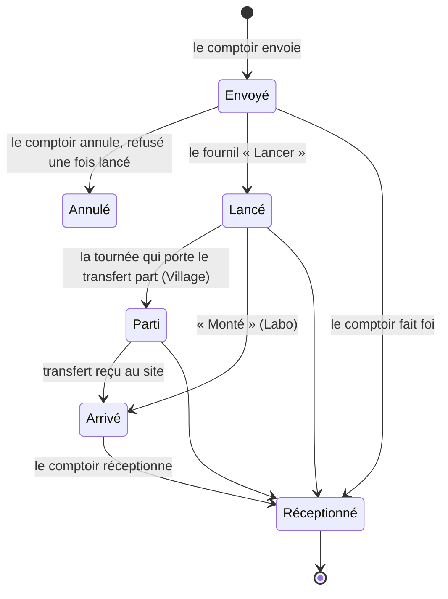
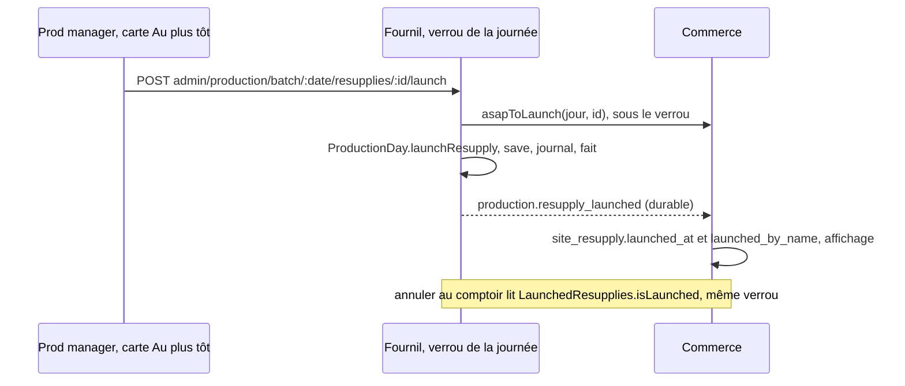
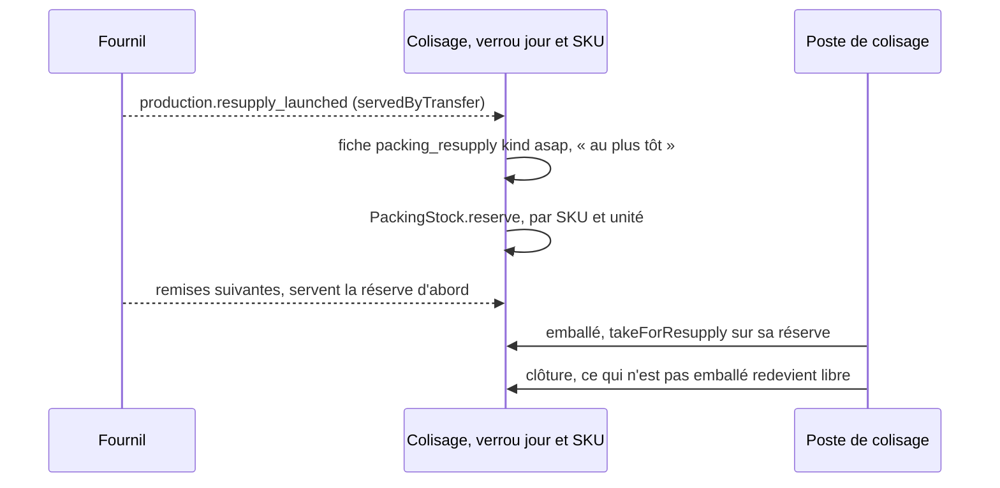
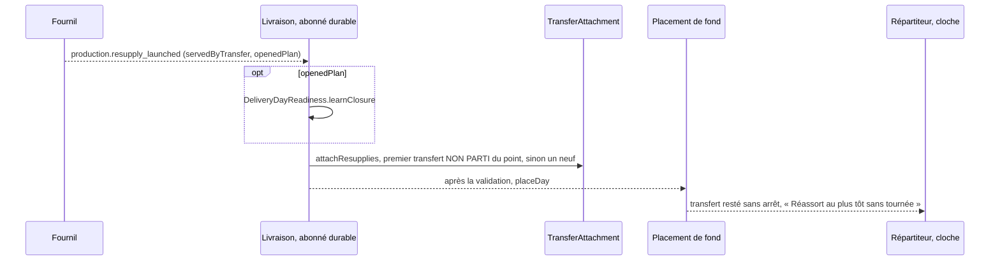

# « Au plus tôt » — le réassort du jour même

> **Doc d'état**, ouverte dans le code le 2026-11-02. Entrée du dossier :
> [`README.md`](README.md). Le chemin du soir, dont celui-ci emprunte les
> mécanismes, est dans [`au-plan-du-fournil.md`](au-plan-du-fournil.md).

Le comptoir envoie un réassort « au plus tôt » quand la vitrine se vide ; il
n'entre dans aucun circuit tant que le **fournil ne l'a pas lancé**. Lancé,
il suit le même chemin que celui du soir, ouvert en cours de journée.

Décisions de Hugo du 2026-10-22 (« donc tu peux lancer R4 ») : le **fournil**
lance, jamais automatiquement ; **pas de seuil** — un lancé rejoint le premier
transfert non parti du point, ou en ouvre un ; au Labo, **« Lancer » puis
« Monté »** ; « Lancer » sur une journée jamais arrêtée **l'ouvre arrêtée** ;
le dossier du jour **n'est pas renvoyé** à chaque lancement ; le colisage
**réserve** les pièces d'un lancé.

## 1. Les états

« Emballé » n'est pas un état du réassort : c'est l'état de sa fiche au
colisage, qui ne bloque rien. Aucun refus ne lit « parti ».

## 2. « Lancer » — fournil

- **L'agrégat** : `ProductionDay.launchResupply`
  (`apps/lfd-api/src/production/domain/entities/production-day.ts:389`,
  règles dans `production-day.launch.ts`) — un geste à part du retirage, qui
  n'absorbe que des commandes. Le lancé est rangé à part des réassorts du
  soir (`launchedResupplies`, `production_resupply.kind = asap`, CHECK « asap
  ⇔ lancé »), ajouté au compte des fournées. Refus : déjà lancé
  (`production.resupply.already_launched`), introuvable
  (`production.resupply.to_launch_not_found`). La réouverture le **garde**,
  le ré-arrêt le recompte ; un « au plus tôt » du Labo lancé compte dans la
  part sur place d'une fournée.
- **La journée jamais arrêtée** s'ouvre arrêtée, signée de qui lance, avec ce
  seul réassort (journal `production_day.resupply_launched`,
  `openedPlan: true`) — sauf s'il restait des commandes ou des réassorts du
  soir à figer : 409 « arrêtez d'abord le plan du jour »
  (`production.resupply.launch_on_unarrested_plan`). Ni
  `production.day_closed`, ni dossier.
- **Le refus d'annuler est synchrone** : `LaunchedResupplies.isLaunched`
  (`production/channels/commerce/launched-resupplies.ts:23`, déclaré et
  implémenté par le fournil) est lu par `ResupplyPlanGate.launched` sous le
  même verrou que le lancement ; l'un des deux gagne
  (`resupply.order.launched`, 409). La colonne `launched_at` du commerce
  n'est qu'un affichage, posée par le fait
  (`RecordLaunchOnResupplyLaunched`).
- **Le fait** `production.resupply_launched:<jour>:<resupplyId>` (+
  `:after-reopening:<instant>`) porte lignes, unité, point,
  `servedByTransfer`, nom, instant, auteur et `openedPlan`.
- **L'écran** : carte « Au plus tôt » de l'onglet Réassorts
  (`apps/lfd-backoffice-frontend/src/app/production/reassorts-a-produire/resupply-launch-card/`),
  « Lancer » sous `production_resupply:write`, puis « Lancé par X à HH:MM »,
  « Parti », « Arrivé ».

## 3. La réserve du colisage

- **L'abonné** `OnResupplyLaunched`
  (`packing/application/handlers/on-resupply-launched.handler.ts:40`) : rien
  pour un point servi sur place. Rejeu sans effet.
- **La réserve** (`PackingStock.reserve`, `packing/domain/entities/packing-stock.ts:136` ;
  règle pure dans `packing/domain/services/stock-reservations.ts`) : le reste
  dû d'une réservation = sa quantité − l'emballé de sa ligne, déduit. Le
  libre des commandes = reçu − rendu − au bac − réservé dû. Les réservations
  se servent **dans l'ordre du lancement** ; une réservation ne prend jamais
  une pièce déjà au bac — si le four n'a pas remis assez, la fiche est « en
  attente du four ». La clôture la lève (`released_at`). Table
  `packing.packing_stock_reservation`, aucune colonne ne nomme une personne.
- **Le poste** : `GET admin/packing/:date/resupplies` porte `kind` et
  `awaitingOven` ; les « au plus tôt » en tête, dans l'ordre du lancement.
  La fiche d'un lancé n'est jamais retirée par une réouverture.

## 4. Le transport

- **L'abonné** `AttachLaunchedResupply`
  (`delivery/application/handlers/attach-launched-resupply.handler.ts:47`) —
  les mécanismes du soir, sans réinvention. Une journée ouverte par un
  lancement pose l'arrêt côté livraison (`delivery_day_readiness.closed_at`),
  sans livraison à annoncer.
- **Le placement** `AsapTransferDispatch`
  (`delivery/application/asap-transfer-dispatch.ts:33`) : `TransferPlacer.placeDay`
  — tournée intégrée, sinon dédiée sur un véhicule libre — puis, si le
  transfert est resté sans arrêt, `AsapTransferUnplacedBell` sonne sous
  `delivery_rounds:write` (une clé par réassort).
- **Un transfert chargé mais pas parti** reçoit le réassort ; la vue du
  chargement porte `resuppliesAfterLoading` et la carte des bacs
  (`livraison/transfer-bins-card/`) dit « déclarez et chargez un bac de plus
  avant « Partir » ». Un transfert parti ne reçoit plus rien.
- **« Monté »** sur un « au plus tôt » non lancé est refusé
  (`resupply.order.not_launched`, 409), sous le verrou de la journée ; la
  carte « À monter » dit « À lancer d'abord ».

## 5. Le suivi

`SiteResupply.recordLaunch` et `recordDeparture`
(`b2b/resupply/domain/site-resupply.ts:247`, `:273`) posent l'affichage ;
rejoués, ils ne changent rien. Le comptoir (`resupply-receptions-card`,
`shared/resupply-steps.ts`) montre Envoyé → Lancé → Parti → Arrivé, chacun
avec son heure et son auteur ; l'onglet Stock de la Supervision dit « Lancé »
et « Parti ». E2e : `resupply-launch`, `resupply-asap-packing`,
`resupply-asap-transfer`, `resupply-asap-village-flow`.
