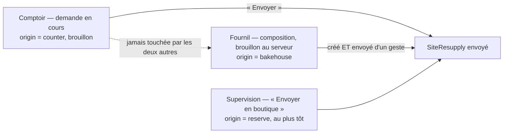
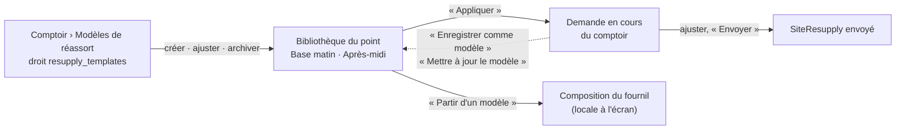

# Commander un réassort — le comptoir, le fournil, la réserve

> **Doc d'état**, ouverte dans le code le 2026-11-02. Entrée du dossier :
> [`README.md`](README.md). Ce qui n'est pas bâti :
> [`reste-a-faire.md`](reste-a-faire.md).

Trois chemins font naître un `SiteResupply` envoyé ; ils ne se touchent
jamais.

## 1. L'agrégat `SiteResupply`

`apps/lfd-api/src/lafoliecoffee/resupply/domain/site-resupply.ts:71` — un point, une
visée (`tomorrow` | `asap`), une **journée déduite** de l'instant du geste à
l'heure de Paris (demain ou aujourd'hui), jamais saisie ; des lignes (SKU,
libellé figé du catalogue publié, **unité** `piece` | `weight`, quantité
entière > 0 — des grammes pour un article au poids), un nom facultatif, une
origine, l'auteur et l'instant de chaque geste. Aucun champ monétaire.

| Méthode                       | Ligne    | Règle                                                                                                                                  |
| ----------------------------- | -------- | -------------------------------------------------------------------------------------------------------------------------------------- |
| `draft`                       | 90       | la demande en cours du comptoir                                                                                                        |
| `sentByBakehouse`             | 98       | créé et envoyé d'un geste, jamais de brouillon ; un article donné deux fois s'additionne                                               |
| `sentFromReserve`             | 116      | « au plus tôt », ne se lance ni ne s'annule ; une autre journée que celle du geste refusée (`resupply.order.reserve_not_today`)        |
| `rename`                      | 174      | la demande en cours seulement ; envoyée, elle ne se renomme plus                                                                       |
| `addLine`                     | 240      | un article déjà présent voit sa quantité **s'additionner** ; deux unités pour un même article refusées (`resupply.sale_unit.mismatch`) |
| `correctLine`, `withdrawLine` | 246, 252 | entier ≥ 1 ; la demande peut rester vide                                                                                               |
| `assertSeen`                  | 258      | verrou de version : `resupply.order.changed_meanwhile` (409)                                                                           |
| `isPlacementOf`               | 265      | le double clic sur « Envoyer » (D5) : envoyé en `version + 1`, il est parti tel que le poste l'a vu                                    |
| `place`                       | 270      | vide refusé (400) ; « pour demain » refusé après l'heure du réassort ou sur un plan arrêté ; journée passée refusée                    |
| `assertReceivable`            | 278      | réceptionner : une commande envoyée seulement (un sans-commande n'a rien à réceptionner)                                               |
| `cancel`                      | 283      | une fois, jamais une suppression ; refus ci-dessous                                                                                    |

Lignes relues le 2026-11-03, après l'audit final du réassort. Depuis ce
jour : `addLine` refuse le 201ᵉ article (`resupply.order.too_many_lines`,
borne `SITE_RESUPPLY_MAX_LINES` = 200, celle du brouillon du fournil) ;
`place`, `cancel` et `markMounted` reçoivent ce que l'appelant a lu sous
verrou en objet NOMMÉ (`PlacementCheck`, `CancellationCheck`, `MountCheck`,
`apps/lfd-api/src/lafoliecoffee/resupply/domain/site-resupply-checks.ts`), plus en booléens positionnels ; `restore`
(l. 134) refuse un brouillon qui porterait une annulation, une arrivée, un
lancement ou un départ (`resupply.order.impossible_state`, 500).

`resupplyNameOf` (`domain/resupply-name.ts:13`) : rogné, blancs intérieurs
ramenés à un espace, vide → `null`, plus de 60 caractères refusé (400),
jamais tronqué. Les noms déjà employés au point (port `ResupplyUsedNames` :
distincts, les plus récents d'abord, 20 au plus) sont proposés à la saisie.

**Annuler** est refusé quand le réassort est déjà réceptionné
(`resupply.order.already_received`, « déjà réceptionné par X à HH:MM »),
figé dans un plan arrêté (`resupply.order.frozen_in_plan` — « réceptionnez
avec un écart »), lancé au fournil (`resupply.order.launched`) ou sorti de la
réserve (`resupply.order.reserve_not_cancellable`). L'annulation lit l'état
du plan et le lancement par `ResupplyPlanGate`
(`application/resupply-plan-gate.ts:27`), sous le verrou de la journée du
fournil, et la réception par le port `ResupplyReceptions`.

## 2. L'heure du réassort

Un « pour demain » se commande jusqu'à **l'heure du réassort**, « la veille,
HH:MM » (`order_cutoff_settings.resupply_cutoff_time`, **20:00** par défaut,
décidé par Hugo le 2026-10-21 ; borne incluse), réglée sur la carte
`reglages/commandes/resupply-cutoff-card/` du back-office. Lue par le port
`ResupplyCutoff` (`infrastructure/settings-resupply-cutoff.ts:17`). « Au plus
tôt » n'a jamais d'heure limite.

Le plan du fournil s'arrête à la **plus tardive** de l'heure limite client et
de l'heure du réassort : un seul compte total, un dossier, une liste à
coliser, un transfert ([`au-plan-du-fournil.md`](au-plan-du-fournil.md)).
Après l'arrêt, un « pour demain » est refusé (`resupply.order.plan_stopped`
au comptoir, `resupply.order.bakehouse_after_stop` au fournil) ; il n'y a
pas d'ajout tardif.

L'ancien interrupteur `resupply_subject_to_cutoff` est retiré de la base
sur ordre de Hugo du 2026-11-02 (migration
`20261102250000_le_reassort_sans_interrupteur`) ; les faits passés du
journal gardent leur `resupplySubjectToCutoff`.

## 3. Le comptoir — la demande en cours

La demande en cours est l'état `draft` de `SiteResupply`, **persistée et
partagée** entre tous les postes : une seule par (point, visée, journée),
index unique partiel `site_resupply_open_draft_key … WHERE placed_at IS NULL`.
Deux postes qui l'ouvrent au même instant : le second est refusé
(`resupply.order.draft_opened_meanwhile`, 409) et refait son geste.
Corriger, retirer et envoyer portent la version vue ; ajouter n'en porte pas
(deux ajouts se cumulent, jamais ne s'écrasent). L'envoi lit la clé de la
journée, prend son verrou, PUIS charge la demande (comme l'annulation,
2026-11-02). Un second « Envoyer » portant la MÊME version que l'envoi qui a
réussi — le double clic — rend 204 sans rien écrire (D5) ; une version plus
ancienne reste refusée en 409.

Une demande restée sans envoi garde sa journée ; le matin de cette journée,
elle part encore si l'heure le permet ; la journée passée, elle quitte
l'écran et son envoi est refusé (`resupply.order.day_passed`). Elle reste en
base.

**Routes** — `admin/site-resupplies/sites` (`http/admin-site-resupplies.controller.ts`),
`handover_counter` :

| Route                                          | Geste                                                                                                                                       |
| ---------------------------------------------- | ------------------------------------------------------------------------------------------------------------------------------------------- |
| `GET :siteId`                                  | réassorts envoyés d'aujourd'hui et demain, demandes en cours, jusqu'à quand « pour demain » passe, noms employés                            |
| `POST :siteId/drafts/:target/lines`            | ajouter                                                                                                                                     |
| `PUT :siteId/drafts/:target/name`              | nommer (ouvre la demande au besoin ; sans version, le dernier nom l'emporte — reposé sur la demande relue si un ajout l'a croisé, 3 essais) |
| `PATCH :siteId/:resupplyId/lines/:sku`         | corriger                                                                                                                                    |
| `POST :siteId/:resupplyId/lines/:sku/withdraw` | retirer                                                                                                                                     |
| `POST :siteId/:resupplyId/send`                | envoyer                                                                                                                                     |
| `POST :siteId/:resupplyId/cancel`              | annuler                                                                                                                                     |

**L'écran** — Comptoir › Réassort (`/comptoir/reassort`,
`apps/lfd-backoffice-frontend/src/app/comptoir/reassort-boutique-page/`),
pour le point et la journée de la bande, « pense comptoir, un clic » (Hugo,
2026-10-21) :

- en tête, seulement s'il y en a, les réassorts à réceptionner
  ([`reception-et-stock.md`](reception-et-stock.md)) ;
- puis **une table de tous les produits publiés** (`resupply-stock-table/`,
  `fold-data-table`) : stock du jour, état OK · Faible · Rupture en un clic,
  et **une seule colonne de quantité** pour la visée choisie au sélecteur
  « Au plus tôt · Pour demain » — « Pour demain » tant que l'heure du réassort
  n'est pas passée, « Au plus tôt » ensuite ; l'autre visée se signale sur le
  sélecteur si elle porte des quantités. Pas rapides +1/+5/+10 (en pièces
  comme au poids), un dialogue de quantité en mobile ;
- des puces de famille (`categoryId`, `categoryName` de
  `admin/resupply-receipts/articles`) et une recherche au-dessus ;
- le nom de la demande (`shared/resupply-name-field/`) et un seul
  « Envoyer » pour la visée affichée ;
- déclarer une rupture bascule en « Au plus tôt » et propose d'ajouter
  l'article à la demande (`asap-draft-adder/`) ;
- la page relit après chaque geste, toutes les 15 s onglet visible, et au
  retour sur l'onglet. L'état est partagé par `SiteResuppliesStore`.

Le fournil ne voit jamais une demande non envoyée.

## 4. Le fournil — « Créer un réassort », et ses brouillons

« Je t'envoie ça » (Hugo, 2026-10-21) : quand un point appelle, le fournil
entre la demande lui-même, **à part** de celle du comptoir, qu'il ne touche
jamais. Le réassort naît `origin = bakehouse`, créé et envoyé d'un geste
(CHECK `site_resupply_bakehouse_placed`), avec les règles du comptoir. Le
chemin d'envoi est un seul, partagé par l'envoi direct et l'envoi d'un
brouillon : `prepareBakehouseResupply` / `writeBakehouseResupply`
(`application/bakehouse-resupply-sending.ts:51`, `:72`).

**Les brouillons** (Hugo, 2026-10-28 : « un enregistrer comme brouillon »,
retrouvé depuis n'importe quel poste) vivent dans leur propre table,
`public.bakehouse_resupply_drafts`, pas dans `site_resupply` : le CHECK
interdit qu'un réassort du fournil y soit brouillon, l'index partiel est
celui du comptoir, et un `SiteResupply` porte une journée qu'un brouillon
repris trois jours plus tard aurait périmée. Agrégat
`BakehouseResupplyDraft` (`domain/bakehouse-resupply-draft.ts:63`) : point,
visée, nom, lignes en `jsonb` (au moins une, 200 au plus, un SKU deux fois
refusé), **aucune journée** (calculée à l'envoi), version, statut
`open → sent | discarded` dans ce sens seulement, `sent_resupply_id` non nul
si et seulement si `sent`. Pas de suppression : « Supprimer » le passe
`discarded`. Un article retiré du catalogue est refusé à l'envoi, jamais à
l'enregistrement ; un article dont l'unité a changé aussi
(`resupply.sale_unit.changed`). Envoyer un brouillon reçoit le contenu
entier de l'écran et la version lue ; un refus laisse le brouillon `open`.
**Un second « Envoyer » sur la version déjà envoyée rend l'identifiant du
réassort créé** (201, rien d'écrit — décision E2 du 2026-11-03,
`BakehouseResupplyDraft.sentAfter`) ; deux clics qui se croisent : le second
bute sur la version, et le brouillon relu donne le réassort du premier.
**Un brouillon ne change pas de point** (D3, 2026-11-02) : son point est figé
à l'ouverture, et l'enregistrer ou l'envoyer vers un autre est refusé
(`resupply.bakehouse_draft.site_frozen`, 409) ; la carte grise le choix du
point dès qu'un brouillon est en main. Les écritures ne vont pas au journal, comme l'envoi qu'elles empruntent.

**Routes** — `admin/bakehouse-resupplies`
(`http/admin-bakehouse-resupplies.controller.ts:44`), `production_resupply` :
`GET articles`, `GET sites/:siteId/names`, `POST sites/:siteId`
(`{ key, target, name, lines }` → `{ id }`), `POST sites/:siteId/:resupplyId/mounted`
(« Monté », [`au-plan-du-fournil.md`](au-plan-du-fournil.md)),
`GET|POST drafts` (création : `{ key, siteId, target, name, lines }`),
`PUT drafts/:draftId`, `POST drafts/:draftId/discard`,
`POST drafts/:draftId/send`. Les points proposés se lisent sur
`GET /admin/pickup-addresses`, ouvert à `production_resupply:read`.

**Une clé, un envoi** (audit du 2026-11-02, C-A et C-C) : l'écran tire une
clé par composition (`BakehouseDraftsStore`), la garde à travers un refus et
la renouvelle dès que la composition change de main. L'envoi sans brouillon
et la première création d'un brouillon en font leur identifiant : deux clics,
ou un renvoi après une réponse perdue, rendent le même réassort ou le même
brouillon. Une clé déjà prise par un autre point, ou par un autre geste, est
refusée en 409 (`resupply.sending_key.taken`,
`resupply.bakehouse_draft.key_taken`) — jamais rendue. La clé se relit
AVANT le point et le catalogue (2026-11-03) : un rejeu après le retrait d'un
article rend la clé au lieu d'un 404
(`apps/lfd-api/src/lafoliecoffee/resupply/application/resupply-sending-key.ts`, partagé
avec la réserve). La journée,
puis l'heure du réassort, s'établissent sous le verrou de la journée, à
l'écriture.

**Les écrans** — Prod manager › Réassorts (`/prod-manager/reassorts`) liste
les réassorts demandés, les brouillons ouverts au-dessus (« Reprendre »,
« Supprimer ») et un bouton « Créer un réassort » (`8065d7c9c`, 2026-10-28).
La composition a sa page : `/prod-manager/reassorts/nouveau`, ou
`/prod-manager/reassorts/brouillon/:draftId` pour reprendre un brouillon
(`production/reassorts-a-produire/bakehouse-resupply-page/`,
`bakehouse-resupply-card/`) — une table par famille, « Enregistrer comme
brouillon » en bouton secondaire, « Envoyer » qui ramène à la liste.

## 5. La réserve — « Envoyer en boutique »

Le pain rendu à la réserve du colisage par une annulation part en boutique
depuis la Supervision (`POST admin/reserve-shop-releases/:serviceDay`,
`production_resupply:write`). Il naît envoyé « au plus tôt »
(CHECK `site_resupply_reserve_placed_asap`), ne se lance jamais et ne
s'annule pas ; `isProducedByBakehouse` (`domain/resupply-origin.ts:20`)
l'écarte des réassorts à produire et de l'onglet de Prod manager. Le comptoir
le réceptionne comme les autres, marqué « Pain rendu, envoyé par la
réserve ». Seule la réserve du jour sort. La clé du panneau est
l'identifiant du réassort ; prise par un autre point, elle est refusée en
409 (C-B, 2026-11-02), plus jamais avalée. Détail :
[`../commandes/annulation/plan-a1-4-envoyer-en-boutique.md`](../commandes/annulation/plan-a1-4-envoyer-en-boutique.md).

## 6. Les modèles de réassort — des raccourcis par point

Demandé par le responsable des comptoirs, décidé par Hugo le 2026-11-19 :
une **bibliothèque de modèles** par point (« Base matin », « Réassort
après-midi »), qu'on applique à une demande, qu'on ajuste, et qu'on affine
quand l'habitude change. Un modèle est un **raccourci de saisie jetable** :
ce qui compte est le réassort envoyé, qui ne sait pas de quel modèle il est
parti, et le modèle ne garde aucun historique.

**Les décisions**, que le code cite par leur numéro :

| #   | Règle                                                                                                                                                                       |
| --- | --------------------------------------------------------------------------------------------------------------------------------------------------------------------------- |
| M1  | Un modèle appartient à **un point** et n'en change jamais.                                                                                                                  |
| M2  | Créer, ajuster, archiver demandent **`resupply_templates`** (accordé à l'écran des rôles, jamais par migration).                                                            |
| M3  | Un modèle s'ajuste (nom, visée proposée, lignes) sous **verrou de version** : une version périmée est refusée (409), jamais écrasée.                                        |
| M4  | Lire la bibliothèque d'un point : `resupply_templates:read`, `handover_counter:read` ou `production_resupply:read`. Appliquer au comptoir : `handover_counter:write`.       |
| M5  | Sur une demande non vide, l'écran demande **Remplacer** ou **Ajouter** (les quantités s'additionnent) ; vide, il remplace.                                                  |
| M6  | Un article retiré du catalogue ou dont l'unité a changé est **écarté à l'application** et nommé ; le modèle n'est jamais corrigé en douce, la bibliothèque marque la ligne. |
| M7  | Pas de suppression : un modèle **s'archive**, et son nom redevient libre.                                                                                                   |
| M8  | **Aucun lien** du réassort vers son modèle, **aucune révision** du modèle.                                                                                                  |

**L'agrégat** `ResupplyTemplate` (`apps/lfd-api/src/lafoliecoffee/resupply/domain/resupply-template.ts`) :
point, nom obligatoire (normalisé par `resupplyNameOf`, unique sans égard à la
casse parmi les modèles actifs du point — index partiel
`resupply_templates_site_active_name_key`), visée proposée, lignes
`{ sku, quantity, saleUnit }`, version, trace de création, de dernière
modification et d'archivage. La règle des lignes (au moins une, 200 au plus,
un SKU une fois, quantité entière ≥ 1) est **commune** avec les brouillons du
fournil : `domain/resupply-line-list.ts`, chaque agrégat gardant ses erreurs.
Table `public.resupply_templates` (lignes en `jsonb`) ; codes d'erreur
`resupply.template.*`.

**Appliquer** (`application/apply-resupply-template.handler.ts`, fonctions
pures dans `resupply-template-applying.ts`) : une transaction scellée par la
clé d'intention (`runSealed`) — un rejeu rend la même réponse et n'additionne
pas deux fois en mode « ajouter ». Modèle inconnu ou d'un autre point : 404 ;
archivé : 409. On applique toujours à **la demande en cours** de la visée de
l'URL ; un réassort envoyé n'est jamais touché. `replace` retire les articles
absents du modèle puis corrige ou ajoute ; la demande prend le nom du modèle si
elle n'en a pas. La réponse nomme les lignes écartées.

**Routes** :

| Route                                                                    | Droit                      | Geste                                                       |
| ------------------------------------------------------------------------ | -------------------------- | ----------------------------------------------------------- |
| `GET admin/resupply-templates/sites/:siteId`                             | M4                         | les modèles actifs, lignes inapplicables marquées           |
| `POST admin/resupply-templates/sites/:siteId`                            | `resupply_templates:write` | créer `{ key, name, target, lines }`                        |
| `PUT admin/resupply-templates/:templateId`                               | `resupply_templates:write` | ajuster (contenu entier + version lue)                      |
| `POST admin/resupply-templates/:templateId/archive`                      | `resupply_templates:write` | archiver                                                    |
| `POST admin/site-resupplies/sites/:siteId/drafts/:target/apply-template` | `handover_counter:write`   | appliquer `{ templateId, mode }`, en-tête `Idempotency-Key` |

Ajuster et archiver ne revérifient pas le point (comme les brouillons du
fournil) : le droit suffit. La liste des points et celle des articles
s'ouvrent aussi à `resupply_templates:read`.

**Les écrans** :

- **Comptoir › Modèles de réassort** (`/comptoir/modeles-reassort`,
  `apps/lfd-backoffice-frontend/src/app/comptoir/resupply-templates/`) : choix
  du point, la bibliothèque, une composition par famille (briques de la carte
  du fournil) pour créer ou ajuster, les lignes qui ne s'appliquent plus à
  retirer, « Archiver ».
- **Comptoir › Réassort** : un menu « Modèles » (`resupply-templates-menu/`)
  applique à la visée affichée, avec le dialogue Remplacer · Ajouter. Avec
  `resupply_templates:write` : « Enregistrer comme modèle » et, après une
  application, « Mettre à jour « X » » avec l'écart calculé à l'écran
  (`resupply-template-drift.ts` : « +2 Croissant, −1 Tradition, 1 article
  ajouté »). Le modèle appliqué n'est gardé qu'en mémoire de l'écran.
- **Prod manager › Réassorts › Créer un réassort** : « Partir d'un modèle »
  remplit la composition locale, sans appel au serveur, et pose la visée et
  le nom du modèle.
