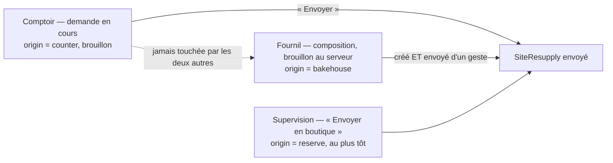

# Commander un réassort — le comptoir, le fournil, la réserve

> **Doc d'état**, ouverte dans le code le 2026-11-02. Entrée du dossier :
> [`README.md`](README.md). Ce qui n'est pas bâti :
> [`reste-a-faire.md`](reste-a-faire.md).

Trois chemins font naître un `SiteResupply` envoyé ; ils ne se touchent
jamais.

## 1. L'agrégat `SiteResupply`

`apps/lfd-api/src/b2b/resupply/domain/site-resupply.ts:68` — un point, une
visée (`tomorrow` | `asap`), une **journée déduite** de l'instant du geste à
l'heure de Paris (demain ou aujourd'hui), jamais saisie ; des lignes (SKU,
libellé figé du catalogue publié, **unité** `piece` | `weight`, quantité
entière > 0 — des grammes pour un article au poids), un nom facultatif, une
origine, l'auteur et l'instant de chaque geste. Aucun champ monétaire.

| Méthode                       | Ligne    | Règle                                                                                                                                  |
| ----------------------------- | -------- | -------------------------------------------------------------------------------------------------------------------------------------- |
| `draft`                       | 94       | la demande en cours du comptoir                                                                                                        |
| `sentByBakehouse`             | 109      | créé et envoyé d'un geste, jamais de brouillon ; un article donné deux fois s'additionne                                               |
| `sentFromReserve`             | 138      | « au plus tôt », ne se lance ni ne s'annule                                                                                            |
| `rename`                      | 205      | la demande en cours seulement ; envoyée, elle ne se renomme plus                                                                       |
| `addLine`                     | 333      | un article déjà présent voit sa quantité **s'additionner** ; deux unités pour un même article refusées (`resupply.sale_unit.mismatch`) |
| `correctLine`, `withdrawLine` | 350, 360 | entier ≥ 1 ; la demande peut rester vide                                                                                               |
| `assertSeen`                  | 370      | verrou de version : `resupply.order.changed_meanwhile` (409)                                                                           |
| `place`                       | 386      | vide refusé (400) ; « pour demain » refusé après l'heure du réassort ou sur un plan arrêté ; journée passée refusée                    |
| `cancel`                      | 425      | une fois, jamais une suppression ; refus ci-dessous                                                                                    |

`resupplyNameOf` (`domain/resupply-name.ts:13`) : rogné, blancs intérieurs
ramenés à un espace, vide → `null`, plus de 60 caractères refusé (400),
jamais tronqué. Les noms déjà employés au point (port `ResupplyUsedNames` :
distincts, les plus récents d'abord, 20 au plus) sont proposés à la saisie.

**Annuler** est refusé quand le réassort est déjà réceptionné
(`resupply.order.already_received`, « déjà réceptionné par X à HH:MM »),
figé dans un plan arrêté (`resupply.order.frozen_in_plan` — « réceptionnez
avec un écart »), lancé au fournil (`resupply.order.launched`) ou sorti de la
réserve (`resupply.order.reserve_not_cancellable`). L'annulation lit l'état
du plan et le lancement par `ResupplyPlanGate`
(`application/resupply-plan-gate.ts:27`), sous le verrou de la journée du
fournil, et la réception par le port `ResupplyReceptions`.

## 2. L'heure du réassort

Un « pour demain » se commande jusqu'à **l'heure du réassort**, « la veille,
HH:MM » (`order_cutoff_settings.resupply_cutoff_time`, **20:00** par défaut,
décidé par Hugo le 2026-10-21 ; borne incluse), réglée sur la carte
`reglages/commandes/resupply-cutoff-card/` du back-office. Lue par le port
`ResupplyCutoff` (`infrastructure/settings-resupply-cutoff.ts:17`). « Au plus
tôt » n'a jamais d'heure limite.

Le plan du fournil s'arrête à la **plus tardive** de l'heure limite client et
de l'heure du réassort : un seul compte total, un dossier, une liste à
coliser, un transfert ([`au-plan-du-fournil.md`](au-plan-du-fournil.md)).
Après l'arrêt, un « pour demain » est refusé (`resupply.order.plan_stopped`
au comptoir, `resupply.order.bakehouse_after_stop` au fournil) ; il n'y a
pas d'ajout tardif.

L'ancien interrupteur `resupply_subject_to_cutoff` est retiré de la base
sur ordre de Hugo du 2026-11-02 (migration
`20261102250000_le_reassort_sans_interrupteur`) ; les faits passés du
journal gardent leur `resupplySubjectToCutoff`.

## 3. Le comptoir — la demande en cours

La demande en cours est l'état `draft` de `SiteResupply`, **persistée et
partagée** entre tous les postes : une seule par (point, visée, journée),
index unique partiel `site_resupply_open_draft_key … WHERE placed_at IS NULL`.
Deux postes qui l'ouvrent au même instant : le second est refusé
(`resupply.order.draft_opened_meanwhile`, 409) et refait son geste.
Corriger, retirer et envoyer portent la version vue ; ajouter n'en porte pas
(deux ajouts se cumulent, jamais ne s'écrasent).

Une demande restée sans envoi garde sa journée ; le matin de cette journée,
elle part encore si l'heure le permet ; la journée passée, elle quitte
l'écran et son envoi est refusé (`resupply.order.day_passed`). Elle reste en
base.

**Routes** — `admin/site-resupplies/sites` (`http/admin-site-resupplies.controller.ts`),
`handover_counter` :

| Route                                          | Geste                                                                                                            |
| ---------------------------------------------- | ---------------------------------------------------------------------------------------------------------------- |
| `GET :siteId`                                  | réassorts envoyés d'aujourd'hui et demain, demandes en cours, jusqu'à quand « pour demain » passe, noms employés |
| `POST :siteId/drafts/:target/lines`            | ajouter                                                                                                          |
| `PUT :siteId/drafts/:target/name`              | nommer (ouvre la demande au besoin ; sans version, le dernier nom l'emporte)                                     |
| `PATCH :siteId/:resupplyId/lines/:sku`         | corriger                                                                                                         |
| `POST :siteId/:resupplyId/lines/:sku/withdraw` | retirer                                                                                                          |
| `POST :siteId/:resupplyId/send`                | envoyer                                                                                                          |
| `POST :siteId/:resupplyId/cancel`              | annuler                                                                                                          |

**L'écran** — Comptoir › Réassort (`/comptoir/reassort`,
`apps/lfd-backoffice-frontend/src/app/comptoir/reassort-boutique-page/`),
pour le point et la journée de la bande, « pense comptoir, un clic » (Hugo,
2026-10-21) :

- en tête, seulement s'il y en a, les réassorts à réceptionner
  ([`reception-et-stock.md`](reception-et-stock.md)) ;
- puis **une table de tous les produits publiés** (`resupply-stock-table/`,
  `fold-data-table`) : stock du jour, état OK · Faible · Rupture en un clic,
  et **une seule colonne de quantité** pour la visée choisie au sélecteur
  « Au plus tôt · Pour demain » — « Pour demain » tant que l'heure du réassort
  n'est pas passée, « Au plus tôt » ensuite ; l'autre visée se signale sur le
  sélecteur si elle porte des quantités. Pas rapides +1/+5/+10 (en pièces
  comme au poids), un dialogue de quantité en mobile ;
- des puces de famille (`categoryId`, `categoryName` de
  `admin/resupply-receipts/articles`) et une recherche au-dessus ;
- le nom de la demande (`shared/resupply-name-field/`) et un seul
  « Envoyer » pour la visée affichée ;
- déclarer une rupture bascule en « Au plus tôt » et propose d'ajouter
  l'article à la demande (`asap-draft-adder/`) ;
- la page relit après chaque geste, toutes les 15 s onglet visible, et au
  retour sur l'onglet. L'état est partagé par `SiteResuppliesStore`.

Le fournil ne voit jamais une demande non envoyée.

## 4. Le fournil — « Créer un réassort », et ses brouillons

« Je t'envoie ça » (Hugo, 2026-10-21) : quand un point appelle, le fournil
entre la demande lui-même, **à part** de celle du comptoir, qu'il ne touche
jamais. Le réassort naît `origin = bakehouse`, créé et envoyé d'un geste
(CHECK `site_resupply_bakehouse_placed`), avec les règles du comptoir. Le
chemin d'envoi est un seul, partagé par l'envoi direct et l'envoi d'un
brouillon : `prepareBakehouseResupply` / `writeBakehouseResupply`
(`application/bakehouse-resupply-sending.ts:56`, `:74`).

**Les brouillons** (Hugo, 2026-10-28 : « un enregistrer comme brouillon »,
retrouvé depuis n'importe quel poste) vivent dans leur propre table,
`public.bakehouse_resupply_drafts`, pas dans `site_resupply` : le CHECK
interdit qu'un réassort du fournil y soit brouillon, l'index partiel est
celui du comptoir, et un `SiteResupply` porte une journée qu'un brouillon
repris trois jours plus tard aurait périmée. Agrégat
`BakehouseResupplyDraft` (`domain/bakehouse-resupply-draft.ts:60`) : point,
visée, nom, lignes en `jsonb` (au moins une, 200 au plus, un SKU deux fois
refusé), **aucune journée** (calculée à l'envoi), version, statut
`open → sent | discarded` dans ce sens seulement, `sent_resupply_id` non nul
si et seulement si `sent`. Pas de suppression : « Supprimer » le passe
`discarded`. Un article retiré du catalogue est refusé à l'envoi, jamais à
l'enregistrement ; un article dont l'unité a changé aussi
(`resupply.sale_unit.changed`). Envoyer un brouillon reçoit le contenu
entier de l'écran et la version lue ; un refus laisse le brouillon `open`.
Les écritures ne vont pas au journal, comme l'envoi qu'elles empruntent.

**Routes** — `admin/bakehouse-resupplies`
(`http/admin-bakehouse-resupplies.controller.ts:43`), `production_resupply` :
`GET articles`, `GET sites/:siteId/names`, `POST sites/:siteId`
(`{ key, target, name, lines }` → `{ id }`), `POST sites/:siteId/:resupplyId/mounted`
(« Monté », [`au-plan-du-fournil.md`](au-plan-du-fournil.md)),
`GET|POST drafts` (création : `{ key, siteId, target, name, lines }`),
`PUT drafts/:draftId`, `POST drafts/:draftId/discard`,
`POST drafts/:draftId/send`. Les points proposés se lisent sur
`GET /admin/pickup-addresses`, ouvert à `production_resupply:read`.

**Une clé, un envoi** (audit du 2026-11-02, C-A et C-C) : l'écran tire une
clé par composition (`BakehouseDraftsStore`), la garde à travers un refus et
la renouvelle dès que la composition change de main. L'envoi sans brouillon
et la première création d'un brouillon en font leur identifiant : deux clics,
ou un renvoi après une réponse perdue, rendent le même réassort ou le même
brouillon. Une clé déjà prise par un autre point, ou par un autre geste, est
refusée en 409 (`resupply.sending_key.taken`,
`resupply.bakehouse_draft.key_taken`) — jamais rendue
(`apps/lfd-api/src/b2b/resupply/application/resupply-sending-key.ts`, partagé
avec la réserve). L'heure du
réassort se lit sous le verrou de la journée, à l'écriture.

**Les écrans** — Prod manager › Réassorts (`/prod-manager/reassorts`) liste
les réassorts demandés, les brouillons ouverts au-dessus (« Reprendre »,
« Supprimer ») et un bouton « Créer un réassort » (`8065d7c9c`, 2026-10-28).
La composition a sa page : `/prod-manager/reassorts/nouveau`, ou
`/prod-manager/reassorts/brouillon/:draftId` pour reprendre un brouillon
(`production/reassorts-a-produire/bakehouse-resupply-page/`,
`bakehouse-resupply-card/`) — une table par famille, « Enregistrer comme
brouillon » en bouton secondaire, « Envoyer » qui ramène à la liste.

## 5. La réserve — « Envoyer en boutique »

Le pain rendu à la réserve du colisage par une annulation part en boutique
depuis la Supervision (`POST admin/reserve-shop-releases/:serviceDay`,
`production_resupply:write`). Il naît envoyé « au plus tôt »
(CHECK `site_resupply_reserve_placed_asap`), ne se lance jamais et ne
s'annule pas ; `isProducedByBakehouse` (`domain/resupply-origin.ts:21`)
l'écarte des réassorts à produire et de l'onglet de Prod manager. Le comptoir
le réceptionne comme les autres, marqué « Pain rendu, envoyé par la
réserve ». Seule la réserve du jour sort. La clé du panneau est
l'identifiant du réassort ; prise par un autre point, elle est refusée en
409 (C-B, 2026-11-02), plus jamais avalée. Détail :
[`../commandes/annulation/plan-a1-4-envoyer-en-boutique.md`](../commandes/annulation/plan-a1-4-envoyer-en-boutique.md).
