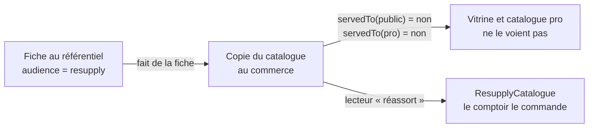

# Plan — les articles de réassort seulement

> **Plan**, ouvert le 2026-11-24. Lots A, B et C bâtis le même jour. Suite
> décidée par Hugo le même jour : l'audience **par déclinaison** (§ 6). Décision de Hugo du même jour : **une
> audience « réassort » dédiée**, plutôt qu'un drapeau « hors vitrine » sur un
> article public. Entrée du dossier : [`README.md`](README.md).

## 1. En très simple

Certains produits ne se vendent à personne en ligne, mais les boutiques doivent
pouvoir les commander au fournil : le **cookie formule** (non emballé), qui sert
aux formules de la boutique.

Aujourd'hui c'est impossible : le catalogue du réassort **est** la vitrine
publique. Un produit absent de la vitrine est absent du réassort.

On ajoute une quatrième réponse à la question « à qui la fiche vend-elle ? » :

| Audience              | Vitrine publique | Catalogue pro | Réassort des boutiques |
| --------------------- | :--------------: | :-----------: | :--------------------: |
| `public`              |        ✓         |               |           ✓            |
| `pro`                 |                  |       ✓       |                        |
| `both`                |        ✓         |       ✓       |           ✓            |
| **`resupply`** (neuf) |                  |               |         **✓**          |

Aucune lecture de la vitrine ni du catalogue pro ne demande `resupply` : ces
articles leur sont invisibles **par construction**, sans filtre à ne pas oublier.

## 2. Ce qui existe (ouvert le 2026-11-24)

- `ResupplyCatalogue` est lu par `CatalogResupplyCatalogue`
  (`apps/lfd-api/src/lafoliecoffee/resupply/infrastructure/catalog-resupply-catalogue.ts`) :
  `listSellable(staffViewer("public"))` filtré par `isShownAsTile`, et
  `findByShopSku` pour valider. Aucun prix ne traverse.
- L'audience d'une fiche vit au référentiel : `pim.product.audience`
  (nullable, hérite de `category.audience`, défaut `both`), tenue par les CHECK
  `product_audience_check` et `category_audience_check`
  (`prisma/migrations/20261015100000_l_audience_du_catalogue/migration.sql:17,21`),
  valeurs `pro | public | both`.
- Le type `Audience` du référentiel **est** `OperationAudience`
  (`src/pim/catalogue/shared/domain/value-objects/audience.ts:13`, de
  `@lfd/pim-contracts`) : fiche et opérations datées partagent la même liste.
- Côté commerce, la copie porte `catalog_items.audience` et
  `catalog_categories.audience` (`prisma/schema/public/catalog.prisma:127,433`),
  lues par `catalogAudienceOf` (`lafoliecoffee/catalog/domain/served-to.ts:100`),
  puis jugées par `servedTo` — **la** règle unique du masquage.
- `ShopAudience = "pro" | "public"` (`catalog/domain/ports/catalog.reader.ts:205`).
- `listSellable` du rayon refuse un article sans taux de TVA
  (`snapshot-catalog.reader.ts:43`).

## 3. 🔴 Le piège qui ordonne les lots

`catalogAudienceOf` lit **une valeur inconnue comme `null`, donc `both`** — vendue
à tout le monde (`served-to.ts`, plusieurs lecteurs y ajoutent `?? "both"`). Si
le référentiel émettait `resupply` avant que le commerce le connaisse, le cookie
formule partirait **en vitrine et chez les pros**.

D'où l'ordre : **le commerce apprend `resupply` d'abord** (lot A, sans que rien
ne puisse encore l'écrire), le référentiel ne l'ouvre qu'ensuite (lot B).

L'ordre est tenu **par le compilateur**, pas par la discipline : le récepteur
du fait de fiche passe l'audience typée du référentiel à
`CatalogProductFactsProjection.putOnSale(…, audience: CatalogAudience)`. Un
référentiel qui élargirait son `Audience` sans que `CatalogAudience` le
connaisse ne compilerait plus.

Décidé en bâtissant le lot A : **pas** de lecture « inconnue = servie à
personne ». Il aurait fallu une valeur sentinelle visible de toutes les vues
du staff, pour une défense que le typage donne déjà.

## 4. Les lots

### A — le commerce comprend `resupply` ✅ bâti le 2026-11-24

- `CatalogAudience` (`lafoliecoffee/catalog/domain/served-to.ts`) gagne
  `resupply` ; `servedTo` le refuse aux pros comme au public, `servedToAnyone`
  aussi.
- `servedToResupply(item)` : servi au public, **ou** `resupply` non masqué
  (ni aux pros ni au public), ni réservé ni sur mesure. Aucun drapeau de
  validation : la fiche n'est montrée à aucun client. `awaitsReview` ne pose
  déjà aucun des deux drapeaux sur une ligne `resupply` (son audience ne
  contient aucun acheteur).
- `SoldAudience` = `CatalogAudience` sans `resupply` : l'audience d'un article
  **servi à un acheteur** (`ResolvedCatalogItem.audience`). `soldAudienceOf`
  lève `ResupplyOnlySoldError` (500) si une lecture d'acheteur en rendait un —
  ce qui ne peut arriver qu'en contournant `servedTo`.
- La lecture nommée du catalogue, `ResupplyOnlyArticlesReader`
  (`catalog/domain/ports/`), implémentée par `PrismaResupplyOnlyArticlesReader`
  sur la base (pas l'instantané : ces articles ne sont ni au devis ni au rayon) ;
  inscrite à `catalogue-door` et à `withdrawn-filter`, elle porte `STILL_SOLD`.
- `CatalogResupplyCatalogue` lit la vitrine **et** cette lecture ; chaque
  article réservé au réassort se range après le dernier article public de sa
  famille (`withinFamilies`), ou à la fin.
- Le contrat staff `CatalogItemAudience` gagne `resupply` (le back-office
  l'affiche « Réassort des boutiques ») ; `ShopItemAudience` ne bouge pas.
- ⚠️ Ce lot affirmait « aucun `CHECK` sur le miroir » : c'était faux. Les
  migrations `20261015200100` et `20261015400000` en posent trois
  (`catalog_items`, `catalog_entries`, `catalog_categories`), que la recherche
  du lot A n'a pas trouvés. L'e2e du lot B l'a vu : la livraison du fait a été
  **refusée par la base**, sans rien servir. Ils sont élargis au lot B.
- Tests : `served-to.spec.ts`, `catalog-resupply-catalogue.spec.ts`.

⚠️ Vu en bâtissant, à reprendre au lot B : le fournil marque `sellable` un
article servi à au moins une clientèle (`catalog-production-articles.reader.ts`) ;
un article `resupply` y sera dit « non vendable ». Il se fabrique quand même
(le fournil range des lignes déjà commandées) ; seul l'indicateur de la page
Postes est en cause.

### B — le référentiel ouvre `resupply` ✅ bâti le 2026-11-24

- `@lfd/pim-contracts` : `CATALOGUE_AUDIENCES` (= `OPERATION_AUDIENCES` +
  `resupply`), `CatalogueAudience`, `catalogueAudienceSchema` ; les routes
  d'audience de la fiche et de la famille, leurs vues et les faits du canal
  (`catalog-product-changed.fact.ts`, `catalog-category-changed.fact.ts`) les
  emploient. Une opération commerciale garde `OPERATION_AUDIENCES`.
- `Audience` du référentiel = `CatalogueAudience` ; `servedAudiences("resupply")`
  rend `[]` : la complétude n'exige aucun prix, seulement les taux.
- Faits du journal (`packages/contracts`, `catalogueAudience()`) :
  `product.audience_changed` et `product_category.audience_changed`.
- Migrations additives : `20261124140000_l_audience_du_reassort` (les deux
  `CHECK` du référentiel) et `20261124140100_l_audience_du_reassort_au_commerce`
  (les trois du miroir).
- La page Postes du fournil compte un article `resupply` comme vendable
  (`catalog-production-articles.reader.ts`, par `servedToResupply`).
- e2e `apps/lfd-api/test/catalog-resupply-audience.e2e-spec.ts` : la fiche (ou sa famille)
  traverse le fil, n'attend aucune validation, est absente de la vitrine et du
  catalogue pro, et présente au réassort.

### C — l'écran de la fiche et de la famille ✅ bâti le 2026-11-24

- Le sélecteur d'audience du référentiel propose « Réassort des boutiques
  seulement » (`pim/catalogue/audience/audience-options.ts`), pour la fiche
  comme pour la famille ; le catalogue publié l'affiche « Réassort des
  boutiques ».
- Non vérifié à l'exécution : les specs du back-office ne compilaient pas ce
  jour-là (chantier « heure d'arrivée du réassort » en cours dans l'arbre).

## 5. Points ouverts — tranchés au bâti, écrits ici

- **Le taux de TVA.** Le rayon refuse un article sans taux ; le réassort lit
  la même copie. La famille du cookie formule a un taux : rien à faire. Si un
  jour une famille `resupply` n'en avait pas, le réassort devra s'en passer —
  décidé au lot A, pas avant.
- **Le fournil** lit les lignes de réassort par leur libellé figé (doc
  `commander.md` § 1) : rien ne change pour lui. À confirmer au lot A en
  ouvrant `DayResupplies`.
- **`vitruve`** : ce plan ne touche ni à l'argent, ni à une migration de
  données (deux CHECK élargis), ni au mur tenant. Pas de contradicteur ; les
  affirmations du § 2 ont été ouvertes.

## 6. Suite : l'audience par déclinaison (décidée, pas conçue)

Hugo, le 2026-11-24 : le cookie des formules doit pouvoir être une
**déclinaison** du cookie vendu, pas une fiche à part. Aujourd'hui l'audience
vit sur la fiche et sur la famille (`pim.product.audience`,
`pim.category.audience`) ; `ProductVariant` n'en porte pas, et le fait de fiche
envoie une seule audience pour toutes ses déclinaisons. Plan :
[`../catalogue/plan-audience-par-declinaison.md`](../catalogue/plan-audience-par-declinaison.md).
