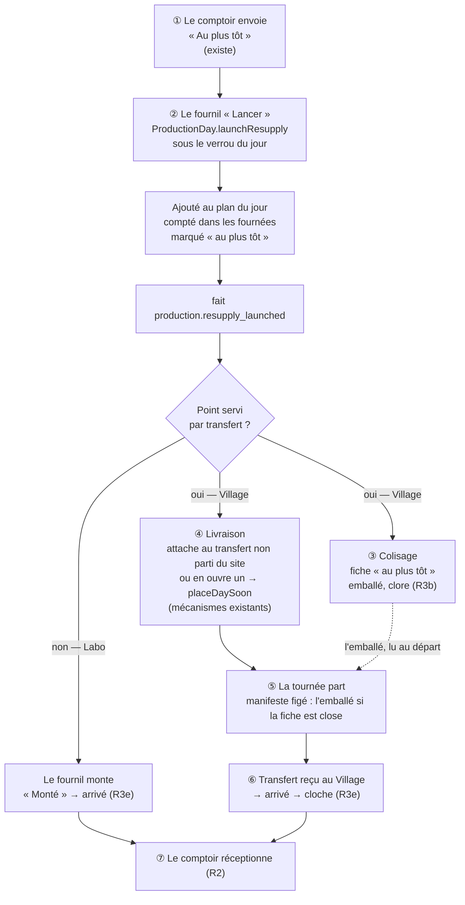
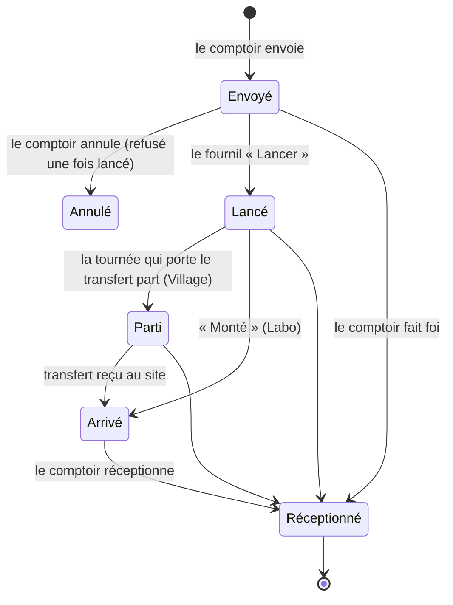

# Plan — R4, le réassort « au plus tôt » dans la journée (version complète)

> **Doc-first, 2026-10-22.** Demandé par Hugo : « je veux un doc sur la version
> complète, avec un schéma qui explique ». Rien n'est bâti. **Contredit par
> `vitruve` le 2026-10-22** (3 BLOQUANTS, 6 SÉRIEUX) et **réécrit en
> conséquence** : la première version passait par le retirage, réinventait le
> placement des transferts et faisait attendre la livraison sur le colisage. Ce
> qui a changé et pourquoi est au §8. Reste à trancher par Hugo (§7).
>
> Le circuit « pour demain » fonctionne en production depuis le 2026-10-22
> (premier réassort réceptionné au Labo ce matin-là). R4 ne touche pas à ce
> circuit : il ajoute le chemin du **jour même**.

## 0. Ce qui existe (ouvert le 2026-10-22)

- **Le comptoir envoie déjà un réassort « au plus tôt »** (`SiteResupply`,
  `target = asap`, R1–R1f), nommé (R1g), visible dans Prod manager ›
  Réassorts (R3d) — mais il **n'entre dans aucun circuit**.
- **Le plan du jour est figé** depuis l'arrêt de la veille (R3a). Le
  **retirage** (`ProductionDay.retake`) n'absorbe que des **commandes** neuves :
  sans commande arrivée, il rend 0 et n'écrit rien
  (`production/domain/services/production-count.ts`, `absorbArrivals`). Il ne
  convient donc **pas** au réassort.
- **À l'arrêt**, la livraison apprend le plan (`production.day_closed` →
  `LearnArrestedPlan`) et attache chaque réassort figé d'un point servi par
  transfert (`TransferAttachment.attachResupplies`, lecture du figé par
  `production/channels/delivery/frozen-resupplies.reader.ts`, R3c).
- **Le placement d'un transfert est déjà automatique** :
  `TransferAttachment` prend le premier transfert non parti du site et du jour
  (`plannedOf`), ou en ouvre un (`InternalTransfer.plan`) ; puis
  `TransferPlacement.placeDay` / `placeDaySoon`
  (`delivery/application/transfer-placement.ts`) place tout transfert sans
  arrêt — dans une tournée intégrée, ou une tournée dédiée ouverte d'office,
  avec repli sur un véhicule libre. **Seul le cas « aucun véhicule libre »
  reste sans arrêt.**
- **Un transfert parti ne reçoit plus rien**, et **une tournée partie ne se
  compose plus** (I6) : un réassort qui les rate attend le transfert suivant.
- **Le colisage** prend l'emballé dans `PackingStock` (« au bac ≤ reçu du four −
  rendu »), le même stock jour × produit que les commandes (R3b).
- **« Arrivé »** (R3e) : la réception du transfert, ou « Monté » au Labo.

## 1. Ce qu'on bâtit

Un réassort « au plus tôt » **lancé** par le fournil suit le **même chemin que
celui du soir**, ouvert en cours de journée : il entre au plan du jour par un
geste à lui, le colisage le reçoit par le même fait, la livraison l'attache et
le place par les mécanismes existants.

Le colisage et la livraison démarrent **en même temps**, sur le même fait — comme
le soir, où la livraison attache à l'arrêt sans attendre le colisage. La
première version faisait attendre la livraison sur la clôture de la fiche : la
tournée pouvait partir entre les deux (objection 5 de `vitruve`).

### Les états

« Emballé » n'est pas un état du réassort : c'est l'état de sa fiche au
colisage, qui ne bloque rien (la réception se pré-remplit de l'emballé s'il est
connu, sinon du demandé). « Le comptoir fait foi » (décision C du 2026-10-21)
reste vrai.

## 2. Les étapes, bloc par bloc

### ② « Lancer » — `production`

- **Une méthode d'agrégat à part**, `ProductionDay.launchResupply(resupply,
at, by)` — **pas** le retirage, qui n'absorbe que des commandes et rend 0
  sans elles (BLOQUANT 1). Elle ajoute UN réassort, ciblé par son
  `resupplyId`, à `resupplies` (genre `asap`, instant et auteur du
  lancement), et **ajoute ses lignes au compte des fournées** (décision B).
  Refus : réassort déjà lancé, journée non arrêtée (voir ci-dessous).
- **Lu par un port ciblé** : `DayResuppliesReader.asapToLaunch(day, resupplyId)`
  (le commerce implémente) — un seul réassort « au plus tôt » envoyé, non
  annulé. Le lecteur du soir (`placedFor`) **reste « pour demain »
  seulement** : sans ça, un arrêt ou un ré-arrêt relirait tous les « au plus
  tôt » comme s'ils étaient du soir (SÉRIEUX 4).
- **Une journée jamais arrêtée** (aucune commande ni réassort du soir la veille,
  `ProductionDayEmptyError`) n'a pas de plan (BLOQUANT 2). Proposé : « Lancer »
  sur une telle journée **l'ouvre arrêtée**, avec ce seul réassort — même
  verrou, même journal (« plan ouvert par un réassort au plus tôt »). À
  trancher (Q5).
- **Faits** : `production.resupply_launched:<jour>:<resupplyId>` (+
  `:after-reopening:<instant>` comme `resupply-list-drawn.event.ts`), qui porte
  le réassort (lignes, point, `servedByTransfer`, nom). Le dossier du jour
  **n'est pas renvoyé** : la fiche d'atelier et Prod manager montrent le
  lancement ; renvoyer un PDF par réassort noierait le fournil (à confirmer,
  Q6).
- **Le refus d'annuler, synchrone** (BLOQUANT 3) : l'annulation d'un réassort
  « au plus tôt » passe par un port du fournil **lu sous le verrou de la
  journée** — `LaunchedResupplies.isLaunched(day, resupplyId)` (déclaré dans
  `production/channels/commerce/`, implémenté par le fournil, comme le
  guichet d'admission). Le lancement et l'annulation prennent le **même
  verrou** de journée ; l'un des deux gagne, l'autre est refusé. La colonne
  « lancé » du commerce n'est qu'un affichage, posée ensuite par le fait.
- **Réouverture** (SÉRIEUX 4) : rare le jour J (refusée dès qu'une fournée ou le
  colisage a commencé). Un réassort lancé **survit à la réouverture** : il est
  rangé à part des réassorts du soir (`launchedResupplies`), que `reopen` ne
  vide pas, et le ré-arrêt le garde.

### ③ Le colisage — `packing`

- L'abonné du colisage écoute `production.resupply_launched` comme il écoute
  `production.resupply_list_drawn` : **même fiche** (R3b), genre `asap`,
  seulement si `servedByTransfer`, titrée « <nom> — <point> · au plus tôt ».
- **Le stock** (SÉRIEUX 8) : l'emballé se prend dans `PackingStock`, que le four
  alimente. Proposé : **le lancement réserve**, au colisage, les quantités du
  réassort sur le stock jour × produit — une commande ne peut pas consommer une
  pièce réservée ; la réserve se lève à la clôture de la fiche ou à
  l'annulation (impossible une fois lancé). Si le four a déjà tout remis, la
  fiche attend la fournée suivante (« en attente du four »). À trancher (Q7).
- **Aucun fait `packing.resupply_packed`** : la livraison n'en a pas besoin
  (elle part sur `resupply_launched`), et le manifeste lit l'emballé au départ
  par `packing/channels/delivery/` comme le soir (R3c).

### ④ Le transport — `delivery`

- Un abonné livraison à `production.resupply_launched` (`@DurableHandler`,
  écouté par `production/channels/delivery/`, comme `day_closed`) appelle
  `TransferAttachment.attachResupplies` **puis** `TransferPlacement.placeDaySoon`
  — **les mécanismes du soir, sans réinvention** (SÉRIEUX 6) : premier
  transfert non parti du site, sinon un neuf, placé d'office dans une tournée
  intégrée ou dédiée.
- `FrozenResuppliesReader` rend aussi les réassorts lancés, avec leurs lignes,
  `servedByTransfer` et l'instant du **lancement** (SÉRIEUX 7).
- **Le cas « aucun véhicule libre »** (le seul où le transfert reste sans
  arrêt) : il apparaît au Tour manager comme aujourd'hui ; la cloche du
  répartiteur sonne pour un transfert « au plus tôt » non placé (ajout).
- **Un transfert déjà chargé** : attacher à un transfert dont l'arrêt est chargé
  mais pas parti est permis par `attach` (non parti) ; le réassort se charge
  alors au bac du transfert avant « Partir ». À vérifier au lot (non vérifié par
  `vitruve`).

## 3. Les migrations — ce qui sera jugé

| Table                                       | Colonne(s)                                                                                                                                                | Nature                                                         |
| ------------------------------------------- | --------------------------------------------------------------------------------------------------------------------------------------------------------- | -------------------------------------------------------------- |
| `public.site_resupply`                      | `launched_at TIMESTAMPTZ NULL`, `launched_by_name TEXT NULL`                                                                                              | affichage (le refus est synchrone au fournil) ; nullables      |
| `production.production_resupply`            | `kind TEXT NOT NULL DEFAULT 'evening'` + CHECK `IN ('evening','asap')` ; `launched_at TIMESTAMPTZ NULL`, `launched_by TEXT NULL` + CHECK « asap ⇔ lancé » | ajout ; les lignes existantes prennent `evening`               |
| `packing.packing_resupply`                  | `kind TEXT NOT NULL DEFAULT 'evening'` + CHECK                                                                                                            | ajout                                                          |
| `packing.packing_stock_reservation` (neuve) | `(service_day, sku, resupply_id)`, `quantity INT > 0`, `released_at`                                                                                      | neuve (si Q7 = réserver)                                       |
| `public.staff_notifications`                | —                                                                                                                                                         | aucune : la cloche du répartiteur réutilise le modèle existant |

Aucune donnée existante n'est convertie ; aucune colonne n'est retirée. Les
déclencheurs `day_change` (posés le 2026-10-22) couvrent déjà
`production_resupply` et `packing_resupply` ; la table de réserve en recevra un.

## 4. Les lots

| Lot     | Contenu                                                                                                                                                                                                    | Touche                                    |
| ------- | ---------------------------------------------------------------------------------------------------------------------------------------------------------------------------------------------------------- | ----------------------------------------- |
| **R4a** | `launchResupply` (agrégat, port ciblé, verrou), `LaunchedResupplies` synchrone et refus d'annuler, fait `resupply_launched`, réouverture, journée jamais arrêtée (selon Q5) ; « Lancer » dans Prod manager | fournil, commerce, back-office            |
| **R4b** | Le colisage : fiche « au plus tôt » sur le fait, réserve de stock (selon Q7)                                                                                                                               | colisage, back-office                     |
| **R4c** | La livraison : abonné au fait → attache + `placeDaySoon` ; `FrozenResuppliesReader` élargi ; cloche « aucun véhicule »                                                                                     | livraison, fournil (lecteur), back-office |
| **R4d** | Le suivi : lancé / parti au comptoir, à l'onglet Stock, à Prod manager                                                                                                                                     | commerce, back-office                     |

## 5. Hors périmètre

- Une tournée **déjà partie** ne reçoit rien (I6).
- Le jour même **sur stock pour les particuliers**
  ([`../limites-de-commande/plan-jour-meme-sur-stock.md`](../limites-de-commande/plan-jour-meme-sur-stock.md)).
- Le réassort récurrent (Q-C1, « plus tard »).

## 6. Les risques, dits d'avance

- **La réserve de stock** (si Q7 = réserver) touche l'invariant central du
  colisage (« au bac ≤ reçu − rendu ») : c'est le lot le plus délicat.
- **Un transfert sans véhicule** n'arrive jamais : la cloche du répartiteur est
  le seul garde-fou ; à défaut, le comptoir réceptionne quand même.
- **Une journée ouverte par un réassort** (Q5) crée un plan d'un genre
  nouveau : le fournil doit le comprendre à l'écran.

## 7. Questions pour Hugo

- **Q1** — Qui lance : le fournil seulement (proposé), ou automatiquement dès
  l'envoi du comptoir ?
- **Q2** — ~~Un transfert sans tournée : « à placer » ou tournée dédiée ?~~
  **Sans objet** : le placement automatique existe déjà (§0) ; seul « aucun
  véhicule libre » reste, et il sonne chez le répartiteur.
- **Q3** — Un seuil (en pièces) sous lequel le réassort attend le prochain
  transfert prévu plutôt que d'en ouvrir un ?
- **Q4** — Le Labo : « Lancer » puis « Monté » (proposé : le fournil voit ce
  qu'il a lancé), ou « Monté » seul comme aujourd'hui ?
- **Q5** — « Lancer » sur une journée jamais arrêtée : l'ouvrir arrêtée avec ce
  seul réassort (proposé), ou refuser ?
- **Q6** — Renvoyer le dossier du jour à chaque lancement, ou non (proposé) ?
- **Q7** — Le colisage réserve-t-il les pièces d'un réassort lancé (proposé), ou
  le réassort prend-il ce qui reste quand la fiche se fait ?

## 8. Ce que `vitruve` a changé (2026-10-22)

| Objection                                                        | Avant                                                | Maintenant                                                          |
| ---------------------------------------------------------------- | ---------------------------------------------------- | ------------------------------------------------------------------- |
| B1 — le retirage rend 0 sans commande, et absorberait tout       | « extension du retirage »                            | `launchResupply`, un réassort ciblé, ses propres faits              |
| B2 — journée jamais arrêtée                                      | non nommée                                           | Q5, proposé : l'ouvrir arrêtée                                      |
| B3 — le refus d'annuler reposait sur un fait asynchrone          | colonne commerce posée par un fait                   | port synchrone du fournil lu sous le même verrou                    |
| S4 — la réouverture effaçait le lancé, le ré-arrêt relisait tout | non traité                                           | lancés rangés à part, survivent ; `placedFor` reste « pour demain » |
| S5 — `packing.resupply_packed` inutile et retardait l'attache    | la livraison attendait la clôture de la fiche        | colisage et livraison partent du même fait, en même temps           |
| S6 — le placement existait déjà                                  | « à placer » manuel, Q2                              | `attachResupplies` + `placeDaySoon` ; Q2 sans objet                 |
| S7 — le lecteur figé ignorait les lancés                         | non dit                                              | `FrozenResuppliesReader` élargi, instant du lancement               |
| S8 — le stock du colisage                                        | non traité                                           | réserve proposée (Q7)                                               |
| S9 — migrations sans engagement                                  | « colonnes »                                         | §3 : tables, colonnes, défauts, CHECK                               |
| Mineurs                                                          | `:asap` dans la clé ; « transferts tirés à l'arrêt » | clé sans `:asap`, avec `:after-reopening:` ; §0 corrigé             |
