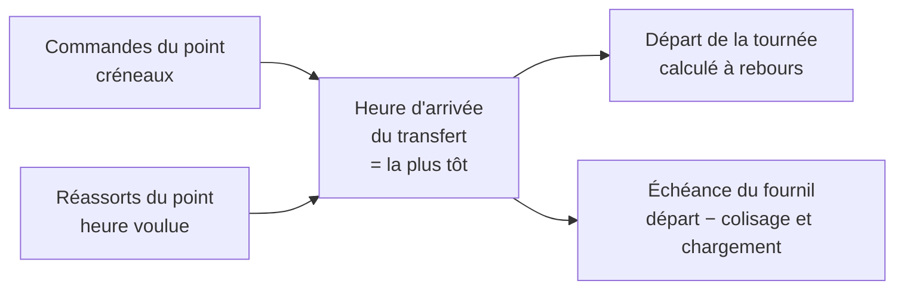

# Plan — l'heure du réassort

> **Plan, doc-first.** Rien n'est bâti. Écrit le 2026-11-24 à la demande de
> Hugo : « on devrait définir une heure au réassort du matin comme pour les
> créneaux de commande, parce que le transfert est une conséquence des
> horaires de tout ce qu'il contient ». Chaque affirmation sur l'existant a
> été ouverte dans le code le 2026-11-24 ; le fichier est cité.

## 1. En deux mots

Aujourd'hui, une commande a un **créneau**, et c'est lui qui fixe l'heure à
laquelle le transfert doit arriver au point. Un réassort n'en a **pas** : il
monte dans le transfert et part quand le transfert part.

On donne au réassort une **heure d'arrivée voulue** (« pour 6 h 30 »), comme
un créneau. Le transfert ne fixe plus son heure lui-même : il prend **la
plus tôt** des heures de tout ce qu'il porte, commandes et réassorts.

Le modèle de réassort porte une heure **par défaut** (« base matin » →
06:30, « après-midi » → 13:00), recopiée quand on l'applique et modifiable.

## 2. Ce qui existe (vérifié le 2026-11-24)

| Fait                                                                                                                                                                                                                                                                                                                          | Où                                                                                    |
| ----------------------------------------------------------------------------------------------------------------------------------------------------------------------------------------------------------------------------------------------------------------------------------------------------------------------------- | ------------------------------------------------------------------------------------- |
| Le réassort n'a pas d'heure : `id, siteId, target, serviceDay, origin, name, lines` et ses traces.                                                                                                                                                                                                                            | `lafoliecoffee/resupply/domain/site-resupply-snapshot.ts`                             |
| Le modèle non plus : `name, target, lines`.                                                                                                                                                                                                                                                                                   | `lafoliecoffee/resupply/domain/resupply-template-content.ts`                          |
| La copie figée du fournil non plus : point, nom, `servedByTransfer`, `kind`, lignes.                                                                                                                                                                                                                                          | `prisma/schema/production.prisma`, `ProductionResupply`                               |
| Un réassort est rangé dans **le premier** transfert prévu du point (`const [planned] = plannedOf(...)`), créé s'il n'y en a pas.                                                                                                                                                                                              | `delivery/application/transfer-attachment.ts`, `attach`                               |
| L'heure d'arrivée d'un transfert (`arrivalBy`) vient du commerce, par `TransferSitesReader`, et la composition en fait la borne « arrivé avant » de l'arrêt.                                                                                                                                                                  | `delivery/application/transfer-routing.ts`, `transferStopOf`                          |
| Le commerce la calcule par `SiteDeadlines` puis `transferDeparture` : le plus tôt de l'ouverture pros et du premier créneau public, sinon le plus tôt des créneaux des commandes, moins la mise en place.                                                                                                                     | `lafoliecoffee/orders/domain/services/transfer-departure.ts`, `referenceMinute`       |
| 🔴 **Un point qui ne reçoit que des réassorts n'a pas d'heure** : `SiteDeadlines.forDay` ne résout que les sites des **retraits** du jour (`ids` tirés des `pickups`), donc `CommerceTransferSites` rend `arrivalBy: null`, et le transfert se place **sans fenêtre** — dans n'importe quelle tournée, d'après-midi comprise. | `lafoliecoffee/orders/application/services/site-deadlines.service.ts`, `forDay`       |
| Un seul transfert par site et par jour en pratique : la composition et l'attache prennent le premier prévu ; « plusieurs dans la journée » était écrit au plan du transfert (§ 1) mais n'est pas bâti.                                                                                                                        | `documentation/livraisons/transferts/plan-transfert-interne.md` § 1 et « hors de T0 » |

La ligne 🔴 est un défaut d'aujourd'hui, indépendant du souhait de Hugo : le
lot H2 le corrige au passage.

## 3. Les décisions proposées

- **H-D1. L'heure est celle d'ARRIVÉE au point**, comme un créneau de
  commande, jamais une heure de départ : le trajet, la mise en place et le
  colisage se déduisent, personne ne les saisit.
- **H-D2. « Pour demain » porte toujours une heure** ; « au plus tôt » n'en
  porte jamais (il part quand le fournil le lance).
- **H-D3. L'heure proposée par défaut** est, dans l'ordre : celle du modèle
  appliqué, sinon l'heure d'arrivée requise du point (la règle d'aujourd'hui,
  `transferDeparture`). Sans rien toucher, on retrouve donc le comportement
  d'aujourd'hui.
- **H-D4. Le transfert prend la plus tôt** des heures de ce qu'il porte.
  L'ouverture du point reste dans le calcul : elle dit quand les commandes
  doivent être là.
- **H-D5. Le modèle reste jetable** : son heure est recopiée, jamais liée
  (décision M du 2026-11-19, `commander.md` § 6).
- **H-D6. Le Labo (servi sur place)** : l'heure sert d'échéance au fournil
  (« monté pour 6 h 30 »). Aucun transfert.

## 4. Les lots

### H1 — l'heure sur le réassort et le modèle

- Colonnes **additives**, nullables : `site_resupply.arrival_by`,
  `bakehouse_resupply_drafts.arrival_by`, `resupply_templates.arrival_by`
  (`HH:MM`, `VARCHAR(5)` + CHECK de forme). Les réassorts déjà envoyés
  restent sans heure : ils gardent la règle d'aujourd'hui.
- Un value object `ResupplyArrivalTime` (forme `HH:MM`, 00:00–23:59).
- `SiteResupply` : envoyer un « pour demain » **sans heure** est refusé
  (`resupply.arrival.required`, 400) ; un « au plus tôt » avec une heure
  aussi (`resupply.arrival.asap`, 400). Changer l'heure suit les mêmes
  règles que changer les lignes (refusé après l'arrêt).
- Modèle : heure facultative ; `apply-template` la recopie si le brouillon
  n'en a pas encore.
- Écrans : un champ « Pour quelle heure ? » dans Comptoir › Réassort, dans la
  carte de brouillon du fournil et dans l'écran des modèles. Pré-rempli selon
  H-D3 (une lecture de l'heure requise du point, servie avec la vue du
  comptoir).
- Contrats : `site-resupply.ts`, `bakehouse-resupply-draft.ts`, le contrat
  des modèles.
- Tests : domaine (refus, recopie), handlers, e2e de l'envoi et du modèle.

### H2 — le transfert prend la plus tôt de ses heures

- `CommerceTransferSites.sitesFor` lit aussi les réassorts **envoyés, non
  annulés, pour demain** du jour et de ces points (le commerce lit ses
  propres tables : aucune frontière franchie), et rend
  `arrivalBy = min(heure du point, heures des réassorts)`.
- `SiteDeadlines` résout aussi un point **sans retrait** quand il a un
  réassort : c'est la correction de la ligne 🔴.
- Les réassorts sans heure (d'avant H1) ne comptent pas dans le `min`.
- Tests : le point à réassorts seuls a une fenêtre ; un réassort à 05:30
  avance le transfert ; un réassort à 13:00 ne le retarde pas.

### H3 — l'échéance du fournil

- La copie figée gagne `production_resupply.arrival_by` (additive),
  recopiée à l'arrêt.
- L'échéance d'un réassort pour le compte à rebours et la fiche d'atelier :
  servi par transfert → départ requis du transfert − marge de livraison ;
  servi sur place → heure − mise en place.
- **À ouvrir au début du lot** : comment le compte à rebours et la fiche
  d'atelier comptent aujourd'hui les réassorts (je n'ai pas trouvé
  d'échéance de réassort dans `production/atelier/` ; à confirmer avant
  d'écrire).

### H4 — plusieurs transferts par point et par jour (le gros morceau)

C'est ce qui rend « un réassort le matin, un l'après-midi » réel. Sans H4,
H1 à H3 donnent la bonne heure au **seul** transfert, donc la plus tôt : le
réassort de 13:00 part avec celui du matin.

- `InternalTransfer` porte son **heure d'arrivée** (la plus tôt de ses
  éléments) ; l'attache range un élément dans le transfert prévu du point
  qui arrive **à temps et pas trop tôt**, sinon en ouvre un.
- « Pas trop tôt » est la vraie question : sans seuil, tout rejoint le
  premier transfert. Proposé : un écart réglable par point (par exemple
  3 h) au-delà duquel un nouveau transfert s'ouvre.
- La composition place chaque transfert séparément ; `TransferRouting`
  accepte déjà plusieurs passages par véhicule.
- Mérite son propre plan, avec `vitruve` (il touche la composition, que les
  commandes partagent).

## 5. Décisions

1. **L'ordre** : H1 → H2 → H3 → H4, tout bâti d'affilée (Hugo, 2026-11-24 :
   « Tout jusqu'à H4 »). H4 a son propre plan, contredit par `vitruve`
   avant d'être bâti.
2. **Entre H3 et H4**, un réassort plus tardif part avec le transfert du
   matin, sans refus : H4 suit dans le même chantier. (Tranché sans Hugo,
   dans le mandat ; il peut revenir dessus.)
3. **Le seuil de H4** : tranché dans le plan de H4, après lecture de la
   composition (écart par point ou vagues fixes) ; le choix et sa raison y
   seront écrits.

## 6. Hors de ce plan

- L'heure ne change rien au prix ni à la facturation : le réassort n'en a pas.
- `vitruve` n'est pas obligatoire pour H1 à H3 (ni argent, ni migration de
  données, ni sécurité, ni runbook : des colonnes additives) ; il l'est pour
  H4, s'il touche la composition des tournées que les commandes partagent.
