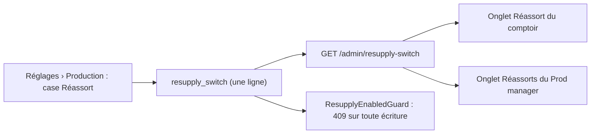

# Plan — l'interrupteur du réassort

> **Plan** (2026-11-28, décidé par Hugo) : un réglage **global**, **éteint par
> défaut**, dans Réglages › Production › Fournil. Éteint, les écrans de
> réassort se masquent **et** l'API refuse d'en écrire un.

## 1. En clair

Le réassort des boutiques ([`README.md`](README.md)) est bâti, mais on ne
l'ouvre pas encore à l'équipe. Une case « Réassort des boutiques » dans les
réglages du fournil l'allume pour tout le monde.

- **Éteint** (aucune ligne, ou `enabled = false`) : l'onglet « Réassort » du
  comptoir, l'onglet « Réassorts » du Prod manager et les pages des modèles
  disparaissent ; une adresse tapée renvoie au premier onglet permis. Toute
  écriture des routes du réassort répond 409 « Le réassort est désactivé —
  il s'allume dans Réglages › Production › Fournil. »
- **Allumé** : tout est comme avant, droits compris.
- Ce qui a déjà été envoyé reste **lisible** (les lectures ne sont pas
  gardées) : éteindre ne fait rien disparaître du fournil ni du colisage.

## 2. Technique

**Le propriétaire** est le contexte qui porte le réassort,
`lafoliecoffee/resupply/` : l'interrupteur gouverne SES écritures. Que l'écran
vive dans Réglages › Production est une place d'interface, pas un
propriétaire — aucun port ne traverse de bloc.

- **Contrat** : `packages/contracts/src/resupply-switch.ts`
  (`ResupplySwitchView`, `resupplySwitchSchema`).
- **Table** : `ResupplySwitch` dans `prisma/schema/public/resupply.prisma`,
  `@@map("resupply_switch")`, une ligne au plus (clé fixe), réécrite, jamais
  supprimée ; l'absence vaut « éteint ». Mêmes colonnes d'auteur que
  `CounterStockSetting`. Migration **additive**.
- **Ports** : `ResupplySwitchReader` (`read(): Promise<ResupplySwitchView>`,
  `isEnabled(): Promise<boolean>`) et `ResupplySwitchWriter`, adaptateurs
  Prisma dans `infrastructure/`.
- **Cas** : `GetResupplySwitchQuery`, `SetResupplySwitchCommand` (B2B :
  fichiers séparés).
- **Route** : `admin/resupply-switch`, `@AdminSurface("production_settings")`.
  `GET` sous `@RequireAnyPermission` de `production_settings:read`,
  `production_resupply:read`, `handover_counter:read`,
  `resupply_templates:read` — le comptoir et le fournil doivent savoir s'ils
  montrent leurs écrans. `PUT` sous `production_settings:write` (le verbe),
  `@Idempotent` (pose une valeur).
- **Le refus** : `ResupplyEnabledGuard`, qui laisse passer `GET`/`HEAD` et
  lève `ResupplyDisabledError` (`BusinessError`, 409,
  `resupply.disabled`) sinon. Posé sur les contrôleurs
  `admin-bakehouse-resupplies`, `admin-site-resupplies`,
  `admin-resupply-templates`, `admin-resupply-receipts`,
  `admin-reserve-shop-releases`. Un garde plutôt qu'un test dans chaque
  handler : une vingtaine de cas d'écriture, et un oubli serait silencieux.
- **Front** : `ResupplySwitchStore` (racine, lu une fois, relu après la
  pose) ; la carte « Réassort des boutiques » sur la page des réglages du
  fournil ; filtre des onglets `reassort` (comptoir) et `reassorts` (Prod
  manager) ; un garde de route sur les routes du réassort et des modèles.

## 3. Lots

1. **API** — table, migration, ports, cas, route, garde, tests (domaine,
   handler, e2e du refus et de la lecture sous chaque droit).
2. **Écran** — store, carte, onglets, gardes de route, specs.
