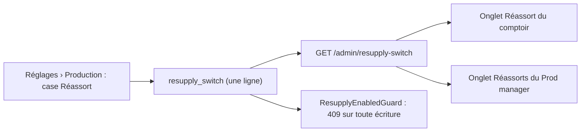

# L'interrupteur du réassort

> **Doc d'état** (bâti le 2026-11-28, décidé par Hugo) : un réglage
> **global**, **éteint par défaut**, dans Réglages › Production › Fournil.
> Éteint, les écrans de réassort se masquent **et** l'API refuse d'en
> envoyer un — mais un réassort déjà envoyé se finit toujours.

## 1. En clair

Le réassort des boutiques ([`README.md`](README.md)) est bâti, mais on ne
l'ouvre pas encore à l'équipe. Une case « Réassort des boutiques » dans les
réglages du fournil l'allume pour tout le monde.

- **Éteint** (aucune ligne, ou `enabled = false`) : l'onglet « Réassort » du
  comptoir, l'onglet « Réassorts » du Prod manager et les pages des modèles
  disparaissent ; une adresse tapée renvoie au premier onglet permis. Toute
  écriture des routes du réassort répond 409 « Le réassort est désactivé —
  il s'allume dans Réglages › Production › Fournil. »
- **Allumé** : tout est comme avant, droits compris.
- Ce qui a déjà été envoyé reste **lisible** (les lectures ne sont pas
  gardées) : éteindre ne fait rien disparaître du fournil ni du colisage.
- Et il **se finit** (décidé par Hugo le 2026-11-28) : recevoir un réassort
  au comptoir et corriger la réception (lignes hors commande comprises), le
  dire « Monté » au fournil, l'annuler. Éteindre empêche d'en envoyer un
  neuf, jamais de terminer ceux qui sont en route.

## 2. Technique

**Le propriétaire** est le contexte qui porte le réassort,
`lafoliecoffee/resupply/` : l'interrupteur gouverne SES écritures. Que l'écran
vive dans Réglages › Production est une place d'interface, pas un
propriétaire — aucun port ne traverse de bloc.

- **Contrat** : `packages/contracts/src/resupply-switch.ts`
  (`ResupplySwitchView`, `resupplySwitchSchema`).
- **Table** : `ResupplySwitch` dans `prisma/schema/public/resupply.prisma`,
  `@@map("resupply_switch")`, une ligne au plus (clé fixe), réécrite, jamais
  supprimée ; l'absence vaut « éteint ». Mêmes colonnes d'auteur que
  `CounterStockSetting`. Migration **additive**.
- **Ports** : `ResupplySwitchReader` (`read(): Promise<ResupplySwitchView>`,
  `isEnabled(): Promise<boolean>`) et `ResupplySwitchWriter`, adaptateurs
  Prisma dans `infrastructure/`.
- **Cas** : `GetResupplySwitchQuery`, `SetResupplySwitchCommand` (B2B :
  fichiers séparés).
- **Route** : `admin/resupply-switch`, `@AdminSurface("production_settings")`.
  `GET` sous `@RequireAnyPermission` de `production_settings:read`,
  `production_resupply:read`, `handover_counter:read`,
  `resupply_templates:read` — le comptoir et le fournil doivent savoir s'ils
  montrent leurs écrans. `PUT` sous `production_settings:write` (le verbe),
  `@Idempotent` (pose une valeur).
- **Le refus** : `ResupplyEnabledGuard`, qui laisse passer `GET`/`HEAD` et
  lève `ResupplyDisabledError` (`BusinessError`, 409,
  `resupply.disabled`) sinon. Posé sur les contrôleurs
  `admin-bakehouse-resupplies`, `admin-site-resupplies`,
  `admin-resupply-templates`, `admin-resupply-receipts`,
  `admin-reserve-shop-releases`. Un garde plutôt qu'un test dans chaque
  handler : une vingtaine de cas d'écriture, et un oubli serait silencieux.
- **Les gestes qui finissent** portent `@PassesWhenResupplyOff(raison)`
  (`resupply-enabled.guard.ts`) : les cinq routes de
  `admin-resupply-receipts`, `mounted` d'`admin-bakehouse-resupplies` et
  `cancel` d'`admin-site-resupplies`. Une route neuve est refusée tant qu'on
  ne la marque pas : l'oubli refuse, il n'ouvre pas.
- **Hors du garde**, parce que ce n'est pas envoyer un réassort : déclarer
  une rupture (`admin-site-stock-alerts`) et les réglages du comptoir
  (`admin-counter-settings`).
- **Tests** : `http/__tests__/resupply-enabled.guard.spec.ts`,
  `application/__tests__/resupply-switch-handlers.spec.ts`,
  `test/resupply-switch.e2e-spec.ts` (défaut, refus, gestes qui finissent,
  lecture sous les quatre droits). Les e2e du réassort allument
  l'interrupteur par `test/resupply-switch.ts`.
- **Front** : `ResupplySwitchStore` (racine, lu une fois, relu après la
  pose) ; la carte « Réassort des boutiques » sur la page des réglages du
  fournil ; filtre des onglets `reassort` (comptoir) et `reassorts` (Prod
  manager) ; un garde de route sur les routes du réassort et des modèles.

## 3. Ce qui est bâti

- **API** (`6fa914da2`) : table `resupply_switch` (migration
  `20261128003000_l_interrupteur_du_reassort`, additive, une ligne au plus
  par CHECK), ports, cas, route, garde ; registre RGPD tenu.
- **Écran** (`b22ca5b4f`) : `shared/resupply-switch/` (store, service, garde
  de route), la carte `production/resupply-switch-card/`, le filtre
  `requiresResupply` des vues du comptoir et du Prod manager (onglets et
  tuiles du lanceur), et `permission.guard.ts` qui saute l'atterrissage
  `/prod-manager/reassorts` quand c'est éteint (sinon, qui ne tient que ce
  droit tournait en rond).
- **Les gestes qui finissent** : le commit qui suit.

## 4. Reste à faire

- Le lien « renvoi » de `supervision/stock-board/stock-board.html` mène
  encore à `/prod-manager/reassorts` ; éteint, il atterrit au Prod manager.
