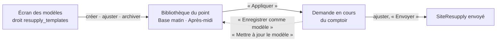

# Plan — les modèles de réassort

> **Plan** (2026-11-19). Il répond à Q-C1 de [`reste-a-faire.md`](reste-a-faire.md)
> (« le réassort habituel du mardi, pré-rempli »). Entrée du dossier :
> [`README.md`](README.md). Les chemins cités ont été ouverts le 2026-11-19.

## 1. En bref

Le responsable veut une **bibliothèque de modèles** par point : « Base matin »,
« Réassort après-midi »… Un modèle est une liste d'articles avec leurs
quantités : un **raccourci de saisie**, rien de plus. On l'applique à la demande
en cours, on ajuste, on envoie ; et on corrige le modèle quand l'habitude change.

Ce qui compte, c'est **le réassort envoyé** (décidé par Hugo le 2026-11-19 :
« le template serait une ressource jetable, ce qui m'importe c'est le résultat
du réassort »). Le réassort ne sait pas de quel modèle il est parti, et le
modèle ne garde pas d'historique.

Un modèle **ne part jamais tout seul** : il ne porte ni journée, ni heure, ni
envoi. Appliquer un modèle ne le modifie pas, et modifier un modèle ne touche
aucune demande.

## 2. Décisions

| #   | Question                                     | Décision                                                                                                                                                      | Par                 |
| --- | -------------------------------------------- | ------------------------------------------------------------------------------------------------------------------------------------------------------------- | ------------------- |
| M1  | À qui appartient un modèle ?                 | **À un point.** Chaque point a sa bibliothèque ; un modèle ne change pas de point (comme un brouillon du fournil, D3).                                        | Hugo, 2026-11-19    |
| M2  | Qui crée, ajuste, archive ?                  | Un droit neuf, **`resupply_templates`**.                                                                                                                      | Hugo, 2026-11-19    |
| M3  | Les modèles s'ajustent-ils ?                 | **Oui** : nom, visée proposée, lignes, sous verrou de version — à l'écran des modèles, ou depuis le comptoir après application.                               | Hugo, 2026-11-19    |
| M4  | Qui applique ?                               | Le comptoir avec son droit actuel (`handover_counter`), le fournil avec `production_resupply` (T4). Lire la bibliothèque d'un point suit ces trois droits.    | défaut, à confirmer |
| M5  | Appliquer sur une demande non vide           | L'écran demande : **Remplacer** ou **Ajouter** (les quantités s'additionnent, comme `addLine`). Demande vide : remplit directement.                           | défaut, à confirmer |
| M6  | Article retiré du catalogue ou unité changée | Écarté **à l'application**, et l'écran dit lesquels. Le modèle n'est jamais corrigé en douce ; la lecture de la bibliothèque marque ses lignes inapplicables. | défaut, à confirmer |
| M7  | Supprimer                                    | **Archiver** (`archived_at`), jamais de DELETE. Le nom d'un modèle archivé redevient libre.                                                                   | règle du dépôt      |
| M8  | Lien réassort → modèle, historique           | **Aucun.** Le modèle est jetable ; le réassort envoyé est la donnée qui compte. Pas de `template_id`, pas de révisions.                                       | Hugo, 2026-11-19    |

Hors du plan : le déclenchement automatique (« le mardi, envoie tout seul »),
la proposition de quantités, et l'analyse des réassorts envoyés — ce dernier
sujet, s'il vient, se lit par point, jour et heure, pas par modèle.

## 3. Le modèle

Agrégat `ResupplyTemplate`, dans `apps/lfd-api/src/lafoliecoffee/resupply/domain/`,
à côté de `SiteResupply` et de `BakehouseResupplyDraft`.

| Champ        | Règle                                                                                                                        |
| ------------ | ---------------------------------------------------------------------------------------------------------------------------- |
| `siteId`     | figé à la création (M1)                                                                                                      |
| `name`       | obligatoire ; même normalisation que `resupplyNameOf` (rogné, 60 caractères) ; **unique parmi les modèles actifs du point**  |
| `target`     | visée proposée à l'application (`tomorrow` \| `asap`) ; l'écran peut l'appliquer à l'autre                                   |
| `lines`      | `{ sku, quantity, saleUnit }` — la forme de `BakehouseResupplyDraftLine` ; ≥ 1, ≤ 200, un SKU une fois, quantité entière ≥ 1 |
| `version`    | verrou optimiste ; un ajustement sur une version périmée est refusé (409)                                                    |
| `archivedAt` | une fois ; un modèle archivé ne s'ajuste ni ne s'applique                                                                    |
| auteurs      | créé par et instant, dernière modification par et instant (`Clock`)                                                          |

La règle des lignes est celle de `domain/bakehouse-resupply-draft-content.ts`
(liste sans libellé, bornée à 200, sans doublon). Elle se partage : le contenu
commun monte dans un module que les deux agrégats emploient, et chacun garde
ses erreurs publiques.

Table `public.resupply_templates` (lignes en `jsonb`, comme
`bakehouse_resupply_drafts`) ; index unique partiel
`(site_id, lower(name)) WHERE archived_at IS NULL`. Migration **additive** :
la table et la valeur `resupply_templates` de `StaffResource`
(`prisma/schema/public/staff.prisma`), **accordée à personne** — elle s'accorde
à l'écran des rôles (`lint:no-role-grants-in-migrations`).

## 4. Appliquer

Commande `ApplyResupplyTemplate { siteId, templateId, target, mode: replace | add }`
sur la demande en cours du comptoir, dans **une** transaction :

1. charger le modèle (actif, du même point ; sinon 404 ou 409) ;
2. confronter chaque ligne au catalogue du réassort (`resupply-catalogue.ts`) :
   retiré ou unité changée → écarté (M6) et rendu dans la réponse ;
3. charger ou ouvrir la demande en cours (`SiteResupply.draft`) ; `replace`
   retire les lignes absentes du modèle et pose les quantités, `add` passe par
   `addLine` ;
4. sauver, rendre `{ resupplyId, skipped: [{ sku, reason }] }`.

On applique toujours à **la demande en cours** : un réassort envoyé n'est
jamais touché. Le nom du modèle devient le nom de la demande si elle n'en a pas.
Route : `POST admin/site-resupplies/sites/:siteId/drafts/:target/apply-template`,
`handover_counter:write`, clé d'intention (`lint:write-idempotence`).

**Enregistrer et affiner depuis le comptoir** (Hugo, 2026-11-19 : « affiner les
modèles pour faire des raccourcis efficaces »). L'écran garde **en mémoire**
le modèle appliqué et sa version lue — rien en base. Après ajustement, il
propose « Mettre à jour « Base matin » » avec un résumé de l'écart (« +2
croissants, −1 tradition, 1 article ajouté »), calculé côté écran : c'est
l'ajustement du § 5 (`PUT :templateId`, contenu entier, version lue). Si le
modèle a bougé entre-temps, 409 et relecture — jamais d'écrasement silencieux.
« Enregistrer comme modèle » crée un modèle à partir des lignes affichées
(`POST sites/:siteId`). Les deux gestes demandent `resupply_templates:write`.

## 5. Les routes de la bibliothèque

`admin/resupply-templates` (nouveau contrôleur, bus seulement) :

| Route                      | Droit                                                                                      | Geste                                                               |
| -------------------------- | ------------------------------------------------------------------------------------------ | ------------------------------------------------------------------- |
| `GET sites/:siteId`        | `resupply_templates:read` **ou** `handover_counter:read` **ou** `production_resupply:read` | les modèles actifs, lignes comprises, lignes inapplicables marquées |
| `POST sites/:siteId`       | `resupply_templates:write`                                                                 | créer (`{ name, target, lines }`)                                   |
| `PUT :templateId`          | `resupply_templates:write`                                                                 | ajuster (contenu entier + version lue)                              |
| `POST :templateId/archive` | `resupply_templates:write`                                                                 | archiver                                                            |

Les écritures portent la clé d'intention de l'écran (`GestureIntents`,
`lint:front-intent-keys`).

## 6. Les écrans

- **Comptoir › Réassort** : un menu « Modèles » listant ceux du point →
  « Appliquer » (dialogue Remplacer / Ajouter si la demande n'est pas vide),
  puis l'avis des articles écartés. Avec `resupply_templates:write` :
  « Enregistrer comme modèle » et, après une application, « Mettre à jour le
  modèle ».
- **Écran des modèles** (`/comptoir/reassort/modeles`, droit
  `resupply_templates`) : choix du point, liste, et une page de composition
  (une table des articles du réassort, quantité par article) ; renommer,
  changer la visée, archiver.
- **Prod manager › Réassorts › Créer un réassort** (T4) : « Partir d'un
  modèle » une fois le point choisi, qui remplit la composition.

## 7. Lots

| Lot | Contenu                                                                                                                                | Tests                                                                                                            |
| --- | -------------------------------------------------------------------------------------------------------------------------------------- | ---------------------------------------------------------------------------------------------------------------- |
| T1  | domaine `ResupplyTemplate` et contenu de lignes partagé, migration, ressource, port et adaptateur, routes de la bibliothèque, contrats | unitaires domaine ; handlers à ports doublés ; e2e : droits, nom unique par point, version, archive, autre point |
| T2  | écran des modèles (back-office)                                                                                                        | specs des composants et du store                                                                                 |
| T3  | « Appliquer » (back + front), « Enregistrer comme modèle » et « Mettre à jour le modèle » au comptoir                                  | e2e : replace / add, article retiré écarté, réassort envoyé intact, rejeu de la clé ; specs de l'écart           |
| T4  | « Partir d'un modèle » au fournil                                                                                                      | spec de la composition                                                                                           |

Après T4 : ce plan devient une section de [`commander.md`](commander.md), Q-C1
quitte `reste-a-faire.md`, et le plan est supprimé.

## 8. À vérifier au bâti

- Que l'adaptateur Prisma de `resupply_templates` reste le seul lecteur de la
  table (`lint:prisma-model-ownership`) et que le schéma est rangé sous
  `prisma/schema/public/` (`lint:prisma-schema-layout`).
- Que les colonnes d'auteur sont au registre RGPD (`lint:rgpd-staff`).
- Que la lecture de la bibliothèque n'élargit rien : un comptoir ne voit que les
  points que son droit lui ouvre aujourd'hui sur `admin/site-resupplies`.
