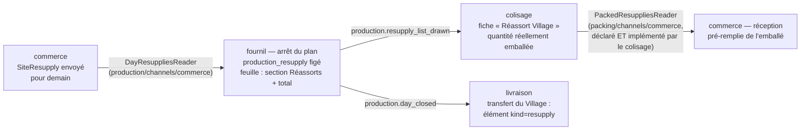

# Plan — le réapprovisionnement d'un site

> **État au 2026-10-21 : partiel.** La **réception** est bâtie (agrégat
> `ResupplyReceipt`, `b2b/resupply/`, et la page Comptoir › Réassort boutique —
> [`plan-jour-meme-sur-stock.md`](../limites-de-commande/plan-jour-meme-sur-stock.md)
> §7), ainsi que le réglage « soumis à l'heure limite / sans limite », stocké
> sans effet. Restent : la **commande au fournil** (`SiteResupply`, lots R1–R5)
> et son branchement aux lecteurs du fournil, du colisage et du transfert ; la
> décision A/B est tranchée en B (§9).
>
> **Doc-first d'origine, 2026-10-14.** Planifié par Hugo
> (« oui planifie le réassort après ») à la suite du transfert interne
> ([`plan-transfert-interne.md`](../livraisons/transferts/plan-transfert-interne.md)), qui lui a déjà
> réservé sa place : l'élément de transfert de genre `resupply`, le cadre
> « Réapprovisionnement » du colisage, le format de ligne du manifeste.
>
> Chaque affirmation sur l'existant est datée et a été ouverte le 2026-10-14 ;
> ce qui ne l'a pas été est marqué « non vérifié ».

## 1. La demande

Hugo, 2026-10-13 : un même transfert porte « des commandes pour le retrait
village **et** le réassort boutique » ; le réassort, « c'est facile, c'est
comme une commande mais au niveau du site, j'imagine pour l'instant avec les
mêmes limites produit pour simplifier ». Vocabulaire tranché le même jour :
**réapprovisionnement** (`resupply`), jamais « réassort » dans le code.

Hugo, 2026-10-14 : voir dans la démo une tournée de début d'après-midi qui
porte du réapprovisionnement.

## 2. Ce qui existe (vérifié le 2026-10-14)

- `delivery_internal_transfer_item` accepte `kind = 'resupply'` avec un
  `resupply_id` **opaque**, sans clé étrangère ; aucun écrivain ne le produit.
- Le manifeste du transfert a une section « réapprovisionnement » au même
  format de ligne (SKU, libellé, quantité) que les commandes ; elle est vide.
- Le colisage a un cadre `replenishment` dans le cadre du transfert
  (`packing-frames.ts`), alimenté par un argument que rien ne fournit.
- La production ne connaît une commande que par un identifiant opaque et un
  snapshot (CLAUDE.md §3) — un réapprovisionnement peut y entrer de la même
  façon.

## 3. La décision structurante : une commande, ou son propre agrégat ?

|                                 | A — une `Order` dont le client est un site                                                                                                            | B — un agrégat `SiteResupply`                                                               |
| ------------------------------- | ----------------------------------------------------------------------------------------------------------------------------------------------------- | ------------------------------------------------------------------------------------------- |
| Production, colisage, transfert | gratuits : ils lisent déjà les commandes                                                                                                              | une seconde source à brancher dans chaque lecteur (fournil, colisage, contenu du transfert) |
| Argent                          | une commande porte prix, TVA, règlement, chiffre d'affaires, facturation : il faudrait les neutraliser partout, et chaque oubli compte un faux revenu | aucun : un réapprovisionnement est un mouvement interne                                     |
| Invariants                      | `Order` suppose une société ou une personne, une clientèle `b2b`/`b2c`                                                                                | les siens : un site destinataire, des lignes, un jour                                       |
| Risque                          | **élevé** — touche l'argent à tous les étages                                                                                                         | modéré — touche des lecteurs                                                                |

**Proposé : B.** L'argent est l'endroit où se tromper coûte le plus, et A
demanderait de prouver partout qu'un réapprovisionnement ne compte pas. B
paie en branchements ce que A paierait en exceptions.

## 4. Le modèle proposé (B)

- **Agrégat `SiteResupply`** dans `b2b/resupply/` : `siteId` (un site
  `supply = transfer`), `serviceDay`, lignes `{ sku, label, quantity }`
  copiées du catalogue au moment de la saisie (snapshot, comme une commande),
  état `draft → placed → cancelled`, auteur (staff).
- **Mêmes limites produit que les commandes** (Hugo) : heure limite de la
  journée, quantités et multiples de l'article — lus par les mêmes règles,
  appliqués à la transition `place()`.
- **Aucun prix, aucune TVA, aucun règlement.** Le snapshot ne porte pas de
  champ monétaire (la porte `lint:price-door` le tiendra).
- **Production** : le fournil lit un réapprovisionnement placé comme une
  commande à produire, par son canal (`production/channels/commerce/`) —
  identifiant opaque préfixé, échéance = celle du transfert du site (T0).
- **Transfert** : à la passation (ou à la clôture si la journée est close),
  l'abonné de T2 range le réapprovisionnement dans le transfert prévu du site
  comme il range une commande ; le manifeste lit son contenu.
- **Colisage** : ses colis vont dans les bacs du transfert (Q-T4 révisée) ;
  le cadre `replenishment` reçoit ses éléments.
- **Droit** : une ressource neuve `lfc_site_resupply` (lecture / écriture),
  accordée à l'écran — jamais par migration.
- **Écran** : Réglages ? Non — c'est un geste du jour. Proposé : une entrée
  « Réapprovisionnement » sous Commandes dans le menu principal, une saisie par
  site et par jour, liste d'articles du catalogue avec quantités.

## 5. Lots

| Lot | Taille | Contenu                                                                                                                             | Dépend de           |
| --- | ------ | ----------------------------------------------------------------------------------------------------------------------------------- | ------------------- |
| R1  | M      | agrégat, table `resupply` + lignes (migration additive), ressource `lfc_site_resupply`, commandes placer / annuler, limites produit | —                   |
| R2  | M      | le fournil le produit (canal), le transfert le porte (abonné), le manifeste lit son contenu                                         | R1, transfert T1–T3 |
| R3  | S      | colisage : ses colis au cadre du transfert, dans les bacs du transfert                                                              | R2                  |
| R4  | M      | écran de saisie au back-office                                                                                                      | R1                  |
| R5  | S      | semis : un réapprovisionnement de Val Village l'après-midi de J                                                                     | R2                  |

`vitruve` d'office avant de bâtir : migration et frontière de droits.

## 6. Questions à Hugo

- **Q-R1** — A ou B (§3) ? Proposé : **B**.
- ~~**Q-R2**~~ — ✅ (Hugo, 2026-10-14) : **les deux**. « Le site commande le
  réassort » — c'est le geste normal, fait par l'équipe du site ; « en cas de
  problème, ou si le site appelle, le labo peut enregistrer le réassort pour
  le village ». Conséquence : le réapprovisionnement porte son **auteur** et
  **pour quel site** il est saisi ; l'écran propose d'office le site de qui
  saisit, et laisse le labo choisir le site. **Non vérifié** : le dépôt
  sait-il rattacher un membre du staff à un site ? Si non, R1 commence par un
  droit unique `lfc_site_resupply` (tout détenteur saisit pour tout site), et
  le cloisonnement par site devient une question à part.
- **Q-R3** — Un site servi **sur place** (le Labo) a-t-il du
  réapprovisionnement ? Proposé : non — il se sert au fournil, sans transport.
- **Q-R4** — Un réapprovisionnement récurrent (le même chaque jour), ou saisi
  chaque fois ? Proposé : saisi chaque fois d'abord, gabarit plus tard.
- **Q-R5** — Faut-il en tenir un coût interne (valorisation du stock du
  site) ? Proposé : non pour R1–R5 ; si oui, c'est un plan d'argent à part.

## 7. Contradiction de `vitruve` (2026-10-14) — le §3 est à refaire

L'option B a été chiffrée trop bas. Toute la chaîne aval est **en forme de
commande**, et un réapprovisionnement qui y entre par un identifiant préfixé
en devient un discriminant implicite :

- `ProducibleOrder` exige `fulfillmentMethod` (`pickup` | `delivery`),
  `clientele`, `customerLabel` ;
- `production.day_closed`, `production.packing_list_drawn` et la table
  `packing_order` (clé `(service_day, order_id)`, `fulfillment_method` non
  nul) supposent une commande ;
- `packing.order_packed` → `MarkOrderReadyCommand` lève
  `OrderReferenceNotFoundError` sur un id inconnu : un abonné durable en
  lettre morte à chaque réapprovisionnement colisé ;
- le rangement au transfert lit `TransferOrdersReader` (commandes seulement)
  et part du fait `commerce-order-placed` ; il faut un fait neuf et son
  annulation, et l'ordre des verrous de `OrderWithdrawalDesk` ;
- l'échéance du transfert vit dans `delivery` : le commerce la lirait par un
  port à nommer.

Et deux promesses fausses : les « quantités et multiples » de l'article
**n'existent pas** (`OrderLine` ne vérifie qu'un entier > 0) ; l'heure limite
est indexée par point de retrait et jour de semaine, et la limite par
article se lit par **audience** (`pro` | `public`), qu'un réapprovisionnement
n'a pas. `lint:price-door` ne tiendrait pas l'absence de champ monétaire.

**Suite** : mesurer honnêtement ce que coûterait l'option A (où une commande
compte de l'argent : chiffre d'affaires, facturation, règlement), puis
re-trancher Q-R1 avec un champ `kind` explicite au contrat dans les deux cas.

## 8. L'option A mesurée (2026-10-14)

Lecture du code (exploration, lignes citées dans l'échange du jour) : une
commande touche l'argent ou le client à **20 endroits** — 16 points de
changement, 4 contraintes de l'agrégat. **6** se règlent par un filtre unique
(`revenueWhere`, `billableOrderWhere`, l'écrivain du journal `order.placed`,
le volume par SKU des paliers, `earningFor`, le courriel « prête ») ; **10**
demandent une branche. **10 sont dangereux** : un oubli y compte un faux
chiffre d'affaires, **facture ou prélève réellement** une société
(`billableOrderWhere`), ouvre une intention Stripe (`settleOrder`) ou envoie un
courriel. Et l'agrégat `Order` calcule toujours prix, TVA et total : A exige
une branche dans l'agrégat lui-même.

|                    | A — une commande                                    | B — un agrégat à part                                  |
| ------------------ | --------------------------------------------------- | ------------------------------------------------------ |
| Endroits à toucher | ~20                                                 | ~8 (3 faits durables, 4 abonnés, réception/annulation) |
| Un oubli…          | se tait : faux revenu, vraie facture, vrai courriel | crie : abonné en lettre morte, visible à la santé      |
| Argent             | partout                                             | nulle part                                             |

**Recommandation maintenue : B**, avec un **genre explicite** (`kind:
order | resupply`) au contrat de ce que le fournil produit et dans les faits
`production.*` / `packing.*`, plutôt qu'un identifiant préfixé.

## 9. Décision de Hugo (2026-10-21) : B

« Pas de prix, part sur B. » Le réapprovisionnement d'un site est un **agrégat
à part** (`SiteResupply`), jamais une commande : pas de prix, pas de TVA, pas
de règlement, pas de chiffre d'affaires. Le coût est de le brancher dans les
lecteurs du fournil, du colisage et du transfert (§3), le jour où il sera
commandé au fournil. La **réception** au comptoir (lignes produit, quantités
reçues, stock estimé du jour) est bâtie avant la commande, le 2026-10-21 —
voir [`../limites-de-commande/plan-jour-meme-sur-stock.md`](../limites-de-commande/plan-jour-meme-sur-stock.md).

## 10. Le circuit complet : commander, produire et emballer, réceptionner (Hugo, 2026-10-21) — l'emporte sur les §4–§5

> « La base c'est commander un réassort ; ensuite la prod produit, emballe, et
> donne donc la quantité réelle produite ; le comptoir atteste de la réception
> de cette quantité et ça remplit tout d'un coup. Personne ne fera du ligne par
> ligne en plein service. » — Hugo, 2026-10-21.

- **① Commander** (`SiteResupply.place`) : par le comptoir du point choisi dans
  le bandeau (Hugo : « le comptoir ; on verra la granularité du droit plus
  tard ») — un droit unique pour commencer. Soumis à l'heure limite générale
  si le réglage `resupply_subject_to_cutoff` le dit (bâti, sans effet
  jusqu'ici). Aucun prix (décision B, §9).
- **② Produire** : le fournil le lit par son canal avec un **genre explicite**
  `kind: order | resupply` (§8), jamais un identifiant préfixé ; il entre dans
  le plan de J et se fige avec lui à l'heure limite.
- **③ Emballer** : le colisage saisit la quantité RÉELLE emballée par ligne (le
  fournil peut produire moins) ; un fait `packing.resupply_packed` la publie.
- **④ Acheminer** : un point servi par transfert (Village) le reçoit dans le
  transfert de J ; le Labo, servi sur place, n'a rien à transporter (Q-R3 :
  le réassort du Labo EXISTE — Hugo : « réassort Labo si switch Labo »).
- **⑤ Réceptionner** : la page Réassort du comptoir (déjà bâtie pour la saisie,
  2026-10-21, commit 558b376c8) devient l'écran de RÉCEPTION : la liste
  emballée en lecture, un bouton **« Réceptionner »** qui atteste tout d'un
  coup ; une ligne ne se corrige qu'en cas d'écart (bac abîmé, erreur). La
  réception remplit `ResupplyReceipt` (la partie « reçue ») → stock du jour.
  La saisie manuelle actuelle reste le secours (réassort non commandé).

### Lots (remplacent R1–R5)

| Lot    | Contenu                                                                                                                                                                               |
| ------ | ------------------------------------------------------------------------------------------------------------------------------------------------------------------------------------- |
| **C1** | `SiteResupply` (commande : brouillon → placé → annulé), table + lignes, routes sous le droit du comptoir, heure limite si soumis ; écran « Commander le réassort » du point (bandeau) |
| **C2** | Le fournil le produit (canal, `kind: resupply`), le plan le fige à l'heure limite                                                                                                     |
| **C3** | Le colisage : le réassort à la liste à coliser, la quantité réellement emballée, `packing.resupply_packed` ; au transfert pour un point servi par transfert                           |
| **C4** | La réception en un geste : page Réassort pré-remplie, « Réceptionner », écarts par ligne → `ResupplyReceipt`                                                                          |

`vitruve` d'office avant C1 : il déplace des frontières entre blocs (commerce,
fournil, colisage, livraison) et en crée de nouveaux faits durables.

### Questions

- **Q-C1** — Un modèle récurrent (« le réassort habituel du mardi » pré-rempli)
  dès C1, ou plus tard ? (Q-R4 proposait « plus tard ».)
- **Q-C2** — Un écart à la réception (moins reçu qu'emballé) : simple
  correction, ou un signalement au fournil ?

**Décisions de Hugo (2026-10-21)** : Q-C1 — le modèle récurrent, **plus
tard** ; Q-C2 — le signalement d'un écart au fournil, **plus tard** (un écart
se corrige simplement sur la ligne à la réception).

## 11. Le plan live — révision de Hugo après `vitruve` (2026-10-21) — l'emporte sur le §10

`vitruve` a contredit le §10 le 2026-10-21 (quatre BLOQUANTS : bac incomplet,
« sans limite » contre « se fige avec le plan », canal de la quantité emballée,
réception sans « attendu »). Hugo y a répondu en changeant le modèle :

- « Le fournil n'est pas censé être au courant des commandes client du jour J,
  puisqu'elles sont prises sur du stock. » → **pas de concurrence** entre
  clients et réassort : le réassort EST ce qui remplit le stock de la vitrine ;
  les commandes de demain ont leur propre production, dans le plan figé.
- « Les réassorts doivent être un plan parallèle, le plan live. » → **deux
  plans** :

|          | Le plan du lendemain                          | Le plan live (réassort)                           |
| -------- | --------------------------------------------- | ------------------------------------------------- |
| Contient | les commandes client pour demain              | les réassorts des points                          |
| Se ferme | à l'heure limite générale (§ une seule heure) | **jamais figé**                                   |
| Alimente | les retraits et livraisons de demain          | le stock de la vitrine (jour même)                |
| Colisage | tout le dû doit être au bac                   | **la quantité réelle**, un bac incomplet se ferme |

- « Il faut faire les deux : le soir, le point commande pour le lendemain ;
  dans la journée, c'est faire au plus tôt. » → un réassort vise **soit demain**
  (la commande du soir, préparée pour le matin), **soit « au plus tôt »**
  (aujourd'hui, quand la vitrine se vide). Les deux entrent au plan live.
- Le réglage « réassort soumis à l'heure limite / sans limite » **est gardé** :
  soumis, la commande du soir pour demain doit passer avant l'heure limite
  générale ; sans limite, elle peut arriver jusqu'au matin. Le « au plus tôt »
  du jour n'a pas d'heure limite.

### Ce que ça règle dans les objections de `vitruve`

- **Bac incomplet** : le colisage du plan live ferme un bac à la quantité
  réelle — une règle de fermeture propre au réassort, distincte de
  `PackingSheet.seal()` qui exige tout le dû.
- **« Sans limite » contre le gel** : le réassort n'entre pas dans le plan figé ;
  il n'y a plus de contradiction.
- **Priorité clients / réassort** : sans objet.

### Ce qui reste à concevoir (avant de bâtir)

- **Le canal de la quantité emballée** : déclaré par le fournil, publié par le
  colisage, lu par le commerce (le chemin de `PackingOrderPackedEvent`), avec
  une clé versionnée (une réouverture corrigée doit atteindre la réception).
- **L'« attendu » distinct du « reçu »** dans la réception : l'emballé remplit
  l'attendu ; « Réceptionner » le recopie en reçu (le stock ne monte qu'à la
  réception, jamais à l'emballage). Saisie de secours et deux réassorts le
  même jour sur un même article : additionner.
- **Le plan live côté fournil** : un écran « à produire au plus tôt » à côté du
  plan figé ; ce que le fournil produit sans commande de réassort reste hors
  du système (pas de stock réel).
- **Le transfert du Village** : des faits « réassort placé / annulé » et un
  lecteur dans `delivery/channels/commerce/`, le réassort « au plus tôt »
  partant par la prochaine tournée ; le Labo n'a rien à transporter, son bac
  prêt se voit à la page de réception.
- Une union discriminée côté fournil (`kind: order | resupply`) pour ce qu'il
  produit, le réassort ne portant ni clientèle ni mode d'acheminement.

Ce §11 se refait contredire par `vitruve` avant le lot C1.

## 12. Contredit une seconde fois, et tranché (Hugo, 2026-10-21) — l'emporte sur le §11

`vitruve` (2026-10-21) : un plan jamais figé ne s'accroche à rien de
l'existant — le colisage et la composition des tournées ne se déclenchent qu'à
l'arrêt du plan (`production.packing_list_drawn`, `production.day_closed`) ; la
réception bâtie refuse un même article deux fois ; la commande du soir hors
plan figé n'apparaîtrait sur aucune feuille de production.

Décisions de Hugo :

- **La commande du soir pour demain entre dans le plan FIGÉ du lendemain**,
  mais **distinguée** (« dans le plan figé c'est pas mal, mais il faut
  distinguer tout de même ») : genre explicite `kind: resupply`, section à
  part sur la feuille de production, au colisage et au transfert — jamais
  mêlée aux commandes client. Le réglage `resupply_subject_to_cutoff` garde
  ainsi son sens : soumise, elle passe avant l'heure limite.
- **« Au plus tôt » dans la journée** reste le plan live : conçu plus tard (R3,
  R4).
- **Un reçu par réassort** : chaque réassort se réceptionne à part ; le stock
  du jour additionne. La saisie de secours devient un « réassort sans
  commande ».

### Lots (remplacent C1–C4)

| Lot                                         | Contenu                                                                                                                                                                                                                                                  | Touche                                                      |
| ------------------------------------------- | -------------------------------------------------------------------------------------------------------------------------------------------------------------------------------------------------------------------------------------------------------- | ----------------------------------------------------------- |
| **R1** ✅ (bâti le 2026-10-21, non commité) | `SiteResupply` : commander (le soir pour demain, ou « au plus tôt »), annuler ; écran du comptoir pour le point du bandeau ; écran du fournil « réassorts à produire » EN LECTURE (demain et aujourd'hui, distingués) — état dans le [README](README.md) | commerce, back-office                                       |
| **R2** ✅ (bâti le 2026-10-21, non commité) | Réception en un geste : un reçu par réassort, pré-rempli de la quantité DEMANDÉE, « Réceptionner », écarts par ligne ; la saisie de secours = réassort sans commande ; stock du jour = somme des reçus                                                   | commerce, back-office (migration de la réception : vitruve) |
| **R3**                                      | Le réassort du soir au plan figé : feuille de production, colisage (quantité réelle), transfert du Village — section distincte                                                                                                                           | fournil, colisage, livraison                                |
| **R4**                                      | « Au plus tôt » : le plan live au colisage et aux tournées                                                                                                                                                                                               | à concevoir                                                 |

### R1b ✅ — Rupture et stock faible au comptoir (Hugo, 2026-10-21 ; bâti le 2026-10-21, non commité)

« Au comptoir on devrait pouvoir déclarer une rupture, un stock faible sur un
produit, ce qui permettrait déjà de bloquer les commandes, avertir. » Et : « pas
forcément pour aujourd'hui, dans la mesure où un réassort relève le stock. »

- **Déclarer** « Rupture » ou « Stock faible » sur un produit, pour un point
  (celui du bandeau), depuis la page Réassort.
- **Durée** : jusqu'à la réception d'un réassort de ce produit au point (R2),
  ou jusqu'à ce que le comptoir la lève à la main — jamais levée d'elle-même
  le lendemain.
- **Effets**, en attendant le circuit du jour même :
  - une **alerte** sur l'écran du fournil « Réassorts à produire » (« Village :
    rupture de croissants »), avec « Lancer un réassort au plus tôt » pour ce
    produit ;
  - la mention sur la page Réassort du point.
- **Plus tard (J2, le jour même)** : une rupture bloque la vente EN LIGNE du jour
  sur stock de ce produit au point ; un stock faible avertit le client. Les
  commandes pour demain ne sont jamais bloquées (elles sont produites au plan).

Bâti juste après R1 (même page). ✅ **Bâti le 2026-10-21** : l'agrégat
`StockAlert` (`b2b/resupply/`), la table `site_stock_alert` (migration
additive `20261021190000_les_alertes_de_stock_du_comptoir`), la levée par la
réception branchée dans `ReceiveResupplyLineHandler`, les deux écrans — état
dans le [README](README.md). Le bouton « Lancer un réassort au plus tôt » du
fournil passe par la route du comptoir : il n'apparaît qu'à qui tient
`handover_counter:write`.

### R1c ✅ — La demande en cours, enregistrée (Hugo, 2026-10-21 ; bâti le 2026-10-21, non commité)

« Un état général de la demande de réassort, pré-envoi de la demande, stocké. »
En R1, le brouillon ne vit qu'à l'écran : un rechargement ou un autre poste le
perd. R1c l'enregistre :

- **Une demande ouverte par point et par visée** (« pour demain », « au plus
  tôt ») — l'état `draft` de `SiteResupply`, persisté.
- **Le comptoir y ajoute et en retire des articles au fil du service**, depuis
  n'importe quel poste (verrou de version : deux postes ne s'écrasent pas).
- **« Envoyer le réassort »** la fige (`place`) et la transmet au fournil ; une
  nouvelle demande s'ouvre ensuite pour la même visée.
- **Avec R1b** : déclarer une rupture ou un stock faible propose d'ajouter le
  produit à la demande « au plus tôt » en cours, plutôt que d'ouvrir un
  réassort à part.

Bâti juste après R1b (mêmes écrans, même agrégat).

✅ **Bâti le 2026-10-21** : le brouillon de `SiteResupply` se persiste (les
colonnes `placed_*` deviennent nullables, index unique partiel
`site_resupply_open_draft_key` — migration additive
`20261021210000_la_demande_de_reassort_en_cours`) ; ajouter (la quantité
s'additionne), corriger, retirer, envoyer, sous verrou de version ; une
demande vide ou d'une journée passée ne part pas. Le `POST` d'un seul tenant
de R1 est gardé et passe par la demande en cours (le bouton du fournil
l'ajoute à la demande « au plus tôt » et l'envoie entière). État dans le
[README](README.md).

### R2 ✅ — La réception en un geste (Hugo, 2026-10-21 ; bâti le 2026-10-21, non commité)

« Personne ne fera du ligne par ligne en plein service. » Un reçu par
réassort ; la saisie de secours devient un « réassort sans commande » ; le
stock du jour additionne les reçus.

- **Un reçu par réassort envoyé** : `ResupplyReceipt` porte désormais un
  `resupplyId`, et chaque ligne son **attendu** (la quantité DEMANDÉE, en
  attendant la quantité emballée de R3) et son **reçu**. « Réceptionner »
  recopie l'attendu en reçu pour toutes les lignes, d'un geste ; le reçu ne
  s'écrit en base qu'à ce moment. Le stock ne monte qu'à la réception, jamais
  à l'envoi.
- **La règle de l'écart** : une ligne ne se corrige qu'**après**
  « Réceptionner » (avant, rien n'est reçu : 409
  `resupply.receipt.not_yet_received`). On n'ajoute ni ne retire d'article à
  un reçu de réassort : un article arrivé en plus va au réassort sans
  commande, un manquant se corrige à zéro.
- **Un second « Réceptionner » est refusé** (409
  `resupply.receipt.already_received`, en nommant qui et quand), jamais
  rejoué en silence ; une course entre deux postes bute sur l'index unique
  `resupply_receipt_resupply_id_key`. Seul un réassort envoyé et non annulé se
  réceptionne (409 `resupply.receipt.resupply_not_receivable`) ; celui d'un
  autre point est introuvable (404).
- **Le réassort sans commande** : même agrégat, `resupplyId` nul, au plus un
  par (point, journée) (index unique partiel `resupply_receipt_unordered_key`)
  — la saisie ligne par ligne d'avant, refus du doublon compris.
- **Le stock estimé du jour** = somme des reçus réceptionnés du jour au
  point, tous reçus confondus (`estimateStock`).
- **Les alertes de R1b** se lèvent à « Réceptionner », pour chaque ligne reçue
  > 0, dans la même transaction, et toujours à la saisie sans commande.
- **Migration** `20261021230000_un_recu_par_reassort` — **non additive** :
  elle retire l'index unique (site, journée) de
  `20261021150000_la_reception_du_reapprovisionnement`, jamais déployée
  (absente de `origin/main`, vérifié le 2026-10-21).
- **L'écran** (Comptoir › Réassort) : « Réceptionner les réassorts » (les
  réassorts envoyés pour la journée du bandeau, attendus en lecture, un
  bouton, puis « Réceptionné par X à HH:MM » et l'écart par ligne), le
  tableau « Stock estimé du jour » en somme, et « Réassort sans commande »
  replié en bas. État dans le [README](README.md).

### R1d ✅ — Le fournil envoie un réassort, à part de la demande du comptoir (Hugo, 2026-10-21 ; bâti le 2026-10-21, non commité)

« Pourquoi le fournil lancerait le réassort [du comptoir] ? Après, je trouve
intéressant la capacité du fournil à dire "je t'envoie ça" — typiquement si le
comptoir demande au téléphone, le fournil peut entrer la demande. C'est une
autre façon de faire. »

- **Corrige R1b/R1c** : sur l'écran du fournil, le bouton d'une alerte
  « Lancer un réassort au plus tôt » envoyait la demande « au plus tôt » DU
  COMPTOIR, avec ce que le comptoir y avait mis. Il disparaît. Les alertes
  restent chez le fournil, pour information.
- **« Envoyer un réassort »** sur l'écran du fournil, par point : le fournil
  choisit articles et quantités et envoie. C'est un réassort À PART, signé
  « par le fournil » (origine), qui ne touche jamais la demande en cours du
  comptoir.
- **Au comptoir**, il arrive dans les réassorts à réceptionner (R2), marqué
  « envoyé par le fournil », et se réceptionne en un geste comme les autres.
- **Droit** : le geste du fournil a son propre droit (à trancher à l'écran des
  rôles), distinct de `handover_counter`.

Bâti juste après R2.

✅ **Bâti le 2026-10-21** : `SiteResupply.origin` (`counter` | `bakehouse`,
migration additive `20261022000100_l_origine_du_reassort`, défaut
`counter`) ; `SiteResupply.sentByBakehouse` crée et envoie d'un geste, sans
brouillon ; la ressource `production_resupply`
(`20261022000000_le_droit_du_reassort_du_fournil`, accordée à l'écran) et
la route `admin/bakehouse-resupplies` ; le `POST :siteId` du comptoir et le
bouton des alertes retirés ; « Envoyé par le fournil » au fournil et à la
réception. Les deux trous de R2 sont fermés : annuler un réassort
réceptionné est refusé (409 `resupply.order.already_received`), réceptionner
avant sa journée aussi (409 `resupply.receipt.day_not_yet_come`). État dans
le [README](README.md).

### R1e ✅ — Une table de tous les produits, pensée « comptoir, un clic » (Hugo, 2026-10-21 ; bâti le 2026-10-21, non commité)

« Au niveau de l'écran, on ferait mieux d'avoir une table avec tous les
produits, avec le stock actuel. » — « Et les boutons de déclaration rupture /
faible. » — « Pense comptoir, un clic ; filtre au-dessus de la table par
catégorie. »

La page Réassort du point (bandeau) remplace ses cartes par :

- **En tête, seulement s'il y en a** : « N réassorts à réceptionner », chacun
  avec son bouton **Réceptionner** (R2).
- **Au-dessus de la table** : des **puces de catégorie** (une par famille du
  catalogue, « Tout » par défaut), un clic filtre ; et une recherche.
- **La table**, tous les produits du catalogue public :

| Produit                              | Stock du jour               | État                            | Au plus tôt | Pour demain |
| ------------------------------------ | --------------------------- | ------------------------------- | ----------- | ----------- |
| somme des reçus réceptionnés du jour | `OK` · `Faible` · `Rupture` | quantité de la demande en cours | idem        |

- **Un clic partout** :
  - l'**État** est un sélecteur à trois positions sur la ligne ; un clic
    déclare (Faible, Rupture) ou lève (OK), sans confirmation — le même clic
    défait ; une rupture passe la ligne en rouge, un stock faible en orange ;
    déclarer une rupture place le curseur dans « Au plus tôt » ;
  - **Au plus tôt / Pour demain** se saisissent dans la case (la demande en
    cours de R1c, enregistrée et partagée) ; des pas rapides (+1, +5, +10)
    à côté de la case ;
  - en bas : **« Envoyer au plus tôt (N) »** et **« Envoyer pour demain (N) »**.
- **Tri par défaut** : ruptures et stocks faibles en tête, puis les produits
  demandés, puis le reste.
- **Le réassort sans commande** devient un geste discret (« + reçu sans
  commande » dans un menu de la ligne), plus une carte.

Aucun changement serveur attendu : tout ce qu'il faut existe (R1–R2). Bâti
juste après R1d (même page).

✅ **Bâti le 2026-10-21**, front seul : `ResupplyStockTable`
(`comptoir/reassort-boutique-page/resupply-stock-table/`) ; le titre
« Réassort <point> » est retiré (l'onglet du bandeau le dit, Hugo) ; la carte
« Réceptionner les réassorts » passe en tête, seulement s'il y en a ; les
cartes « Commander au fournil » et « Réassort sans commande » sont
supprimées (la table les remplace). La recherche est là.
Les **puces de catégorie** sont bâties le 2026-10-21 (R1e-bis, demande de
Hugo, non commité) : `ResupplyArticleView` gagne `categoryId` et
`categoryName` (la tête de la famille, lue sur `CatalogReader` comme le
catalogue publié du commerce — champ ajouté, rien retiré) ; la table
affiche « Tout » puis une puce par famille présente (`fold-view-toggle`),
combinée à la recherche.

## 13. R3 — Le réassort du soir au plan figé (conçu le 2026-10-21, doc-first)

> Décisions de Hugo du 2026-10-21 : Q1 le Labo passe aussi au colisage ;
> Q2 la feuille porte un total par produit (commandes + réassorts) en plus de
> la section à part ; Q3 un réassort figé ne s'annule plus ; Q4 le colisage
> ouvre un lecteur de la quantité emballée, que le commerce lit.

### 13.0 Ce qui existe (ouvert le 2026-10-21)

- **Le fournil ne connaît aucun réassort** : aucun fichier de `src/production`
  ni de `src/packing` ne le nomme. Tout son circuit est en forme de commande :
  `DayOrdersReader.producibleFor(day)` (`production/channels/commerce/day-orders.reader.ts`)
  rend des `ProducibleOrder` avec `fulfillmentMethod: "pickup" | "delivery"`,
  `clientele`, `sheetDetails` (le bon) — des champs qu'un réassort n'a pas.
- **Le plan se fige** dans `close-production-day.handler.ts` (`closeUnderLock`) :
  verrou, `ProductionDay.close(producible, withdrawn, …)`, journal,
  `production.day_closed`, puis un `production.packing_list_drawn` par commande
  (clé `…:<serviceDay>:<orderId>`), dans une seule unité de travail. La
  feuille compte par SKU (`countOf`, `production-count.ts`), les commandes
  restent détaillées (`ProductionOrder`, sans FK vers `public`).
- **Le colisage** tient `PackingOrder` clé `(serviceDay, orderId)`. On peut y
  mettre MOINS que la quantité : la ligne reste « incomplète »
  (`packing-sheet.ts`, `markByAllocation`) ; plus est refusé. Aucune quantité
  « réellement emballée » n'est publiée.
- **Le transfert interne** porte déjà le genre `resupply`
  (`delivery_internal_transfer_item.kind`, `resupply_id` opaque, CHECK
  exclusif, index partiel `…_resupply_key`) et le domaine le connaît
  (`internal-transfer-state.ts`) ; **aucun écrivain**.
- **Le commerce** : `SiteResupply` (`target: tomorrow | asap`, `serviceDay`,
  `placed`, `cancelled`, `origin`), aucun canal exposé à un autre bloc.

### 13.1 Ce qu'on bâtit

1. **Un canal à part** : `apps/lfd-api/src/production/channels/commerce/day-resupplies.reader.ts`
   — `DayResuppliesReader.placedFor(day)` → `{ resupplyId, siteId, siteLabel,
lines: {sku, productName, quantity}[] }[]`, réassorts **pour demain,
   envoyés, non annulés**. Le commerce l'implémente ; `appBootstrap` relie.
   Jamais mêlé à `ProducibleOrder`. Le « au plus tôt » n'y entre pas (R4).
2. **Figé à l'arrêt**, dans la même unité de travail : tables
   `production.production_resupply` + `_line` (clé `(serviceDay, resupplyId)`,
   aucune FK vers `public`). `ProductionDay` porte `resupplies` à côté
   d'`orders`. Un plan vide de commandes mais avec des réassorts n'est **pas
   vide** (`ProductionDayEmptyError` à revoir). Le compte de commandes du
   journal ne change pas.
3. **La feuille de production** : la section « Réassorts » (par point, par
   produit), et un **total par produit commandes + réassorts** (Q2). Le
   retirage (`absorbArrivals`) n'admet pas de réassort : il naît figé.
4. **Q3 — figé, il ne s'annule plus** : `SiteResupply.cancel` refuse un
   réassort pour demain dont la journée est arrêtée (409, « le plan du
   fournil est arrêté : réceptionnez avec un écart »). Le commerce lit l'état
   du plan par le canal existant (`ClosedPlansReader`, à vérifier au lot).
5. **Colisage** : un fait `production.resupply_list_drawn:<serviceDay>:<resupplyId>`
   publié par le fournil (`production/channels/packing/`) ; le colisage tient
   une fiche de réassort **à part** de `PackingOrder` (tables `packing.packing_resupply`
   - `_line`), titrée « Réassort <point> ». Il saisit la quantité **réellement
     emballée** par ligne (≤ demandée, 0 permis), puis clôt la fiche : le
     `packed` par ligne est écrit. Le Labo y passe aussi (Q1).
6. **Le lecteur de l'emballé (Q4)** : `PackedResuppliesReader`, dans
   `packing/channels/commerce/` (à créer, R3b),
   **déclaré et implémenté par le colisage** (forme des lecteurs d'historique
   du 2026-10-08) : `packedOf(resupplyIds)` → quantités emballées par ligne,
   null tant que la fiche n'est pas close. La matrice gagne `b2b → packing :
port uniquement` ; `packing → b2b` reste interdit. La réception (R2) se
   pré-remplit de l'emballé quand il est connu, sinon du demandé.
7. **Transfert du Village** : à `production.day_closed`, la livraison
   attache au transfert du site un élément `kind=resupply` par réassort de
   ce site (lu par son canal commerce existant, `delivery/channels/commerce/`,
   lecteur à ajouter) ; le manifeste et la feuille de tournée l'affichent
   « Réassort ». Un point servi sur place (Labo) : aucun transfert.

### 13.2 Lots

| Lot     | Contenu                                                                                                                       | Touche                               |
| ------- | ----------------------------------------------------------------------------------------------------------------------------- | ------------------------------------ |
| **R3a** | Canal `DayResuppliesReader`, gel à l'arrêt, tables du fournil, feuille (section + total), refus d'annuler une fois figé ; e2e | commerce, fournil, migration         |
| **R3b** | Fait `resupply_list_drawn`, fiche de réassort au colisage, quantité emballée, `PackedResuppliesReader`, réception pré-remplie | fournil, colisage, commerce, matrice |
| **R3c** | Élément `resupply` du transfert du Village, manifeste et feuille de tournée                                                   | livraison, commerce                  |
| **R3d** | Back-office : feuille, poste du colisage, manifeste                                                                           | back-office                          |

`vitruve` avant R3a : il déplace des frontières (une arête `b2b → packing`),
crée des faits durables entre blocs (`@DurableHandler`) et porte des
migrations.

### 13.3 Contredit par `vitruve`, et l'heure de l'arrêt (Hugo, 2026-10-21) — l'emporte sur le §13.1 là où ils divergent

`vitruve` (2026-10-21) : 4 BLOQUANTS — un envoi « pour demain » après l'arrêt
n'est ni figé ni refusé (aucun verrou de journée à l'envoi, `deadline` nulle
« sans limite ») ; l'annulation se croise avec l'arrêt hors verrou ; la
réouverture ignore les réassorts (fiches survivantes, clé de fait sans
`:after-reopening:`) ; la livraison lirait l'état vivant du commerce au lieu
de la liste figée (le fait `production.day_closed` ne porte que des
`orderIds`). 7 SÉRIEUX (total de la feuille et fournées, journée « vide »,
destination de la fiche au colisage, contenu du transfert, porte des blocs,
écran « Réassorts à produire » vivant, réception avant la clôture du colisage).

**Le moment de l'arrêt — la piste retenue, avec l'incertitude de Hugo.**
Trois façons ont été écartées : accepter un envoi tardif et laisser le
retirage l'absorber (dépend d'un clic qu'on peut oublier : 20 croissants
acceptés et jamais produits) ; refuser et proposer « au plus tôt » (R4 non
bâti) ; « pour demain = avant l'heure limite client » (Hugo : « dommage de ne
pas imprimer une seule fois le compte total »). Proposé par Hugo, **retenu
avec réserve** (« je ne sais pas trop si c'est la bonne méthode ») :

- **Deux heures, un seul arrêt.** L'heure limite CLIENT bloque les commandes
  pour demain ; une heure limite du RÉASSORT, plus tardive (la veille, HH:MM),
  bloque les réassorts pour demain ; **le plan s'arrête à la plus tardive des
  deux** — un seul compte total imprimé, une feuille, un dossier, une liste à
  coliser, un transfert.
- Ce qui arrive après l'arrêt passe par le **retirage** du fournil, comme une
  commande hors plan.
- **Révise « une seule heure »** (`../limites-de-commande/plan-une-seule-heure.md`
  §5) : l'arrêt suit la plus tardive des heures limites, et l'écran le dit.
  Tout ce qui se déclenche à l'arrêt (paiements en suspens, liste à coliser,
  composition des tournées) se décale d'autant — à vérifier au lot.
- Le réglage `resupply_subject_to_cutoff` (oui/non) devient une heure du
  réassort, sur la page de l'heure limite.
- L'envoi et l'annulation d'un réassort pour demain passent par le guichet
  d'admission du plan, sous le verrou de la journée (comme `OrderPlanGate`).

**Corrections retenues** : réouverture symétrique des commandes (dégel, retrait
des fiches, suffixe `:after-reopening:`, fiche entamée = pas de réouverture,
annulation de nouveau permise) ; `production.day_closed` gagne `resupplyIds`
(champ ajouté) ; journée vide = 0 commande et 0 réassort ; fiche de colisage
avec destination (transfert ou sur place), dans la progression, les bacs et le
retour ; transfert : l'emballé s'il est connu, sinon le demandé, par
`packing/channels/delivery/` ; second chemin d'attache pour un site sans
commande ; `b2b → packing` dans la porte et la matrice ; « Réassorts à
produire » ne montre plus que le non figé.

**Ouvert** : l'heure du réassort par défaut ; B (fournées cochées sur le
total) ; C (réception faite avant l'emballé : le compte du comptoir fait foi).

**Tranché (Hugo, 2026-10-21)** : heure du réassort par défaut **la veille à
20:00** ; B — les fournées se cochent sur le **total** commandes + réassorts ;
C — la réception faite avant l'emballé : **le compte du comptoir fait foi**.
« Vu que l'arrêt est automatique » : le décaler à la plus tardive des heures
ne demande aucun geste.

**R3a ✅ (bâti le 2026-10-21, non commité)** — ce qui diffère du texte
ci-dessous : la feuille (section « Réassorts » du PDF/écran) n'est pas faite
(R3d) — seul le total des comptes inclut les réassorts ; le retirage n'absorbe
aucun réassort, aucun ne pouvant arriver après l'arrêt (envoi refusé sous le
verrou) — il les garde au compte refait ; l'arrêt les lit SOUS le verrou
plutôt qu'avant + relecture des annulations. Sans heure limite générale,
l'heure du réassort seule n'arrête pas le plan.

**R3a (révisé)** : heure du réassort (réglage, page de l'heure limite ; la
colonne `resupply_subject_to_cutoff` reste en base, documentée à retirer) ;
arrêt automatique à la plus tardive des deux heures ; envoi et annulation d'un
réassort pour demain sous le verrou de la journée (guichet d'admission) ;
`DayResuppliesReader` ; gel dans les tables du fournil ; total des comptes
(fournées) ; journée vide ; réouverture symétrique côté fournil ; retirage qui
absorbe aussi les réassorts arrivés ; `production.day_closed` + `resupplyIds` ;
« Réassorts à produire » limité au non figé.

### 13.4 Après R3a (2026-10-21) — points ouverts et Q1 révisée

**Bâti** : R3a, commit `1b231fadd` (état dans le [README](README.md)).

**Ouvert, noté à la demande de Hugo** :

1. **Aucun recours après l'arrêt.** Le retirage n'absorbe que des commandes,
   et l'envoi « pour demain » est refusé sous le verrou : un réassort ne peut
   plus rejoindre un plan arrêté. Le fournil n'a que « produire hors plan, puis
   envoyer au plus tôt le jour même ». À trancher : cela suffit-il, ou faut-il
   un vrai ajout tardif ?
2. **Heure limite client absente** : l'heure du réassort seule n'arrête pas le
   plan (choix du bâtisseur). Sans objet tant que l'heure limite générale est
   toujours en vigueur (« une seule heure »).
3. **Le refus d'un arrêt anticipé** nomme « l'heure limite générale » même
   quand l'heure du réassort fixe l'arrêt : l'heure est juste, la cause non.
   Corrigé en R3b.
4. **Le décalage de l'arrêt** (balayage des paiements, confirmation des
   commandes, liste à coliser, composition des tournées, dossier du jour)
   n'est pas éprouvé en e2e.
5. **L'arrêt relit toute la liste des réassorts sous le verrou** (lecture d'un
   autre bloc, verrou tenu) plutôt que « lire avant, relire les annulations ».
   À confirmer.
6. La section « Réassorts » de la feuille (écran, PDF) : R3d. Aucun abonné ne
   lit encore `resupplyIds` (R3b, R3c).
7. `site-resupply.ts` (331 lignes) et `prisma-production-day.repository.ts`
   (~350) dépassent 300 lignes.

**Q1 révisée (Hugo, 2026-10-21)** : « le magasin d'usine est aussi le labo de
prod — coliser, c'est coliser pour aller à la pièce du dessus ». Retenu : **un
point qui n'est pas servi par transfert (réglage du site « approvisionné par » : `supply = transfer`) ne passe PAS par le
colisage**. Seuls les réassorts d'un site servi par transfert (Village) ont une
fiche au colisage et une quantité emballée ; ceux du Labo vont de la feuille à
la vitrine, et leur réception reste pré-remplie du demandé (le compte du
comptoir fait foi, C). Révisable : une seule condition dans l'abonné du
colisage.

**R3b ✅ (bâti le 2026-10-21, non commité)** — ce qui diffère du texte :

- Le filtre « servi par transfert » est au **fournil** (figé à l'arrêt,
  `production_resupply.served_by_transfer`, publié pour ceux-là seuls), pas
  dans l'abonné du colisage comme le dit la Q1 révisée. Le réviser reste une
  seule condition, côté fournil (`resupplyListFactsOf`). Un réassort figé
  avant la colonne vaut `false` (aucune fiche).
- La saisie de l'emballé **prend dans la réserve** du colisage
  (`packing_stock.packed`) : refusée si le four n'a pas remis les pièces ; un
  retour du fournil ne les reprend pas. C'est ainsi que la fiche « entre dans
  le retour ».
- **Les bacs : non.** `container` a une clé étrangère vers `packing_order`, et
  `BinDesk`, le chargement et le départ raisonnent par commande — y faire
  entrer une fiche de réassort demande une décision (R3c).
- La clôture est refusée tant qu'une ligne n'est pas saisie (0 explicite).
  Aucun fait à la clôture : le commerce lit l'emballé à la réception.
- Le point 3 ci-dessus est corrigé : le refus nomme l'heure du réassort quand
  c'est elle qui fixe l'arrêt (`planStopOf`).
- Routes : `GET|PUT|POST admin/packing/:date/resupplies…` sous
  `production_packing` ; l'écran est R3d.
