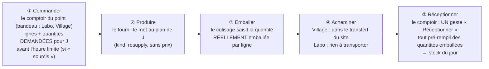

# Plan — le réapprovisionnement d'un site

> **État au 2026-10-21 : partiel.** La **réception** est bâtie (agrégat
> `ResupplyReceipt`, `b2b/resupply/`, et la page Comptoir › Réassort boutique —
> [`plan-jour-meme-sur-stock.md`](../limites-de-commande/plan-jour-meme-sur-stock.md)
> §7), ainsi que le réglage « soumis à l'heure limite / sans limite », stocké
> sans effet. Restent : la **commande au fournil** (`SiteResupply`, lots R1–R5)
> et son branchement aux lecteurs du fournil, du colisage et du transfert ; la
> décision A/B est tranchée en B (§9).
>
> **Doc-first d'origine, 2026-10-14.** Planifié par Hugo
> (« oui planifie le réassort après ») à la suite du transfert interne
> ([`plan-transfert-interne.md`](../livraisons/transferts/plan-transfert-interne.md)), qui lui a déjà
> réservé sa place : l'élément de transfert de genre `resupply`, le cadre
> « Réapprovisionnement » du colisage, le format de ligne du manifeste.
>
> Chaque affirmation sur l'existant est datée et a été ouverte le 2026-10-14 ;
> ce qui ne l'a pas été est marqué « non vérifié ».

## 1. La demande

Hugo, 2026-10-13 : un même transfert porte « des commandes pour le retrait
village **et** le réassort boutique » ; le réassort, « c'est facile, c'est
comme une commande mais au niveau du site, j'imagine pour l'instant avec les
mêmes limites produit pour simplifier ». Vocabulaire tranché le même jour :
**réapprovisionnement** (`resupply`), jamais « réassort » dans le code.

Hugo, 2026-10-14 : voir dans la démo une tournée de début d'après-midi qui
porte du réapprovisionnement.

## 2. Ce qui existe (vérifié le 2026-10-14)

- `delivery_internal_transfer_item` accepte `kind = 'resupply'` avec un
  `resupply_id` **opaque**, sans clé étrangère ; aucun écrivain ne le produit.
- Le manifeste du transfert a une section « réapprovisionnement » au même
  format de ligne (SKU, libellé, quantité) que les commandes ; elle est vide.
- Le colisage a un cadre `replenishment` dans le cadre du transfert
  (`packing-frames.ts`), alimenté par un argument que rien ne fournit.
- La production ne connaît une commande que par un identifiant opaque et un
  snapshot (CLAUDE.md §3) — un réapprovisionnement peut y entrer de la même
  façon.

## 3. La décision structurante : une commande, ou son propre agrégat ?

|                                 | A — une `Order` dont le client est un site                                                                                                            | B — un agrégat `SiteResupply`                                                               |
| ------------------------------- | ----------------------------------------------------------------------------------------------------------------------------------------------------- | ------------------------------------------------------------------------------------------- |
| Production, colisage, transfert | gratuits : ils lisent déjà les commandes                                                                                                              | une seconde source à brancher dans chaque lecteur (fournil, colisage, contenu du transfert) |
| Argent                          | une commande porte prix, TVA, règlement, chiffre d'affaires, facturation : il faudrait les neutraliser partout, et chaque oubli compte un faux revenu | aucun : un réapprovisionnement est un mouvement interne                                     |
| Invariants                      | `Order` suppose une société ou une personne, une clientèle `b2b`/`b2c`                                                                                | les siens : un site destinataire, des lignes, un jour                                       |
| Risque                          | **élevé** — touche l'argent à tous les étages                                                                                                         | modéré — touche des lecteurs                                                                |

**Proposé : B.** L'argent est l'endroit où se tromper coûte le plus, et A
demanderait de prouver partout qu'un réapprovisionnement ne compte pas. B
paie en branchements ce que A paierait en exceptions.

## 4. Le modèle proposé (B)

- **Agrégat `SiteResupply`** dans `b2b/resupply/` : `siteId` (un site
  `supply = transfer`), `serviceDay`, lignes `{ sku, label, quantity }`
  copiées du catalogue au moment de la saisie (snapshot, comme une commande),
  état `draft → placed → cancelled`, auteur (staff).
- **Mêmes limites produit que les commandes** (Hugo) : heure limite de la
  journée, quantités et multiples de l'article — lus par les mêmes règles,
  appliqués à la transition `place()`.
- **Aucun prix, aucune TVA, aucun règlement.** Le snapshot ne porte pas de
  champ monétaire (la porte `lint:price-door` le tiendra).
- **Production** : le fournil lit un réapprovisionnement placé comme une
  commande à produire, par son canal (`production/channels/commerce/`) —
  identifiant opaque préfixé, échéance = celle du transfert du site (T0).
- **Transfert** : à la passation (ou à la clôture si la journée est close),
  l'abonné de T2 range le réapprovisionnement dans le transfert prévu du site
  comme il range une commande ; le manifeste lit son contenu.
- **Colisage** : ses colis vont dans les bacs du transfert (Q-T4 révisée) ;
  le cadre `replenishment` reçoit ses éléments.
- **Droit** : une ressource neuve `lfc_site_resupply` (lecture / écriture),
  accordée à l'écran — jamais par migration.
- **Écran** : Réglages ? Non — c'est un geste du jour. Proposé : une entrée
  « Réapprovisionnement » sous Commandes dans le menu principal, une saisie par
  site et par jour, liste d'articles du catalogue avec quantités.

## 5. Lots

| Lot | Taille | Contenu                                                                                                                             | Dépend de           |
| --- | ------ | ----------------------------------------------------------------------------------------------------------------------------------- | ------------------- |
| R1  | M      | agrégat, table `resupply` + lignes (migration additive), ressource `lfc_site_resupply`, commandes placer / annuler, limites produit | —                   |
| R2  | M      | le fournil le produit (canal), le transfert le porte (abonné), le manifeste lit son contenu                                         | R1, transfert T1–T3 |
| R3  | S      | colisage : ses colis au cadre du transfert, dans les bacs du transfert                                                              | R2                  |
| R4  | M      | écran de saisie au back-office                                                                                                      | R1                  |
| R5  | S      | semis : un réapprovisionnement de Val Village l'après-midi de J                                                                     | R2                  |

`vitruve` d'office avant de bâtir : migration et frontière de droits.

## 6. Questions à Hugo

- **Q-R1** — A ou B (§3) ? Proposé : **B**.
- ~~**Q-R2**~~ — ✅ (Hugo, 2026-10-14) : **les deux**. « Le site commande le
  réassort » — c'est le geste normal, fait par l'équipe du site ; « en cas de
  problème, ou si le site appelle, le labo peut enregistrer le réassort pour
  le village ». Conséquence : le réapprovisionnement porte son **auteur** et
  **pour quel site** il est saisi ; l'écran propose d'office le site de qui
  saisit, et laisse le labo choisir le site. **Non vérifié** : le dépôt
  sait-il rattacher un membre du staff à un site ? Si non, R1 commence par un
  droit unique `lfc_site_resupply` (tout détenteur saisit pour tout site), et
  le cloisonnement par site devient une question à part.
- **Q-R3** — Un site servi **sur place** (le Labo) a-t-il du
  réapprovisionnement ? Proposé : non — il se sert au fournil, sans transport.
- **Q-R4** — Un réapprovisionnement récurrent (le même chaque jour), ou saisi
  chaque fois ? Proposé : saisi chaque fois d'abord, gabarit plus tard.
- **Q-R5** — Faut-il en tenir un coût interne (valorisation du stock du
  site) ? Proposé : non pour R1–R5 ; si oui, c'est un plan d'argent à part.

## 7. Contradiction de `vitruve` (2026-10-14) — le §3 est à refaire

L'option B a été chiffrée trop bas. Toute la chaîne aval est **en forme de
commande**, et un réapprovisionnement qui y entre par un identifiant préfixé
en devient un discriminant implicite :

- `ProducibleOrder` exige `fulfillmentMethod` (`pickup` | `delivery`),
  `clientele`, `customerLabel` ;
- `production.day_closed`, `production.packing_list_drawn` et la table
  `packing_order` (clé `(service_day, order_id)`, `fulfillment_method` non
  nul) supposent une commande ;
- `packing.order_packed` → `MarkOrderReadyCommand` lève
  `OrderReferenceNotFoundError` sur un id inconnu : un abonné durable en
  lettre morte à chaque réapprovisionnement colisé ;
- le rangement au transfert lit `TransferOrdersReader` (commandes seulement)
  et part du fait `commerce-order-placed` ; il faut un fait neuf et son
  annulation, et l'ordre des verrous de `OrderWithdrawalDesk` ;
- l'échéance du transfert vit dans `delivery` : le commerce la lirait par un
  port à nommer.

Et deux promesses fausses : les « quantités et multiples » de l'article
**n'existent pas** (`OrderLine` ne vérifie qu'un entier > 0) ; l'heure limite
est indexée par point de retrait et jour de semaine, et la limite par
article se lit par **audience** (`pro` | `public`), qu'un réapprovisionnement
n'a pas. `lint:price-door` ne tiendrait pas l'absence de champ monétaire.

**Suite** : mesurer honnêtement ce que coûterait l'option A (où une commande
compte de l'argent : chiffre d'affaires, facturation, règlement), puis
re-trancher Q-R1 avec un champ `kind` explicite au contrat dans les deux cas.

## 8. L'option A mesurée (2026-10-14)

Lecture du code (exploration, lignes citées dans l'échange du jour) : une
commande touche l'argent ou le client à **20 endroits** — 16 points de
changement, 4 contraintes de l'agrégat. **6** se règlent par un filtre unique
(`revenueWhere`, `billableOrderWhere`, l'écrivain du journal `order.placed`,
le volume par SKU des paliers, `earningFor`, le courriel « prête ») ; **10**
demandent une branche. **10 sont dangereux** : un oubli y compte un faux
chiffre d'affaires, **facture ou prélève réellement** une société
(`billableOrderWhere`), ouvre une intention Stripe (`settleOrder`) ou envoie un
courriel. Et l'agrégat `Order` calcule toujours prix, TVA et total : A exige
une branche dans l'agrégat lui-même.

|                    | A — une commande                                    | B — un agrégat à part                                  |
| ------------------ | --------------------------------------------------- | ------------------------------------------------------ |
| Endroits à toucher | ~20                                                 | ~8 (3 faits durables, 4 abonnés, réception/annulation) |
| Un oubli…          | se tait : faux revenu, vraie facture, vrai courriel | crie : abonné en lettre morte, visible à la santé      |
| Argent             | partout                                             | nulle part                                             |

**Recommandation maintenue : B**, avec un **genre explicite** (`kind:
order | resupply`) au contrat de ce que le fournil produit et dans les faits
`production.*` / `packing.*`, plutôt qu'un identifiant préfixé.

## 9. Décision de Hugo (2026-10-21) : B

« Pas de prix, part sur B. » Le réapprovisionnement d'un site est un **agrégat
à part** (`SiteResupply`), jamais une commande : pas de prix, pas de TVA, pas
de règlement, pas de chiffre d'affaires. Le coût est de le brancher dans les
lecteurs du fournil, du colisage et du transfert (§3), le jour où il sera
commandé au fournil. La **réception** au comptoir (lignes produit, quantités
reçues, stock estimé du jour) est bâtie avant la commande, le 2026-10-21 —
voir [`../limites-de-commande/plan-jour-meme-sur-stock.md`](../limites-de-commande/plan-jour-meme-sur-stock.md).

## 10. Le circuit complet : commander, produire et emballer, réceptionner (Hugo, 2026-10-21) — l'emporte sur les §4–§5

> « La base c'est commander un réassort ; ensuite la prod produit, emballe, et
> donne donc la quantité réelle produite ; le comptoir atteste de la réception
> de cette quantité et ça remplit tout d'un coup. Personne ne fera du ligne par
> ligne en plein service. » — Hugo, 2026-10-21.

- **① Commander** (`SiteResupply.place`) : par le comptoir du point choisi dans
  le bandeau (Hugo : « le comptoir ; on verra la granularité du droit plus
  tard ») — un droit unique pour commencer. Soumis à l'heure limite générale
  si le réglage `resupply_subject_to_cutoff` le dit (bâti, sans effet
  jusqu'ici). Aucun prix (décision B, §9).
- **② Produire** : le fournil le lit par son canal avec un **genre explicite**
  `kind: order | resupply` (§8), jamais un identifiant préfixé ; il entre dans
  le plan de J et se fige avec lui à l'heure limite.
- **③ Emballer** : le colisage saisit la quantité RÉELLE emballée par ligne (le
  fournil peut produire moins) ; un fait `packing.resupply_packed` la publie.
- **④ Acheminer** : un point servi par transfert (Village) le reçoit dans le
  transfert de J ; le Labo, servi sur place, n'a rien à transporter (Q-R3 :
  le réassort du Labo EXISTE — Hugo : « réassort Labo si switch Labo »).
- **⑤ Réceptionner** : la page Réassort du comptoir (déjà bâtie pour la saisie,
  2026-10-21, commit 558b376c8) devient l'écran de RÉCEPTION : la liste
  emballée en lecture, un bouton **« Réceptionner »** qui atteste tout d'un
  coup ; une ligne ne se corrige qu'en cas d'écart (bac abîmé, erreur). La
  réception remplit `ResupplyReceipt` (la partie « reçue ») → stock du jour.
  La saisie manuelle actuelle reste le secours (réassort non commandé).

### Lots (remplacent R1–R5)

| Lot    | Contenu                                                                                                                                                                               |
| ------ | ------------------------------------------------------------------------------------------------------------------------------------------------------------------------------------- |
| **C1** | `SiteResupply` (commande : brouillon → placé → annulé), table + lignes, routes sous le droit du comptoir, heure limite si soumis ; écran « Commander le réassort » du point (bandeau) |
| **C2** | Le fournil le produit (canal, `kind: resupply`), le plan le fige à l'heure limite                                                                                                     |
| **C3** | Le colisage : le réassort à la liste à coliser, la quantité réellement emballée, `packing.resupply_packed` ; au transfert pour un point servi par transfert                           |
| **C4** | La réception en un geste : page Réassort pré-remplie, « Réceptionner », écarts par ligne → `ResupplyReceipt`                                                                          |

`vitruve` d'office avant C1 : il déplace des frontières entre blocs (commerce,
fournil, colisage, livraison) et en crée de nouveaux faits durables.

### Questions

- **Q-C1** — Un modèle récurrent (« le réassort habituel du mardi » pré-rempli)
  dès C1, ou plus tard ? (Q-R4 proposait « plus tard ».)
- **Q-C2** — Un écart à la réception (moins reçu qu'emballé) : simple
  correction, ou un signalement au fournil ?

**Décisions de Hugo (2026-10-21)** : Q-C1 — le modèle récurrent, **plus
tard** ; Q-C2 — le signalement d'un écart au fournil, **plus tard** (un écart
se corrige simplement sur la ligne à la réception).

## 11. Le plan live — révision de Hugo après `vitruve` (2026-10-21) — l'emporte sur le §10

`vitruve` a contredit le §10 le 2026-10-21 (quatre BLOQUANTS : bac incomplet,
« sans limite » contre « se fige avec le plan », canal de la quantité emballée,
réception sans « attendu »). Hugo y a répondu en changeant le modèle :

- « Le fournil n'est pas censé être au courant des commandes client du jour J,
  puisqu'elles sont prises sur du stock. » → **pas de concurrence** entre
  clients et réassort : le réassort EST ce qui remplit le stock de la vitrine ;
  les commandes de demain ont leur propre production, dans le plan figé.
- « Les réassorts doivent être un plan parallèle, le plan live. » → **deux
  plans** :

|          | Le plan du lendemain                          | Le plan live (réassort)                           |
| -------- | --------------------------------------------- | ------------------------------------------------- |
| Contient | les commandes client pour demain              | les réassorts des points                          |
| Se ferme | à l'heure limite générale (§ une seule heure) | **jamais figé**                                   |
| Alimente | les retraits et livraisons de demain          | le stock de la vitrine (jour même)                |
| Colisage | tout le dû doit être au bac                   | **la quantité réelle**, un bac incomplet se ferme |

- « Il faut faire les deux : le soir, le point commande pour le lendemain ;
  dans la journée, c'est faire au plus tôt. » → un réassort vise **soit demain**
  (la commande du soir, préparée pour le matin), **soit « au plus tôt »**
  (aujourd'hui, quand la vitrine se vide). Les deux entrent au plan live.
- Le réglage « réassort soumis à l'heure limite / sans limite » **est gardé** :
  soumis, la commande du soir pour demain doit passer avant l'heure limite
  générale ; sans limite, elle peut arriver jusqu'au matin. Le « au plus tôt »
  du jour n'a pas d'heure limite.

### Ce que ça règle dans les objections de `vitruve`

- **Bac incomplet** : le colisage du plan live ferme un bac à la quantité
  réelle — une règle de fermeture propre au réassort, distincte de
  `PackingSheet.seal()` qui exige tout le dû.
- **« Sans limite » contre le gel** : le réassort n'entre pas dans le plan figé ;
  il n'y a plus de contradiction.
- **Priorité clients / réassort** : sans objet.

### Ce qui reste à concevoir (avant de bâtir)

- **Le canal de la quantité emballée** : déclaré par le fournil, publié par le
  colisage, lu par le commerce (le chemin de `PackingOrderPackedEvent`), avec
  une clé versionnée (une réouverture corrigée doit atteindre la réception).
- **L'« attendu » distinct du « reçu »** dans la réception : l'emballé remplit
  l'attendu ; « Réceptionner » le recopie en reçu (le stock ne monte qu'à la
  réception, jamais à l'emballage). Saisie de secours et deux réassorts le
  même jour sur un même article : additionner.
- **Le plan live côté fournil** : un écran « à produire au plus tôt » à côté du
  plan figé ; ce que le fournil produit sans commande de réassort reste hors
  du système (pas de stock réel).
- **Le transfert du Village** : des faits « réassort placé / annulé » et un
  lecteur dans `delivery/channels/commerce/`, le réassort « au plus tôt »
  partant par la prochaine tournée ; le Labo n'a rien à transporter, son bac
  prêt se voit à la page de réception.
- Une union discriminée côté fournil (`kind: order | resupply`) pour ce qu'il
  produit, le réassort ne portant ni clientèle ni mode d'acheminement.

Ce §11 se refait contredire par `vitruve` avant le lot C1.

## 12. Contredit une seconde fois, et tranché (Hugo, 2026-10-21) — l'emporte sur le §11

`vitruve` (2026-10-21) : un plan jamais figé ne s'accroche à rien de
l'existant — le colisage et la composition des tournées ne se déclenchent qu'à
l'arrêt du plan (`production.packing_list_drawn`, `production.day_closed`) ; la
réception bâtie refuse un même article deux fois ; la commande du soir hors
plan figé n'apparaîtrait sur aucune feuille de production.

Décisions de Hugo :

- **La commande du soir pour demain entre dans le plan FIGÉ du lendemain**,
  mais **distinguée** (« dans le plan figé c'est pas mal, mais il faut
  distinguer tout de même ») : genre explicite `kind: resupply`, section à
  part sur la feuille de production, au colisage et au transfert — jamais
  mêlée aux commandes client. Le réglage `resupply_subject_to_cutoff` garde
  ainsi son sens : soumise, elle passe avant l'heure limite.
- **« Au plus tôt » dans la journée** reste le plan live : conçu plus tard (R3,
  R4).
- **Un reçu par réassort** : chaque réassort se réceptionne à part ; le stock
  du jour additionne. La saisie de secours devient un « réassort sans
  commande ».

### Lots (remplacent C1–C4)

| Lot                                         | Contenu                                                                                                                                                                                                                                                  | Touche                                                      |
| ------------------------------------------- | -------------------------------------------------------------------------------------------------------------------------------------------------------------------------------------------------------------------------------------------------------- | ----------------------------------------------------------- |
| **R1** ✅ (bâti le 2026-10-21, non commité) | `SiteResupply` : commander (le soir pour demain, ou « au plus tôt »), annuler ; écran du comptoir pour le point du bandeau ; écran du fournil « réassorts à produire » EN LECTURE (demain et aujourd'hui, distingués) — état dans le [README](README.md) | commerce, back-office                                       |
| **R2**                                      | Réception en un geste : un reçu par réassort, pré-rempli de la quantité DEMANDÉE, « Réceptionner », écarts par ligne ; la saisie de secours = réassort sans commande ; stock du jour = somme des reçus                                                   | commerce, back-office (migration de la réception : vitruve) |
| **R3**                                      | Le réassort du soir au plan figé : feuille de production, colisage (quantité réelle), transfert du Village — section distincte                                                                                                                           | fournil, colisage, livraison                                |
| **R4**                                      | « Au plus tôt » : le plan live au colisage et aux tournées                                                                                                                                                                                               | à concevoir                                                 |

### R1b — Rupture et stock faible au comptoir (Hugo, 2026-10-21)

« Au comptoir on devrait pouvoir déclarer une rupture, un stock faible sur un
produit, ce qui permettrait déjà de bloquer les commandes, avertir. » Et : « pas
forcément pour aujourd'hui, dans la mesure où un réassort relève le stock. »

- **Déclarer** « Rupture » ou « Stock faible » sur un produit, pour un point
  (celui du bandeau), depuis la page Réassort.
- **Durée** : jusqu'à la réception d'un réassort de ce produit au point (R2),
  ou jusqu'à ce que le comptoir la lève à la main — jamais levée d'elle-même
  le lendemain.
- **Effets**, en attendant le circuit du jour même :
  - une **alerte** sur l'écran du fournil « Réassorts à produire » (« Village :
    rupture de croissants »), avec « Lancer un réassort au plus tôt » pour ce
    produit ;
  - la mention sur la page Réassort du point.
- **Plus tard (J2, le jour même)** : une rupture bloque la vente EN LIGNE du jour
  sur stock de ce produit au point ; un stock faible avertit le client. Les
  commandes pour demain ne sont jamais bloquées (elles sont produites au plan).

Bâti juste après R1 (même page).
