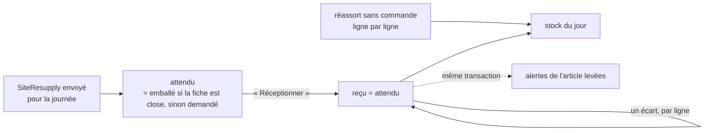
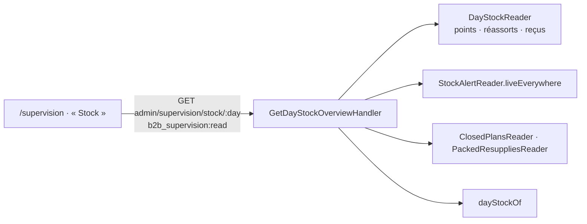

# Réceptionner, alerter, compter — le stock du jour d'une vitrine

> **Doc d'état**, ouverte dans le code le 2026-11-02. Entrée du dossier :
> [`README.md`](README.md). Les commandes qui puisent dans ce stock sont dans
> [`../limites-de-commande/jour-meme-sur-stock.md`](../limites-de-commande/jour-meme-sur-stock.md).

## 1. La réception — un geste par réassort

Décisions de Hugo du 2026-10-21 : « personne ne fera du ligne par ligne en
plein service » ; un reçu par réassort ; la saisie de secours devient un
« réassort sans commande » ; le stock du jour additionne les reçus.

L'agrégat `ResupplyReceipt`
(`apps/lfd-api/src/lafoliecoffee/resupply/domain/resupply-receipt.ts:67`) a deux
sortes, une seule règle — seul le reçu compte au stock :

- **le reçu d'un réassort envoyé** : `expecting` (l. 88) le fait naître
  attendu (`expectedLinesOf`, `apps/lfd-api/src/lafoliecoffee/resupply/domain/resupply-receipt-expected.ts:35` : l'emballé lu par
  `PackedResuppliesReader` si la fiche du colisage est close, sinon le
  demandé) ; `receiveAll` (l. 156) recopie l'attendu en reçu d'un geste ;
  une ligne ne se corrige (`correct`, l. 189) qu'**après**
  (`resupply.receipt.not_yet_received`). On n'y ajoute ni n'en retire
  d'article : un article en plus va au sans commande, un manquant se corrige
  à zéro. **Un second « Réceptionner » rend succès sans rien écrire**
  (décision E2 du 2026-11-03, la politique de l'envoi du comptoir) : le
  handler relit la réception avant d'écrire, et, si deux postes se croisent
  à l'écriture, la relit HORS de la transaction défaite. Le domaine refuse
  toujours un second `receiveAll` (`resupply.receipt.already_received`, qui
  et quand) : c'est l'application qui ne le lui demande plus. Seul un
  réassort envoyé et non annulé se réceptionne
  (`resupply.receipt.resupply_not_receivable`, tenu par
  `SiteResupply.assertReceivable`), et pas avant sa journée
  (`resupply.receipt.day_not_yet_come`). Le réassort est SAUVÉ sous sa version
  avant le reçu : une annulation ou une arrivée lues avant échouent en 409
  (G1, 2026-11-02) ;
- **le réassort sans commande** (`resupplyId` nul, `openUnordered`, l. 110) :
  `receive` (l. 184), `correct`, `withdraw` ligne par ligne — « Réceptionner » d'un
  geste y est refusé (`resupply.receipt.not_bound_to_resupply`) —, au plus un par (point,
  journée) (index unique partiel `resupply_receipt_unordered_key`). **Il ne
  se saisit qu'aujourd'hui** (décision E1, 2026-11-03 : la journée du geste
  à l'heure de Paris, horloge du serveur ; sinon
  `resupply.receipt.unordered_not_today`, 409). Le même article à la même
  quantité, saisi deux fois, rend succès sans rien écrire (E2, `holds`) ; à
  une autre quantité, il est refusé (`resupply.receipt.line_already_present`
  — c'est une correction).

Le reçu n'est écrit en base qu'une fois reçu : avant, l'attendu se lit du
réassort. Ses lignes s'écrivent par différence avec la base
(`apps/lfd-api/src/lafoliecoffee/resupply/infrastructure/resupply-receipt-lines.writer.ts`) : une correction n'en
réécrit qu'une. Une ligne relue dont un geste daté n'a pas son auteur entier
est refusée (`resupply.row.unreadable`, 500), jamais comblée de chaînes
vides. Le stock ne monte qu'à la réception, jamais à l'envoi ni à
l'emballage. Un reçu porte une `version` (`resupply.receipt.changed_meanwhile`).
Une réception faite avant la clôture du colisage reste ce qu'elle est : un
emballé connu après ne change rien (le comptoir fait foi).

**Routes** — `admin/resupply-receipts` (`http/admin-resupply-receipts.controller.ts:47`),
`handover_counter` : `GET articles` (le catalogue publié, pièces et poids,
avec la famille — ce que le rayon montre, `isShownAsTile` : le défaut et
les déclinaisons en vignette ; la validation d'un article saisi suit le même
critère depuis le 2026-11-03, décision E4), `GET :siteId/:day` (les réassorts envoyés de la journée
avec leur réception, le sans commande, le stock),
`POST :siteId/resupplies/:resupplyId/receive`,
`PATCH :siteId/resupplies/:resupplyId/lines/:sku`, et
`POST|PATCH|DELETE :siteId/:day/lines…` pour le sans commande
(`ReceiveUnorderedReceiptLine`, `CorrectUnorderedReceiptLine`,
`WithdrawUnorderedReceiptLine` — renommés le 2026-11-02 pour ne plus se lire
comme les gestes de la demande ; contrats `receiveUnorderedReceiptLineSchema`
et `correctReceiptLineSchema`). Le `:sku` du chemin est validé (400 qui le
nomme).

**L'écran** — en tête de Comptoir › Réassort, seulement s'il y en a,
`resupply-receptions-card/` : chaque réassort attendu de la journée, ses
étapes (Envoyé → Lancé → Parti → Arrivé, « Attendu » / « Arrivé »), son
origine (« Envoyé par le fournil », « Pain rendu, envoyé par la réserve »),
un bouton « Réceptionner », puis « Réceptionné par X à HH:MM » et l'écart par
ligne. Le reçu sans commande est dans le menu de chaque ligne de la table.

## 2. Le stock du jour

- **Le stock est le réassort reçu** au point ce jour-là, reçus
  **réceptionnés** seulement, moins ce que les commandes « sur stock » du
  jour ont pris. Sans reçu, pas de stock — **jamais un stock inventé**.
- **Un seul calcul** : `estimateStock(receipts, draws)`, pure
  (`lafoliecoffee/resupply/domain/estimated-stock.ts:50`), **par (article, unité)**
  (`stockKeyOf`, `domain/stock-tally.ts:4`) — jamais pièces et grammes ensemble ; un article au
  poids a un stock en grammes entiers (Hugo, 2026-11-02). `DayShelfStock`
  (`application/day-shelf-stock.ts:20`) est le seul à lui passer les
  prélèvements, lus par `ShelfDrawsReader` (déclaré par le réassort,
  implémenté par les commandes, relié par
  `apps/lfd-api/src/appBootstrap/shelf-draws-feed.module.ts` depuis le 2026-11-03 — un
  câblage dans `OrdersModule` ferait un cycle). La Supervision les lit en
  une fois pour la journée (`drawsOn`, `DayShelfStock.allOn`), plus point
  par point.
- **Toute baisse d'un reçu** (corriger une ligne réceptionnée, corriger ou
  retirer une ligne sans commande) passe par `ReceivedStockLowering.lower`
  (`application/received-stock-lowering.ts:39`), sous `ShelfStockLock`, et
  refuse de descendre sous le déjà-pris
  (`resupply.receipt.below_shelf_draws`, 409).
- **Les commandes pour demain ne s'y soustraient pas** : elles sont dans le
  plan du fournil et ne puisent pas dans la vitrine.

## 3. Rupture et stock faible

« Au comptoir on devrait pouvoir déclarer une rupture, un stock faible sur un
produit » (Hugo, 2026-10-21).

- **L'agrégat** `StockAlert` (`domain/stock-alert.ts:69`) : une alerte vivante
  par (point, SKU), niveau `out_of_stock` ou `low`, libellé figé, auteur et
  instant de la dernière déclaration. Redéclarer change le niveau
  (`redeclare`, l. 134) ; une alerte levée ne se rouvre pas.
- **Sa durée** : aucune échéance. Elle tient jusqu'à ce que le comptoir la
  lève (`liftByHand`, l. 141, raison `manual`) ou qu'une ligne de l'article
  soit reçue > 0 au point (`liftOnReceipt`, l. 146, raison `receipt`) — par
  `liftStockAlertsOnReceipt` (`application/lift-stock-alert-on-receipt.ts`),
  dans l'unité de travail de « Réceptionner » et du sans commande — une
  lecture des alertes vivantes pour tout le reçu. Corriger
  ou retirer une ligne ne lève rien.
- **La table** `site_stock_alert`, index unique partiel `(site_id, sku) WHERE
lifted_at IS NULL` ; une levée garde qui, quand et pourquoi. Deux
  déclarations simultanées du même article : la seconde reçoit 409
  `resupply.stock_alert.declared_meanwhile` (2026-11-02). L'index partiel
  `site_stock_alert_live_declared_idx` sert la lecture de tous les points.
- **Routes** : `admin/site-stock-alerts/sites/:siteId` (`handover_counter` :
  lire, `POST { sku, level }`, `…/:alertId/lift`) ;
  `admin/site-stock-alerts/live` (`production_resupply:read`) : les alertes
  vivantes de tous les points.
- **Les écrans** : l'état OK · Faible · Rupture de chaque ligne de la table du
  comptoir (`stock-alert-actions/`, `stock-alerts-card/`) ; au fournil, en
  marque sur les lignes de l'onglet Réassorts, **pour information**.
- **Aucun effet sur la boutique ni sur la passation** : une rupture ne bloque
  rien, un stock faible n'avertit personne. Ce qui borne la vente du jour,
  c'est le reste calculé (§2).

## 4. L'onglet Stock de la Supervision

`/supervision` porte une bascule **« Journée · Stock »** dans son bandeau.
« Stock » montre, pour le jour regardé, une carte par point, en lecture
seule.

- **Le calcul** `dayStockOf` (`domain/day-stock.ts:76`) : l'état d'un
  réassort est le plus avancé de réceptionné › arrivé › parti › lancé › figé ›
  envoyé ; un annulé n'y est que s'il avait été réceptionné. Par produit et
  unité : le stock du jour, l'alerte vivante, l'attendu (l'emballé, sinon le
  demandé, des réassorts ni annulés ni réceptionnés). Seuls les produits
  qu'un reçu, une alerte ou un attendu nomment ; tri : alertes, attendus, le
  reste.
- **Tous les points non archivés** ont leur carte, même vide ; un point
  archivé n'y vient que s'il porte quelque chose ce jour-là.
- **Front** `supervision/stock-board/`, rafraîchi avec les colonnes. Les
  écritures du réassort font bouger la version du jour (déclencheurs
  `day_change`, migration `20261022140000_le_reassort_fait_bouger_la_journee`)
  ; une alerte, qui ne porte pas de jour, ne se voit qu'au prochain mouvement
  ou au rechargement. Le renvoi « Ouvrir le réassort » mène à
  `/prod-manager/reassorts`.
