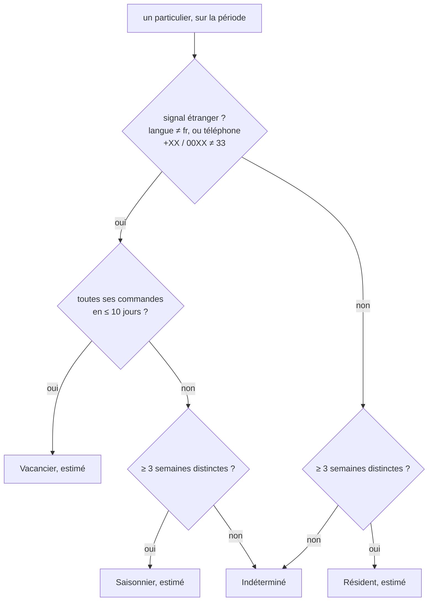
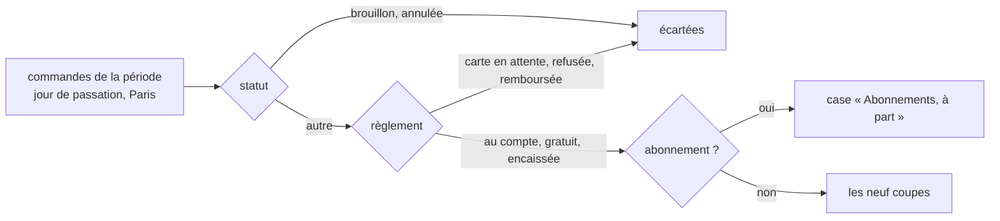

# Les audiences de la clientèle — ce qui est bâti

> **Doc d'état** (2026-10-18, lots A1 et A3 de [`plan-audiences.md`](plan-audiences.md)).
> Elle dit ce qui existe ; le plan garde ce qui reste (A2–A4) et la décision
> attendue sur le regroupement NAF (Q4). Bâti et éprouvé aux trois niveaux
> (domaine, application, e2e) ; pas encore regardé dans un navigateur contre
> l'API locale.

## 1. En une phrase

Un tableau de bord au back-office, **Analytics › Audiences**, qui décrit la
clientèle par ce qu'elle fait — neuf coupes, sur 7, 30 ou 90 jours — en
chiffres **agrégés** : une case de moins de **5 clients distincts** ne montre
aucun chiffre, et aucun identifiant de client ne sort du serveur.

## 2. Les neuf coupes

| Coupe (`dimension`) | Cases                                                                                | Source                                                                                           |
| ------------------- | ------------------------------------------------------------------------------------ | ------------------------------------------------------------------------------------------------ |
| `clientele`         | Professionnels, Particuliers                                                         | `orders.clientele` ; une commande d'avant la colonne est pro si elle porte une société           |
| `activity`          | Hôtellerie, Restauration, Café-bar, Commerce alimentaire, Autre, Non renseignée      | `companies.naf_code` de la société de la commande, regroupé (§4) ; les particuliers n'y sont pas |
| `fulfillment`       | Retrait, Livraison                                                                   | `orders.fulfillment_method`                                                                      |
| `pickup_site`       | une case par site, « non renseigné » pour une commande d'avant les sites             | `pickup_address->>'siteId'`, nommé par `pickup_address->>'label'`                                |
| `delivery_zone`     | une case par code postal livré, nommée « code commune »                              | `delivery_address_snapshot->>'codePostal'` et `->>'ville'`                                       |
| `loyalty`           | 1 commande, 2 à 4, 5 et plus — sur la période                                        | nombre de commandes d'un même client dans le périmètre                                           |
| `moment`            | 35 cases : jour × tranche (nuit 0–7 h, matin 7–11 h, midi 11–14 h, après-midi, soir) | `created_at`, lu **à l'heure de Paris**                                                          |
| `order_locale`      | Français, Anglais, Italien, Non renseignée                                           | `orders.locale` (A3, §2 bis)                                                                     |
| `stay_profile`      | Résident, Saisonnier, Vacancier (tous « estimé »), Indéterminé                       | **estimé** par particulier sur la période (A3, §2 bis) ; les pros n'y sont pas                   |

Le **client** compté est la société pour un pro, la personne sinon
(`COALESCE(company_id, placed_by_user_id)`). Il sert au `COUNT(DISTINCT)` et à
la fidélité, et ne sort jamais de la requête.

Chaque case porte : clients distincts, commandes, chiffre d'affaires **HT**
(marchandises : `subtotal − remise − bon`, sans frais ni TVA) et **TTC**
(`total_cents`, frais compris), les deux paniers moyens, et les trois familles
de produits au plus gros CA HT de lignes (« Famille inconnue » pour un article
que le catalogue ne sert plus). Tout est en centimes ; aucun prix en
millicentimes n'est lu.

## 2 bis. La langue de la commande et le profil de séjour estimé (A3)

**La langue** : `orders.locale` (`fr` | `en` | `it`, CHECK en base), posée
par l'agrégat `Order` (value object `OrderLocale`) depuis le champ facultatif
`locale` des contrats `POST /orders` et `POST /shop/orders`. La boutique y met
la langue de son interface au moment du clic. `NULL` — la case « Non
renseignée » — pour une saisie de l'équipe (le contrat staff n'a pas le
champ ; l'agrégat refuse une langue sur une commande saisie par l'équipe),
une boutique qui ne l'envoie pas, et **toutes les commandes d'avant le
2026-10-18, jamais rattrapées**.

**Le profil de séjour** n'est **jamais déclaré ni stocké** : la requête rend,
par particulier, trois signaux encodés dans la clé brute de la case, et le
domaine les nomme (`stay-profiles.ts`) :

Un numéro sans indicatif (`06…`) ne dit rien ; le téléphone lu est celui
d'aujourd'hui. L'écran titre la coupe « Profil de séjour (estimé) » et en
donne la règle en une phrase ; l'outil agent le dit aussi. Le même seuil de
5 clients s'applique à chaque case. Les limites (saisonnier fragile, rien
au-delà de vacancier sur 7 jours) sont au §9 du plan.

## 3. Le périmètre des commandes

- **Gardées, à la différence des chiffres des suggestions (RS6)** : les
  commandes saisies par l'équipe. RS6 les écarte parce qu'elles n'ont vu aucune
  suggestion ; ici on décrit qui commande, et une commande prise au téléphone
  reste celle du client. Leur moment est celui de la saisie.
- **À part** : les commandes d'abonnement, dont le moment est celui du
  planificateur et la fréquence automatique — une seule case, sous le même seuil.

Code : `apps/lfd-api/src/b2b/audiences/domain/audience-scope.ts`.

## 4. Le regroupement NAF — ✅ validé par Hugo le 2026-10-18 (Q4)

| Famille                 | Codes NAF rév. 2                                        |
| ----------------------- | ------------------------------------------------------- |
| Hôtellerie              | 55.xx (hôtels, hébergement touristique, campings)       |
| Restauration            | 56.1x, 56.2x (restaurants, rapide, traiteurs, cantines) |
| Café, bar               | 56.30Z                                                  |
| Commerce alimentaire    | 47.11, 47.2x (magasins), 10.71 (boulangeries)           |
| Autre activité          | tout autre code renseigné                               |
| Activité non renseignée | code vide, ou commande pro sans société                 |

Une table de préfixes, `apps/lfd-api/src/b2b/audiences/domain/activity-families.ts` ;
la changer ne touche ni la requête ni l'écran.

## 5. Où ça vit

| Couche      | Fichier                                                                                       |
| ----------- | --------------------------------------------------------------------------------------------- |
| Contrat     | `packages/contracts/src/audiences.ts` — `GET /admin/audiences?days=&dimension=`               |
| Domaine     | `b2b/audiences/domain/` — seuil (`AUDIENCE_MIN_CLIENTS`), coupes, tranches, paliers, NAF      |
| Application | `b2b/audiences/application/queries/get-audiences.*`                                           |
| Lecture SQL | `b2b/orders/infrastructure/prisma-audience-order.reader.ts` — un `GROUP BY` par lecture       |
| Langue      | `orders.locale`, `b2b/orders/domain/value-objects/order-locale.ts`                            |
| Séjour      | `b2b/audiences/domain/stay-profiles.ts` — la règle et ses constantes                          |
| Familles    | `b2b/audiences/infrastructure/catalog-audience-family.reader.ts` (catalogue pro, puis public) |
| HTTP        | `b2b/audiences/http/admin-audiences.controller.ts`, sous `b2b_growth`                         |
| Écran       | `apps/lfd-backoffice-frontend/src/app/analytics/audiences/`                                   |
| Outil agent | `audiences_read` (`agent/audience-agent-tools.ts`), sous `b2b_growth:read`                    |

Un contexte `b2b/audiences/` à lui plutôt qu'un coin de `b2b/recommendations/` :
décrire la clientèle n'est pas recommander, et les suggestions par segment (A4)
liront d'ici par un port. Le port `AudienceOrderReader` est déclaré par les
audiences et implémenté par la commande, comme `SuggestedSkuSalesReader` (RS6).
L'activité se lit par une jointure `orders × companies` dans l'adaptateur de la
commande — deux contextes du même bloc et du même schéma — plutôt que par un
port du compte qui ferait sortir des identifiants de sociétés.

Le droit est **`b2b_growth`**, celui de la croissance et des compteurs
d'audience : la même nature de chiffres, lus pour comprendre. Aucune ressource
neuve, aucun droit écrit en migration. A1 n'avait **aucune migration** ; A3
en ajoute une, additive (`20261018210000_la_langue_de_la_commande`) — une
colonne sur la COMMANDE, rien par personne.

L'écran est la deuxième vue d'Analytics : le rail et le lanceur mobile en font
une section (Croissance, Audiences) ; la croissance garde son adresse
`/analytics`, les audiences sont sous `/analytics/audiences`.

## 6. Ce que ça ne fait pas

- Aucun segment n'est stocké, aucune personne n'est visée (plan, §5).
- Résident · saisonnier · vacancier **déclaré** : rien ici (A2). Seule
  l'estimation existe (A3), affichée comme telle.
- Pas de précalcul : neuf coupes = vingt agrégats par affichage (deux par coupe, deux pour les abonnements), à la
  demande. Un précalcul dans `growth` attendra qu'une mesure le justifie.
