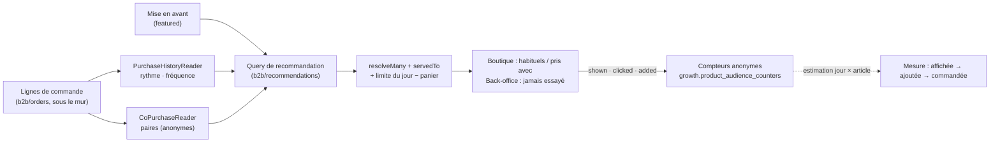

# Plan — la recommandation de produits

> **Où on en est (2026-10-18)**
>
> | Lot                                 | État                                                                                                                                                                                                            |
> | ----------------------------------- | --------------------------------------------------------------------------------------------------------------------------------------------------------------------------------------------------------------- |
> | **R0** — socle                      | ✅ bâti : contexte `b2b/recommendations/`, filtre R4, compteurs d'audience anonymes (R5 bis)                                                                                                                    |
> | **RS** — suggestions du staff       | 🟡 en cours : panier, fiche, accueil, après-ajout, aperçu, chiffres bâtis ([`suggestions-du-staff.md`](suggestions-du-staff.md)) ; la suite dans [`plan-suggestions-du-staff.md`](plan-suggestions-du-staff.md) |
> | **R2** — « souvent pris avec »      | ✅ bâti le 2026-10-18 au panier ([`suggestions-calculees.md`](suggestions-calculees.md)) ; restent les chiffres du calculé à l'écran des résultats, la fiche et l'accueil                                       |
> | **A1** — tableau des audiences      | à faire ([`plan-audiences.md`](plan-audiences.md))                                                                                                                                                              |
> | **R1** — « vos habituels » (pros)   | à faire                                                                                                                                                                                                         |
> | **R3** — « vos habituels » (public) | après l'avis du cabinet ([`historique-du-particulier.md`](historique-du-particulier.md))                                                                                                                        |
> | **R4**, **R5** (lots)               | plus tard                                                                                                                                                                                                       |
>
> Vue d'ensemble du dossier : [`README.md`](README.md).

> Ouvert le 2026-10-17 en doc-first. Les affirmations du §1 sur l'existant
> ont été ouvertes ce jour-là et citées `fichier:ligne` ; elles décrivent
> l'état **d'avant** R0 et n'ont pas été relues depuis, sauf le §1.5.
>
> **Ce plan ne touche pas l'argent** : il choisit QUELS articles montrer, et
> le prix affiché reste celui que la boutique résout déjà. Pas de migration de
> données, pas de déplacement du mur tenant : **pas de `vitruve` d'office**
> (CLAUDE.md §9 bis). Un seul point pourrait le justifier : R3 lit un
> historique **par personne** pour un client public (§6, RGPD).

> **Ordre revu le 2026-10-18 (Hugo)** : le collectif (« souvent pris avec »,
> « les plus commandés ») passe AVANT « vos habituels » — il sert tout le monde,
> invités compris, sous un seuil d'anonymat
> ([`historique-du-particulier.md`](historique-du-particulier.md) §1 bis). Et
> les suggestions décidées par le staff (RS) passent avant tout le calculé.

## 0. La demande

Hugo, 2026-10-17 : « un plan pour la recommandation de produit ».

Proposition reprise : des **règles simples, explicables**, calculées sur **nos
propres commandes**, sans apprentissage automatique au départ ; chaque
suggestion porte sa **raison** (« vous en prenez tous les mardis »). Quatre
usages :

1. **« Vos habituels »** à l'accueil de la boutique — ce qu'un client
   recommande souvent, au bon rythme (surtout les pros) ;
2. **« Souvent pris avec »** dans le panier — co-occurrence dans les commandes ;
3. **« Nouveau » / « De saison »** — mise en avant ;
4. côté commercial, **« ce client n'a jamais essayé… »** — ce que des clients
   semblables prennent.

Garde-fous : ne recommander que ce qui se vend à CE client ; mesurer l'effet
(affichée → cliquée → commandée). Ordre : 1, puis 2, le reste plus tard.

## 1. Ce qui existe (ouvert le 2026-10-17)

### 1.1 L'historique par client et par SKU — il existe déjà, pour les pros

- **`CustomerSkuReader`** — port de `b2b/orders`, fenêtre glissante de
  **12 mois** (`apps/lfd-api/src/b2b/orders/domain/ports/customer-sku.reader.ts:2`).
- Son adaptateur lit les lignes de commande **sous le mur** :
  `where: { order: { companyId, createdAt: { gte: … } } }`
  (`apps/lfd-api/src/b2b/orders/infrastructure/prisma-customer-sku.reader.ts:48`),
  la fenêtre comptée depuis le `Clock` (`…:61-65`), trié par réemploi puis
  récence (`…:57`).
- **`ListCustomerSkusHandler`** rejoint ces habitudes au catalogue
  **d'aujourd'hui**, en un lot, audience `"pro"` écrite en dur
  (`apps/lfd-api/src/b2b/orders/application/queries/list-customer-skus.handler.ts:35-38`),
  et **garde** le SKU disparu avec `stillAvailable: false` (`…:16-18`, `…:49`)
  — c'est le bon choix pour un commercial au téléphone, le **mauvais** pour une
  vitrine : une recommandation ne montre jamais un article qu'on ne peut pas
  commander.
- Il rend `orderCount`, `totalQuantity`, `lastOrderedAt` (`…:45-48`) — **pas de
  rythme** (jour de semaine, intervalle). « Vous en prenez tous les mardis » est
  donc à calculer ; le comptage, lui, existe.

### 1.2 Le client public : compte ou invité ?

- `Order.companyId` est **optionnel** : une commande « zéro friction »
  n'appartient qu'au client connecté, `placedByUserId` étant « LE mur sans
  entreprise » (`apps/lfd-api/prisma/schema/public/orders.prisma:71-74`).
- `placedByUserId` est **obligatoire** (`orders.prisma:89`) : même un invité a
  une ligne `User`, inscrite par `GuestBuyerRegistrar`
  (`apps/lfd-api/src/b2b/orders/application/commands/place-shop-order.handler.ts:17`).
  Comment un invité est reconnu d'une commande à l'autre : **non vérifié**.
- Conséquence : l'historique d'un **particulier connecté** se lit par
  `placedByUserId` ; celui d'un **invité** n'est pas une base de
  recommandation (pas de session durable ; et le recommander supposerait de le
  reconnaître, ce qui est une décision RGPD, pas technique).

### 1.3 Ce que `growth` et `alerts` font déjà

- **`product.first_order`** (`apps/lfd-api/src/b2b/alerts/domain/detectors/first-order.ts:13-31`)
  : détecte, **sur une commande passée**, les lignes jamais commandées par ce
  compte (`everOrdered`), et se tait sur les premières commandes
  (`…:19`). C'est l'**inverse** de l'usage 4 : il constate un premier essai, il
  ne le suggère pas. Le jeu `everOrdered` est en revanche exactement ce dont
  l'usage 4 a besoin pour exclure.
- **Le « moteur de reco » commercial** (`documentation/b2b/espace-commercial-prospects-leads.md` §8)
  recommande des **coups commerciaux** (verrouille / rescousse / upgrade /
  win-back) sur des **prospects et comptes**, pas des produits. Ce qui en est
  bâti : le cockpit lit un top 5 (`apps/lfd-api/src/b2b/growth/application/queries/get-cockpit.handler.ts:12`)
  et **journalise `reco.shown`**, best-effort, idempotent par (sujet, fenêtre de
  recalcul) (`…:15-20`). La boucle `action → issue → recalibrage` est annoncée
  « Phase 2 » (`…:17`) : **non bâtie**. Le moteur d'offre (« croissants 5×/sem →
  abonnement ») du §8 n'existe pas.
- **`ActivityRecorder`** (`apps/lfd-api/src/b2b/growth/domain/ports/activity-recorder.ts:10-29`)
  offre deux garanties ; `record()` est best-effort et idempotent, et son
  JSDoc cite **« une reco affichée »** comme cas d'usage (`…:12-15`). La mesure
  a donc déjà son port et son précédent (`reco.shown`).

### 1.4 « Ce qui se vend à ce client »

- **`servedTo(item, viewer)`** est la règle unique : audience de l'article
  (`pro | public | both`, `null` lu `both`) ET pas masqué pour ce lecteur ET
  validé pour lui (`apps/lfd-api/src/b2b/catalog/domain/served-to.ts:46-54`).
  Son JSDoc nomme les quatre lecteurs qu'elle a remplacés (`…:41-44`) : une
  recommandation sera le cinquième, et **ne doit pas** relire le masquage
  elle-même.
- **`ProductCatalogReader.resolveMany(skus, audience)`**
  (`apps/lfd-api/src/b2b/catalog/domain/ports/product-catalog.reader.ts:110`)
  résout un lot de SKU pour une audience ; `CatalogItem.orderTimeLimit` porte la
  limite de commande de l'article (`…:38-47`).
- **La mise en avant existe** : `SetCatalogFeaturedCommand(sku, audience, featured, decidedBy)`
  (`apps/lfd-api/src/b2b/catalog/application/commands/set-catalog-featured.command.ts`),
  une décision **par audience** depuis le 2026-10-18 — la pastille
  « Incontournable », page Gestion Boutique › Mise en avant
  ([`catalogue-synchronise.md`](../catalogue/catalogue-synchronise.md)).
  L'usage 3 « Nouveau / De saison » a donc déjà son geste manuel ; reste à
  savoir s'il suffit (Q4).
- La rupture et l'heure limite par jour : leurs lecteurs (`b2b/order-cutoffs`,
  `b2b/order-opening`) existent en dossiers ; leur API n'a **pas été ouverte**
  pour ce plan — à lire au lot R1.

### 1.5 Ce que la boutique affiche déjà

- **Le panier et la fiche** montrent la suggestion du staff depuis le
  2026-10-18 ([`suggestions-du-staff.md`](suggestions-du-staff.md)), et
  **rien** sans règle applicable. La relance codée en dur d'avant
  (cart-upsell.service.ts et sa liste `TREATS`, une gourmandise absente du
  panier, sans raison) est retirée le même jour par Hugo, sans repli. L'usage 2
  viendra s'ajouter au même emplacement, après la place du staff.
- L'accueil public a sa vitrine (`client/accueil-public/home-storefront/`) ; la
  route `boutique` existe (`apps/lfc-ecommerce-frontend/src/app/app.routes.ts:271`),
  comme `accueil` (`…:345`). Leur gabarit n'a **pas été ouvert** : l'emplacement
  exact d'un bandeau se décide au lot (fold-ng d'abord).

## 2. Décisions proposées

**R1 — Le calcul vit dans `b2b/`, contexte neuf `b2b/recommendations/`.**
Tout ce qu'il lit est déjà du commerce : les lignes de commande (`b2b/orders`)
et le catalogue servi (`b2b/catalog`). Aucune arête nouvelle dans la matrice du
§3 : `b2b → pim` reste interdit et inutile, `servedTo` suffit. Il ne vit **ni**
dans `growth` (qui parle de prospects et de coups commerciaux) **ni** dans
`orders` (dont l'agrégat n'a rien à garder ici) ; il **déclare** ses ports de
lecture (`PurchaseHistoryReader`, `CoPurchaseReader`) et `orders` les
implémente, comme `CustomerSkuReader` aujourd'hui.

**R2 — Calculé à la lecture d'abord, précalculé seulement quand on l'a mesuré.**
« Vos habituels » = l'agrégat déjà fait par `CustomerSkuReader`, borné à une
société ou une personne : une requête indexée (`orders.prisma:347`, `:349`).
« Souvent pris avec » sur tout l'historique est la seule lecture qui grossit
avec le volume ; on la **précalcule** dans une table de paires
(`sku_a, sku_b, audience, count, computed_at`) quand elle dépasse un seuil
mesuré — pas avant. Le précalcul est une projection, pas un fait métier.

> Bâti à la lecture le 2026-10-18 (R2) : 66 ms en médiane sur 30 000
> commandes de la base jetable, aucune table de paires
> ([`suggestions-calculees.md`](suggestions-calculees.md) §2.2).

**R3 — Chaque suggestion porte sa raison, comme une donnée typée.**
`reason: { kind: "weekly_rhythm", weekday } | { kind: "frequent", orderCount }
| { kind: "bought_with", sku, share } | { kind: "featured" } | { kind: "new" }`
— le front la met en phrase (libellés en français, dictionnaire de la
boutique). Jamais une phrase fabriquée côté serveur, jamais un score nu.

> Bâti le 2026-10-18 pour « souvent pris avec » sous la forme
> `{ source: "data", kind: "bought_with", withSku, withName }` : **sans
> `share`** — une part ou un compte, près du seuil d'anonymat, dirait combien
> de personnes ont fait ce panier. `source` sépare le calculé du décidé (§2 bis).

**R4 — Le filtre est celui de la commande, appliqué en dernier, sans repli.**
Après le calcul : `resolveMany(skus, audience)` puis `servedTo`, puis la limite
de commande du jour. Un article qui ne passe pas **disparaît** ; une liste vide
rend une **carte absente**, jamais un remplissage inventé (mémoire « pas de
valeur inventée »). Les articles déjà au panier sont exclus.

**R5 bis — La mesure est un compteur anonyme, pas un fait par personne
(Hugo, 2026-10-18).** Bâti en R0 : `growth.product_audience_counters`,
`(jour, sku, événement, emplacement, source) → nombre`, sans identifiant de
visiteur ni de client — `product_viewed`, `added_to_cart`, `suggestion_shown`,
`suggestion_clicked`, `suggestion_added`. Incrémentée côté serveur, par lot,
best-effort (`POST /shop/audience`) ; lue sous `b2b_growth`
(`GET /admin/product-audience`). La **source** (`none`, `data`, `staff`)
sépare le geste ordinaire, le calculé et le décidé. « Commandée » se lit dans
les commandes, par une estimation jour × article (méthode dans
[`suggestions-du-staff.md`](suggestions-du-staff.md) §8.2). C'est la mesure
d'audience exemptée de consentement (statistiques anonymes, pour le seul
éditeur, sans croisement — [`historique-du-particulier.md`](historique-du-particulier.md)
§1 bis). Elle a remplacé la mesure nominative d'abord proposée (des faits
`recommendation.*` au journal d'activité, par personne). Un outil de marketing
(Plausible ou Matomo) viendra plus tard, pour l'acquisition ; il ne remplace
pas ce compteur.

## 2 bis. Deux sources : calculée et décidée (Hugo, 2026-10-18)

« Il faut distinguer les recos data driven et business driven — le staff
décrète une suggestion. » Une suggestion a une **source** : `data` (calculée :
« souvent pris avec », « vos habituels ») ou `staff` (une règle décidée, avec
sa phrase ou un titre par défaut). Le décidé passe **en premier**, dans une
place bornée ; le calculé remplira le reste ; **le même filtre R4** vaut pour
les deux. Le décidé est bâti et décrit dans
[`suggestions-du-staff.md`](suggestions-du-staff.md).

## 3. Le modèle

Aucune écriture métier : que des **queries** CQRS (B2B, fichiers séparés, §4).

| Query                            | Lit                                  | Rend                                  |
| -------------------------------- | ------------------------------------ | ------------------------------------- |
| `ListMyUsualsQuery`              | historique du demandeur (mur)        | ≤ 8 articles servis + raison          |
| `ListBoughtWithQuery(skus)`      | co-occurrences, audience du lecteur  | ≤ 3 articles servis + raison          |
| `ListFeaturedQuery`              | mise en avant (`featured`) + récence | articles servis + raison              |
| `ListNeverTriedQuery(companyId)` | sociétés semblables − `everOrdered`  | ≤ 10 pour le commercial (back-office) |

Le mur : pour un pro, `companyId` du `Principal` dans le `where` — **y
compris** les agrégats (CLAUDE.md §3). Pour un particulier, `placedByUserId`.
Les co-occurrences sont **anonymes par construction** : des comptes de paires,
jamais « qui » — elles traversent les comptes sans traverser le mur.

La mesure n'est pas une commande de ce modèle : elle passe par les compteurs
anonymes déjà bâtis (`RecordProductAudienceCommand`, R5 bis).

## 4. Les écrans

- **Boutique, accueil** — une rangée « Vos habituels » au-dessus des rayons,
  chaque carte avec sa raison en une ligne et l'ajout au panier. Absente si
  vide, absente pour un invité.
- **Boutique, panier** — « Souvent pris avec », raison comprise, après la
  place de la suggestion du staff. Pas de repli.
- **Back-office, fiche client** — un encart « Jamais essayé » à côté des
  habitudes déjà affichées par `ListCustomerSkus` (lot 4).
- **Back-office, mesure** — les chiffres par règle du staff existent
  (Gestion Boutique › Suggestions) ; ceux du calculé suivront, par source
  `data`.

## 5. Lots

Dans l'ordre retenu le 2026-10-18 :

| Lot    | Contenu                                                                                                                            | Dépend de   | État                                                                                     |
| ------ | ---------------------------------------------------------------------------------------------------------------------------------- | ----------- | ---------------------------------------------------------------------------------------- |
| **R0** | contexte `b2b/recommendations/`, filtre R4, compteurs anonymes R5 bis (table, route de la boutique, vue de fiche, ajout au panier) | —           | ✅ bâti                                                                                  |
| **RS** | suggestions décidées par le staff (§2 bis)                                                                                         | R0          | 🟡 en cours — [`plan-suggestions-du-staff.md`](plan-suggestions-du-staff.md)             |
| **R2** | « Souvent pris avec » au panier, après la place du staff, sous le seuil d'anonymat                                                 | R0, RS      | ✅ bâti au panier le 2026-10-18 — [`suggestions-calculees.md`](suggestions-calculees.md) |
| **A1** | tableau de bord des audiences ([`plan-audiences.md`](plan-audiences.md))                                                           | R0          | à faire                                                                                  |
| **R1** | « Vos habituels » (pros), rythme hebdomadaire + fréquence ; rangée d'accueil                                                       | R0          | à faire                                                                                  |
| **R3** | « Vos habituels » pour le particulier connecté (`placedByUserId`)                                                                  | R1, cabinet | après l'avis du cabinet                                                                  |
| **R4** | « Jamais essayé » au back-office (sociétés du même secteur)                                                                        | R1          | plus tard                                                                                |
| **R5** | « Nouveau / De saison » si la mise en avant manuelle ne suffit pas (Q4)                                                            | R0          | plus tard                                                                                |

## 6. Risques

- **Vie privée.** Afficher l'historique d'une personne à elle-même est banal ;
  l'afficher **sur un poste partagé** (comptoir d'un restaurant, compte pro à
  plusieurs) l'est moins. Pour un pro, l'historique est celui de la **société**
  (déjà visible dans « Mes commandes ») : pas de fait nouveau. Pour un
  particulier, c'est un traitement de profilage léger : à inscrire au registre
  (`documentation/legal/rgpd-registre.json`, `lint:rgpd-staff` ne couvre que le
  staff — non vérifié pour les clients) et à annoncer dans l'information du
  client. C'est le point qui justifierait `vitruve` (cf. en-tête).
- **Performance.** « Vos habituels » est borné par un index ; les paires
  croissent en carré du panier moyen. Mesurer avant de précalculer (R2). Le
  front ne doit faire **qu'un** appel par écran (mémoire « le front multiplie »).
- **Démarrage vide.** Pré-release, sans activité réelle (CLAUDE.md §0) : il n'y
  a pas d'historique. Les cartes seront **absentes**, pas fausses ; la mise en
  avant manuelle couvre l'amorçage. Un seuil (ex. 3 commandes, comme
  `minPreviousOrders` de `first-order.ts:19`) évite qu'une commande unique
  devienne une « habitude ».
- **Raison fausse.** « Tous les mardis » sur deux mardis est un mensonge : la
  règle de rythme exige un minimum d'occurrences, sinon elle retombe sur
  « souvent ».

## 7. Questions à Hugo

> Q1 et Q2 sont **dépassées** par l'ordre du 2026-10-18 (le staff, puis le
> collectif, puis « vos habituels » des pros, puis le public après le
> cabinet). Gardées pour leur raisonnement.

1. **Pour qui d'abord — pros ou public ?** _Recommandation : les pros._ Leur
   historique existe et est déjà lu sous le mur (§1.1), le rythme y est réel
   (commandes régulières), et il n'y a pas de question RGPD nouvelle.
2. **Où d'abord — accueil ou panier ?** _Recommandation : l'accueil (« vos
   habituels »)._ Il raccourcit la commande récurrente, ce qui sert le client ;
   le panier a la suggestion du staff (RS).
3. **La ligne du commercial maintenant ou plus tard ?** _Recommandation : plus
   tard (R4)._ « Jamais essayé » demande des sociétés semblables, donc du volume ;
   les habitudes, elles, sont déjà affichées au back-office.
4. **« Nouveau / De saison » : à la main en Gestion Boutique, ou dérivé des
   dates d'activation ?** _Recommandation : à la main, avec la mise en avant
   qui existe déjà (`SetCatalogFeaturedCommand`)._ Dériver « nouveau » d'une
   date d'activation suppose de la lire ; elle n'a pas été trouvée côté
   plateforme ce jour (non vérifié au-delà d'une recherche dans
   `b2b/catalog/domain`).
