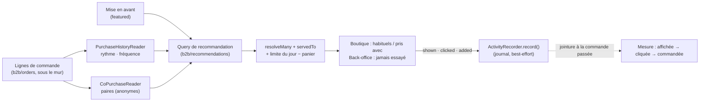

# Plan — la recommandation de produits

> 📐 **Doc-first, rien n'est bâti** (ouvert le 2026-10-17). Chaque affirmation
> sur l'existant est citée `fichier:ligne` et a été **ouverte ce jour** ; ce qui
> n'a pas été ouvert est dit « non vérifié ».
>
> **Ce plan ne touche pas l'argent** : il ne change aucun prix, aucune TVA,
> aucune facture — il choisit QUELS articles montrer, et le prix affiché reste
> celui que la boutique résout déjà. Il ne porte pas de migration de données
> (au plus une table neuve, additive) et ne déplace pas le mur tenant : il s'y
> appuie. Donc **pas de `vitruve` d'office** (CLAUDE.md §9 bis). Un seul point
> pourrait le justifier : R1 lit un historique **par personne** pour un client
> public (§6, RGPD) — si Hugo tranche Q1 « public d'abord », ce point mérite
> une contradiction avant de bâtir.

> 🔨 **R0 bâti le 2026-10-18 (non commité à cette date)** — contexte
> `apps/lfd-api/src/b2b/recommendations/` : le filtre R4
> (`application/services/recommendation-filter.ts`, règle pure
> `domain/orderable-today.ts`), les compteurs anonymes R5 bis dans
> `growth.product_audience_counters` (migration
> `20261018140000_les_compteurs_d_audience`, Hugo : schéma `growth`),
> `POST /shop/audience` (publique, lot ≤ 50, 30 lots/min/IP, corps JSON ou
> `text/plain` de `sendBeacon`), `GET /admin/product-audience?from=&to=` sous
> `b2b_growth`. Boutique : vue de fiche et entrée au panier depuis le rayon
> (`client/audience/`). **Pas encore** : `PurchaseHistoryReader` et
> `CoPurchaseReader` (R1, R2), les gestes `suggestion_*` côté boutique (aucune
> suggestion n'est affichée). Écart au texte de R4 : `servedTo` n'est pas
> appelé après `resolveMany` — il y est déjà appliqué, et `CatalogItem` ne
> porte pas les champs de masquage. La politique de confidentialité n'est pas
> modifiée (à Hugo et au cabinet).

> **Ordre revu le 2026-10-18 (Hugo)** : le collectif (« souvent pris avec »,
> « les plus commandés ») passe AVANT « vos habituels » — il sert tout le monde,
> invités compris, sous un seuil d'anonymat ; voir
> [`historique-du-particulier.md`](historique-du-particulier.md) §1 bis.
>
> **Le public** : ce qu'il faut pour recommander à un particulier est dans
> [`historique-du-particulier.md`](historique-du-particulier.md) (2026-10-18).

## 0. La demande

Hugo, 2026-10-17 : « un plan pour la recommandation de produit ».

Proposition reprise : des **règles simples, explicables**, calculées sur **nos
propres commandes**, sans apprentissage automatique au départ ; chaque
suggestion porte sa **raison** (« vous en prenez tous les mardis »). Quatre
usages :

1. **« Vos habituels »** à l'accueil de la boutique — ce qu'un client
   recommande souvent, au bon rythme (surtout les pros) ;
2. **« Souvent pris avec »** dans le panier — co-occurrence dans les commandes ;
3. **« Nouveau » / « De saison »** — mise en avant ;
4. côté commercial, **« ce client n'a jamais essayé… »** — ce que des clients
   semblables prennent.

Garde-fous : ne recommander que ce qui se vend à CE client ; mesurer l'effet
(affichée → cliquée → commandée). Ordre : 1, puis 2, le reste plus tard.

## 1. Ce qui existe (ouvert le 2026-10-17)

### 1.1 L'historique par client et par SKU — il existe déjà, pour les pros

- **`CustomerSkuReader`** — port de `b2b/orders`, fenêtre glissante de
  **12 mois** (`apps/lfd-api/src/b2b/orders/domain/ports/customer-sku.reader.ts:2`).
- Son adaptateur lit les lignes de commande **sous le mur** :
  `where: { order: { companyId, createdAt: { gte: … } } }`
  (`apps/lfd-api/src/b2b/orders/infrastructure/prisma-customer-sku.reader.ts:48`),
  la fenêtre comptée depuis le `Clock` (`…:61-65`), trié par réemploi puis
  récence (`…:57`).
- **`ListCustomerSkusHandler`** rejoint ces habitudes au catalogue
  **d'aujourd'hui**, en un lot, audience `"pro"` écrite en dur
  (`apps/lfd-api/src/b2b/orders/application/queries/list-customer-skus.handler.ts:35-38`),
  et **garde** le SKU disparu avec `stillAvailable: false` (`…:16-18`, `…:49`)
  — c'est le bon choix pour un commercial au téléphone, le **mauvais** pour une
  vitrine : une recommandation ne montre jamais un article qu'on ne peut pas
  commander.
- Il rend `orderCount`, `totalQuantity`, `lastOrderedAt` (`…:45-48`) — **pas de
  rythme** (jour de semaine, intervalle). « Vous en prenez tous les mardis » est
  donc à calculer ; le comptage, lui, existe.

### 1.2 Le client public : compte ou invité ?

- `Order.companyId` est **optionnel** : une commande « zéro friction »
  n'appartient qu'au client connecté, `placedByUserId` étant « LE mur sans
  entreprise » (`apps/lfd-api/prisma/schema/public/orders.prisma:71-74`).
- `placedByUserId` est **obligatoire** (`orders.prisma:89`) : même un invité a
  une ligne `User`, inscrite par `GuestBuyerRegistrar`
  (`apps/lfd-api/src/b2b/orders/application/commands/place-shop-order.handler.ts:17`).
  Comment un invité est reconnu d'une commande à l'autre : **non vérifié**.
- Conséquence : l'historique d'un **particulier connecté** se lit par
  `placedByUserId` ; celui d'un **invité** n'est pas une base de
  recommandation (pas de session durable ; et le recommander supposerait de le
  reconnaître, ce qui est une décision RGPD, pas technique).

### 1.3 Ce que `growth` et `alerts` font déjà

- **`product.first_order`** (`apps/lfd-api/src/b2b/alerts/domain/detectors/first-order.ts:13-31`)
  : détecte, **sur une commande passée**, les lignes jamais commandées par ce
  compte (`everOrdered`), et se tait sur les premières commandes
  (`…:19`). C'est l'**inverse** de l'usage 4 : il constate un premier essai, il
  ne le suggère pas. Le jeu `everOrdered` est en revanche exactement ce dont
  l'usage 4 a besoin pour exclure.
- **Le « moteur de reco » commercial** (`documentation/b2b/espace-commercial-prospects-leads.md` §8)
  recommande des **coups commerciaux** (verrouille / rescousse / upgrade /
  win-back) sur des **prospects et comptes**, pas des produits. Ce qui en est
  bâti : le cockpit lit un top 5 (`apps/lfd-api/src/b2b/growth/application/queries/get-cockpit.handler.ts:12`)
  et **journalise `reco.shown`**, best-effort, idempotent par (sujet, fenêtre de
  recalcul) (`…:15-20`). La boucle `action → issue → recalibrage` est annoncée
  « Phase 2 » (`…:17`) : **non bâtie**. Le moteur d'offre (« croissants 5×/sem →
  abonnement ») du §8 n'existe pas.
- **`ActivityRecorder`** (`apps/lfd-api/src/b2b/growth/domain/ports/activity-recorder.ts:10-29`)
  offre deux garanties ; `record()` est best-effort et idempotent, et son
  JSDoc cite **« une reco affichée »** comme cas d'usage (`…:12-15`). La mesure
  a donc déjà son port et son précédent (`reco.shown`).

### 1.4 « Ce qui se vend à ce client »

- **`servedTo(item, viewer)`** est la règle unique : audience de l'article
  (`pro | public | both`, `null` lu `both`) ET pas masqué pour ce lecteur ET
  validé pour lui (`apps/lfd-api/src/b2b/catalog/domain/served-to.ts:46-54`).
  Son JSDoc nomme les quatre lecteurs qu'elle a remplacés (`…:41-44`) : une
  recommandation sera le cinquième, et **ne doit pas** relire le masquage
  elle-même.
- **`ProductCatalogReader.resolveMany(skus, audience)`**
  (`apps/lfd-api/src/b2b/catalog/domain/ports/product-catalog.reader.ts:110`)
  résout un lot de SKU pour une audience ; `CatalogItem.orderTimeLimit` porte la
  limite de commande de l'article (`…:38-47`).
- **La mise en avant existe** : `SetCatalogFeaturedCommand(sku, featured, decidedBy)`
  (`apps/lfd-api/src/b2b/catalog/application/commands/set-catalog-featured.command.ts:2-8`).
  L'usage 3 « Nouveau / De saison » a donc déjà son geste manuel ; reste à
  savoir s'il suffit (Q4).
- La rupture et l'heure limite par jour : leurs lecteurs (`b2b/order-cutoffs`,
  `b2b/order-opening`) existent en dossiers ; leur API n'a **pas été ouverte**
  pour ce plan — à lire au lot R1.

### 1.5 Ce que la boutique affiche déjà

- **La relance codée en dur est retirée le 2026-10-18** (Hugo). `CartUpsell`
  (fichier cart-upsell.service.ts, supprimé) proposait la
  première gourmandise absente du panier sur une liste de rayons en dur
  (`TREATS`), sans historique ni raison. Le panier montre désormais la
  suggestion du staff si une règle s'applique (RS2,
  [`plan-suggestions-du-staff.md`](plan-suggestions-du-staff.md)), sinon
  **rien** — pas de remplissage. L'usage 2 viendra s'ajouter au même
  emplacement, avec la même règle « jamais un produit déjà dedans ».
- L'accueil public a sa vitrine (`client/accueil-public/home-storefront/`) ; la
  route `boutique` existe (`apps/lfc-ecommerce-frontend/src/app/app.routes.ts:271`),
  comme `accueil` (`…:345`). Leur gabarit n'a **pas été ouvert** : l'emplacement
  exact d'un bandeau se décide au lot (fold-ng d'abord).

## 2. Décisions proposées

**R1 — Le calcul vit dans `b2b/`, contexte neuf `b2b/recommendations/`.**
Tout ce qu'il lit est déjà du commerce : les lignes de commande (`b2b/orders`)
et le catalogue servi (`b2b/catalog`). Aucune arête nouvelle dans la matrice du
§3 : `b2b → pim` reste interdit et inutile, `servedTo` suffit. Il ne vit **ni**
dans `growth` (qui parle de prospects et de coups commerciaux) **ni** dans
`orders` (dont l'agrégat n'a rien à garder ici) ; il **déclare** ses ports de
lecture (`PurchaseHistoryReader`, `CoPurchaseReader`) et `orders` les
implémente, comme `CustomerSkuReader` aujourd'hui.

**R2 — Calculé à la lecture d'abord, précalculé seulement quand on l'a mesuré.**
« Vos habituels » = l'agrégat déjà fait par `CustomerSkuReader`, borné à une
société ou une personne : une requête indexée (`orders.prisma:347`, `:349`).
« Souvent pris avec » sur tout l'historique est la seule lecture qui grossit
avec le volume ; on la **précalcule** dans une table de paires
(`sku_a, sku_b, audience, count, computed_at`) quand elle dépasse un seuil
mesuré — pas avant. Le précalcul est une projection, pas un fait métier.

**R3 — Chaque suggestion porte sa raison, comme une donnée typée.**
`reason: { kind: "weekly_rhythm", weekday } | { kind: "frequent", orderCount }
| { kind: "bought_with", sku, share } | { kind: "featured" } | { kind: "new" }`
— le front la met en phrase (libellés en français, dictionnaire de la
boutique). Jamais une phrase fabriquée côté serveur, jamais un score nu.

**R4 — Le filtre est celui de la commande, appliqué en dernier, sans repli.**
Après le calcul : `resolveMany(skus, audience)` puis `servedTo`, puis la limite
de commande du jour. Un article qui ne passe pas **disparaît** ; une liste vide
rend une **carte absente**, jamais un remplissage inventé (mémoire « pas de
valeur inventée »). Les articles déjà au panier sont exclus.

**R5 bis — La mesure est un compteur anonyme, pas un fait par personne
(Hugo, 2026-10-18 ; remplace R5 ci-dessous).** Une table de compteurs
`(jour, sku, événement, emplacement) → nombre`, sans identifiant de visiteur ni
de client : `product_viewed`, `added_to_cart`, `suggestion_shown`,
`suggestion_clicked`, `suggestion_added`. Incrémentée côté serveur, par lot,
best-effort (une mesure perdue ne casse jamais un geste du client). « Commandée »
se lit dans les commandes. C'est la mesure d'audience exemptée de consentement
(CNIL : statistiques anonymes, pour le seul éditeur, sans croisement) — voir
[`historique-du-particulier.md`](historique-du-particulier.md) §1 bis. Elle
nourrit aussi les suggestions collectives (« les plus regardés »). Un outil de
marketing (Plausible ou Matomo) viendra plus tard, pour l'acquisition et les
parcours ; il ne remplace pas ce compteur.

**R5 — (remplacé par R5 bis) La mesure passe par `ActivityRecorder.record()`, best-effort.**
Trois faits : `recommendation.shown`, `recommendation.clicked`,
`recommendation.added` (au panier) ; « commandée » se **déduit** en rejoignant
la commande passée, sans fait de plus. Clé idempotente
`(sujet, emplacement, sku, jour)` comme `reco.shown`. Le journal ne porte que
des identifiants, jamais une coordonnée (règle du cockpit, `get-cockpit.handler.ts:22-25`).

## 2 bis. Deux sources : calculée et décidée (Hugo, 2026-10-18)

> Le détail du décidé est dans
> [`plan-suggestions-du-staff.md`](plan-suggestions-du-staff.md), qui prime.

« Il faut distinguer les recos data driven et business driven — le staff
décrète une suggestion. » Une suggestion a donc une **source** :

| Source      | Exemple                                                         | Raison affichée                         |
| ----------- | --------------------------------------------------------------- | --------------------------------------- |
| **`data`**  | « souvent pris avec », « vos habituels », « les plus regardés » | la raison calculée (R3)                 |
| **`staff`** | « avec un croissant, le café », « cette semaine, la galette »   | « Notre conseil » ou la phrase du staff |

**Une suggestion décidée** : un **déclencheur** (un article ou une famille au
panier, une fiche ouverte, ou partout), les **articles suggérés**, un
**emplacement** (panier, fiche, accueil), une **audience** (pros, public, les
deux ; un segment du plan des audiences plus tard), une **période** (début et
fin obligatoires : une offre de Noël ne survit pas en janvier) et une
**phrase** facultative. C'est un agrégat (une règle peut refuser une écriture :
période inversée, article inconnu, déclencheur vide), dans
`b2b/recommendations/`, réglé dans Gestion Boutique.

**Combinaison** : le décidé passe **en premier**, dans une place **bornée**
(1 ou 2 cartes sur 3, à régler) ; le calculé remplit le reste. **Même filtre
R4** pour les deux. La mise en avant existante (`SetCatalogFeaturedCommand`)
devient le cas « partout, sans déclencheur, sans date ».

**Mesure** : les compteurs portent la **source** (`none` pour une vue ou un
ajout ordinaire, `data` ou `staff` pour un événement `suggestion_*`) — ajoutée
le 2026-10-18, tant que la table était vide. On compare ainsi ce que
convertissent les conseils du staff et le calcul.

## 3. Le modèle

Aucune écriture métier : que des **queries** CQRS (B2B, fichiers séparés, §4).

| Query                            | Lit                                  | Rend                                  |
| -------------------------------- | ------------------------------------ | ------------------------------------- |
| `ListMyUsualsQuery`              | historique du demandeur (mur)        | ≤ 8 articles servis + raison          |
| `ListBoughtWithQuery(skus)`      | co-occurrences, audience du lecteur  | ≤ 3 articles servis + raison          |
| `ListFeaturedQuery`              | mise en avant (`featured`) + récence | articles servis + raison              |
| `ListNeverTriedQuery(companyId)` | sociétés semblables − `everOrdered`  | ≤ 10 pour le commercial (back-office) |

Le mur : pour un pro, `companyId` du `Principal` dans le `where` — **y
compris** les agrégats (CLAUDE.md §3). Pour un particulier, `placedByUserId`.
Les co-occurrences sont **anonymes par construction** : des comptes de paires,
jamais « qui » — elles traversent les comptes sans traverser le mur.

Une seule commande : `RecordRecommendationEventCommand` (clic, ajout), qui
n'écrit que le journal.

## 4. Les écrans

- **Boutique, accueil** — une rangée « Vos habituels » au-dessus des rayons,
  chaque carte avec sa raison en une ligne et l'ajout au panier. Absente si
  vide, absente pour un invité.
- **Boutique, panier** — « Souvent pris avec », raison comprise, dans la
  carte de suggestion où le staff passe d'abord. Plus de repli : `TREATS` est
  retiré le 2026-10-18 (Hugo).
- **Back-office, fiche client** — un encart « Jamais essayé » à côté des
  habitudes déjà affichées par `ListCustomerSkus` (lot 4).
- **Back-office, mesure** — un compteur par emplacement (affichées, cliquées,
  commandées) ; rien de plus tant que les volumes sont faibles.

## 5. Lots

| Lot    | Contenu                                                                                                                                                                                                                                                                  | Dépend de |
| ------ | ------------------------------------------------------------------------------------------------------------------------------------------------------------------------------------------------------------------------------------------------------------------------ | --------- |
| **R0** | contexte `b2b/recommendations/`, ports, filtre R4, **compteurs anonymes R5 bis** (table, écriture par lot, route de la boutique, premiers émetteurs : vue de fiche, ajout au panier) ; tests aux 3 niveaux                                                               | —         |
| **R1** | « Vos habituels » (pros), rythme hebdomadaire + fréquence ; rangée d'accueil                                                                                                                                                                                             | R0        |
| **RS** | **Suggestions décidées par le staff** (§2 bis) : règle déclencheur → articles suggérés, emplacement, audience, période, phrase ; écran « Suggestions » en Gestion Boutique ; passe avant le calculé, dans une place bornée ; la mise en avant devient un cas particulier | R0        |
| **R2** | « Souvent pris avec » au panier (la relance `CartUpsell` est retirée le 2026-10-18)                                                                                                                                                                                      | R0        |
| **R3** | « Vos habituels » pour le particulier connecté (`placedByUserId`), après Q1 et §6                                                                                                                                                                                        | R1        |
| **R4** | « Jamais essayé » au back-office (sociétés du même secteur)                                                                                                                                                                                                              | R1        |
| **R5** | « Nouveau / De saison » si la mise en avant manuelle ne suffit pas (Q4)                                                                                                                                                                                                  | R0        |

## 6. Risques

- **Vie privée.** Afficher l'historique d'une personne à elle-même est banal ;
  l'afficher **sur un poste partagé** (comptoir d'un restaurant, compte pro à
  plusieurs) l'est moins. Pour un pro, l'historique est celui de la **société**
  (déjà visible dans « Mes commandes ») : pas de fait nouveau. Pour un
  particulier, c'est un traitement de profilage léger : à inscrire au registre
  (`documentation/legal/rgpd-registre.json`, `lint:rgpd-staff` ne couvre que le
  staff — non vérifié pour les clients) et à annoncer dans l'information du
  client. C'est le point qui justifierait `vitruve` (cf. en-tête).
- **Performance.** « Vos habituels » est borné par un index ; les paires
  croissent en carré du panier moyen. Mesurer avant de précalculer (R2). Le
  front ne doit faire **qu'un** appel par écran (mémoire « le front multiplie »).
- **Démarrage vide.** Pré-release, sans activité réelle (CLAUDE.md §0) : il n'y
  a pas d'historique. Les cartes seront **absentes**, pas fausses ; la mise en
  avant manuelle couvre l'amorçage. Un seuil (ex. 3 commandes, comme
  `minPreviousOrders` de `first-order.ts:19`) évite qu'une commande unique
  devienne une « habitude ».
- **Raison fausse.** « Tous les mardis » sur deux mardis est un mensonge : la
  règle de rythme exige un minimum d'occurrences, sinon elle retombe sur
  « souvent ».

## 7. Questions à Hugo

1. **Pour qui d'abord — pros ou public ?** _Recommandation : les pros._ Leur
   historique existe et est déjà lu sous le mur (§1.1), le rythme y est réel
   (commandes régulières), et il n'y a pas de question RGPD nouvelle.
2. **Où d'abord — accueil ou panier ?** _Recommandation : l'accueil (« vos
   habituels »)._ Il raccourcit la commande récurrente, ce qui sert le client ;
   le panier a la suggestion du staff (RS2) ; la relance `CartUpsell` est
   retirée le 2026-10-18.
3. **La ligne du commercial maintenant ou plus tard ?** _Recommandation : plus
   tard (R4)._ « Jamais essayé » demande des sociétés semblables, donc du volume ;
   les habitudes, elles, sont déjà affichées au back-office.
4. **« Nouveau / De saison » : à la main en Gestion Boutique, ou dérivé des
   dates d'activation ?** _Recommandation : à la main, avec la mise en avant
   qui existe déjà (`SetCatalogFeaturedCommand`)._ Dériver « nouveau » d'une
   date d'activation suppose de la lire ; elle n'a pas été trouvée côté
   plateforme ce jour (non vérifié au-delà d'une recherche dans
   `b2b/catalog/domain`).
