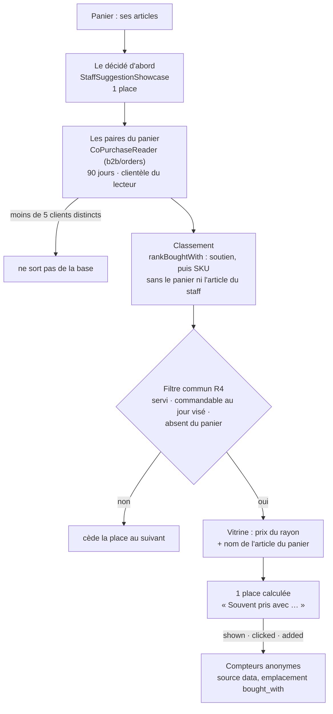

# Les suggestions calculées — ce qui est bâti

> **Doc d'état** (2026-10-18, lot R2 de
> [`plan-recommandation-de-produits.md`](plan-recommandation-de-produits.md)).
> Elle décrit ce qui existe : « souvent pris avec », au panier. Le décidé (les
> règles du staff) est dans [`suggestions-du-staff.md`](suggestions-du-staff.md) ;
> l'ensemble du sujet dans [`README.md`](README.md). Éprouvé aux trois niveaux
> (domaine, application, e2e) ; pas encore regardé dans un navigateur contre
> l'API locale.

Une suggestion **calculée** dit ce que les clients **font** : un article que
d'autres clients ont souvent commandé dans la même commande qu'un article de
ce panier. Elle ne vise personne — c'est le régime du **collectif**
([`historique-du-particulier.md`](historique-du-particulier.md) §1 bis) : des
comptes de paires, sous un seuil d'anonymat, aucun identifiant stocké. Elle ne
change aucun prix.

Code : `apps/lfd-api/src/b2b/recommendations/` (`domain/services/bought-with.ts`,
`domain/ports/co-purchase.reader.ts`, `application/services/bought-with-showcase.ts`),
l'adaptateur `apps/lfd-api/src/b2b/orders/infrastructure/prisma-co-purchase.reader.ts`,
la carte partagée de la boutique (`client/suggestions/staff-suggestion-card/`).
Contrat : `packages/contracts/src/cart-suggestions.ts`.

## 1. Le parcours



## 2. Le calcul

Une **paire** (article du panier, autre article) vaut le nombre de **clients
distincts** qui les ont commandés dans la **même commande**. Le client est la
société pour un pro, la personne sinon — `COALESCE(company_id, placed_by_user_id)`,
comme le tableau des audiences ([`audiences.md`](audiences.md)) ; il sert au
`COUNT(DISTINCT)` et **ne sort pas de la requête**. Une personne qui commande
cinq fois la même paire reste un client.

| Réglage             | Valeur                                                                              | Constante                                                                       |
| ------------------- | ----------------------------------------------------------------------------------- | ------------------------------------------------------------------------------- |
| Fenêtre glissante   | 90 jours métier, aujourd'hui compris (jour de passation, Paris)                     | `BOUGHT_WITH_WINDOW_DAYS`                                                       |
| Seuil d'anonymat    | **5** clients distincts au moins — appliqué EN BASE (`HAVING`), puis par le domaine | `BOUGHT_WITH_MIN_CLIENTS` (même valeur qu'`AUDIENCE_MIN_CLIENTS`, tenue à part) |
| Paires lues au plus | 20, de quoi remplir la place après le filtre                                        | `BOUGHT_WITH_CANDIDATES`                                                        |
| Places au panier    | 1, **après** celle du staff                                                         | `BOUGHT_WITH_CART_PLACES`                                                       |

**Le score** est le **soutien** — le nombre de clients distincts de la paire —,
pas la part conditionnelle (« sur ceux qui prennent A, combien prennent B ») :
sur de petits volumes, 5 sur 6 dirait plus fort ce qui est le plus fragile.
Un article proposé par deux articles du panier prend sa **meilleure** paire,
jamais leur somme (un même client y serait compté deux fois). Ordre stable :
soutien décroissant, puis SKU proposé, puis article du panier.

**La clientèle est séparée** : un pro ne lit que les commandes pro, un
particulier que les commandes des particuliers (`orders.clientele` ; une
commande d'avant la colonne est pro si elle porte une société).

### 2.1 Les commandes qui comptent

Même périmètre que le tableau des audiences (A1), et pour les mêmes raisons :

- **exclues** : le brouillon (personne n'a commandé), l'annulée, la carte en
  attente, refusée ou remboursée (rien n'a été pris) ;
- **gardées** : les commandes **saisies par le staff**. Les chiffres des
  suggestions (RS6) les écartent parce qu'elles n'ont vu aucune suggestion ;
  ici on lit ce que le client prend, et une commande prise au téléphone est
  son panier ;
- **exclues** : les commandes **nées d'un abonnement** — leur panier a été
  composé une fois, peut-être avant la fenêtre, et le planificateur le répète.

### 2.2 Calculé à la lecture

Une requête par demande du panier, sans table de paires (décision R2 du plan :
précalculer seulement si une mesure le justifie). Elle part des lignes du
panier (`order_lines.sku` est indexé), remonte aux commandes de la fenêtre et
de la clientèle, et lit leurs autres lignes.

**Mesuré le 2026-10-18** sur la base jetable (Postgres local du poste de dev) :
30 000 commandes et 99 572 lignes sur 80 articles, 2 000 clients, un panier de
5 articles — **66 ms** en médiane sur dix lectures, 70 ms au pire. La base de
production est vide de commandes (pré-release) : aucun précalcul n'est justifié
aujourd'hui. Le seuil à surveiller est le temps de la route du panier, pas un
nombre de commandes.

## 3. La raison, typée

```ts
{ source: "data", kind: "bought_with", withSku: "VIE-001", withName: "Croissant" }
```

`withName` est le nom de l'article du panier **tel que la vitrine le sert à ce
lecteur** : la phrase cite ce que le client voit. Si l'article du panier n'est
pas au rayon de ce lecteur, la proposition tombe plutôt que de citer un nom
inventé. **Aucun nombre de clients ni part n'est exposé** : un compte exact,
près du seuil, dirait combien de personnes ont fait ce panier.

La boutique met la phrase : **« Souvent pris avec {name} »** (`shop.boughtWith`,
FR / EN / IT, glossaire du back-office, recueil régénéré par `pnpm copy:digest`).

## 4. Au panier

- **Le décidé passe d'abord** et garde sa place (`STAFF_CART_PLACES` = 1). Le
  calculé a **la sienne**, une, qu'une règle du staff s'applique ou non : un
  panier montre donc au plus **deux** cartes, la décidée puis la calculée.
- **Pas de doublon** : l'article que le staff montre n'est pas repris.
- **Le même filtre** que le décidé (`RecommendationFilter`) : servi à ce
  lecteur, commandable au jour visé, absent du panier ; un article écarté cède
  sa place au suivant. Puis la vitrine, au prix du rayon (HT pro, TTC
  particulier).
- **Une seule requête** : la route du panier (`POST /shop/suggestions/cart`,
  et `/mine`) rend les deux, dans cet ordre. Aucune route n'a été ajoutée.
- **La même carte** (`StaffSuggestionCard`) : un clic ouvre la fiche, le « + »
  ajoute. L'**après-ajout** (« Ajouté ! ») montre la première suggestion du
  panier : la décidée, sinon la calculée.
- **Les compteurs** : `suggestion_shown`, `suggestion_clicked`,
  `suggestion_added`, source **`data`**, emplacement **`bought_with`**
  (`suggestionOrigin`, `client/suggestions/suggestion-origin.ts`) — permis par
  les `CHECK` de `growth.product_audience_counters` sans migration.

**Hors du lot R2** : la fiche et l'accueil n'ont pas de calculé (leurs routes
ne servent que le décidé, `StaffSuggestionView`).

## 5. L'aperçu du staff

`POST /admin/suggestions/preview`, au panier, montre le calculé **après** la
carte du staff, avec sa raison : « Souvent pris avec … », l'article, son prix,
et une ligne qui dit d'où il vient. La fenêtre finit aujourd'hui ; le jour
choisi ne sert qu'à l'heure limite. L'outil agent `suggestion_preview` le dit
aussi (« Puis, calculée : … »). La fiche et l'accueil n'en ont pas.

## 6. Ce qui n'est pas bâti

- **Les chiffres du calculé** (RS6, « Calculé : souvent pris avec ») : les
  compteurs `data` sont écrits, mais l'écran des résultats ne les lit pas.
  L'ajouter n'est pas qu'une ligne : l'estimation des commandes partage, case
  par case, le plafond entre ce qui a fait ajouter un article — y faire entrer
  le calculé changerait les chiffres déjà affichés des règles du staff. Décision
  à prendre avant de bâtir.
- La fiche, l'accueil, « vos habituels » (R1, R3) : voir le plan.

## 7. La vie privée

**La politique de confidentialité n'est pas modifiée**, et c'est délibéré :
le collectif ne vise personne. Rien n'est stocké — ni paire, ni client —, la
requête ne rend que des comptes au-dessus de cinq clients distincts, et la
réponse au client n'en porte aucun.
