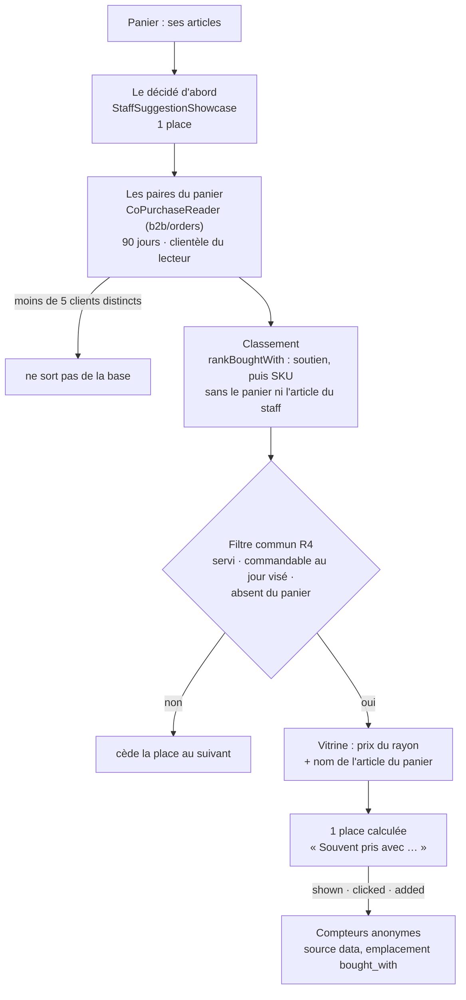
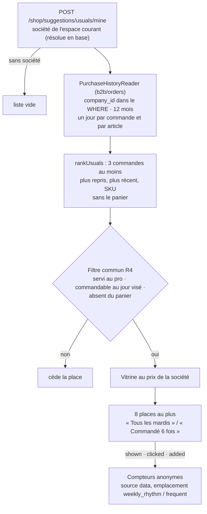

# Les suggestions calculées — ce qui est bâti

> **Doc d'état** (2026-10-18, lots R2 et R1 de
> [`plan-recommandation-de-produits.md`](plan-recommandation-de-produits.md)).
> Elle décrit ce qui existe : « souvent pris avec », au panier (§1–§7), et
> « vos habituels » d'un pro, à l'accueil (§8). Le décidé (les
> règles du staff) est dans [`suggestions-du-staff.md`](suggestions-du-staff.md) ;
> l'ensemble du sujet dans [`README.md`](README.md). Éprouvé aux trois niveaux
> (domaine, application, e2e) ; pas encore regardé dans un navigateur contre
> l'API locale.

Une suggestion **calculée** dit ce que les clients **font** : un article que
d'autres clients ont souvent commandé dans la même commande qu'un article de
ce panier. Elle ne vise personne — c'est le régime du **collectif**
([`historique-du-particulier.md`](historique-du-particulier.md) §1 bis) : des
comptes de paires, sous un seuil d'anonymat, aucun identifiant stocké. Elle ne
change aucun prix.

Code : `apps/lfd-api/src/b2b/recommendations/` (`domain/services/bought-with.ts`,
`domain/ports/co-purchase.reader.ts`, `application/services/bought-with-showcase.ts`),
l'adaptateur `apps/lfd-api/src/b2b/orders/infrastructure/prisma-co-purchase.reader.ts`,
la carte partagée de la boutique (`client/suggestions/staff-suggestion-card/`).
Contrat : `packages/contracts/src/cart-suggestions.ts`.

## 1. Le parcours



## 2. Le calcul

Une **paire** (article du panier, autre article) vaut le nombre de **clients
distincts** qui les ont commandés dans la **même commande**. Le client est la
société pour un pro, la personne sinon — `COALESCE(company_id, placed_by_user_id)`,
comme le tableau des audiences ([`audiences.md`](audiences.md)) ; il sert au
`COUNT(DISTINCT)` et **ne sort pas de la requête**. Une personne qui commande
cinq fois la même paire reste un client.

| Réglage             | Valeur                                                                              | Constante                                                                       |
| ------------------- | ----------------------------------------------------------------------------------- | ------------------------------------------------------------------------------- |
| Fenêtre glissante   | 90 jours métier, aujourd'hui compris (jour de passation, Paris)                     | `BOUGHT_WITH_WINDOW_DAYS`                                                       |
| Seuil d'anonymat    | **5** clients distincts au moins — appliqué EN BASE (`HAVING`), puis par le domaine | `BOUGHT_WITH_MIN_CLIENTS` (même valeur qu'`AUDIENCE_MIN_CLIENTS`, tenue à part) |
| Paires lues au plus | 20, de quoi remplir la place après le filtre                                        | `BOUGHT_WITH_CANDIDATES`                                                        |
| Places au panier    | 1, **après** celle du staff                                                         | `BOUGHT_WITH_CART_PLACES`                                                       |

**Le score** est le **soutien** — le nombre de clients distincts de la paire —,
pas la part conditionnelle (« sur ceux qui prennent A, combien prennent B ») :
sur de petits volumes, 5 sur 6 dirait plus fort ce qui est le plus fragile.
Un article proposé par deux articles du panier prend sa **meilleure** paire,
jamais leur somme (un même client y serait compté deux fois). Ordre stable :
soutien décroissant, puis SKU proposé, puis article du panier.

**La clientèle est séparée** : un pro ne lit que les commandes pro, un
particulier que les commandes des particuliers (`orders.clientele` ; une
commande d'avant la colonne est pro si elle porte une société).

### 2.1 Les commandes qui comptent

Même périmètre que le tableau des audiences (A1), et pour les mêmes raisons :

- **exclues** : le brouillon (personne n'a commandé), l'annulée, la carte en
  attente, refusée ou remboursée (rien n'a été pris) ;
- **gardées** : les commandes **saisies par le staff**. Les chiffres des
  suggestions (RS6) les écartent parce qu'elles n'ont vu aucune suggestion ;
  ici on lit ce que le client prend, et une commande prise au téléphone est
  son panier ;
- **exclues** : les commandes **nées d'un abonnement** — leur panier a été
  composé une fois, peut-être avant la fenêtre, et le planificateur le répète.

### 2.2 Calculé à la lecture

Une requête par demande du panier, sans table de paires (décision R2 du plan :
précalculer seulement si une mesure le justifie). Elle part des lignes du
panier (`order_lines.sku` est indexé), remonte aux commandes de la fenêtre et
de la clientèle, et lit leurs autres lignes.

**Mesuré le 2026-10-18** sur la base jetable (Postgres local du poste de dev) :
30 000 commandes et 99 572 lignes sur 80 articles, 2 000 clients, un panier de
5 articles — **66 ms** en médiane sur dix lectures, 70 ms au pire. La base de
production est vide de commandes (pré-release) : aucun précalcul n'est justifié
aujourd'hui. Le seuil à surveiller est le temps de la route du panier, pas un
nombre de commandes.

## 3. La raison, typée

```ts
{ source: "data", kind: "bought_with", withSku: "VIE-001", withName: "Croissant" }
```

`withName` est le nom de l'article du panier **tel que la vitrine le sert à ce
lecteur** : la phrase cite ce que le client voit. Si l'article du panier n'est
pas au rayon de ce lecteur, la proposition tombe plutôt que de citer un nom
inventé. **Aucun nombre de clients ni part n'est exposé** : un compte exact,
près du seuil, dirait combien de personnes ont fait ce panier.

La boutique met la phrase : **« Souvent pris avec {name} »** (`shop.boughtWith`,
FR / EN / IT, glossaire du back-office, recueil régénéré par `pnpm copy:digest`).

## 4. Au panier

- **Le décidé passe d'abord** et garde sa place (`STAFF_CART_PLACES` = 1). Le
  calculé a **la sienne**, une, qu'une règle du staff s'applique ou non : un
  panier montre donc au plus **deux** cartes, la décidée puis la calculée.
- **Pas de doublon** : l'article que le staff montre n'est pas repris.
- **Le même filtre** que le décidé (`RecommendationFilter`) : servi à ce
  lecteur, commandable au jour visé, absent du panier ; un article écarté cède
  sa place au suivant. Puis la vitrine, au prix du rayon (HT pro, TTC
  particulier).
- **Une seule requête** : la route du panier (`POST /shop/suggestions/cart`,
  et `/mine`) rend les deux, dans cet ordre. Aucune route n'a été ajoutée.
- **La même carte** (`StaffSuggestionCard`) : un clic ouvre la fiche, le « + »
  ajoute. L'**après-ajout** (« Ajouté ! ») montre la première suggestion du
  panier : la décidée, sinon la calculée.
- **Les compteurs** : `suggestion_shown`, `suggestion_clicked`,
  `suggestion_added`, source **`data`**, emplacement **`bought_with`**
  (`suggestionOrigin`, `client/suggestions/suggestion-origin.ts`) — permis par
  les `CHECK` de `growth.product_audience_counters` sans migration.

**Hors du lot R2** : la fiche et l'accueil n'ont pas de calculé (leurs routes
ne servent que le décidé, `StaffSuggestionView`).

## 5. L'aperçu du staff

`POST /admin/suggestions/preview`, au panier, montre le calculé **après** la
carte du staff, avec sa raison : « Souvent pris avec … », l'article, son prix,
et une ligne qui dit d'où il vient. La fenêtre finit aujourd'hui ; le jour
choisi ne sert qu'à l'heure limite. L'outil agent `suggestion_preview` le dit
aussi (« Puis, calculée : … »). La fiche et l'accueil n'en ont pas.

## 6. La mesure — les chiffres du calculé

Décidé par Hugo le 2026-10-18, bâti le même jour. L'écran des résultats
(`GET /admin/suggestions/results`, champ `computed` de
`StaffSuggestionResultsView`) rend deux lignes sous les règles :
**« Calculé : souvent pris avec »** (emplacement `bought_with`) et
**« Calculé : vos habituels »** (`weekly_rhythm` et `frequent` réunis), avec
les six chiffres d'une règle — affichées, cliquées, ajoutées, taux, commandées
(estimé), CA HT (estimé). Les compteurs `data` se lisent par leur propre port
(`ComputedSuggestionCounterReader`, source filtrée dans le `WHERE`), distinct
de celui du staff.

**Le calculé entre dans le MÊME partage que les règles du staff**
(`attributeOrders`, `suggestions-du-staff.md` §8.2) : par jour × article, le
plafond min(ajouts depuis des suggestions, quantité commandée) se partage au
prorata des ajouts de chaque prétendant — une règle, ou un genre du calculé —,
au plus fort reste. Une pièce n'est jamais comptée deux fois. Conséquence
voulue : les chiffres d'une règle **baissent** quand le calculé a aussi fait
ajouter l'article ce jour-là. À égalité de reste, la clé la plus petite au sens
de `localeCompare` l'emporte (un genre du calculé porte la clé
`data:<genre>`, une règle son id).

Le back-office (page Suggestions) et l'outil agent `suggestion_results` les
rendent, l'aide « estimé » dit que le partage inclut le calculé.

## 6 bis. Ce qui n'est pas bâti

- La fiche, et « vos habituels » d'un particulier (R3) : voir le plan.
  « Vos habituels » d'un pro est bâti (§8).

## 7. La vie privée

**La politique de confidentialité n'est pas modifiée**, et c'est délibéré :
le collectif ne vise personne. Rien n'est stocké — ni paire, ni client —, la
requête ne rend que des comptes au-dessus de cinq clients distincts, et la
réponse au client n'en porte aucun.

## 8. « Vos habituels » — l'accueil d'un pro (R1)

Bâti le 2026-10-18. Éprouvé aux trois niveaux ; pas encore regardé dans un
navigateur contre l'API locale.

Ce que **la société** du lecteur commande régulièrement, montré à elle seule.
Ce n'est pas le régime du collectif : c'est l'historique d'**un** client,
montré à ce client — celui qu'il voit déjà dans « Mes commandes » (plan §6).
D'où deux bornes : **pros seulement** (un particulier attend l'avis du
cabinet, lot R3, [`historique-du-particulier.md`](historique-du-particulier.md)),
et **route murée seule**.

Code : `apps/lfd-api/src/b2b/recommendations/` (`domain/services/usuals.ts`,
`domain/ports/purchase-history.reader.ts`, `application/queries/list-my-usuals.*`,
`http/my-shop-usual-suggestions.controller.ts`), l'adaptateur
`apps/lfd-api/src/b2b/orders/infrastructure/prisma-purchase-history.reader.ts`,
la rangée de la boutique (`client/suggestions/usual-picks/`). Contrat :
`packages/contracts/src/usual-suggestions.ts`.



### 8.1 Le calcul

| Réglage              | Valeur                                                      | Constante                       |
| -------------------- | ----------------------------------------------------------- | ------------------------------- |
| Fenêtre glissante    | 12 mois de passation, même quantième un an plus tôt (Paris) | `USUALS_WINDOW_MONTHS`          |
| Seuil d'une habitude | **3** commandes de la société qui portent l'article         | `USUALS_MIN_ORDERS`             |
| Minimum d'un rythme  | **3** commandes le même jour de la semaine                  | `WEEKLY_RHYTHM_MIN_OCCURRENCES` |
| Places à l'accueil   | **8** au plus, jamais de remplissage en dessous             | `USUALS_PLACES`                 |

- **Le mur** : `company_id` de la société de l'espace courant, résolue en base
  par `AuthGuard` (jamais reçue du corps), dans le `WHERE` de la seule requête,
  agrégat compris. L'e2e le prouve, y compris quand deux commandes de A et
  deux de B porteraient ensemble l'article au seuil.
- **Le jour d'une commande** est celui pour lequel elle est passée
  (`requested_delivery_date` : retrait ou livraison), sinon son jour de
  passation à Paris. « Tous les mardis » dit quand la société reçoit. La
  **fenêtre**, elle, se compte sur la passation, comme les habitudes du
  back-office (`CustomerSkuReader`).
- **Les commandes qui comptent** : le périmètre des commandes prises de §2.1
  — ni brouillon, ni annulée, ni carte non encaissée ; les saisies du staff
  comptent ; **pas** les commandes nées d'un abonnement (leur rythme est celui
  du planificateur, et proposer d'en rajouter doublerait ce qui arrive déjà).
- **Le classement** : le plus repris (commandes distinctes), puis le plus
  récent, puis le SKU — l'habitude, pas le prix.

### 8.2 La raison, typée

```ts
{ source: "data", kind: "weekly_rhythm", weekday: "tue" }
{ source: "data", kind: "frequent", orderCount: 6 }
```

`weekly_rhythm` exige un jour qui revient **au moins trois fois et plus
souvent qu'aucun autre** : deux mardis, ou trois mardis et trois jeudis, ne
font pas « tous les mardis » — l'article reste un habituel, dit `frequent`.
`orderCount` est un compte de SES commandes, qu'elle voit déjà ; ce n'est pas
le compte d'autres clients que §3 interdit d'exposer.

La boutique met la phrase : **« Tous les mardis »** (`shop.usualEvery.<jour>`,
une phrase par jour, l'accord ne se composant pas dans les trois langues) et
**« Commandé {count} fois »** (`shop.usualOrdered`) ; la rangée s'intitule
**« Vos habituels »** (`shop.usuals`). FR / EN / IT, glossaire du back-office,
recueil régénéré par `pnpm copy:digest`.

### 8.3 À l'accueil

- **Une rangée au-dessus de « Notre sélection »**, pour un pro connecté dont
  l'espace courant est une société ; rien pour un invité, un particulier ou
  l'espace perso — la boutique ne demande même pas. Absente sans habituel.
- **La même carte** que le décidé et « souvent pris avec »
  (`StaffSuggestionCard`) : son titre est la raison, un clic ouvre la fiche
  (`PieceRequest`), le « + » ajoute ; un article entré au panier cède sa place.
- **Un appel de plus à l'accueil d'un pro** : la route est à part de celle de
  « Notre sélection » (`/shop/suggestions/home`), qui sert aussi les visiteurs.
  Une seule requête serveur par appel. **Décision de Hugo, 2026-10-18 :
  l'accueil d'un pro garde ces deux appels** (« Vos habituels » + « Notre
  sélection ») ; on ne les fusionne pas.
- **Les compteurs** : `suggestion_shown`, `suggestion_clicked`,
  `suggestion_added`, source **`data`**, emplacement **`weekly_rhythm`** ou
  **`frequent`** — permis par les `CHECK` de
  `growth.product_audience_counters` sans migration (l'emplacement y est libre,
  la source `data` déjà admise).

### 8.4 Ce qui n'est pas bâti

- **L'aperçu du staff** (RS5) ne montre pas « vos habituels » : il faudrait y
  choisir une société, donc lire l'historique d'un client sous le droit
  `lfc_suggestions:read`, qui ne le donne pas aujourd'hui. Quel droit le
  permet est une décision de périmètre, pas prise.
- Aucune route publique, et c'est voulu jusqu'au lot R3.
