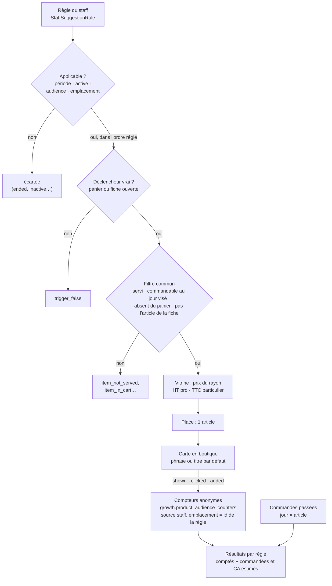

# Les suggestions décidées par le staff — ce qui est bâti

> **Doc d'état** (2026-10-18, relue contre le code au commit `651b446d3`). Elle
> décrit ce qui existe. Ce qui reste à faire (l'accueil, l'après-ajout, des
> règles plus fines, les gestes du staff, l'alerte, la mise en avant dans les
> règles) est dans [`plan-suggestions-du-staff.md`](plan-suggestions-du-staff.md).
> L'ensemble du sujet (calculé, décidé, mis en avant) est présenté dans
> [`README.md`](README.md).

Une suggestion **décidée** est une règle posée par le staff : « quand le client
fait ceci, montre-lui cela ». Elle dit ce que la maison **veut** vendre (un
accord, la saison, une nouveauté, un stock à écouler) là où la suggestion
**calculée** dira ce que les clients **font**. Elle ne change aucun prix :
l'article sort au prix que la boutique résout déjà.

Code : `apps/lfd-api/src/b2b/recommendations/` (backend),
`apps/lfd-backoffice-frontend/src/app/suggestions/` (écran),
`apps/lfc-ecommerce-frontend/src/app/client/suggestions/` et
`client/cart/staff-cart-suggestion.service.ts` (boutique). Contrats :
`packages/contracts/src/staff-suggestions.ts`, `cart-suggestions.ts`,
`product-suggestions.ts`, `staff-suggestion-preview.ts`,
`staff-suggestion-results.ts`.

## 1. Le parcours

La boutique et l'aperçu de l'écran passent par la **même** chaîne,
`StaffSuggestionShowcase` (`application/services/staff-suggestion-showcase.ts`) :
`show` rend ce que voit le client, `diagnose` déroule les mêmes portes pas à pas.
Un emplacement de plus est une query de plus qui apporte son déclencheur, pas
une branche dans cette chaîne.

## 2. La règle

C'est un agrégat, `StaffSuggestionRule`
(`domain/entities/staff-suggestion-rule.ts`), seul écrivain de
`public.staff_suggestion_rules`. Dans `public` et non dans `growth` : une règle
est une **décision** du commerce, `growth` porte ce qu'on **observe**.

| Champ           | Ce qu'il porte                                                                                                                                                      | Refusé si…                                                                                                                |
| --------------- | ------------------------------------------------------------------------------------------------------------------------------------------------------------------- | ------------------------------------------------------------------------------------------------------------------------- |
| **Déclencheur** | `everywhere` (partout) · `product_in_cart` (article au panier) · `category_in_cart` (famille au panier, sous-familles comprises) · `product_viewed` (fiche ouverte) | inconnu ; « partout » qui nomme quelque chose, ou un autre qui ne nomme rien ; article ou famille hors du catalogue servi |
| **Suggérés**    | 1 à 3 SKU distincts, dans l'ordre voulu                                                                                                                             | aucun ou plus de 3 ; un doublon ; un article égal au déclencheur ; hors du catalogue servi                                |
| **Emplacement** | `cart` (panier) · `product` (fiche) · `home` (accueil)                                                                                                              | le déclencheur ne peut pas y être vrai : un déclencheur de panier ne vaut qu'au panier, une fiche ouverte qu'en fiche     |
| **Audience**    | `pro` · `public` · `both`                                                                                                                                           | inconnue                                                                                                                  |
| **Période**     | début et fin obligatoires, jours métier (Paris), bornes comprises                                                                                                   | jour invalide ; fin avant début ; fin déjà passée **à la création** (permise à la réécriture)                             |
| **Phrase**      | facultative ; le français d'abord, anglais et italien facultatifs ; 90 caractères par langue                                                                        | une traduction sans français ; une langue au-delà de 90 caractères                                                        |
| **Priorité**    | entier de 0 à 999, plus haut = d'abord                                                                                                                              | hors borne ou non entier                                                                                                  |
| **Active**      | interrupteur ; une règle naît active                                                                                                                                | —                                                                                                                         |

Les refus sont nommés dans `domain/errors/staff-suggestion-errors.ts`
(`suggestions.*`), écrits pour le personnel : ils disent le cas et le geste de
sortie, les jours en `JJ/MM/AAAA`. L'existence d'un article ou d'une famille au
catalogue servi est demandée par les cas d'usage (`UnknownSuggestionCatalogueError`) ;
le reste, l'agrégat le juge seul.

**Pas de suppression.** Une règle se coupe et se rallume (`setActive`), se
réécrit entière (`revise`, un `PUT` remplace tout), et s'**archive** — pour
toujours : une archivée ne s'écrit plus et ne paraît plus en boutique, mais se
lit encore à l'écran. Les SKU et la famille sont des identifiants opaques, sans
clé étrangère : un article retiré ne fait pas disparaître la règle qui le cite.

Chaque geste est journalisé : `staff_suggestion.created`, `.revised`,
`.activated`, `.deactivated`, `.archived`, `staff_suggestion_order.changed`
(`packages/contracts/src/journal-facts/commerce-suggestions.ts`).

## 3. L'ordre entre règles

Un réglage unique de la boutique, `public.staff_suggestion_order_settings`
(ligne absente = `recent`), tranché par Hugo le 2026-10-18 (« il faut coder
priorité, et mettre un switch pour que l'admin décide récente ou priorité ») :

- **`recent`** : la plus récemment **créée** d'abord — la réécrire ne la fait
  pas passer devant une règle plus jeune ;
- **`priority`** : la priorité la plus haute, puis la plus récente à égalité.

L'id départage deux créations au même instant. Un article proposé par deux
règles revient à la première ; la seconde est « battue » (`outranked_by`).

## 4. Où elle s'affiche

| Emplacement | Déclencheurs qui y valent                           | Titre sans phrase dans la langue du client | Places | Bâti                                                     |
| ----------- | --------------------------------------------------- | ------------------------------------------ | ------ | -------------------------------------------------------- |
| **Panier**  | `everywhere`, `product_in_cart`, `category_in_cart` | « Notre conseil » (`shop.staffAdvice`)     | 1      | oui                                                      |
| **Fiche**   | `everywhere`, `product_viewed` sur l'article ouvert | « Vous aimerez aussi » (`shop.alsoLike`)   | 1      | oui                                                      |
| **Accueil** | `everywhere`                                        | —                                          | —      | **non** : la règle s'enregistre, rien ne s'affiche (RS7) |

Les places sont des constantes du domaine, `STAFF_CART_PLACES` et
`STAFF_PRODUCT_PLACES` (`domain/services/cart-suggestions.ts`,
`product-suggestions.ts`). Hugo a tranché **une place au panier** le
2026-10-18 ; la fiche a pris la même valeur, à confirmer. Le calculé qui
remplirait les places suivantes n'existe pas encore.

**Au panier**, la carte remplace la relance codée en dur d'avant
(cart-upsell.service.ts et sa liste `TREATS`, retirés le 2026-10-18 par Hugo,
sans repli) : sans règle applicable, le panier ne montre **rien**. Une requête
par ouverture du panier et par changement de son contenu, du lecteur ou du jour
visé, après un court délai.

**Sur la fiche**, la carte se pose sous l'article de `ProductSheet`
(`StaffProductSuggestion`) : une requête par ouverture, le panier et le jour
visé lus au départ.

Des deux côtés : rien en SSR, la requête vit dans un morceau chargé à la
demande (le paquet initial de la boutique est près de son plafond), et la carte
est un composant partagé, `client/suggestions/staff-suggestion-card/`.

## 5. Le filtre

Après le déclencheur, chaque candidat passe `RecommendationFilter`
(`application/services/recommendation-filter.ts`), le filtre commun à toute
suggestion, sans repli :

1. **servi à ce lecteur** — `resolveMany(skus, audience)`, qui applique
   `servedTo` (audience de l'article, masquage, validation) ;
2. **commandable au jour visé** — la limite de l'article, sinon la règle
   d'heure limite du commerce, et seulement si elle est **ouverte** (un article
   en rattrapage, qui ne passerait qu'avec une dérogation, est écarté). Sans
   jour visé, pas d'heure à opposer, comme à la passation
   (`domain/orderable-today.ts`) ;
3. **absent du panier**.

Sur la fiche, l'article ouvert n'est jamais proposé. Un candidat qui ne passe
pas **disparaît** : une règle ne force jamais la vente d'un article
indisponible, et une liste vide rend une carte absente.

## 6. Le prix

L'article sort au **prix de vitrine** (`ShopCataloguePricing`, par
`ShopSuggestedArticleReader`), dans l'assiette du rayon : **HT à un
professionnel, TTC à un particulier**, par la même fonction que la vignette
(`shelfPriceLabel`, `client/shop/shop-price-basis.service.ts`). Le lecteur se
déduit de la société agissante, comme partout dans le commerce : la route
publique sert un particulier ; la route `…/mine` laisse l'espace courant
décider (un pro y reçoit son tarif de société).

## 7. L'aperçu de l'écran

`POST /admin/suggestions/preview` (un `POST` parce que le corps porte un
panier ; lecture seule, droit `lfc_suggestions:read`). On choisit un
emplacement (panier avec ses articles, ou fiche d'un article), une clientèle
(`public` ou `pro`) et un jour — qui sert à la fois à la période et à l'heure
limite. Aux professionnels, l'aperçu montre la vitrine pro **sans tarif de
société** (`pricedWithoutCompany`) : ni mercuriale, ni tarif négocié.

Il rend la carte exacte, puis chaque règle non archivée avec son sort, en
vocabulaire fermé (`domain/services/suggestion-diagnosis.ts`) :

| Code                          | À l'écran                                          |
| ----------------------------- | -------------------------------------------------- |
| `shown`                       | affichée                                           |
| `ended` · `not_started`       | période finie · pas encore commencée               |
| `inactive`                    | coupée                                             |
| `wrong_audience`              | pas pour cette clientèle                           |
| `wrong_placement`             | pas pour cet emplacement                           |
| `trigger_false`               | déclencheur faux pour ce panier ou cette fiche     |
| `item_not_served`             | article non servi à cette clientèle                |
| `item_not_orderable_that_day` | article non commandable ce jour-là                 |
| `item_in_cart`                | déjà au panier                                     |
| `item_is_the_product`         | c'est l'article de la fiche                        |
| `outranked_by`                | battue par une règle mieux classée (`outrankedBy`) |

Une règle ne reçoit qu'une raison de porte, la première dans l'ordre période →
interrupteur → audience → emplacement ; une règle déclenchée reçoit un verdict
par article. Rien n'est rejugé : chaque raison est celle qu'une porte de la
chaîne de la boutique a rendue. L'accueil n'a pas d'aperçu tant qu'il n'a pas
d'affichage.

## 8. Les chiffres

### 8.1 Les compteurs, anonymes

La carte compte ses gestes dans `growth.product_audience_counters`, la table
des compteurs d'audience (`(jour métier, sku, événement, emplacement, source)
→ nombre`, sans identifiant de visiteur ni de client), par
`POST /shop/audience` :

- `suggestion_shown` une fois par article et par ouverture (du panier, de la
  fiche) ;
- `suggestion_clicked` et `suggestion_added` ensemble, au « + » — aujourd'hui
  la carte n'a pas d'autre geste, les deux chiffres sont donc égaux ;
- `added_to_cart` **aussi**, au passage de zéro à une pièce (Hugo,
  2026-10-18 : le taux d'ajout global inclut les suggestions).

Source `staff`, emplacement = **l'id de la règle en minuscules** (un ULID tient
dans `[a-z0-9_]{1,32}`) : c'est ce qui permet de comparer les règles entre
elles. La file du navigateur envoie par lots, au plus toutes les cinq secondes,
et par balise au départ de la page ; un envoi perdu est perdu, jamais un geste
du client.

### 8.2 Les résultats par règle

`GET /admin/suggestions/results?days=7|30|90` (30 par défaut ; la période finit
aujourd'hui, jour métier, compris). Par règle : **affichée, cliquée, ajoutée**
(comptées), **taux d'ajout** (ajoutées ÷ affichées, en points de base, `null`
sans affichage), puis **commandées (estimé)** et **CA HT apporté (estimé)**, en
centimes. `GET /admin/suggestions/counters?from=&to=` rend les seuls chiffres
comptés.

**Pourquoi « estimé ».** Les compteurs ne disent pas qui a ajouté : une
commande ne se relie pas à un clic. L'estimation (`attributeOrders`,
`domain/services/suggestion-attribution.ts`, pure) se fait case par case, un
jour métier × un article :

1. le plafond est le plus petit de deux nombres : les ajouts depuis des
   suggestions ce jour-là, et la quantité commandée ce jour-là ;
2. si plusieurs règles ont fait ajouter le même article le même jour, ce
   plafond se **partage** au prorata de leurs ajouts (plus fort reste, entiers)
   — une pièce n'est jamais comptée deux fois ;
3. le CA vaut cette quantité au **prix HT moyen payé ce jour-là** (total HT des
   lignes ÷ quantité), arrondi au centime par part.

Les ventes se lisent par `SuggestedSkuSalesReader`, port déclaré par la
recommandation et implémenté par la commande
(`apps/lfd-api/src/b2b/orders/infrastructure/prisma-suggested-sku-sales.reader.ts`) :
un `GROUP BY` jour × article sur le jour de passation à Paris. Rien d'autre ne
sort — ni commande, ni société, ni client.

**Exclus** : les commandes en brouillon ou annulées, celles saisies par le
staff (`placed_by_staff_id`, elles n'ont vu aucune suggestion), celles nées
d'un abonnement.

**Limites**, dites à l'écran dans l'aide « estimé » :

- un panier commandé **le lendemain** de l'ajout ne compte pas ;
- un client qui aurait pris l'article de toute façon, le même jour, est compté
  — l'estimation est un plafond, pas une preuve.

## 9. Les droits

Une ressource staff à elle, **`lfc_suggestions`** (« Suggestions de la
boutique »), lecture et écriture ; l'action se déduit du verbe HTTP. Elle
s'accorde à l'écran des rôles (`/admin/staff-roles`), jamais par migration ;
la graine (base vierge, dev, e2e) ne l'accorde qu'à l'administrateur. Les
compteurs bruts de toute la boutique (`GET /admin/product-audience`) restent
sous `b2b_growth`.

## 10. L'écran

**Gestion Boutique › Suggestions** (`/suggestions`, garde
`lfc_suggestions:read`, entrée de menu dans `app.html`) :

- **Chiffres** : la période (7 / 30 / 90 jours), l'aide « estimé », et par
  règle les six chiffres du §8.2 ;
- **Aperçu** (`suggestion-preview-card/`) : la carte du client et le sort de
  chaque règle ; chaque règle hors accueil a un bouton « Ouvrir l'aperçu » ;
- **Ordre** (`suggestion-order-card/`) : `recent` ou `priority` ;
- **Suggestions** : la liste (active, période, déclencheur → suggérés,
  emplacement, audience), le panneau d'édition (`suggestion-panel/`) ;
- **Archivées** : lisibles, plus rien n'en paraît en boutique.

Une règle neuve est préremplie « partout, à l'accueil, pour tous, aujourd'hui
seulement » (`suggestion-draft.ts`).

## 11. Les outils agent

Neuf outils WebMCP sous `lfc_suggestions`, déclarés par l'écran
`/outils-agent` : quatre lectures (`suggestion_list`, `suggestion_order_get`,
`suggestion_preview`, `suggestion_results`) et cinq écritures. Détail dans
[`outils-agent-suggestions.md`](outils-agent-suggestions.md).

## 12. Les routes

| Route                                 | Droit                   | Rend                                                |
| ------------------------------------- | ----------------------- | --------------------------------------------------- |
| `GET /admin/suggestions`              | `lfc_suggestions:read`  | toutes les règles, archivées comprises              |
| `GET /admin/suggestions/choices`      | `lfc_suggestions:read`  | les articles et familles du catalogue servi         |
| `GET /admin/suggestions/applicable`   | `lfc_suggestions:read`  | les règles applicables à un emplacement aujourd'hui |
| `GET /admin/suggestions/order`        | `lfc_suggestions:read`  | l'ordre réglé                                       |
| `GET /admin/suggestions/counters`     | `lfc_suggestions:read`  | affichée, cliquée, ajoutée par règle                |
| `GET /admin/suggestions/results`      | `lfc_suggestions:read`  | les résultats du §8.2                               |
| `POST /admin/suggestions/preview`     | `lfc_suggestions:read`  | l'aperçu du §7                                      |
| `POST /admin/suggestions`             | `lfc_suggestions:write` | crée une règle                                      |
| `PUT /admin/suggestions/order`        | `lfc_suggestions:write` | règle l'ordre                                       |
| `PUT /admin/suggestions/:id`          | `lfc_suggestions:write` | réécrit la règle entière                            |
| `PUT /admin/suggestions/:id/active`   | `lfc_suggestions:write` | coupe ou rallume                                    |
| `PUT /admin/suggestions/:id/archive`  | `lfc_suggestions:write` | archive                                             |
| `POST /shop/suggestions/cart`         | publique (60/min)       | la carte du panier, lecteur particulier             |
| `POST /shop/suggestions/cart/mine`    | connecté                | la carte du panier, lecteur de l'espace courant     |
| `POST /shop/suggestions/product`      | publique (60/min)       | la carte de la fiche, lecteur particulier           |
| `POST /shop/suggestions/product/mine` | connecté                | la carte de la fiche, lecteur de l'espace courant   |
| `POST /shop/audience`                 | publique (30 lots/min)  | compte un lot de gestes (≤ 50)                      |

Pas de `DELETE` : on archive. Les chemins nommés sont déclarés avant `:id`.

## 13. Ce qui reste à faire

Dans [`plan-suggestions-du-staff.md`](plan-suggestions-du-staff.md) : l'accueil
et l'après-ajout (RS7), des règles plus fines (RS8), les gestes du staff (RS9),
l'alerte sur une règle vide (RS10), et la mise en avant dans les règles (RS4).
