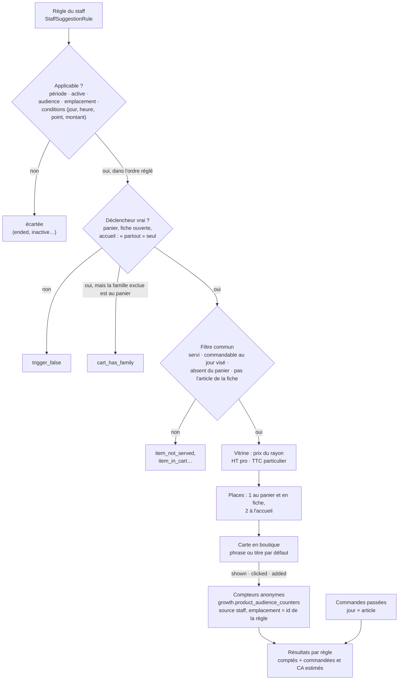

# Les suggestions décidées par le staff — ce qui est bâti

> **Doc d'état** (2026-10-18, relue contre le code au commit `651b446d3` ;
> l'accueil et l'après-ajout, RS7, les alertes, RS10, les gestes du staff,
> RS9, et les conditions facultatives, RS8, ajoutés le même jour).
> Elle décrit ce qui existe. Ce qui reste à faire (les segments, la
> recherche dans le champ article, la mise en avant dans les règles) est dans [`plan-suggestions-du-staff.md`](plan-suggestions-du-staff.md).
> L'ensemble du sujet (calculé, décidé, mis en avant) est présenté dans
> [`README.md`](README.md).

Une suggestion **décidée** est une règle posée par le staff : « quand le client
fait ceci, montre-lui cela ». Elle dit ce que la maison **veut** vendre (un
accord, la saison, une nouveauté, un stock à écouler) là où la suggestion
**calculée** dira ce que les clients **font**. Elle ne change aucun prix :
l'article sort au prix que la boutique résout déjà.

Code : `apps/lfd-api/src/b2b/recommendations/` (backend),
`apps/lfd-backoffice-frontend/src/app/suggestions/` (écran),
`apps/lfc-ecommerce-frontend/src/app/client/suggestions/` et
`client/cart/staff-cart-suggestion.service.ts` (boutique). Contrats :
`packages/contracts/src/staff-suggestions.ts`, `cart-suggestions.ts`,
`product-suggestions.ts`, `home-suggestions.ts`, `staff-suggestion-preview.ts`,
`staff-suggestion-results.ts`, `staff-suggestion-alerts.ts`,
`staff-suggestion-conditions.ts`.

## 1. Le parcours

La boutique et l'aperçu de l'écran passent par la **même** chaîne,
`StaffSuggestionShowcase` (`application/services/staff-suggestion-showcase.ts`) :
`show` rend ce que voit le client, `diagnose` déroule les mêmes portes pas à pas.
Un emplacement de plus est une query de plus qui apporte son déclencheur, pas
une branche dans cette chaîne.

## 2. La règle

C'est un agrégat, `StaffSuggestionRule`
(`domain/entities/staff-suggestion-rule.ts`), seul écrivain de
`public.staff_suggestion_rules`. Dans `public` et non dans `growth` : une règle
est une **décision** du commerce, `growth` porte ce qu'on **observe**.

| Champ           | Ce qu'il porte                                                                                                                                                      | Refusé si…                                                                                                                |
| --------------- | ------------------------------------------------------------------------------------------------------------------------------------------------------------------- | ------------------------------------------------------------------------------------------------------------------------- |
| **Déclencheur** | `everywhere` (partout) · `product_in_cart` (article au panier) · `category_in_cart` (famille au panier, sous-familles comprises) · `product_viewed` (fiche ouverte) | inconnu ; « partout » qui nomme quelque chose, ou un autre qui ne nomme rien ; article ou famille hors du catalogue servi |
| **Suggérés**    | 1 à 3 SKU distincts, dans l'ordre voulu                                                                                                                             | aucun ou plus de 3 ; un doublon ; un article égal au déclencheur ; hors du catalogue servi                                |
| **Emplacement** | `cart` (panier) · `product` (fiche) · `home` (accueil)                                                                                                              | le déclencheur ne peut pas y être vrai : un déclencheur de panier ne vaut qu'au panier, une fiche ouverte qu'en fiche     |
| **Audience**    | `pro` · `public` · `both`                                                                                                                                           | inconnue                                                                                                                  |
| **Période**     | début et fin obligatoires, jours métier (Paris), bornes comprises                                                                                                   | jour invalide ; fin avant début ; fin déjà passée **à la création** (permise à la réécriture)                             |
| **Phrase**      | facultative ; le français d'abord, anglais et italien facultatifs ; 90 caractères par langue                                                                        | une traduction sans français ; une langue au-delà de 90 caractères                                                        |
| **Priorité**    | entier de 0 à 999, plus haut = d'abord                                                                                                                              | hors borne ou non entier                                                                                                  |
| **Active**      | interrupteur ; une règle naît active                                                                                                                                | —                                                                                                                         |
| **Conditions**  | facultatives, toutes en ET avec le reste (§2.1)                                                                                                                     | voir §2.1                                                                                                                 |

Les refus sont nommés dans `domain/errors/staff-suggestion-errors.ts`
(`suggestions.*`), écrits pour le personnel : ils disent le cas et le geste de
sortie, les jours en `JJ/MM/AAAA`. L'existence d'un article ou d'une famille au
catalogue servi est demandée par les cas d'usage (`UnknownSuggestionCatalogueError`) ;
le reste, l'agrégat le juge seul.

**Pas de suppression.** Une règle se coupe et se rallume (`setActive`), se
réécrit entière (`revise`, un `PUT` remplace tout), et s'**archive** — pour
toujours : une archivée ne s'écrit plus et ne paraît plus en boutique, mais se
lit encore à l'écran. Les SKU et la famille sont des identifiants opaques, sans
clé étrangère : un article retiré ne fait pas disparaître la règle qui le cite.

Chaque geste est journalisé : `staff_suggestion.created`, `.revised`,
`.activated`, `.deactivated`, `.archived`, `staff_suggestion_order.changed`
(`packages/contracts/src/journal-facts/commerce-suggestions.ts`).

### 2.1 Les conditions facultatives (RS8)

Bâties le 2026-10-18 (Hugo : « je veux tout ce que tu as écrit comme
amélioration »). Chacune est **facultative** ; posées, elles valent **en ET**
entre elles et avec la période, la clientèle, l'emplacement et le
déclencheur. Value object `domain/value-objects/suggestion-conditions.ts`,
porte `domain/services/suggestion-conditions-gate.ts`, refus
`domain/errors/suggestion-condition-errors.ts`.

| Condition                      | Ce qu'elle porte                                                                                             | Jugée…                                                                                          | Refusée si…                                                                   |
| ------------------------------ | ------------------------------------------------------------------------------------------------------------ | ----------------------------------------------------------------------------------------------- | ----------------------------------------------------------------------------- |
| **Jours de la semaine**        | un sous-ensemble de lundi–dimanche ; les sept valent « aucune condition »                                    | au jour métier de l'**affichage** (Paris, `Clock`), pas au jour de retrait                      | liste vide, jour inconnu, doublon                                             |
| **Plage horaire**              | `HH:MM` → `HH:MM`, heure de Paris, début compris, fin exclue                                                 | à l'heure de l'affichage (`instantToLocal(clock.now())`)                                        | heure mal formée ; fin pas après le début — **pas de plage qui passe minuit** |
| **Montant minimum du panier**  | des **centimes** entiers, de 0,01 € à 10 000 €                                                               | contre le total que le client **lit** au panier ; un panier pas encore chiffré ne l'atteint pas | non entier, ≤ 0, au-delà ; posé ailleurs qu'au panier                         |
| **Sans article d'une famille** | un id de famille du catalogue servi (« sans boisson »), sous-familles comprises                              | sur la lignée des articles du panier, après le déclencheur                                      | famille inconnue ; ailleurs qu'au panier ; la même que celle qui déclenche    |
| **Points de retrait**          | 1 à 20 ids de `pickup_addresses` (les sites du commerce, `b2b/sites`), ouverts (non archivés, qui remettent) | au point du jour visé ; **pas encore choisi** ou **en livraison** : la règle ne paraît pas      | liste vide, doublon, plus de 20 ; point inconnu, archivé ou qui ne remet pas  |

**Le montant, tranché à la règle d'affichage du panier.** Le panier ne
multiplie rien : ses montants viennent du devis du serveur (`/shop/quote`). Le
seuil se compare au chiffre de la ligne **« Total »** : **HT pour un
professionnel au compte, TTC sinon** — remise, bon et port compris
(`shownCartTotalCents`, `client/cart/shown-cart-total.ts`, la fonction même de
`CartSummary`). Le staff écrit « si le panier atteint 20 € » en pensant à ce
que le client voit. La boutique n'envoie ce total que lorsque le devis est
`ready` pour CE panier ; pendant un nouveau décompte, ou dans le retour
« Ajouté ! » (l'article vient d'entrer, rien n'est encore chiffré), la règle à
seuil ne paraît pas. Ni flottant ni conversion : des centimes du serveur.

**Panier seulement.** Le montant et la famille exclue ne se jugent qu'à
l'emplacement `cart` : ni la fiche ni l'accueil ne connaissent le total, et la
fiche ne juge pas de famille. L'agrégat le refuse (et un `CHECK`).

**Le point de retrait** est celui que la boutique envoie déjà avec le jour
visé (`target.pickupAddressId`) : `target` absent = **pas encore choisi**,
`pickupAddressId` nul = **livraison**. Une règle à points ne paraît ni dans
l'un ni dans l'autre cas. Les points se lisent aux sites
(`SuggestionSiteReader`, adaptateur sur `SiteReader`) — à l'écriture, et pour
les alertes (§13).

**En base** : six colonnes ajoutées à `staff_suggestion_rules` (migration
`20261018200000_les_conditions_des_suggestions`, additive) — listes vides
(`condition_weekdays`, `condition_pickup_address_ids`) ou nulles
(`condition_hours_from`/`_to`, `condition_min_cart_total_cents`,
`condition_cart_without_family_id`) pour « pas posée ». Les `CHECK` tiennent
les jours connus, la plage dans l'ordre, le seuil positif et les conditions
du panier au panier. Les règles d'avant n'ont aucune condition ; un client qui
n'envoie pas `conditions` en crée une sans — et une réécriture sans elles les
retire (un `PUT` remplace tout). Les faits `staff_suggestion.created` /
`.revised` portent `conditions` (facultatif dans les faits d'avant).

## 3. L'ordre entre règles

Un réglage unique de la boutique, `public.staff_suggestion_order_settings`
(ligne absente = `recent`), tranché par Hugo le 2026-10-18 (« il faut coder
priorité, et mettre un switch pour que l'admin décide récente ou priorité ») :

- **`recent`** : la plus récemment **créée** d'abord — la réécrire ne la fait
  pas passer devant une règle plus jeune ;
- **`priority`** : la priorité la plus haute, puis la plus récente à égalité.

L'id départage deux créations au même instant. Un article proposé par deux
règles revient à la première ; la seconde est « battue » (`outranked_by`).

## 4. Où elle s'affiche

| Emplacement | Déclencheurs qui y valent                           | Titre sans phrase dans la langue du client | Places |
| ----------- | --------------------------------------------------- | ------------------------------------------ | ------ |
| **Panier**  | `everywhere`, `product_in_cart`, `category_in_cart` | « Notre conseil » (`shop.staffAdvice`)     | 1      |
| **Fiche**   | `everywhere`, `product_viewed` sur l'article ouvert | « Vous aimerez aussi » (`shop.alsoLike`)   | 1      |
| **Accueil** | `everywhere` seulement                              | « Notre sélection » (`shop.ourPicks`)      | 2      |

Les places sont des constantes du domaine, `STAFF_CART_PLACES`,
`STAFF_PRODUCT_PLACES` et `STAFF_HOME_PLACES` (`domain/services/cart-suggestions.ts`,
`product-suggestions.ts`, `home-suggestions.ts`). Hugo a tranché **une place
au panier** le 2026-10-18, et validé le même jour la même valeur sur la fiche
et **deux** places à l'accueil — la recommandation d'origine (« 2 sur 3 »),
avec « Notre sélection » pour titre par défaut. Au **panier**, le calculé
« souvent pris avec » (R2) suit la carte du staff, à sa propre place, sans
reprendre son article ([`suggestions-calculees.md`](suggestions-calculees.md)) ;
la fiche et l'accueil n'ont pas de calculé.

**Au panier**, la carte remplace la relance codée en dur d'avant
(cart-upsell.service.ts et sa liste `TREATS`, retirés le 2026-10-18 par Hugo,
sans repli) : sans règle applicable, le panier ne montre **rien**. Une requête
par ouverture du panier et par changement de son contenu, du lecteur, du jour
visé ou de son total chiffré (RS8 : le panier envoie `cartTotalCents` quand le
devis est prêt), après un court délai.

**Sur la fiche**, la carte se pose sous l'article de `ProductSheet`
(`StaffProductSuggestion`) : une requête par ouverture, le panier et le jour
visé lus au départ.

**À l'accueil**, la rangée « Notre sélection » (`StaffHomePicksRow`, service
`StaffHomePicks`) se pose sur `/bienvenue` (`AccueilPublic`), juste au-dessus
de la vitrine composée de l'accueil : c'est la page que la boutique appelle
`home`, celle où tombe la racine du site. Le rayon « Tout » de `/boutique` n'a
pas été retenu : c'est un rayon, il a déjà la fiche et le panier pour suggérer.
Une requête par affichage de l'accueil ; le panier courant n'y sert qu'à
exclure ce qu'il contient. Une carte par article, côte à côte au bureau ; sans
règle, ni rangée ni titre.

**Après un ajout** (« Ajouté ! »), ce n'est pas un quatrième emplacement
(Hugo, 2026-10-18) : la
suggestion du **panier** (mêmes règles, `placement` `cart`, même route),
recalculée avec l'article qui vient d'entrer. Elle répond à une **entrée** au
panier — le passage de zéro à une pièce depuis une tuile, la fiche ou une
carte de suggestion (`CartEntries`, annoncée là où `added_to_cart` est compté) ;
un « + » sur un article déjà présent n'en est pas une, une reprise du panier
gardé en base non plus. Elle paraît dans un `fold-toast` (`AfterAddToast`, au
bas de l'écran, refermable, 6 s, suspendu au survol), ne bloque rien et
n'ouvre pas le panier ; elle se tait panier ouvert, où la carte du panier parle
déjà. Sans règle applicable, rien ne paraît : la tuile et la pastille du
panier disent déjà que l'article est entré. Un hôte du shell (`AfterAddHost`)
ne charge le retour qu'à la première entrée, par import à la demande.

**La carte a deux gestes** (Hugo, 2026-10-18). Un clic sur la carte — un
bouton, nommé par ce qu'il montre — **ouvre la fiche** de l'article suggéré ;
seul le **« + »**, un second bouton à côté (« Ajouter … »), l'ajoute au panier.
La fiche vit dans la boutique : la demande passe par `PieceRequest`
(`client/shop/piece-request.service.ts`), qui mène à `/boutique` quand on n'y
est pas (depuis l'accueil, ou le retour « Ajouté ! » posé ailleurs), et que
`ShopPage` consomme une fois, comme le toucher d'une tuile. Ce qui couvrirait
la fiche s'efface : le dialogue du panier et son popover se referment, le
retour « Ajouté ! » aussi. Sur une fiche ouverte, la fiche passe à l'article
suggéré. Pas de « ne plus proposer » au retour « Ajouté ! » (Hugo, même jour).

Partout : rien en SSR, la requête vit dans un morceau chargé à la demande (le
paquet initial de la boutique est près de son plafond — RS7 l'a porté de
1 304,91 kB à 1 306,16 kB, RS8 à 1 306,37 kB, plafond 1 400 kB, le 2026-10-18), et la carte est un
composant partagé, `client/suggestions/staff-suggestion-card/`.

## 5. Le filtre

Après le déclencheur, chaque candidat passe `RecommendationFilter`
(`application/services/recommendation-filter.ts`), le filtre commun à toute
suggestion, sans repli :

1. **servi à ce lecteur** — `resolveMany(skus, audience)`, qui applique
   `servedTo` (audience de l'article, masquage, validation) ;
2. **commandable au jour visé** — la limite de l'article, sinon la règle
   d'heure limite du commerce, et seulement si elle est **ouverte** (un article
   en rattrapage, qui ne passerait qu'avec une dérogation, est écarté). Sans
   jour visé, pas d'heure à opposer, comme à la passation
   (`domain/orderable-today.ts`) ;
3. **absent du panier**.

Sur la fiche, l'article ouvert n'est jamais proposé ; à l'accueil, le panier
courant sert à cette seule exclusion. Un candidat qui ne passe
pas **disparaît** : une règle ne force jamais la vente d'un article
indisponible, et une liste vide rend une carte absente.

## 6. Le prix

L'article sort au **prix de vitrine** (`ShopCataloguePricing`, par
`ShopSuggestedArticleReader`), dans l'assiette du rayon : **HT à un
professionnel, TTC à un particulier**, par la même fonction que la vignette
(`shelfPriceLabel`, `client/shop/shop-price-basis.service.ts`). Le lecteur se
déduit de la société agissante, comme partout dans le commerce : la route
publique sert un particulier ; la route `…/mine` laisse l'espace courant
décider (un pro y reçoit son tarif de société).

## 7. L'aperçu de l'écran

`POST /admin/suggestions/preview` (un `POST` parce que le corps porte un
panier ; lecture seule, droit `lfc_suggestions:read`). On choisit un
emplacement (panier avec ses articles, fiche d'un article, ou accueil — dont
le panier n'écarte que ce qu'il contient), une clientèle
(`public` ou `pro`) et un jour — qui sert à la fois à la période et à l'heure
limite —, puis pour les conditions (RS8) une **heure** (`time`, vide =
maintenant), un **point de retrait** (vide = « pas encore choisi » : l'heure
limite suit alors la règle générale) et, au panier, un **total du panier**
(`cartTotalCents`, vide = pas encore chiffré). « Ouvrir l'aperçu » depuis une
règle conditionnée pose un jour de ses jours, le début de sa plage, son seuil
et son premier point : elle y paraît si rien d'autre ne l'écarte. Aux professionnels, l'aperçu montre la vitrine pro **sans tarif de
société** (`pricedWithoutCompany`) : ni mercuriale, ni tarif négocié.

Il rend la carte exacte, puis chaque règle non archivée avec son sort, en
vocabulaire fermé (`domain/services/suggestion-diagnosis.ts`) :

| Code                          | À l'écran                                          |
| ----------------------------- | -------------------------------------------------- |
| `shown`                       | affichée                                           |
| `ended` · `not_started`       | période finie · pas encore commencée               |
| `inactive`                    | coupée                                             |
| `wrong_audience`              | pas pour cette clientèle                           |
| `wrong_placement`             | pas pour cet emplacement                           |
| `outside_weekdays`            | pas ce jour de la semaine (RS8)                    |
| `outside_hours`               | pas à cette heure (RS8)                            |
| `no_site_yet`                 | aucun point de retrait choisi (RS8)                |
| `wrong_site`                  | autre point, ou livraison (RS8)                    |
| `cart_below_threshold`        | panier sous le seuil, ou pas chiffré (RS8)         |
| `trigger_false`               | déclencheur faux pour ce panier ou cette fiche     |
| `cart_has_family`             | la famille exclue est au panier (RS8)              |
| `item_not_served`             | article non servi à cette clientèle                |
| `item_not_orderable_that_day` | article non commandable ce jour-là                 |
| `item_in_cart`                | déjà au panier                                     |
| `item_is_the_product`         | c'est l'article de la fiche                        |
| `outranked_by`                | battue par une règle mieux classée (`outrankedBy`) |

Une règle ne reçoit qu'une raison de porte, la première dans l'ordre période →
interrupteur → audience → emplacement → jour de la semaine → heure → point de
retrait → montant ; la famille exclue se juge après le déclencheur ; une règle déclenchée reçoit un verdict
par article. Rien n'est rejugé : chaque raison est celle qu'une porte de la
chaîne de la boutique a rendue. Chaque règle non archivée, d'accueil comprise,
a son bouton « Ouvrir l'aperçu ».

## 8. Les chiffres

### 8.1 Les compteurs, anonymes

La carte compte ses gestes dans `growth.product_audience_counters`, la table
des compteurs d'audience (`(jour métier, sku, événement, emplacement, source)
→ nombre`, sans identifiant de visiteur ni de client), par
`POST /shop/audience` :

- `suggestion_shown` une fois par article et par ouverture (du panier, de la
  fiche, de l'accueil), et une fois par proposition de l'après-ajout ;
- `suggestion_clicked` quand un clic sur la carte ouvre la fiche, et
  `suggestion_added` au « + » — deux gestes distincts depuis le 2026-10-18
  (Hugo) : le « + » ne compte pas de clic, et cliquées ≠ ajoutées. Avant,
  les deux partaient ensemble au « + » : sur les jours antérieurs, les deux
  chiffres sont égaux ;
- `added_to_cart` **aussi**, au passage de zéro à une pièce (Hugo,
  2026-10-18 : le taux d'ajout global inclut les suggestions).

Source `staff`, emplacement = **l'id de la règle en minuscules** (un ULID tient
dans `[a-z0-9_]{1,32}`) : c'est ce qui permet de comparer les règles entre
elles. La file du navigateur envoie par lots, au plus toutes les cinq secondes,
et par balise au départ de la page ; un envoi perdu est perdu, jamais un geste
du client.

### 8.2 Les résultats par règle

`GET /admin/suggestions/results?days=7|30|90` (30 par défaut ; la période finit
aujourd'hui, jour métier, compris). Par règle : **affichée, cliquée, ajoutée**
(comptées), **taux d'ajout** (ajoutées ÷ affichées, en points de base, `null`
sans affichage), puis **commandées (estimé)** et **CA HT apporté (estimé)**, en
centimes. `GET /admin/suggestions/counters?from=&to=` rend les seuls chiffres
comptés.

**Pourquoi « estimé ».** Les compteurs ne disent pas qui a ajouté : une
commande ne se relie pas à un clic. L'estimation (`attributeOrders`,
`domain/services/suggestion-attribution.ts`, pure) se fait case par case, un
jour métier × un article :

1. le plafond est le plus petit de deux nombres : les ajouts depuis des
   suggestions ce jour-là, et la quantité commandée ce jour-là ;
2. si plusieurs suggestions ont fait ajouter le même article le même jour,
   ce plafond se **partage** au prorata de leurs ajouts (plus fort reste,
   entiers) — une pièce n'est jamais comptée deux fois. **Depuis le
   2026-10-18 (Hugo), le calculé entre dans ce partage** : « souvent pris
   avec » et « vos habituels » y sont deux prétendants de plus, à côté des
   règles (compteurs source `data`, `suggestions-calculees.md` §6). Les
   chiffres d'une règle **baissent** quand le calculé a aussi fait ajouter
   l'article ce jour-là ; c'est voulu ;
3. le CA vaut cette quantité au **prix HT moyen payé ce jour-là** (total HT des
   lignes ÷ quantité), arrondi au centime par part.

Les ventes se lisent par `SuggestedSkuSalesReader`, port déclaré par la
recommandation et implémenté par la commande
(`apps/lfd-api/src/b2b/orders/infrastructure/prisma-suggested-sku-sales.reader.ts`) :
un `GROUP BY` jour × article sur le jour de passation à Paris. Rien d'autre ne
sort — ni commande, ni société, ni client.

**Exclus** : les commandes en brouillon ou annulées, celles saisies par le
staff (`placed_by_staff_id`, elles n'ont vu aucune suggestion), celles nées
d'un abonnement.

**Limites**, dites à l'écran dans l'aide « estimé » :

- un panier commandé **le lendemain** de l'ajout ne compte pas ;
- un client qui aurait pris l'article de toute façon, le même jour, est compté
  — l'estimation est un plafond, pas une preuve.

## 9. Les droits

Une ressource staff à elle, **`lfc_suggestions`** (« Suggestions de la
boutique »), lecture et écriture ; l'action se déduit du verbe HTTP. Elle
s'accorde à l'écran des rôles (`/admin/staff-roles`), jamais par migration ;
la graine (base vierge, dev, e2e) ne l'accorde qu'à l'administrateur. Les
compteurs bruts de toute la boutique (`GET /admin/product-audience`) restent
sous `b2b_growth`.

## 10. L'écran

**Gestion Boutique › Suggestions** (`/suggestions`, garde
`lfc_suggestions:read`, entrée de menu dans `app.html`) :

- **Chiffres** : la période (7 / 30 / 90 jours), l'aide « estimé », et par
  règle les six chiffres du §8.2 ; sous la liste des règles, les deux lignes
  « Calculé : souvent pris avec » et « Calculé : vos habituels »
  (`suggestion-computed-results/`), mêmes six chiffres ;
- **Aperçu** (`suggestion-preview-card/`) : la carte du client et le sort de
  chaque règle, à l'un des trois emplacements ; chaque règle a un bouton
  « Ouvrir l'aperçu » ;
- **Ordre** (`suggestion-order-card/`) : `recent` ou `priority` ;
- **Suggestions** (`suggestion-rule-list/`, RS9) : la liste **regroupée par
  état** — l'état que le badge de la ligne dit déjà (`stateOf`,
  `suggestion-groups.ts`) : « À venir », « En cours », « Finies », puis
  « Coupées » et « Archivées », **repliées** (`fold-disclosure`). Chaque groupe
  dit son compte, un groupe vide ne paraît pas. En tête, le filtre « Toutes /
  À corriger (n) » : il ne garde que les règles signalées, les archivées
  restant à part (une archivée n'est jamais signalée) ;
- **Une règle** (`suggestion-rule-row/`) : sa phrase résumée en ligne
  principale, son état, et si elle est signalée le badge « Vide » ou
  « Partielle » et ses raisons en clair (§13) ; ses chiffres ; puis les gestes
  — « Ouvrir l'aperçu », « Modifier », « Dupliquer », « Couper / Rallumer »,
  « Archiver ». Une archivée ne garde que « Dupliquer » (on décline une saison
  retirée sans la ressusciter) ;
- **Dupliquer** (RS9) ouvre le panneau d'édition (`suggestion-panel/`) sur une
  **copie** (`copyDraftOf`, `suggestion-draft.ts`) : mêmes déclencheur,
  articles, emplacement, clientèle, phrase et priorité ; la période **garde sa
  durée et commence au plus tôt aujourd'hui** — une règle finie se décline pour
  la saison suivante sans revivre dans le passé, une règle à venir garde ses
  jours pour une variante. L'enregistrement passe par la **création**
  (`POST admin/suggestions`) : une nouvelle règle, née active, l'originale
  intacte. Aucune route n'a été ajoutée.

Une règle neuve est préremplie « partout, à l'accueil, pour tous, aujourd'hui
seulement » (`suggestion-draft.ts`) — un défaut qui s'affiche depuis RS7.

**Les conditions** (RS8) ferment le panneau, dans un encadré
**« Conditions (facultatives) »** (`suggestion-conditions-fieldset/`) : une
phrase qui dit qu'elles se cumulent, des exemples (« le matin, du lundi au
vendredi, de 7 h à 11 h » ; « si le panier atteint 20 € » ; « si le panier n'a
aucune boisson » ; « en retrait à la boutique de la gare »), puis les jours,
la plage, et — au panier seulement — le montant en euros et la famille
exclue, enfin les points de retrait ouverts (`/admin/suggestions/choices`
rend désormais `sites`). La phrase d'aperçu du panneau et le résumé de la
liste les disent à la suite de la période : « …, du 20 au 31 octobre, du
lundi au vendredi, de 7 h à 11 h, si le panier atteint 20 €. »
(`suggestion-conditions.ts`, `conditionsParts`).

## 11. Les outils agent

Dix outils WebMCP sous `lfc_suggestions`, déclarés par l'écran
`/outils-agent` : cinq lectures (`suggestion_list`, `suggestion_order_get`,
`suggestion_preview`, `suggestion_results`, `suggestion_alerts`) et cinq
écritures. Détail dans
[`outils-agent-suggestions.md`](outils-agent-suggestions.md).

## 12. Les routes

| Route                                 | Droit                   | Rend                                                                                |
| ------------------------------------- | ----------------------- | ----------------------------------------------------------------------------------- |
| `GET /admin/suggestions`              | `lfc_suggestions:read`  | toutes les règles, archivées comprises                                              |
| `GET /admin/suggestions/choices`      | `lfc_suggestions:read`  | les articles et familles du catalogue servi, et les points de retrait ouverts (RS8) |
| `GET /admin/suggestions/applicable`   | `lfc_suggestions:read`  | les règles applicables à un emplacement aujourd'hui                                 |
| `GET /admin/suggestions/order`        | `lfc_suggestions:read`  | l'ordre réglé                                                                       |
| `GET /admin/suggestions/counters`     | `lfc_suggestions:read`  | affichée, cliquée, ajoutée par règle                                                |
| `GET /admin/suggestions/results`      | `lfc_suggestions:read`  | les résultats du §8.2                                                               |
| `GET /admin/suggestions/alerts`       | `lfc_suggestions:read`  | les alertes du §13                                                                  |
| `POST /admin/suggestions/preview`     | `lfc_suggestions:read`  | l'aperçu du §7                                                                      |
| `POST /admin/suggestions`             | `lfc_suggestions:write` | crée une règle                                                                      |
| `PUT /admin/suggestions/order`        | `lfc_suggestions:write` | règle l'ordre                                                                       |
| `PUT /admin/suggestions/:id`          | `lfc_suggestions:write` | réécrit la règle entière                                                            |
| `PUT /admin/suggestions/:id/active`   | `lfc_suggestions:write` | coupe ou rallume                                                                    |
| `PUT /admin/suggestions/:id/archive`  | `lfc_suggestions:write` | archive                                                                             |
| `POST /shop/suggestions/cart`         | publique (60/min)       | la carte du panier, lecteur particulier                                             |
| `POST /shop/suggestions/cart/mine`    | connecté                | la carte du panier, lecteur de l'espace courant                                     |
| `POST /shop/suggestions/product`      | publique (60/min)       | la carte de la fiche, lecteur particulier                                           |
| `POST /shop/suggestions/product/mine` | connecté                | la carte de la fiche, lecteur de l'espace courant                                   |
| `POST /shop/suggestions/home`         | publique (60/min)       | la rangée de l'accueil, lecteur particulier                                         |
| `POST /shop/suggestions/home/mine`    | connecté                | la rangée de l'accueil, lecteur de l'espace courant                                 |
| `POST /shop/audience`                 | publique (30 lots/min)  | compte un lot de gestes (≤ 50)                                                      |

Pas de `DELETE` : on archive. Les chemins nommés sont déclarés avant `:id`.

## 13. Les alertes

Une règle qui **vit** — non archivée, allumée, période en cours ou à venir —
et qui ne peut plus rien montrer ne doit pas passer inaperçue (RS10).
`GET /admin/suggestions/alerts` (`lfc_suggestions:read`) rend les seules
règles signalées, calculées à la demande, sans table. Une règle finie, coupée
ou archivée n'est jamais signalée : elle ne s'affiche déjà plus.

Pour chaque clientèle de la règle (`both` = les deux), chaque article suggéré
passe par le filtre de la boutique, `RecommendationFilter.judgeOver` — le
même `resolveMany` puis `judgeOrderable` jour par jour. Raisons, en
vocabulaire fermé (`STAFF_SUGGESTION_ALERT_REASONS`) :

| Code                  | À l'écran                                                   | Lu par                                         |
| --------------------- | ----------------------------------------------------------- | ---------------------------------------------- |
| `withdrawn`           | « … est retiré du catalogue. » (une seule ligne, pour tous) | paramétrage : aucune déclinaison en rayon      |
| `not_for_audience`    | « … n'est plus vendu aux particuliers. »                    | hors gamme, validation en attente, sans tarif  |
| `hidden_for_audience` | « … est masqué pour les particuliers. »                     | paramétrage : toutes ses déclinaisons masquées |
| `never_orderable`     | « … n'est commandable aucun jour d'ici le 25 octobre (…). » | heure limite de l'article ou règle du commerce |

La cause d'un refus de service se lit au paramétrage du catalogue
(`NotServedCauseReader`, adaptateur `CatalogNotServedCauseReader` sur
`CatalogAdminReader`) : `resolveMany` dit ce qui est servi, pas pourquoi le
reste ne l'est pas.

**« Jamais commandable »** cherche un jour ouvert de la plus tardive
d'aujourd'hui et du début, à la plus proche de la fin et d'aujourd'hui + 30 :
**31 jours au plus** (`STAFF_SUGGESTION_ALERT_HORIZON_DAYS`). Une période plus
longue n'est regardée que jusque-là, et la vue le dit (`window.capped`,
« la suite de la période n'est pas regardée ») ; une règle qui commence
au-delà n'est pas jugée sur ce point. Sans point de retrait : la règle
générale du commerce, celle de la livraison — une heure limite propre à un
point de retrait n'est pas regardée (validé par Hugo le 2026-10-18).

**Le déclencheur** : un article (au panier, fiche ouverte) qu'aucune
clientèle de la règle ne reçoit, ou une famille que le catalogue servi ne
connaît plus (`SuggestionFamilyReader`, celui de l'écriture) — la règle ne
peut plus se déclencher (`triggerWithdrawn`).

**Les conditions** (RS8) : un point de retrait choisi qui n'est plus
ouvert — archivé, ou qui ne remet plus — est signalé (`site_closed`, avec
`siteId`) ; s'ils le sont **tous**, la règle ne peut plus paraître. Des jours
de la semaine dont aucun ne tombe dans la fenêtre regardée
(`no_weekday_left`) l'éteignent aussi ; une fenêtre plafonnée couvre plus
d'une semaine et n'en dit rien. La vue porte ces raisons dans `conditions`
(`STAFF_SUGGESTION_CONDITION_ALERT_REASONS`) ; domaine `conditionFindings`.

**Gravité** : un article passe s'il est servi et commandable pour au moins
une clientèle de la règle. Aucun ne passe, un déclencheur mort, ou une
condition qui ne peut plus être vraie : **Vide**
(badge alerte). Sinon, la moindre raison : **Partielle** (avertissement) —
ainsi un article servi aux seuls professionnels, dans une règle qui vise les
deux clientèles, la rend Partielle (validé par Hugo le 2026-10-18).

Domaine pur : `domain/services/suggestion-alerts.ts` (`watchedRules`,
`alertWindow`, `ruleAlert`) ; cas d'usage :
`list-staff-suggestion-alerts.handler.ts`. Écran : `suggestion-alerts.ts`
(les phrases), outil agent `suggestion_alerts`.

## 14. Ce qui reste à faire

Dans [`plan-suggestions-du-staff.md`](plan-suggestions-du-staff.md) : les
segments (le reste de RS8, qui attend le lot A1 des audiences), la recherche dans le champ article (reste de RS9,
attend un combobox de fold-ng), et la mise en avant dans les règles (RS4).
