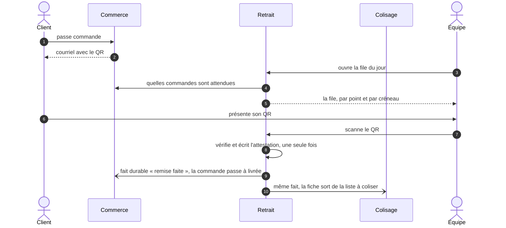

# Le retrait — le transfert de garde d'une commande

> **État : ✅ implémenté** — le bloc `apps/lfd-api/src/handover/`, son schéma
> Postgres `handover`, ses canaux, sa file et son écran tournent. Ce qui reste
> est au dernier paragraphe.

## Partie 1 — en simple

Le **retrait** est l'instant où un sac change de mains : au comptoir, quand le
client montre le QR de son courriel, ou sur le pas d'une porte, quand le livreur
le remet. Le système grave **qui** a remis, **quand**, et **comment** (scan,
saisie du numéro, dépôt à la porte).

Le retrait n'est pas le fournil : le fournil raisonne par **journée** (un plan,
une clôture) ; le retrait raisonne par **commande** — une commande passée après
la clôture reste remettable. D'où un bloc à part, avec ses propres tables.

Une commande (plus exactement un **envoi** : la commande, puis ses reliquats)
ne se remet qu'**une fois**, et c'est la base qui le refuse, pas une condition
qu'on pourrait oublier.

Les traits pleins sont des lectures synchrones par port ; les `-)` sont un fait
**durable**, écrit dans la boîte d'envoi avec l'attestation et rejoué si un
abonné échoue.

## Partie 2 — technique

### Les tables (`apps/lfd-api/prisma/schema/handover.prisma`, `@@schema("handover")`)

| Table                           | Ce qu'elle porte                                                                                    | Clé / unicité                                    |
| ------------------------------- | --------------------------------------------------------------------------------------------------- | ------------------------------------------------ |
| `handover.order_handover`       | l'attestation : `handed_over_at`, `handed_over_by`, `handed_over_via` (`scan`, `manual`, `deposit`) | `@@unique([orderId, rank])`, `reference @unique` |
| `handover.order_handover_proof` | les pièces d'une remise à la porte : photo, signature, bon signé, nom de qui a réceptionné          | `@@id([orderId, rank])`                          |
| `handover.order_departure`      | la garde passée au livreur : `departed_at`, `returned_at` (commande rapportée)                      | `@@id([orderId, rank])`                          |

`order_id` est **opaque** : aucune clé étrangère vers le commerce. Les tables
ont été déplacées par `SET SCHEMA` (migration
`20261103110000_le_retrait_dans_son_schema`), qui laisse dans `production` trois
**vues de transition** du même nom (lignes 29-31 de cette migration) pour
l'image précédente pendant un déploiement.

### Le bloc

- `domain/` — `OrderHandover` (l'agrégat, un auteur obligatoire), `HandoverProof`,
  `handoverBlocker` (`domain/services/handover.ts`, pur : annulée ou brouillon ⇒
  refus avec la phrase à lire), `queue-state.ts` (l'état d'une ligne de file :
  `handed_over` l'emporte même sur une annulée), la durée de garde des pièces.
- `application/` — commandes `confirm-handover`, `confirm-manual-handover`,
  `receive-transfer-at-counter`, `erase-handover-proofs`,
  `purge-handover-proofs-older-than` ; requêtes `get-handover`,
  `get-handover-by-order`, `get-handover-queue`, `get-cockpit-handovers`,
  `get-delivery-run-sheet` ; abonnés durables `record-round-departed`,
  `record-orders-brought-back` (faits de la livraison) ;
  `handover-attestation.service.ts`, le geste commun au scan et à la saisie.
- `http/` — `handover.controller.ts` (`/admin/handover`, surface
  `handover_counter`), `handover-supervision.controller.ts`
  (`/admin/supervision/handover`), `handover-cockpit.controller.ts`
  (`/admin/cockpit/handovers`), `delivery-run-sheet.controller.ts`.
  Le périmètre de la file est posé par la route, jamais par l'écran (décidé par
  Hugo le 2026-11-13) : le comptoir lit les retraits seuls (`counter`), la
  Supervision la journée entière (`whole_day`), le cockpit deux compteurs par
  acheminement. Les droits :
  [`droits-des-commandes.md`](../droits-et-permissions/droits-des-commandes.md).

### Les canaux

| Canal                           | Déclaré par  | Implémenté par | Ce qu'il porte                                                                                                                         |
| ------------------------------- | ------------ | -------------- | -------------------------------------------------------------------------------------------------------------------------------------- |
| `handover/channels/commerce/`   | le retrait   | le commerce    | `HandoverSubjectReader`, `HandoverQueueReader`, verrou de commande, aperçu et guichet du comptoir…                                     |
| `handover/channels/commerce/`   | le retrait   | le retrait     | `OrderHandoverHistoryReader`, `ShipmentHandoverReader`, `HandoverProofReader` (lus par le commerce), et le fait `OrderHandedOverEvent` |
| `handover/channels/packing/`    | le retrait   | —              | republie `OrderHandedOverEvent` (`handover.handed_over`) pour le colisage                                                              |
| `production/channels/handover/` | le fournil   | le retrait     | `AttestedHandoversReader`, `OrderCustodyReader` (ce que le fournil demande au retrait)                                                 |
| `production/channels/handover/` | le fournil   | le fournil     | `QualityHoldsReader`, `AtelierSheetsReader` (ce que le retrait lit au fournil)                                                         |
| `delivery/channels/handover/`   | la livraison | le retrait     | faits `delivery.round_departed` et commandes rapportées, `DepartureHoldsReader`, attestation à la porte, réception d'un transfert      |

`lint:context-boundaries` et `lint:prisma-model-ownership`
(`dev-toolbox/gates/`) connaissent le bloc : `handover → lafoliecoffee` et
`handover → packing` sont interdits, et seul le retrait lit ses trois modèles.

### Ce qu'il stocke, et ce qu'il lit vif

On ne copie pas pour aller plus vite ; on garde une donnée quand elle peut
**diverger** de sa source et que l'écart veut dire quelque chose. L'attestation
survit à l'annulation de la commande : elle est à lui. Le contenu du sac, le
point et le créneau sont lus vifs au commerce : c'est de l'alimentaire, le
contenu gèle au démarrage du four, et le retrait a lieu après.

### Les invariants

| Invariant                                            | Tenu par                                                        |
| ---------------------------------------------------- | --------------------------------------------------------------- |
| un envoi ne se remet qu'une fois                     | la base : `(order_id, rank)` et `reference` uniques             |
| un retrait a toujours un auteur                      | l'agrégat `OrderHandover`                                       |
| annulée ou brouillon ⇒ refus lisible                 | `handoverBlocker`                                               |
| un retrait survit à l'annulation                     | la réhydratation ne repasse pas la règle                        |
| deux postes scannent en même temps ⇒ un seul retrait | le perdant reçoit `P2002`, relit et republie le fait du gagnant |

Le QR encode la route front `/retrait/:token`
(`apps/lfd-backoffice-frontend/src/app/retrait/`) ; elle ne bouge jamais, seul
le chemin d'API qu'elle appelle peut changer. Les e2e du bloc sont
`apps/lfd-api/test/handover-*.e2e-spec.ts`.

## Reste à faire

- **Retirer les trois vues de transition** `production.order_handover`,
  `production.order_handover_proof`, `production.order_departure` : migration
  `DROP VIEW` ×3 (aucune migration ne les supprime aujourd'hui). Point
  d'irréversibilité : revenir à `production` demanderait ensuite un nouveau
  `SET SCHEMA` en trois déploiements.
- **Retirer l'alias d'URL déprécié** `admin/production/handover`
  (`handover.controller.ts:38`, `HANDOVER_ROUTES`), avec l'appel qui l'atteste
  encore dans `test/production-batch.e2e-spec.ts:1377`.
- **Les états de comptoir** — « au frais », « client appelé », « passera à
  9 h » — n'existent pas. Ce sont des faits qui naissent au comptoir : ils
  reviendront à une table du retrait.
