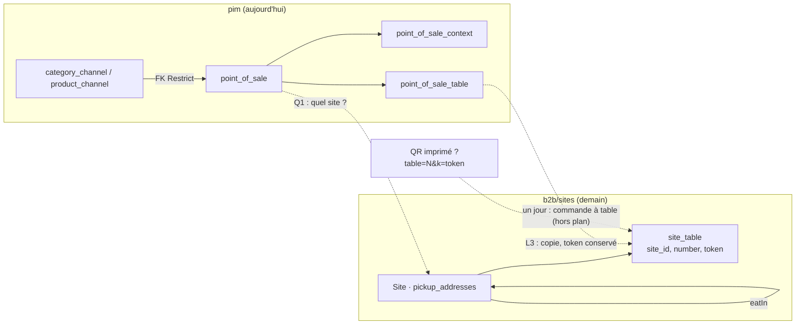

# Plan — « sur place » devient une capacité de site

> 📐 **Doc-first, 2026-10-17.** Rien de ce qui est proposé ici n'est bâti.
> Demande de Hugo (2026-10-16/17) : « sur place devient presque une capacité de
> site ».
>
> 🔴 **Ce plan touche la TVA** (le taux d'une commande sur place) **et porte une
> migration de données** (la grille de tables quitte `pim`). Il passe donc
> par `vitruve` avant Hugo (`CLAUDE.md` §9 bis) ; ses objections seront
> ajoutées en §10.
>
> Chaque affirmation sur l'existant cite `fichier:ligne`, ouvert le
> 2026-10-17. Chemins relatifs à `apps/lfd-api/` sauf mention.

> ✅ **L1 et L2 bâtis le 2026-10-17** (commit `63da84243`) — voir « Mesure de
> production et simplification » ci-dessous, qui prime sur §4, §7 et §8.
>
> ✅ **L3 bâti le 2026-10-17** (non commité à l'écriture de cette ligne) —
> voir « Ce qui est bâti (L3) » en fin de document : deux objections de
> `vitruve` y sont tranchées d'une façon que Hugo doit relire.

## 0. Ce qui est convenu, et ce qui ne bouge pas

- **Le contexte de vente `eatIn` reste.** Il porte le taux de TVA « sur place »
  face à `takeaway` ; la TVA par contexte est une décision de Hugo, que ce
  plan ne touche pas.
- **Une capacité de site « sur place »** dit OÙ l'on peut consommer sur place,
  à côté des rôles Retrait / Approvisionné / Livraison.
- **La grille de tables** (QR rotatifs) quitte le point de vente du
  référentiel pour le site.
- **Le reste du point de vente** (genre `shop`/`platform`, contextes offerts)
  disparaît.
- **Indépendance** : un autre chantier retire la lecture de la matrice des
  canaux et le refus `context_still_sold`. Ce plan n'en dépend pas — sauf un
  point de séquence dit en §7 (la FK de la matrice vers `point_of_sale`).

## 1. L'existant

### 1.1 Le site et ses rôles (bloc `b2b`, schéma `public`)

- Modèle `Site` sur la table `pickup_addresses` :
  `prisma/schema/public/settings.prisma:15`, `@@map("pickup_addresses")` `:106`.
- Rôles en colonnes : `pickup` `:57`, `pickupForB2b`/`pickupForB2c` `:63-64`,
  `supply` (`on_site` | `transfer`) `:68`, `deliveryDeparture` `:72`,
  `transferMode` `:80`, `counterSetupMinutes` `:84`, `archivedAt` `:76`.
  Horaires du retrait en JSON `opening` `:48`.
- Agrégat : `src/b2b/sites/domain/site.ts` — `SiteRoles` `:43`,
  `Site.declare()` `:146`, `assignRoles(roles, gps, isDeparture)` `:206` qui
  passe par `checkRoles` ; refus listés dans `documentation/sites/sites.md` §2.
- Écran Réglages › Sites : `apps/lfd-backoffice-frontend/src/app/reglages/sites/`.
- `sites.md` §1 (ligne 56) : le rôle **« vend » n'est pas modélisé** et renvoie
  à `PointOfSale` ; la question Q-S3 (relier un point de vente à un site) est
  ouverte (`sites.md` ligne 432).

### 1.2 Le point de vente du référentiel (bloc `pim`, schéma `pim`)

- `PointOfSale` : `prisma/schema/pim/sales-contexts.prisma:137` — `kind`
  (`shop`|`platform`, enum `PointOfSaleKind` juste au-dessus), `label`, `baseUrl` (boutique
  seulement, contrainte SQL `point_of_sale_shop_has_base_url`), `contexts`
  `:149`, `tables` `:153`, et **`categoryChannels`/`productChannels` `:157-158`**.
- `PointOfSaleContext` `:169` — ce qu'il « offre », par `context_key`.
- `PointOfSaleTable` `:189` — clé `(point_of_sale_id, number)` `:198`,
  `qr_created`, `token` rotatif nullable `:196`.
- La matrice y pointe : `categories.prisma:64-65` et `product.prisma:67-68`
  (`point_of_sale_id`, relation sans `onDelete` ⇒ Restrict).
- Code : `src/pim/points-of-sale/` (agrégat
  domain/entities/point-of-sale.ts:58 (retiré en L3), cas generate-table-qr.ts (retiré en L3),
  remove-table-qr.ts (retiré en L3), …), contrôleur http/point-of-sale.controller.ts:31 (retiré en L3)
  — `GET`, `POST`, `PUT :id`, `DELETE :id`, `POST|DELETE :id/tables/:number/qr`
  (`:38-86`). Toutes sous `/pim`, staff.
- Le QR : generate-table-qr.ts:18-19 (retiré en L3) — l'URL imprimée dérive
  `…?table=N&k=token`. **Aucune route publique ne lit ce jeton** : grep de
  `tableToken`, `table-token`, `/t/` hors `points-of-sale` dans `src/` et
  `gateway/` → vide (2026-10-17).
- Lecteurs hors du module : le registre des contextes —
  `src/pim/sales-contexts/application/list-sales-contexts.ts:27-28`
  (`offeredByLocations()`, `usageByKey()`), implémentés
  `infrastructure/prisma-sales-context.registry.ts:88` et
  `prisma-sales-context.repository.ts:107`. Le journal :
  `src/pim/journal/pim-journal.ts:299-308` (`point_of_sale.*`), et
  `src/b2b/growth/domain/activity-module.ts:33` (préfixe). Le compteur de
  schéma `src/platform/database/schema-ops.counter.ts:164-166`. Aucun autre
  bloc ni la boutique ne lisent le point de vente.
- Front : `apps/lfd-backoffice-frontend/src/app/pim/points-of-sale/` (page,
  store, panneau), route dans `pim.routes.ts`, et les phrases du journal
  (`shared/journal/phrases/referential-settings-phrases.ts`).
- L'agrégat dit lui-même (point-of-sale.ts:43-50 (retiré en L3)) que la grille est de
  **l'équipement**, distinct du fait de servir en salle.

### 1.3 Contextes de vente et TVA

- `SalesContext` `sales-contexts.prisma` (modèle avant `:109`) : `key` unique,
  `active`. Les clés sont `takeaway` et `eatIn` (et `b2b`) —
  `src/pim/sales-contexts/domain/value-objects/bootstrap-contexts.ts:12-13`.
- Le référentiel pousse au commerce le **prix public par contexte** :
  `CatalogItem.publicByContext` `prisma/schema/public/catalog.prisma:176-190`,
  `{ "takeaway": { vatRatePercent, htMillicents }, … }`. La projection :
  `src/pim/channels/b2b-platform/products/projection.ts`.

### 1.4 Comment une commande choisit aujourd'hui son taux

- `Order.fulfillmentMethod` : enum `delivery | pickup`
  (`prisma/schema/public/orders.prisma:4-8`, colonne `:143`). **Pas de mode
  « sur place ».**
- Prix servi : `src/b2b/catalog/infrastructure/prisma-catalog.reader.ts:276-293`
  (`servedPriceOf`). Pro ⇒ `vatRatePercent` de l'article ; particulier ⇒
  `publicByContext[PUBLIC_SALES_CONTEXT]`.
- `PUBLIC_SALES_CONTEXT = "takeaway"` en dur :
  `src/b2b/catalog/domain/public-context.ts:30`. Son JSDoc (`:21-24`) annonce
  déjà que « le sur place arrive par son propre chemin » et que la constante
  deviendra une fonction du mode de service.
- **La boutique ne propose pas « sur place »** : aucune occurrence de
  `eatIn`/sur place comme mode dans `apps/lfc-ecommerce-frontend/src` (les
  seules « sur place » sont un canal de rendez-vous commercial et un contact de
  livraison). Le contexte `eatIn` n'est donc **jamais facturé** aujourd'hui.

## 2. Ce que le code change à la demande

1. **Il n'y a rien à « déplacer » côté commande** : aucune commande n'est sur
   place aujourd'hui. La capacité de site peut naître seule, sans toucher au
   taux, et le taux `eatIn` n'entre en jeu qu'au jour où un mode sur place est
   vendu (§5, hors du lot de base).
2. **La grille n'a aucun lecteur public** : la déménager ne casse aucun QR lu
   — mais les QR **imprimés** portent `table=N&k=token` ; garder le `token`
   tel quel les fait survivre au déménagement.
3. **`PointOfSale` ne peut pas tomber tant que la matrice le référence**
   (`categories.prisma:65`, `product.prisma:68`). Le retrait de son code peut
   précéder ; la suppression de la table attend la mort de la matrice.

## 3. Proposition — la capacité « sur place »

Sur `Site` (schéma `public`, bloc `b2b/sites`) :

| Champ (proposé) | Type                    | Règle de l'agrégat                                                                                                                            |
| --------------- | ----------------------- | --------------------------------------------------------------------------------------------------------------------------------------------- |
| `eatIn`         | `boolean`, défaut false | aucune règle croisée proposée (Q2)                                                                                                            |
| `eatInOpening`  | non, pas dans ce plan   | les horaires du retrait (`opening`) suffisent tant que rien ne vend sur place, Q3                                                             |
| tables (§4)     | table liée              | une grille n'est permise que sur un site `eatIn` (recommandé, Q4) — l'agrégat du PIM disait l'inverse (point-of-sale.ts:43-50 (retiré en L3)) |

- `SiteRoles` gagne `eatIn` ; `assignRoles` le pose ; fait de journal
  `pickup_address.roles_set` le porte déjà par construction (même charge).
- Écran Réglages › Sites : une case « Sur place » dans le bloc des rôles.
- Droit : `lfc_site_settings` (existant, `sites.md` §5) — aucune ressource
  neuve.

## 4. Proposition — la grille de tables déménage dans `b2b/sites`



- Table `public.site_table` : `(site_id, number)` clé, `token` nullable,
  `qr_created_at` (un instant plutôt qu'un booléen). FK vers
  `pickup_addresses` — même schéma, légitime.
- Agrégat : la grille devient une **collection de l'agrégat `Site`** ou un
  petit agrégat `SiteTables` à part. Recommandation : **à part**, chargé par
  site — la grille a jusqu'à 200 lignes (point-of-sale.ts:64 (retiré en L3)) et ne doit pas
  être relue à chaque lecture de site (checkout compris).
- Cas : `SetSiteTableCount`, `GenerateSiteTableQr`, `RemoveSiteTableQr` (B2B,
  fichiers command/handler séparés, §4 de `CLAUDE.md`). Le générateur de jeton
  (uuid-table-token-generator.ts (retiré en L3)) se recopie côté `b2b` — `b2b → pim`
  n'est permis que par le canal (§3), et ce n'est pas un fait du référentiel.
- **Matrice §3 : inchangée.** Tout vit dans `b2b` ; aucune arête nouvelle.
- Faits de journal neufs : `pickup_address.table_qr_generated`,
  `.table_qr_removed`, `.tables_set` (le sujet reste `pickup_address`, une
  valeur n'est pas un nom). Les faits passés `point_of_sale.*` restent.

### Ce que le QR ouvrirait un jour

La commande à table (scanner, commander, taux `eatIn`, servi en salle).
**Pas dans ce plan** : rien ne la demande, aucune route ne lit le jeton, et
elle exigerait un mode de service, un paiement à table et un écran de salle.
Ce plan garde seulement le jeton valide.

## 5. Le taux `eatIn` d'une commande sur place — décrit, non bâti

Quand un mode sur place sera vendu (hors de ce plan, Q5) :

1. `FulfillmentMethod` gagne `eat_in` (valeur d'enum additive).
2. `PUBLIC_SALES_CONTEXT` devient `publicContextOf(fulfillment)` :
   `eat_in → "eatIn"`, sinon `"takeaway"` (`public-context.ts:21-24` l'annonce).
   Le pro garde son taux d'article (`prisma-catalog.reader.ts:279`).
3. Le checkout ne propose `eat_in` qu'aux sites `eatIn = true`, refus côté
   agrégat `Order` (`SiteNotEatInError`), pas seulement à l'écran.
4. Le taux est **figé sur la ligne** à la passation, comme aujourd'hui.

🔴 Risque d'argent : un article dont le référentiel n'a pas poussé
`publicByContext.eatIn` doit être **invendable sur place** (`null`, comme
`:284-286`), jamais servi au taux à emporter.

## 6. Retrait du reste du point de vente

- Retirer `kind`, `baseUrl`, `PointOfSaleContext` du code, l'écran « Points de
  vente » et sa route.
- Registre des contextes : retirer `offeredByLocations()` (port
  `sales-context.registry.ts:39`) et la part « point de vente » de
  `usageByKey()` ; la colonne « offert par N lieux » de l'écran tombe.
- Tables `pim.point_of_sale*` : **gardées en base** (`CLAUDE.md` §0) jusqu'à la
  mort de la matrice, puis supprimées sur ordre de Hugo.

## 7. Migration des données

Requête **en lecture seule**, à lancer par Hugo sur la production :

```sql
SELECT p.id, p.kind, p.label,
       count(t.number)                                   AS tables,
       count(t.token)                                    AS qr_actifs,
       array_agg(DISTINCT c.context_key) FILTER (WHERE c.context_key IS NOT NULL) AS contextes
FROM pim.point_of_sale p
LEFT JOIN pim.point_of_sale_table   t ON t.point_of_sale_id = p.id
LEFT JOIN pim.point_of_sale_context c ON c.point_of_sale_id = p.id
GROUP BY p.id, p.kind, p.label
ORDER BY p.label;
```

(Les deux jointures multiplient les lignes : `count(DISTINCT …)` si l'écart
compte.) Selon le résultat :

- **aucune table ou aucun QR actif** ⇒ pas de copie ; la grille naît vide.
- **des QR actifs** ⇒ migration de données qui copie `(number, token)` vers
  `site_table` du site désigné par Hugo (Q1) — une ligne de correspondance
  écrite dans le SQL, relue par `lecteur-de-migrations`.
- `eatIn` du site : posé à `true` seulement là où Hugo le dit, jamais déduit
  de `point_of_sale_context` (un contexte offert n'était lu par personne).

## 8. Lots

| Lot | Contenu                                                                 | Dépend de                      |
| --- | ----------------------------------------------------------------------- | ------------------------------ |
| L1  | `Site.eatIn` : colonne, agrégat, écran, journal, tests                  | —                              |
| L2  | `site_table` + cas QR côté `b2b/sites`, écran sous le site              | L1                             |
| L3  | copie des tables (si la requête §7 en trouve), correspondance par Hugo  | L2, Q1                         |
| L4  | retrait du code et de l'écran « Points de vente », `offeredByLocations` | L3                             |
| L5  | suppression des tables `pim.point_of_sale*`                             | matrice retirée, ordre de Hugo |
| —   | mode sur place vendu (§5)                                               | hors plan                      |

## 9. Risques

- **TVA** : le jour du §5, un repli silencieux sur `takeaway` facturerait faux.
  Le refus doit être structurel.
- **Jetons** : une copie qui régénère le jeton invaliderait des QR imprimés.
- **FK de la matrice** : supprimer `point_of_sale` avant la matrice échoue
  (Restrict) — d'où L5 séparé.
- **Doublon d'écran** pendant L2–L4 : deux endroits éditent une grille ; L4
  suit L3 sans délai.

## 10. Questions à Hugo

| #   | Question                                                              | Recommandation                                                        |
| --- | --------------------------------------------------------------------- | --------------------------------------------------------------------- |
| Q1  | Quel site reçoit la grille de chaque point de vente `shop` existant ? | dépend de la requête §7 ; sans QR actif, ne rien copier               |
| Q2  | « Sur place » exige-t-il un site approvisionné (pas un site servi) ?  | non : un site servi par transfert peut avoir une salle — pas de règle |
| Q3  | Des horaires propres au sur place ?                                   | non pour l'instant ; `opening` suffit tant que rien ne se vend        |
| Q4  | Une grille de tables sur un site sans « sur place » ?                 | refusée : sans salle, une table n'a pas de sens au comptoir           |
| Q5  | Vendre le sur place en ligne (§5) : quand, et pour qui ?              | hors de ce plan ; un plan à part, passé par `vitruve`                 |
| Q6  | Le mode « sur place » vaut-il pour les pros ?                         | non : particuliers seulement                                          |

_Objections de `vitruve` : à ajouter ici après son passage._

## Contradiction de `vitruve` (2026-10-17), qui prime sur le plan

- **Le harnais e2e et le démarrage appellent le point de vente** (BLOQUANT) :
  `test/e2e-harness.ts` appelle `ensureRootPointOfSale()` à chaque `reset()`,
  et le module sème `pos_b2b` au démarrage (bootstrap-point-of-sale.ts (retiré en L3)) ;
  s'y ajoutent `pim-prisma.service.ts` et quatre suites e2e. L4 doit dire qui
  garantit `pos_b2b` tant que la matrice vit en base — peut-être personne, plus
  aucune écriture de matrice n'existant : à trancher, pas à taire.
- **Un QR imprimé ne dira plus de quel site il vient** (BLOQUANT) : l'URL est
  `baseUrl…?table=N&k=token`, et c'est `baseUrl` qui désigne le lieu ; le plan
  le retire, et aucun index n'assure l'unicité d'un jeton de table. « Garder le
  jeton valide » exige `token UNIQUE` dans `site_table`, ou la correspondance
  `baseUrl → site` conservée. (Non vérifié : le constructeur réel de l'URL côté
  front — l'objection tombe s'il porte un identifiant de lieu.)
- **Le journal du site** (SÉRIEUX) : `site.events.ts` énumère la charge champ
  par champ ; `eatIn` doit y être ajouté à la main, sinon personne ne saura qui
  a ouvert une salle.
- **`qr_created_at`** (SÉRIEUX) : la source n'a qu'un booléen ; copier
  obligerait à inventer une date. Colonne nullable, `NULL` = « créé avant la
  copie, date inconnue », ou un booléen.
- **Le registre des contextes** (SÉRIEUX) : `point_of_sale_context` reste en
  base jusqu'à L5 et sa clé étrangère retient la suppression d'un contexte ;
  si L4 retire le compte, le refus nommera un faux cas. Vider la table en L4,
  ou garder le compte.
- **Le retour arrière** (SÉRIEUX) : après la copie, les lignes du référentiel
  doivent être gelées ou neutralisées, sinon un QR régénéré côté site laisse un
  ancien jeton qui ment ; la migration inverse est à écrire.
- **La copie n'est pas journalisée** (SÉRIEUX) : un fait émis par la migration,
  ou l'absence de trace dite.
- **La requête du §7 multiplie les lignes** (SÉRIEUX) : `count(DISTINCT t.number)`,
  `count(DISTINCT t.token)`, et une colonne `base_url`.
- Mineurs : « eatIn jamais facturé » est vrai pour tout le code du commerce
  (pas seulement la boutique) ; citer le constructeur d'URL ; §0 et L5 se
  contredisent sur la dépendance à l'autre chantier.

## Mesure de production et simplification (Hugo, 2026-10-17)

**Mesure de Hugo en production, 2026-10-17** : les trois points de vente
(`pos_b2b` « B2B », « L'Adroit », « Village ») ont **0 table, 0 QR actif,
aucun jeton**. Il n'y a donc **rien à recopier** : le lot de copie disparaît,
et avec lui les objections de `vitruve` sur les jetons gardés, la date
inventée (`qr_created_at`), le gel des anciennes lignes et la trace de la
copie. Q1 tombe. **La grille de tables naît vide sur les sites.**

Décisions de Hugo, « bâtis » :

- **Q4 : une grille est refusée sur un site sans « Sur place »** — et, son
  corollaire, on ne retire pas « Sur place » à un site qui a des tables
  (ramener d'abord leur nombre à 0).
- **Q3 : pas d'horaires propres** au sur place.
- **Jetons UNIQUES** en base (on part de zéro, rien à concilier) ;
  `qr_created_at` nullable, `NULL` avec le jeton.
- **Le journal du site porte `eatIn`** : `site.events.ts` énumère la charge
  champ par champ, le champ y est ajouté à la main (objection de `vitruve`).

### Les lots, renumérotés (remplacent le tableau du §8)

| Lot | Contenu                                                                                  | État                                                               |
| --- | ---------------------------------------------------------------------------------------- | ------------------------------------------------------------------ |
| L1  | La case « Sur place » d'un site : colonne `eat_in`, `SiteRoles.eatIn`, journal, écran    | **bâti** (2026-10-17)                                              |
| L2  | La grille de tables sur un site « Sur place » : `public.site_table` dans `b2b/sites`, QR | **bâti** (2026-10-17)                                              |
| L3  | Retrait du point de vente du référentiel (code, écran, `offeredByLocations`)             | **bâti** (2026-10-17), sauf `offeredByLocations` — voir ci-dessous |
| L4  | Suppression des tables `pim.point_of_sale*`                                              | plus tard, sur ordre de Hugo                                       |

### Ce qui est bâti (L1, L2)

- **Migration** `20261017090000_le_sur_place_et_les_tables_du_site`,
  additive : `pickup_addresses.eat_in BOOLEAN NOT NULL DEFAULT false`, et la
  table `public.site_table (site_id, number, token, qr_created_at)` — clé
  `(site_id, number)`, `token` UNIQUE nullable, `CHECK (number >= 1)`, FK vers
  `pickup_addresses` sans cascade. Rien n'est copié, rien n'est retiré.
- **L1** — `Site.eatIn` ; `assignRoles` le pose, sans règle croisée (Q2), et
  refuse de le retirer quand la grille a des tables
  (`EatInSiteWithTablesError`, 409). Le contrat `SiteRolesPayload.eatIn` est
  **facultatif** (absent = inchangé, comme `pickupAudiences`) ;
  `StoredSiteView.eatIn` est toujours rendu. Le fait
  `pickup_address.roles_set` porte `eatIn` (facultatif dans le catalogue pour
  les faits antérieurs).
- **L2** — agrégat **à part** `SiteTables` (`apps/lfd-api/src/b2b/sites/domain/site-tables.ts`),
  deux ports (`SiteTablesRepository`, `SiteTablesReader`). Tables numérotées
  de 1 à N, 0 à 200 ; changer le nombre ajoute ou retire en fin de grille et
  garde les QR des autres. Refus : `SiteTablesWithoutEatInError` (409),
  `SiteTableCountError` (400), `SiteTableNotFoundError` (404),
  `ArchivedSiteError` (409). Cas B2B séparés : `SetSiteTableCount`,
  `GenerateSiteTableQr`, `RemoveSiteTableQr`, `GetSiteTables`. Routes sous
  `lfc_site_settings` : `GET|PUT admin/sites/:id/tables`,
  `POST|DELETE admin/sites/:id/tables/:number/qr`. Faits
  `pickup_address.tables_set` (`count`, `before`),
  `.table_qr_generated` / `.table_qr_removed` (`table`) — le **numéro**, jamais
  le jeton.
- **Le jeton** vient du port d'identifiants (`IdGenerator`, un ULID : 80 bits
  aléatoires derrière l'horodatage). Le générateur UUID v4 du référentiel
  n'est pas recopié.
- **Ce que contient le QR** : `<CLIENT_BASE_URL>/table/<jeton>`, composé par
  l'adaptateur de lecture (`PrismaSiteTablesReader`). Le jeton, unique en
  base, désigne **à lui seul** le site et la table — plus besoin de
  `baseUrl` ni de `?table=N` (objection BLOQUANTE de `vitruve` levée). Sans
  `CLIENT_BASE_URL`, l'adresse est `null` et l'écran le dit. **Aucune route ne
  la sert encore** : la commande à table reste hors plan.
- **Validé par Hugo le 2026-10-17** : on ne retire pas « Sur place » à un site
  qui a des tables ; le jeton reste un ULID (pas de secret entièrement
  aléatoire) ; `CLIENT_BASE_URL` est bien la racine de la boutique.
- **Écran** Réglages › Sites : case « Sur place » dans la carte Rôles ; carte
  « Tables » (`site-tables-card/`) visible seulement pour un site « Sur place »
  enregistré — nombre, QR par table, export SVG.

### Ce qui est bâti (L3)

- **Retiré** : `apps/lfd-api/src/pim/points-of-sale/` entier (agrégat, cas,
  contrôleur `/pim/points-of-sale`, générateur UUID, semis de `pos_b2b` au
  démarrage), le contrat points-of-sale.ts (retiré en L3) de `@lfd/pim-contracts`, l'écran
  « Points de vente » (`/pim/emplacements`, entrée du rail), les deux suites
  e2e du point de vente, la phase « points de vente » de `seed:pim`, et les
  constantes `point_of_sale.*` de `PIM_EVENTS`. Les **faits passés**
  `point_of_sale.*` restent au catalogue de `@lfd/contracts` et dans les
  phrases du journal : ils se relisent.
- **En base, rien ne bouge** : les tables `pim.point_of_sale*` et leurs lignes
  (dont `pos_b2b`) restent (L4).
- **`pos_b2b` n'est plus garanti par personne** (objection BLOQUANTE de
  `vitruve`, tranchée par vérification) : la matrice ne s'écrit plus depuis X4
  (`d66b331f0`) — aucun écrivain de `category_channel` / `product_channel`
  dans `src/` (grep du 2026-10-17) —, donc plus rien n'a besoin de sa cible.
  Le harnais e2e ne le resème plus, et le test « compte la plateforme parmi
  les points de vente qui offrent le B2B » est retiré avec lui.
- **Le registre des contextes garde son compte** (objection SÉRIEUSE, laissée
  à Hugo) : `point_of_sale_context` reste en base et sa clé étrangère retient
  toujours la suppression d'une carte offerte. Retirer `offeredByLocations()`
  ferait annoncer « rien ne la retient » puis refuser — le cas que l'écran
  existe pour éviter. Le compte, la colonne « point(s) de vente » de l'écran
  des contextes et leurs tests sont donc **gardés**. Les deux sorties : vider
  `point_of_sale_context` (une suppression de données, sur ordre de Hugo), ou
  attendre L4.
