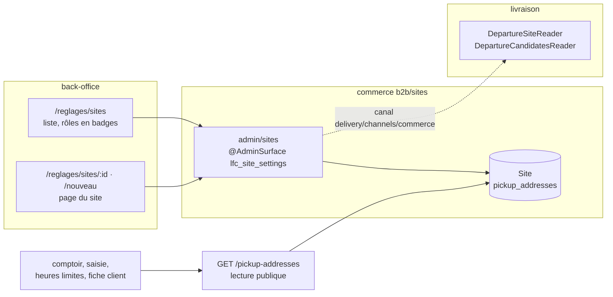

# Les sites — nos lieux, leurs rôles, leurs couleurs

> **État : ✅ bâti (lots S0 et S1 et leurs suites), relu dans le code le
> 2026-10-13.** Commits `c37ee5067` (serveur S0/S1), `768a2d8f7` (front S1),
> `a3bc7894d` (rôles Retrait / Livraison, GPS, couleurs révocables,
> paramétrage du retrait, départ des tournées), `0def0a6c9` puis `1b286aaf6`
> (heures limites posées sur la page du site, puis retirées).
>
> Né du plan commun « sites, transfert interne, tri et couleurs » du
> 2026-10-13, découpé le même jour en trois documents (Hugo) : celui-ci (le
> site, bâti), [`../livraisons/transferts/plan-transfert-interne.md`](../livraisons/transferts/plan-transfert-interne.md)
> (le transfert, plan) et
> [`../commandes/plan-tri-depart-et-couleurs.md`](../commandes/plan-tri-depart-et-couleurs.md)
> (le tri et les couleurs de la logistique, plan).
>
> **Pourquoi un dossier à part**, et pas sous `livraisons/` : le site
> appartient au commerce (`b2b/sites/`), le checkout, la remise, les créneaux
> publics et le comptoir le lisent autant que la livraison. Le ranger sous la
> livraison aurait affirmé un propriétaire qu'il n'a pas.

**Décisions de Hugo du 2026-10-13 qui fondent le site :**

- on introduit la notion de **site** ; son but est aussi de **rassembler tous
  les points de définition qui concernent un lieu** ;
- un site porte **une couleur pour le retrait B2B et une pour le retrait
  B2C**, saisissables au back-office (puis : et deux de livraison) ;
- « tout rassembler ce qui concerne les sites dans réglages/sites » ;
- droits **granulaires** : `lfc_site_settings` (nom retenu à la place de
  `lfc_sites`) ;
- couleurs **libres**, aucune teinte refusée, et **facultatives pour de bon** ;
- vocabulaire : `pickup` / « Retrait », `deliveryDeparture` / « Livraison » ;
- un site qui livre, ou qui est servi par transfert, a un **point GPS**.

## 1. Ce qu'est un site

> Un **site** est un lieu physique **à nous**, avec une adresse, où au moins
> une de ces choses arrive : on y **fabrique et on en part** (le fournil), on
> y **remet** des commandes à des clients (retrait), on y **est servi** par
> un transfert interne.

Le site **est** l'ancien point de retrait, élargi : la table reste
`pickup_addresses` (Q-S1 du plan d'origine, laissée ouverte : la renommer
n'achète rien et coûte une migration relue), le modèle Prisma s'appelle
`Site` (`apps/lfd-api/prisma/schema/public/settings.prisma`). Aucune donnée
n'a changé de table.

| Rôle (écran)                  | Champ                                        | Ce qui en dépend                                                                                |
| ----------------------------- | -------------------------------------------- | ----------------------------------------------------------------------------------------------- |
| **Retrait**                   | `pickup: boolean`                            | proposé au checkout, onglet au comptoir, créneaux publics, ouverture pros, remise de retrait    |
| **Approvisionné**             | `supply: 'on_site' \| 'transfer'`            | `on_site` = fabriqué/colisé **là** ; `transfer` = y arrive par transfert interne (plan à part)  |
| ↳ mode du transfert           | `transferMode: 'integrated' \| 'dedicated'`  | lu par le futur transfert ; `integrated` par défaut                                             |
| **Mise en place au comptoir** | `counterSetupMinutes` (entier ≥ 0, défaut 0) | lu par le futur calcul de l'heure requise (lot T0 du transfert)                                 |
| **Livraison**                 | `deliveryDeparture: boolean`                 | les livraisons (et demain les transferts) peuvent en partir ; porte les couleurs de livraison   |
| **départ des tournées**       | `DeliveryDeparture` (bloc `delivery`)        | LE site d'où partent les tournées, choisi en Livraison › Point de départ parmi ceux qui livrent |
| **vend**                      | non modélisé                                 | c'est `PointOfSale` du référentiel (§5, ligne 10) ; Q-S3                                        |

Le vocabulaire a été renommé le 2026-10-13 (Hugo, lexique `CLAUDE.md` §8) :
`handsOver` → `pickup`, `dispatches` → `deliveryDeparture` ; « Remet » →
« Retrait », « Expédie » → « Livraison » à l'écran. La migration
`20261013510000` a été modifiée en place : elle n'avait pas quitté le poste.

## 2. L'agrégat `Site` — ce qui peut refuser une écriture

`apps/lfd-api/src/b2b/sites/domain/site.ts`, erreurs dans `site-errors.ts`.
Factory `Site.declare()` : un site neuf remet, est sur place, ne livre pas,
n'a pas de couleur.

| Règle                                                             | Refus                                                          |
| ----------------------------------------------------------------- | -------------------------------------------------------------- |
| servi par transfert ⇒ remet                                       | `SiteTransferWithoutHandoverError` (400)                       |
| livre ⇒ sur place                                                 | `SiteDeliveryDepartureFromTransferError` (400)                 |
| mise en place entière ≥ 0                                         | `SiteCounterSetupError` (400)                                  |
| livre ⇒ point GPS (aux transitions)                               | `SiteDeliveryDepartureWithoutGpsError` (409)                   |
| servi par transfert ⇒ point GPS (aux transitions)                 | `SiteTransferWithoutGpsError` (409)                            |
| le départ des tournées garde « Livraison »                        | `DepartureSiteMustDeliverError` (409)                          |
| le site par défaut remet                                          | `DefaultSiteMustHandOverError` (409)                           |
| on n'archive ni le défaut, ni un site qui livre                   | `DefaultSiteArchiveError`, `DeliveryDepartureSiteArchiveError` |
| un site archivé ne se modifie plus                                | `ArchivedSiteError` (409)                                      |
| couleur de forme `#rrggbb` (value object `SiteColor`, minuscules) | `SiteColorFormatError` (400)                                   |

- **Le GPS est tenu aux transitions, jamais au chargement** : la migration S1
  a posé `delivery_departure = true` sur le site de départ sans regarder son
  GPS ; revalider dans `rehydrate` casserait toutes ses lectures, checkout
  compris (même raison que l'objection B1, §8). Une telle ligne se relit et
  se modifie ; elle refuse seulement ce qui l'aggraverait, et l'écran la
  signale sous « Livraison ».
- **Les couleurs sont facultatives pour de bon** (Hugo, 2026-10-13) :
  `paint()` accepte `null`, qui **retire** une couleur. La règle d'abord
  écrite (« une couleur posée ne s'efface pas ») est abandonnée, et le
  `CHECK` de présence prévu au lot S3r est tombé ; seule la forme est tenue en
  base.
- **Archiver, pas supprimer** : `archived_at` remplace le `delete` physique ;
  un site archivé n'est plus proposé mais se résout par id (départ, tournée,
  copies). « Supprimer » sur l'ancienne API `admin/pickup-addresses`
  archive aussi.
- « Un seul défaut » : le handler démet l'ancien (`relinquishDefault`) ; « au
  moins un site » en découle, le défaut ne s'archive pas.
- **Le départ des tournées est un fait de la livraison.** Le port
  `DepartureSiteReader` est **déclaré ET implémenté par `delivery`**
  (`delivery/channels/commerce/departure-site.reader.ts`, comme
  `OrderDeliveryHistoryReader`) et lu par le commerce, qui le passe à
  `assignRoles(…, isDeparture)` et l'affiche (`SiteView.isDeparture`, badge
  « Départ des tournées »). Le plan d'origine le faisait déclarer par le
  commerce, ce qui aurait fait importer `b2b` à la livraison — corrigé par
  Hugo le 2026-10-13. La livraison ne propose comme départ que les sites qui
  livrent (`DepartureCandidatesReader`).

Faits de journal (`site.events.ts`, sujet `pickup_address` — une valeur n'est
pas un nom, `CLAUDE.md` §8) : `pickup_address.archived`, `.roles_set`,
`.colors_set` (qui nomme les couleurs retirées dans `removed`).

## 3. Les couleurs

Quatre colonnes `text NULL` sur `pickup_addresses` — `pickup_color_b2b`,
`pickup_color_b2c`, `delivery_color_b2b`, `delivery_color_b2c` — forme
`#rrggbb` tenue par un `CHECK` (migration `20261013510000`). Pas d'enum,
pas de palette : Hugo a remplacé la « palette fermée » d'abord proposée
(Q-S6) par des couleurs libres, puis retiré la réserve des teintes (vert,
rouge / rose, que la demande gardait aux surligneurs OK / KO) : « l'équipe
s'organise entre elle ».

À l'écran, une couleur de livraison dont la clientèle n'est pas livrée
(Livraison › Zones de livraison) est grisée avec la raison ; le serveur
l'enregistre quand même — aide, pas règle. Aucune couleur n'est posée par une
migration : elles se saisissent à l'écran (« Adroit » est le nom d'un site
que Hugo saisira, Q3 ; aucun nom de site dans le code).

Qui les **lit** : personne encore — c'est le plan du tri et des couleurs.

## 4. L'écran Réglages › Sites et l'API

**API** `admin/sites` (`b2b/sites/http/admin-sites.controller.ts`, sous
`lfc_site_settings`) : `GET`, `GET :id`, `POST`, `PATCH :id` (identité,
adresse, heures, réduction), `PATCH :id/default`, `PUT :id/roles` (rôles + `gps`
facultatif : absent = inchangé, pour que « cocher et poser le point » soit jugé
en une écriture), `PUT :id/couleurs`, `POST :id/archive`,
`GET`/`PUT :id/creneaux-publics`. Contrat : `packages/contracts/src/site.ts`.

**La page** (`apps/lfd-backoffice-frontend/src/app/reglages/sites/`), une page
de détail et une `fold-card` par sujet :

- **En-tête** : nom, adresse en une ligne, statut ; n'enregistre rien.
- **Identité et adresse** — sa carte et son bouton (« Ajouter » à la création).
- **Rôles**, dans cet ordre : Retrait (+ couleurs retrait B2B / B2C) →
  Approvisionné (+ mode) → Mise en place au comptoir → Livraison (+ point
  GPS, + couleurs livraison B2B / B2C). Le point se saisit sous le premier
  rôle qui l'exige (« par transfert », puis « Livraison » — les deux ne
  coexistent pas). Une capacité décochée masque ses couleurs sans les
  effacer. Badges d'en-tête sur l'état enregistré. Un seul « Enregistrer »
  appelle `PUT …/roles` puis `PUT …/couleurs` ; si le second échoue : « Rôles
  enregistrés, mais les couleurs n'ont pas pu l'être », brouillon gardé.
  Couleurs : `input type=color` natif dans un `fold-fieldset`, code en
  `fold-input`, pastille ; forme jugée par une copie front de `SiteColor`
  (`reglages/sites/site-color.ts`), le serveur reste l'autorité.
- **Paramétrage du retrait** (site qui remet seulement), trois sous-cartes
  `surface="sunken"` : heures de retrait, créneaux publics (+ fermetures),
  réduction de retrait. Créneaux absents à la création et sur un site
  archivé.
- **Archivage** dans la `fold-danger-zone`.

Chaque carte enregistre ce qu'elle montre (Hugo, 2026-10-13) ; celles qui
passent par l'unique `PATCH` renvoient l'état **enregistré** pour le reste et
n'écrasent pas la saisie d'une autre carte. Un site archivé se lit sans se
modifier.

**Navigation** : « Sites » est une section des Réglages (`EXPLOITATION_VIEWS`,
rail et lanceur mobile d'une même table) ; « Points de retrait » a quitté
l'E-commerce. Redirigent vers `/reglages/sites` : `/b2b/reglages/points-de-retrait`
(+ `…/nouveau`, `…/:id`, même id), `/reglages/retraits-livraisons`.

**Les lectures hors de l'écran ne passent pas par `lfc_site_settings`** : le
comptoir, la saisie d'une commande, les heures limites et la fiche client
lisent la route **publique** `GET /pickup-addresses` (`PickupAddressesService.list()`,
vérifié le 2026-10-13). L'objection S2 (§8) partait d'un fait faux ; aucun
lecteur dédié n'a été nécessaire. Les écritures de `PickupAddressesService`
sont retirées du front ; l'API `admin/pickup-addresses` (sous `b2b_settings`)
reste servie.

**La sous-carte « Heures limites de commande »**, posée le 2026-10-13
(`0def0a6c9`), a été retirée le jour même (`1b286aaf6`, Hugo) : l'heure limite
par point appartient à `OrderCutoff`, en démontage
([`../commandes/demontage-order-cutoff.md`](../commandes/demontage-order-cutoff.md)),
et la limite générale va dans Réglages › Commandes.

## 5. Les droits — granulaires (Hugo, 2026-10-13)

> « Réglage commandes peut aussi aller dans réglages, droit
> `lfc_order_settings` ? On essaie d'être granulaire sur les droits ; même
> chose pour les sites, `lfc_site_settings`. » — Hugo, 2026-10-13.

- Migration `20261013500000_les_droits_des_sites_et_des_commandes` : deux
  valeurs de `StaffResource`, `lfc_site_settings` et `lfc_order_settings`,
  accordées à **aucun** rôle (`lint:no-role-grants-in-migrations`).
- **Geste de bascule** : après déploiement, l'admin accorde
  `lfc_site_settings` (lecture, écriture) aux rôles voulus à
  `/admin/staff-roles` — sinon l'écran est mort (objection S3, §8). Le même
  geste vaut pour `lfc_order_settings` et se dit dans le message de livraison.
- Gardes front : `lfc_site_settings:read` (création : `:write`).
- `lfc_order_settings` sert au déménagement de Réglages › Commandes (lot O1),
  qui a son plan :
  [`../commandes/plan-reglages-commandes.md`](../commandes/plan-reglages-commandes.md)
  (ouverture du e-commerce, heure limite, annulation ; la bascule des droits
  y est détaillée).

## 6. Inventaire — tout ce qui définit un lieu (vérifié le 2026-10-13)

Le site doit être **la** définition d'un lieu à nous. Ce qui en définit un,
ou en a l'air, et ce qu'il est par rapport au site :

| #   | Ce qui existe                                   | Fichier                                  | Ce qu'il porte                                                                                      | Bloc         | Rapport au site                                                                                                    |
| --- | ----------------------------------------------- | ---------------------------------------- | --------------------------------------------------------------------------------------------------- | ------------ | ------------------------------------------------------------------------------------------------------------------ |
| 1   | `Site` (`pickup_addresses`)                     | `public/settings.prisma`                 | libellé, adresse, `isDefault`, remise de retrait, `opening` (public + pros), `gps`, rôles, couleurs | `b2b`        | **le site lui-même**                                                                                               |
| 2   | `PublicPickupSlotRule`, `PublicPickupClosure`   | même fichier                             | créneaux publics, fermetures datées                                                                 | `b2b`        | attribut du site (rôle Retrait, côté B2C)                                                                          |
| 3   | `OrderCutoff.pickupAddressId`                   | `public/orders.prisma`                   | heure limite par point                                                                              | `b2b`        | référence au site — en démontage                                                                                   |
| 4   | `Company.preferredPickupAddressId`              | `public/account.prisma`                  | le retrait préféré d'un pro                                                                         | `b2b`        | référence au site (champ Prisma pas encore renommé `siteId`)                                                       |
| 5   | `Subscription.pickupAddressId`                  | `public/subscriptions.prisma`            | le point de retrait d'un abonnement                                                                 | `b2b`        | référence au site (idem)                                                                                           |
| 6   | `Order.pickupAddress` (JSON)                    | `public/orders.prisma`                   | **snapshot** postal ; **aucun id**                                                                  | `b2b`        | doit gagner `siteId` (lot S2, §7) : sans id, une couleur s'accroche à un libellé                                   |
| 7   | `DeliveryDeparture.pickupAddressId`             | `delivery.prisma`                        | d'où partent les tournées ; absent = défaut ; id **opaque**                                         | `delivery`   | référence opaque au site, lue par `delivery/channels/commerce/`                                                    |
| 8   | `production_order.pickup_label` (+ `address_*`) | `production.prisma`                      | snapshot imprimé sur le bon                                                                         | `production` | doit gagner `site_id` opaque (lot S2)                                                                              |
| 9   | Onglets du comptoir (`pickupTabs`)              | `handover-shop/handover-queue.ts`        | « tous les points connus », **par libellé**                                                         | front        | à lire par id (lot S2, S3r)                                                                                        |
| 10  | `PointOfSale` (`kind: shop / platform`)         | `pim/sales-contexts.prisma`              | « d'où l'on vend » pour le catalogue ; `platform` n'a aucun lieu                                    | `pim`        | **à part** : canal de vente, pas un lieu ; le fusionner ferait lire le PIM hors de son canal. Lien éventuel : Q-S3 |
| 11  | `CategoryChannel.pointOfSaleId`                 | `pim/categories.prisma`                  | ce que l'on vend où                                                                                 | `pim`        | à part (même raison)                                                                                               |
| 12  | `LegalEntity` (adresse)                         | `public/accounting.prisma`               | siège sur les mentions légales                                                                      | `b2b`        | à part : adresse **juridique**, figée sur les documents émis                                                       |
| 13  | `DeliveryZone`                                  | `public/settings.prisma`                 | préfixes postaux **chez le client** + frais                                                         | `b2b`        | à part : un secteur de clients (rattachement à un site de départ : Q-S4)                                           |
| 14  | `DeliveryAvailability`                          | `public/settings.prisma`                 | ouverture B2B/B2C de la livraison, marges                                                           | `b2b`        | à part ; les couleurs de livraison n'y sont **pas** allées (elles sont sur le site qui livre)                      |
| 15  | `Address` (carnet), `MarketZone`                | `public/account.prisma`, `growth.prisma` | adresses des clients ; prospection                                                                  | `b2b`        | à part : pas nos lieux                                                                                             |

Ce qu'en dit l'inventaire : un lieu à nous n'était défini qu'une fois — le
point de retrait — et les autres sont des références, des snapshots ou des
notions qui ne sont pas des lieux. Le travail était de **renommer et
élargir**, pas de fusionner. Le nom mentait deux fois (le départ des tournées
s'appuyait sur un « point de retrait », le JSDoc l'appelait « laboratoire ») :
le site a corrigé le nom, le modèle était juste.

**Pourquoi au commerce** (`b2b/sites/`) : la ligne y vivait ; checkout, remise,
créneaux, abonnements et sociétés la lisent en direct dans le même bloc. Au
bloc `delivery`, checkout et remise (de l'argent) auraient lu un port pour un
fait de configuration ; `handover → b2b` est interdit ; un bloc neuf aurait
ajouté une ligne de matrice pour une notion que cinq blocs lisaient déjà au
même endroit. Les autres blocs le lisent par les canaux qu'ils déclarent :

| Lecteur      | Canal                                               | Ce qu'il lit                                         | État                                     |
| ------------ | --------------------------------------------------- | ---------------------------------------------------- | ---------------------------------------- |
| `delivery`   | `delivery/channels/commerce/`                       | adresse + GPS du site de départ, candidats au départ | ✅ ; sites servis par transfert : plan T |
| `handover`   | `handover/channels/commerce/`                       | sites qui remettent (onglets), couleurs              | à faire (lecteur exact non vérifié)      |
| `production` | `production/channels/commerce/` (`DayOrdersReader`) | `siteId` dans le snapshot `ProducibleOrder`          | à faire (S2)                             |
| `packing`    | faits du fournil (`production/channels/packing/`)   | `siteId` recopié                                     | à faire ; `packing → b2b` reste interdit |

## 7. Reste à faire

- **S2** — `siteId` dans le snapshot `Order.pickupAddress` à la passation,
  depuis le `pickupAddressId` que la passation reçoit déjà
  (`b2b/orders/application/services/order-drafting.service.ts` ; `null` =
  défaut, résolu à l'id du défaut au moment de figer) ;
  `production_order.site_id text null` ; onglets du comptoir par id. **Pas de
  rattrapage** par libellé (irréversible, objection S5 ; Q-S2 tranchée) :
  l'historique est « autre ». Le typage du snapshot
  (`BillingAddressPayload`) sera élargi à ce lot (non relu).
- **S3r** — retirer les lectures par libellé (`pickupTabs(places: string[])`
  → par id). Le `CHECK` de présence des couleurs est tombé.
- Renommer les champs Prisma des références (4, 5 ; `siteId`,
  `@map` inchangé) — aucun SQL.
- **« Approvisionné depuis… »** (Hugo, 2026-10-13) : un site servi par
  transfert porte le site qui l'approvisionne (`supplied_from_site_id`, qui
  doit avoir le rôle Livraison). **Écrit, pas bâti** : il n'y a qu'un site qui
  livre et la valeur se déduit ; à bâtir quand un second livrera (Q-S4). Le
  trajet du transfert part de ce site.
- Le rôle « Départ des tournées » se **lit** sur la page (badge) mais se
  **choisit** toujours en Livraison › Point de départ (`/livraison/depart`,
  `delivery_settings`) : la bascule depuis la page et la redirection de
  `/livraison/depart`, prévues au plan, ne sont pas faites.
- `/reglages` mène toujours à `/documentation/facturation` (le plan voulait
  `/reglages/sites`, à faire confirmer : la redirection vit dans des favoris).
- ⚠️ Le JSDoc de `Site` (`site.ts`) dit encore qu'il ne tient pas le refus de
  retirer « Livraison » au départ des tournées ; c'est faux depuis
  `a3bc7894d` (`DepartureSiteMustDeliverError`, vérifié le 2026-10-13). À
  corriger avec le prochain lot qui touche le fichier.

**Questions ouvertes** : Q-S1 (garder la table `pickup_addresses` sous le
modèle `Site` — c'est l'état actuel), Q-S3 (relier un `PointOfSale` à un
site), Q-S4 (un second fournil ?). Tranchées : Q-S2 (pas de rattrapage),
Q-S5 (`lfc_site_settings`), Q-S6 (pas de palette, couleurs libres), Q3
(« Adroit » est un site, saisi en admin).

## 8. Contradiction par `vitruve` (2026-10-13) — ce qui concerne le site

Objections du premier passage sur le plan commun (le reste est dans les deux
autres documents).

| #   | Niveau   | Objection (résumé)                                                                        | Sort                                                                                                                                                                                                                                   |
| --- | -------- | ----------------------------------------------------------------------------------------- | -------------------------------------------------------------------------------------------------------------------------------------------------------------------------------------------------------------------------------------- |
| B1  | BLOQUANT | couleurs obligatoires dans l'agrégat dès S1 : `toDomain` refuserait les lignes existantes | **corrigé** : l'agrégat tolère l'absence ; puis (Hugo) couleurs facultatives pour de bon, retirables ; la migration n'en pose aucune                                                                                                   |
| S1  | SÉRIEUX  | suppression physique d'un site référencé                                                  | **corrigé** : `archived_at` ; « supprimer » archive ; refus d'archiver le défaut ou un site qui livre                                                                                                                                  |
| S2  | SÉRIEUX  | le comptoir lit les points par l'API de l'écran de réglages                               | **sans objet** au bâti : le comptoir et la saisie lisent la route publique `GET /pickup-addresses` ; l'objection partait d'un fait faux                                                                                                |
| S3  | SÉRIEUX  | deux droits pour une palette ; ressource neuve = écran mort jusqu'à l'accord              | **corrigé** : toutes les couleurs sous `lfc_site_settings` ; S0 déployé et accordé **avant** que S1 ne garde l'écran                                                                                                                   |
| S4  | SÉRIEUX  | la page écrit le départ (delivery) sans port ; invariant tenu d'un côté                   | **corrigé, puis revu par Hugo** : la livraison ne propose que les sites qui livrent ; le commerce refuse de retirer « Livraison » au départ via `DepartureSiteReader` — **déclaré et implémenté par la livraison**, lu par le commerce |
| S5  | SÉRIEUX  | rattrapage par libellé irréversible ; `pickupAddressId` déjà reçu à la passation          | **corrigé** (lot S2, à faire) : le snapshot gardera l'id reçu ; pas de rattrapage                                                                                                                                                      |
| m   | mineurs  | `OrderCutoff` sans relation ; `Order.pickupAddress` typé `BillingAddressPayload` ; baril  | **assumés** : typage élargi à S2 ; la fonction de catégorie vit côté back-office (plan du tri)                                                                                                                                         |
