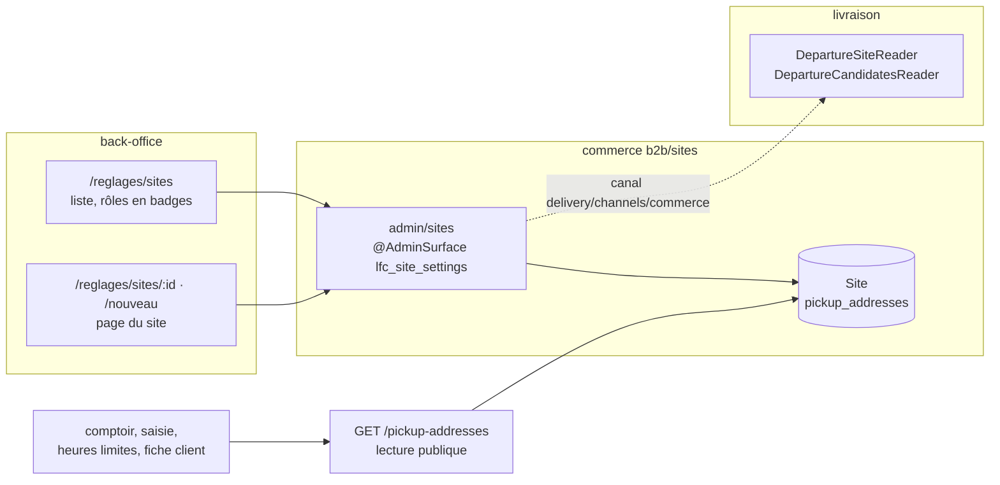
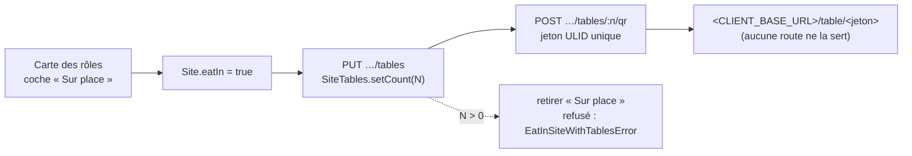

# Les sites — nos lieux, leurs rôles, leurs couleurs

> **État : ✅ bâti (lots S0, S1 et leurs suites, et S2 le 2026-10-13 — non
> commité à l'écriture), relu dans le code le 2026-10-13.** Commits `c37ee5067` (serveur S0/S1), `768a2d8f7` (front S1),
> `a3bc7894d` (rôles Retrait / Livraison, GPS, couleurs révocables,
> paramétrage du retrait, départ des tournées), `0def0a6c9` puis `1b286aaf6`
> (heures limites posées sur la page du site, puis retirées).
>
> Né du plan commun « sites, transfert interne, tri et couleurs » du
> 2026-10-13, découpé le même jour en trois documents (Hugo) : celui-ci (le
> site, bâti), [`../livraisons/transferts/plan-transfert-interne.md`](../livraisons/transferts/plan-transfert-interne.md)
> (le transfert, plan) et
> [`../commandes/plan-tri-depart-et-couleurs.md`](../commandes/plan-tri-depart-et-couleurs.md)
> (le tri et les couleurs de la logistique, plan).
>
> **Pourquoi un dossier à part**, et pas sous `livraisons/` : le site
> appartient au commerce (`b2b/sites/`), le checkout, la remise, les créneaux
> publics et le comptoir le lisent autant que la livraison. Le ranger sous la
> livraison aurait affirmé un propriétaire qu'il n'a pas.

**Décisions de Hugo du 2026-10-13 qui fondent le site :**

- on introduit la notion de **site** ; son but est aussi de **rassembler tous
  les points de définition qui concernent un lieu** ;
- un site porte **une couleur pour le retrait B2B et une pour le retrait
  B2C**, saisissables au back-office (puis : et deux de livraison) ;
- « tout rassembler ce qui concerne les sites dans réglages/sites » ;
- droits **granulaires** : `lfc_site_settings` (nom retenu à la place de
  `lfc_sites`) ;
- couleurs **libres**, aucune teinte refusée, et **facultatives pour de bon** ;
- vocabulaire : `pickup` / « Retrait », `deliveryDeparture` / « Livraison » ;
- un site qui livre, ou qui est servi par transfert, a un **point GPS**.

## 1. Ce qu'est un site

> Un **site** est un lieu physique **à nous**, avec une adresse, où au moins
> une de ces choses arrive : on y **fabrique et on en part** (le fournil), on
> y **remet** des commandes à des clients (retrait), on y **est servi** par
> un transfert interne.

Le site **est** l'ancien point de retrait, élargi : la table reste
`pickup_addresses` (Q-S1 du plan d'origine, laissée ouverte : la renommer
n'achète rien et coûte une migration relue), le modèle Prisma s'appelle
`Site` (`apps/lfd-api/prisma/schema/public/settings.prisma`). Aucune donnée
n'a changé de table.

| Rôle (écran)                  | Champ                                             | Ce qui en dépend                                                                                |
| ----------------------------- | ------------------------------------------------- | ----------------------------------------------------------------------------------------------- |
| **Retrait**                   | `pickup: boolean`                                 | proposé au checkout, onglet au comptoir, créneaux publics, ouverture pros, remise de retrait    |
| ↳ clientèles du retrait       | `pickupAudiences: { b2b, b2c }` (défaut les deux) | « Retrait pour les pros » / « … pour les particuliers » : qui peut y retirer (2026-10-15)       |
| **Approvisionné**             | `supply: 'on_site' \| 'transfer'`                 | `on_site` = fabriqué/colisé **là** ; `transfer` = y arrive par transfert interne (plan à part)  |
| ↳ mode du transfert           | `transferMode: 'integrated' \| 'dedicated'`       | lu par le futur transfert ; `integrated` par défaut                                             |
| **Mise en place au comptoir** | `counterSetupMinutes` (entier ≥ 0, défaut 0)      | lu par le futur calcul de l'heure requise (lot T0 du transfert)                                 |
| **Livraison**                 | `deliveryDeparture: boolean`                      | les livraisons (et demain les transferts) peuvent en partir ; porte les couleurs de livraison   |
| **départ des tournées**       | `DeliveryDeparture` (bloc `delivery`)             | LE site d'où partent les tournées, choisi en Livraison › Point de départ parmi ceux qui livrent |
| **vend**                      | non modélisé                                      | retiré le 2026-10-17 ; la salle est `Site.eatIn` (§6 bis)                                       |

### Le retrait réservé à une clientèle (Hugo, 2026-10-15)

« Imaginons que mes pros ne peuvent plus retirer qu'à une seule boutique » :
un site peut être réservé au retrait des **pros** (société **active**) ou des
**particuliers** (visiteur, espace perso, société en attente, suspendue ou
résiliée — `audienceOf`, la règle de
[`plan-remise-et-livraison-par-clientele.md`](../livraisons/clientele/plan-remise-et-livraison-par-clientele.md), D1).
Réglé à l'écran, jamais en dur.

- **En base** : `pickup_for_b2b`, `pickup_for_b2c`, `NOT NULL DEFAULT true` sur
  `pickup_addresses` (migration `20261015700000`) ; un CHECK refuse un retrait
  ouvert à personne. Un site d'avant les cases remet aux deux.
- **L'agrégat** refuse `pickup = true` sans aucune case
  (`SitePickupWithoutAudienceError`, 400) ; un site sans retrait garde ses
  cases sans les lire. `PUT …/roles` : `pickupAudiences` **absent = inchangé**.
- **Au serveur, sans exception pour l'équipe** : `CartAdjustments.forPickup`
  refuse (`PickupClosedForAudienceError`, 409,
  `orders.pickup.closed_for_audience`, nomme le site, la clientèle et le geste
  de sortie) — donc le devis et les trois passations (`POST /orders`,
  `POST /shop/orders`, `POST /admin/orders`) opposent le même refus. Ce n'est
  pas une affaire d'heure : un site ouvert aux deux garde les fenêtres
  (`windowFitsPickup`) telles quelles.
- **Les lectures sont filtrées AU SERVEUR** (Hugo, 2026-10-15 : « c'est
  devenu un choix business » ; ce paragraphe disait le contraire le matin
  même). Le `where` de `PickupAddressRepository.list(audience)` porte la case
  de la clientèle :
  - `GET /pickup-addresses` (publique, anonyme) ne sert que les sites
    ouverts **aux particuliers** — la clientèle d'un visiteur ;
  - `GET /pickup-addresses/mine` (client reconnu, `MyPickupAddressesController`,
    `b2b/orders/http/`) sert ceux de la clientèle de l'**espace** agissant
    (`audienceOf`, par `CustomerAudiences`) ; la boutique la relit au
    changement d'espace (`PickupListGateway`, `ServicePoints`) ;
  - `GET /admin/pickup-addresses?companyId=` (équipe) sert ceux du client
    choisi — saisie de commande, fiche client ; sans paramètre, tous les sites
    proposés — le comptoir. Ouverte à qui lit `b2b_place_order`, `b2b_orders`,
    `b2b_companies`, `b2b_settings`, `handover_counter` ou `b2b_counter`.

  La boutique et le back-office ne filtrent plus eux-mêmes ; `pickupOpenTo`
  ne sert plus qu'au refus de la caisse. Le refus serveur reste : une liste ne
  garde pas une porte.

### Plus de site par défaut (Hugo, 2026-10-15)

`Site.isDefault` a disparu du domaine, de l'API et des écrans. La colonne
`pickup_addresses.is_default` **reste en base** (§0 : pas de suppression sans
ordre), ni lue ni écrite ; aucun index ni CHECK ne la lie (vérifié dans les
migrations le 2026-10-15). Le geste « définir par défaut »
(`PATCH admin/sites/:id/default`, `PATCH admin/pickup-addresses/:id/default`)
est retiré ; un client qui envoie encore `isDefault` dans une charge le voit
ignoré. Le fait `pickup_address.default_set` n'est plus publié, mais reste au
registre pour relire l'historique.

Ce qui le remplace :

- **La présélection du retrait, par client** — une seule fonction pure,
  `preselectedPickupId(offered, preferredId)` (`@lfd/contracts`,
  `pickup-audiences.values.ts`), parmi les points **ouverts à sa clientèle** :
  (a) son point préféré (`fulfillmentPreference.pickupAddressId`, « Mon
  compte » ou la fiche client) s'il en fait partie ; (b) sinon le seul point
  ouvert ; (c) sinon aucun — le client choisit. Elle vit dans les contrats
  parce que DEUX côtés décident : le serveur, quand un devis arrive sans
  point (`CartAdjustments.forPickup(null, …)`), et la boutique, qui coche un
  point à l'ouverture du choix (`PublicHousePickerDialog`) — comme
  `audienceOf`, une règle écrite deux fois finirait par cocher un point que la
  caisse ne retient pas. Le back-office l'applique aussi (saisie de commande,
  fiche client).
- **`forPickup(null)`** applique cette règle et refuse en 409
  (`PickupChoiceRequiredError`, `orders.pickup.choice_required`) quand
  plusieurs points sont ouverts sans préféré parmi eux ; aucun point ouvert :
  `orders.pickup.not_configured`. Les trois passations refusaient déjà un
  retrait sans point au schéma (400, « point de retrait requis ») : seul le
  devis de la boutique arrive au serveur sans point.
- **Le départ des tournées** est un réglage de livraison : sans choix, il
  n'est déduit que d'un candidat unique — cf.
  [`../livraisons/tournees/plan-preparation-de-tournee.md`](../livraisons/tournees/plan-preparation-de-tournee.md), Q9.
- **L'archivage** : le premier site n'est plus protégé ; seul le site qui
  livre refuse d'être archivé. « Au moins un site » n'est plus tenu.

### Une clientèle sans site de retrait (Hugo, 2026-10-16)

Sans site par défaut, rien ne garantit qu'un site reste ouvert au retrait
d'une clientèle. **On ne bloque pas** — ni l'archivage, ni une case décochée :
on laisse fermer le retrait à une clientèle, et on le montre.

- **La boutique** lit la liste servie (`/pickup-addresses` pour un visiteur,
  `/pickup-addresses/mine` pour un client) : SERVIE pour qui regarde et vide,
  le retrait n'est pas proposé (`ServicePoints.pickupsKnown`,
  `OrderDoors.pickupOpen`). Pas encore lue ou en échec, elle ne ferme rien.
  Le choix du mode va alors droit au coursier ; la porte « Retrait » d'un pro
  disparaît (`ServiceDoors.pickupOffered`) ; le bandeau d'un visiteur mène à
  la livraison ; un retrait gardé dans le navigateur sur un point que la liste
  ne porte plus s'efface (`OrderContextStore`). Ni retrait ni livraison
  (`OrderDoors.serviceOffered`) : l'accueil et le panier le disent, et le
  règlement est grisé.
- **Le serveur** refusait déjà ; ses messages nomment désormais le cas. Sans
  point choisi : `PickupNotOfferedToAudienceError` (code inchangé,
  `orders.pickup.not_configured`) — « Le retrait n'est pas proposé aux
  particuliers : aucun site ne leur est ouvert. Choisissez la livraison, ou
  appelez-nous ; l'équipe ouvre un site au retrait dans Réglages › Sites. »
  Sur un site fermé à la clientèle sans autre site ouvert,
  `PickupClosedForAudienceError` garde son code et dit la même chose en
  nommant le site, au lieu de « choisissez un autre point ».
- **Réglages › Sites** pose un `fold-callout` par clientèle sans aucun site
  actif (retrait coché, non archivé) ouvert au retrait — « Aucun site de
  retrait pour les particuliers : le retrait ne leur est pas proposé. » ; en
  alerte quand le réglage Livraison (`GET /delivery-availability`, lu comme
  la carte des rôles) la lui ferme aussi : « Les particuliers ne peuvent plus
  commander : ni retrait, ni livraison. » Règle :
  `apps/lfd-backoffice-frontend/src/app/reglages/sites/pickup-coverage.ts`, la même que le `where` du serveur.

Le vocabulaire a été renommé le 2026-10-13 (Hugo, lexique `CLAUDE.md` §8) :
`handsOver` → `pickup`, `dispatches` → `deliveryDeparture` ; « Remet » →
« Retrait », « Expédie » → « Livraison » à l'écran. La migration
`20261013510000` a été modifiée en place : elle n'avait pas quitté le poste.

## 2. L'agrégat `Site` — ce qui peut refuser une écriture

`apps/lfd-api/src/b2b/sites/domain/site.ts`, erreurs dans `site-errors.ts`.
Factory `Site.declare()` : un site neuf remet, est sur place, ne livre pas,
n'a pas de couleur.

| Règle                                                             | Refus                                          |
| ----------------------------------------------------------------- | ---------------------------------------------- |
| servi par transfert ⇒ remet                                       | `SiteTransferWithoutHandoverError` (400)       |
| livre ⇒ sur place                                                 | `SiteDeliveryDepartureFromTransferError` (400) |
| mise en place entière ≥ 0                                         | `SiteCounterSetupError` (400)                  |
| remet ⇒ au moins une clientèle (2026-10-15)                       | `SitePickupWithoutAudienceError` (400)         |
| livre ⇒ point GPS (aux transitions)                               | `SiteDeliveryDepartureWithoutGpsError` (409)   |
| servi par transfert ⇒ point GPS (aux transitions)                 | `SiteTransferWithoutGpsError` (409)            |
| le départ des tournées garde « Livraison »                        | `DepartureSiteMustDeliverError` (409)          |
| on n'archive pas un site qui livre                                | `DeliveryDepartureSiteArchiveError` (409)      |
| un site archivé ne se modifie plus                                | `ArchivedSiteError` (409)                      |
| couleur de forme `#rrggbb` (value object `SiteColor`, minuscules) | `SiteColorFormatError` (400)                   |

- **Le GPS est tenu aux transitions, jamais au chargement** : la migration S1
  a posé `delivery_departure = true` sur le site de départ sans regarder son
  GPS ; revalider dans `rehydrate` casserait toutes ses lectures, checkout
  compris (même raison que l'objection B1, §8). Une telle ligne se relit et
  se modifie ; elle refuse seulement ce qui l'aggraverait, et l'écran la
  signale sous « Livraison ».
- **Les couleurs sont facultatives pour de bon** (Hugo, 2026-10-13) :
  `paint()` accepte `null`, qui **retire** une couleur. La règle d'abord
  écrite (« une couleur posée ne s'efface pas ») est abandonnée, et le
  `CHECK` de présence prévu au lot S3r est tombé ; seule la forme est tenue en
  base.
- **Archiver, pas supprimer** : `archived_at` remplace le `delete` physique ;
  un site archivé n'est plus proposé mais se résout par id (départ, tournée,
  copies). « Supprimer » sur l'ancienne API `admin/pickup-addresses`
  archive aussi.
- ~~« Un seul défaut »~~ : retiré le 2026-10-15 avec le site par défaut
  (`DefaultSiteMustHandOverError`, `DefaultSiteArchiveError`, `makeDefault`,
  `relinquishDefault`, `designateDefault`, `loadDefault`).
- **Le départ des tournées est un fait de la livraison.** Le port
  `DepartureSiteReader` est **déclaré ET implémenté par `delivery`**
  (`delivery/channels/commerce/departure-site.reader.ts`, comme
  `OrderDeliveryHistoryReader`) et lu par le commerce, qui le passe à
  `assignRoles(…, isDeparture)` et l'affiche (`SiteView.isDeparture`, badge
  « Départ des tournées »). Le plan d'origine le faisait déclarer par le
  commerce, ce qui aurait fait importer `b2b` à la livraison — corrigé par
  Hugo le 2026-10-13. La livraison ne propose comme départ que les sites qui
  livrent (`DepartureCandidatesReader`).

Faits de journal (`site.events.ts`, sujet `pickup_address` — une valeur n'est
pas un nom, `CLAUDE.md` §8) : `pickup_address.archived`, `.roles_set`,
`.colors_set` (qui nomme les couleurs retirées dans `removed`).

## 3. Les couleurs

Quatre colonnes `text NULL` sur `pickup_addresses` — `pickup_color_b2b`,
`pickup_color_b2c`, `delivery_color_b2b`, `delivery_color_b2c` — forme
`#rrggbb` tenue par un `CHECK` (migration `20261013510000`). Pas d'enum,
pas de palette : Hugo a remplacé la « palette fermée » d'abord proposée
(Q-S6) par des couleurs libres, puis retiré la réserve des teintes (vert,
rouge / rose, que la demande gardait aux surligneurs OK / KO) : « l'équipe
s'organise entre elle ».

À l'écran, une couleur de livraison dont la clientèle n'est pas livrée
(Livraison › Zones de livraison) est grisée avec la raison ; le serveur
l'enregistre quand même — aide, pas règle. Aucune couleur n'est posée par une
migration : elles se saisissent à l'écran (« Adroit » est le nom d'un site
que Hugo saisira, Q3 ; aucun nom de site dans le code).

**La teinte du réassort** (Hugo, 2026-10-22) : une cinquième colonne,
`resupply_color`, même forme et même `CHECK` (migration `20261022240000`),
tenue par `SiteColors.resupply`. Elle peint la part des réassorts que le site
reçoit dans le camembert du compte à produire ; `NULL` = gris. Elle voyage
dans le même `PUT …/couleurs`, où elle est **facultative : absente =
inchangée** (un onglet ouvert avant elle ne l'efface pas), `null` la retire.
Le fait `pickup_address.colors_set` la porte (`resupplyColor`, absente des
faits antérieurs). Lue au tirage par le fournil via
`ResupplyPrintColorsReader` (`production/channels/commerce/`), que
`SiteResupplyPrintColorsReader` implémente.

Qui les **lit** (depuis le 2026-10-13, lots L1a/L1b/L5 du plan du tri et des
couleurs, non commités à l'écriture) : la palette en lecture seule
`GET admin/sites/palette` (colisage et livraison, sans `lfc_site_settings`),
les ports `DeliveryColorsReader` et `RunSheetColorsReader` (papier), et le bon
de commande au rendu.

## 4. L'écran Réglages › Sites et l'API

**API** `admin/sites` (`b2b/sites/http/admin-sites.controller.ts`, sous
`lfc_site_settings`) : `GET`, `GET :id`, `POST`, `PATCH :id` (identité,
adresse, heures, réduction), `PUT :id/roles` (rôles + `gps`
facultatif : absent = inchangé, pour que « cocher et poser le point » soit jugé
en une écriture), `PUT :id/couleurs`, `POST :id/archive`,
`GET`/`PUT :id/creneaux-publics`. Contrat : `packages/contracts/src/site.ts`.

**La page** (`apps/lfd-backoffice-frontend/src/app/reglages/sites/`), une page
de détail et une `fold-card` par sujet :

- **En-tête** : nom, adresse en une ligne, statut ; n'enregistre rien.
- **Identité et adresse** — sa carte et son bouton (« Ajouter » à la création).
- **Rôles**, dans cet ordre : Retrait (+ « Retrait pour les pros » /
  « Retrait pour les particuliers », au moins une — 2026-10-15 ; + couleurs
  retrait B2B / B2C) →
  Approvisionné (+ teinte du réassort, 2026-10-22 ; + mode) → Mise en place au comptoir → Livraison (+ point
  GPS, + couleurs livraison B2B / B2C). Le point se saisit sous le premier
  rôle qui l'exige (« par transfert », puis « Livraison » — les deux ne
  coexistent pas). Une capacité décochée masque ses couleurs sans les
  effacer. Badges d'en-tête sur l'état enregistré. Un seul « Enregistrer »
  appelle `PUT …/roles` puis `PUT …/couleurs` ; si le second échoue : « Rôles
  enregistrés, mais les couleurs n'ont pas pu l'être », brouillon gardé.
  Couleurs : `input type=color` natif dans un `fold-fieldset`, code en
  `fold-input`, pastille ; forme jugée par une copie front de `SiteColor`
  (`reglages/sites/site-color.ts`), le serveur reste l'autorité.
- **Paramétrage du retrait** (site qui remet seulement), trois sous-cartes
  `surface="sunken"` : heures de retrait, créneaux publics (+ fermetures),
  réduction de retrait. Créneaux absents à la création et sur un site
  archivé.
- **Archivage** dans la `fold-danger-zone`.

Chaque carte enregistre ce qu'elle montre (Hugo, 2026-10-13) ; celles qui
passent par l'unique `PATCH` renvoient l'état **enregistré** pour le reste et
n'écrasent pas la saisie d'une autre carte. Un site archivé se lit sans se
modifier.

**Navigation** : « Sites » est une section des Réglages (`EXPLOITATION_VIEWS`,
rail et lanceur mobile d'une même table) ; « Points de retrait » a quitté
l'E-commerce. Redirigent vers `/reglages/sites` : `/b2b/reglages/points-de-retrait`
(+ `…/nouveau`, `…/:id`, même id), `/reglages/retraits-livraisons`.

**Les lectures hors de l'écran ne passent pas par `lfc_site_settings`** : le
comptoir, la saisie d'une commande et la fiche client lisent
`GET /admin/pickup-addresses` (`PickupAddressesService`, back-office) depuis
le 2026-10-15 — la route publique ne sert plus que les points des
particuliers (§1). Les écritures de `PickupAddressesService`
sont retirées du front ; l'API `admin/pickup-addresses` (sous `b2b_settings`)
reste servie.

**La sous-carte « Heures limites de commande »**, posée le 2026-10-13
(`0def0a6c9`), a été retirée le jour même (`1b286aaf6`, Hugo) : l'heure limite
par point appartient à `OrderCutoff`, en démontage
([`../limites-de-commande/demontage-order-cutoff.md`](../limites-de-commande/demontage-order-cutoff.md)),
et la limite générale va dans Réglages › Commandes.

## 5. Les droits — granulaires (Hugo, 2026-10-13)

> « Réglage commandes peut aussi aller dans réglages, droit
> `lfc_order_settings` ? On essaie d'être granulaire sur les droits ; même
> chose pour les sites, `lfc_site_settings`. » — Hugo, 2026-10-13.

- Migration `20261013500000_les_droits_des_sites_et_des_commandes` : deux
  valeurs de `StaffResource`, `lfc_site_settings` et `lfc_order_settings`,
  accordées à **aucun** rôle (`lint:no-role-grants-in-migrations`).
- **Geste de bascule** : après déploiement, l'admin accorde
  `lfc_site_settings` (lecture, écriture) aux rôles voulus à
  `/admin/staff-roles` — sinon l'écran est mort (objection S3, §8). Le même
  geste vaut pour `lfc_order_settings` et se dit dans le message de livraison.
- Gardes front : `lfc_site_settings:read` (création : `:write`).
- `lfc_order_settings` sert au déménagement de Réglages › Commandes (lot O1),
  qui a son plan :
  [`../commandes/plan-reglages-commandes.md`](../commandes/plan-reglages-commandes.md)
  (ouverture du e-commerce, heure limite, annulation ; la bascule des droits
  y est détaillée).

## 6. Inventaire — tout ce qui définit un lieu (vérifié le 2026-10-13)

Le site doit être **la** définition d'un lieu à nous. Ce qui en définit un,
ou en a l'air, et ce qu'il est par rapport au site :

| #   | Ce qui existe                                   | Fichier                                  | Ce qu'il porte                                                                                                      | Bloc         | Rapport au site                                                                                                    |
| --- | ----------------------------------------------- | ---------------------------------------- | ------------------------------------------------------------------------------------------------------------------- | ------------ | ------------------------------------------------------------------------------------------------------------------ |
| 1   | `Site` (`pickup_addresses`)                     | `public/settings.prisma`                 | libellé, adresse, remise de retrait, `opening` (public + pros), `gps`, rôles, couleurs (`is_default` en base, mort) | `b2b`        | **le site lui-même**                                                                                               |
| 2   | `PublicPickupSlotRule`, `PublicPickupClosure`   | même fichier                             | créneaux publics, fermetures datées                                                                                 | `b2b`        | attribut du site (rôle Retrait, côté B2C)                                                                          |
| 3   | `OrderCutoff.pickupAddressId`                   | `public/orders.prisma`                   | heure limite par point                                                                                              | `b2b`        | référence au site — en démontage                                                                                   |
| 4   | `Company.preferredPickupAddressId`              | `public/account.prisma`                  | le retrait préféré d'un pro                                                                                         | `b2b`        | référence au site (champ Prisma pas encore renommé `siteId`)                                                       |
| 5   | `Subscription.pickupAddressId`                  | `public/subscriptions.prisma`            | le point de retrait d'un abonnement                                                                                 | `b2b`        | référence au site (idem)                                                                                           |
| 6   | `Order.pickupAddress` (JSON)                    | `public/orders.prisma`                   | **snapshot** postal + `siteId` (depuis S2 ; absent avant)                                                           | `b2b`        | référence au site, figée à la passation (S2, §7) ; les commandes d'avant n'en ont pas                              |
| 7   | `DeliveryDeparture.pickupAddressId`             | `delivery.prisma`                        | d'où partent les tournées ; absent = le seul site qui livre, sinon aucun ; id **opaque**                            | `delivery`   | référence opaque au site, lue par `delivery/channels/commerce/`                                                    |
| 8   | `production_order.pickup_label` (+ `address_*`) | `production.prisma`                      | snapshot imprimé sur le bon ; `site_id` opaque depuis S2                                                            | `production` | référence opaque au site, figée à l'arrêt (S2)                                                                     |
| 9   | Onglets du comptoir (`pickupTabs`)              | `handover-shop/handover-queue.ts`        | « tous les points connus », **par id** (S2), repli libellé                                                          | front        | repli sur le libellé à retirer (S3r)                                                                               |
| 10  | ~~`PointOfSale`~~ (retiré le 2026-10-17)        | `pim/sales-contexts.prisma`              | « d'où l'on vend » pour le catalogue ; `platform` n'a aucun lieu                                                    | `pim`        | **à part** : canal de vente, pas un lieu ; le fusionner ferait lire le PIM hors de son canal. Q-S3 tombée (§6 bis) |
| 11  | `CategoryChannel.pointOfSaleId`                 | `pim/categories.prisma`                  | ce que l'on vend où                                                                                                 | `pim`        | à part (même raison)                                                                                               |
| 12  | `LegalEntity` (adresse)                         | `public/accounting.prisma`               | siège sur les mentions légales                                                                                      | `b2b`        | à part : adresse **juridique**, figée sur les documents émis                                                       |
| 13  | `DeliveryZone`                                  | `public/settings.prisma`                 | préfixes postaux **chez le client** + frais                                                                         | `b2b`        | à part : un secteur de clients (rattachement à un site de départ : Q-S4)                                           |
| 14  | `DeliveryAvailability`                          | `public/settings.prisma`                 | ouverture B2B/B2C de la livraison, marges                                                                           | `b2b`        | à part ; les couleurs de livraison n'y sont **pas** allées (elles sont sur le site qui livre)                      |
| 15  | `Address` (carnet), `MarketZone`                | `public/account.prisma`, `growth.prisma` | adresses des clients ; prospection                                                                                  | `b2b`        | à part : pas nos lieux                                                                                             |

Ce qu'en dit l'inventaire : un lieu à nous n'était défini qu'une fois — le
point de retrait — et les autres sont des références, des snapshots ou des
notions qui ne sont pas des lieux. Le travail était de **renommer et
élargir**, pas de fusionner. Le nom mentait deux fois (le départ des tournées
s'appuyait sur un « point de retrait », le JSDoc l'appelait « laboratoire ») :
le site a corrigé le nom, le modèle était juste.

**Pourquoi au commerce** (`b2b/sites/`) : la ligne y vivait ; checkout, remise,
créneaux, abonnements et sociétés la lisent en direct dans le même bloc. Au
bloc `delivery`, checkout et remise (de l'argent) auraient lu un port pour un
fait de configuration ; `handover → b2b` est interdit ; un bloc neuf aurait
ajouté une ligne de matrice pour une notion que cinq blocs lisaient déjà au
même endroit. Les autres blocs le lisent par les canaux qu'ils déclarent :

| Lecteur      | Canal                                               | Ce qu'il lit                                                                             | État                                                                      |
| ------------ | --------------------------------------------------- | ---------------------------------------------------------------------------------------- | ------------------------------------------------------------------------- |
| `delivery`   | `delivery/channels/commerce/`                       | adresse + GPS du site de départ, candidats au départ                                     | ✅ ; sites servis par transfert : plan T                                  |
| `handover`   | `handover/channels/commerce/`                       | sites qui remettent (onglets) ; couleurs de livraison du départ (`RunSheetColorsReader`) | couleurs ✅ (2026-10-13) ; onglets : route publique                       |
| `production` | `production/channels/commerce/` (`DayOrdersReader`) | `siteId` dans le snapshot `ProducibleOrder`                                              | ✅ (S2)                                                                   |
| `packing`    | faits du fournil (`production/channels/packing/`)   | `siteId` recopié                                                                         | ✅ (2026-10-13, `packing_order.site_id`) ; `packing → b2b` reste interdit |

## 6 bis. Sur place et tables (2026-10-17, en production)

Bâti en quatre lots le 2026-10-17 (`63da84243`, `63bb374a8`, `93013804e`) ;
le plan qui les décrivait est supprimé, cette section le remplace.

**« Sur place » est une capacité du site, pas un taux.** `Site.eatIn`
(colonne `pickup_addresses.eat_in`, défaut `false`) dit qu'on peut consommer
dans ce lieu, une salle. Il ne fixe aucun taux et n'a aucune règle croisée
avec les autres rôles. Il se coche dans la carte des rôles et passe dans la
charge de `pickup_address.roles_set`. Le **contexte de vente** `eatIn` du
référentiel reste, lui, ce qui porte le taux de TVA.

🔴 On ne retire pas « Sur place » à un site qui a des tables :
`EatInSiteWithTablesError` (`site.ts`). Il faut d'abord ramener leur nombre à 0.

**La grille de tables** est l'agrégat `SiteTables` (`b2b/sites/domain/site-tables.ts`,
table `public.site_table`). Il est séparé de `Site` parce qu'aucune lecture du
site, checkout compris, n'a à relire jusqu'à 200 lignes :

- de **0 à 200** tables (`MAX_SITE_TABLES`), numérotées de 1 à N. Le numéro
  est l'identité imprimée : changer le nombre ajoute ou retire **en fin** de
  grille, et les autres tables gardent leur QR (`SiteTableCountError`) ;
- refusée sur un site sans « Sur place » (`SiteTablesWithoutEatInError`) ou
  archivé (`ArchivedSiteError`) ;
- un QR par table au plus. Son jeton est un ULID (`IdGenerator`), **unique
  dans toute la base**, et désigne seul le site et la table. Le régénérer
  invalide l'ancien code imprimé. Le retirer remet le jeton et
  `qr_created_at` à `NULL` ;
- l'adresse du QR est composée par le serveur (`prisma-site-tables.reader.ts`) :
  `<CLIENT_BASE_URL>/table/<jeton>`. L'écran ne la fabrique pas.
  **Aucune route ne la sert encore.**

| Route (`lfc_site_settings`)                | Geste                                       |
| ------------------------------------------ | ------------------------------------------- |
| `GET admin/sites/:id/tables`               | la grille, avec l'adresse de chaque QR      |
| `PUT admin/sites/:id/tables`               | le nombre de tables (`{ count }`), 204      |
| `POST admin/sites/:id/tables/:number/qr`   | (re)générer le QR d'une table, 204          |
| `DELETE admin/sites/:id/tables/:number/qr` | retirer le QR (le jeton, pas la table), 204 |

Faits du journal, sujet `pickup_address` : `pickup_address.tables_set`
(`count`, `before`), `pickup_address.table_qr_generated` et
`pickup_address.table_qr_removed` (`table`). Ils portent le **numéro**, jamais
le jeton : le jeton vaut accès à la table, et un journal se relit plus
largement que la grille.

**Écran** : Réglages › Sites › un site, carte « Tables » (`site-tables-card`).
Elle n'est montrée que pour un site « Sur place », et a sa propre sauvegarde.

**Le point de vente du référentiel n'existe plus.** Son code, ses routes
`/pim/points-of-sale` et l'écran « Points de vente » sont retirés (L3). Ses
tables (`pim.point_of_sale`, `point_of_sale_context`, `point_of_sale_table`,
type `point_of_sale_kind`) et la matrice figée (`category_channel`,
`product_channel`, `product_channel_override`) sont supprimées par
`20261017120000_retrait_du_point_de_vente_et_de_la_matrice` (L4). Production
mesurée avant le `DROP` : 3 points de vente, 0 table. Le contenu a été exporté
en JSON par Hugo, hors du dépôt. Aucune grille n'a été recopiée : celle des
sites est née vide.

**Le registre des contextes de vente** ne retient plus un contexte que par ses
**taux** de TVA, famille et fiche. La même migration a repassé leurs clés
étrangères en `ON DELETE RESTRICT` : c'est la base qui refuse de retirer un
contexte encore cité (`remove-sales-context.ts`).

**Reste à faire** — la commande à table. Rien ne sert le QR : aucune route ne
lit le jeton. Il faudrait un mode de service `eat_in`, le taux `eatIn` figé sur
la ligne, un paiement et un écran de salle. Un article sans taux `eatIn` serait
invendable sur place, jamais servi au taux à emporter. C'est un plan à part, à
passer par `vitruve` (argent). Pas d'horaires propres au sur place, et pas de
sur place pour les pros (décidé le 2026-10-17).

## 7. Reste à faire

- ~~**S2**~~ — ✅ bâti le 2026-10-13 :
  - le snapshot `Order.pickupAddress` porte `siteId` — l'id du point
    **résolu** à la passation (`toSnapshot`, `order-drafting.service.ts` ; un
    client qui n'a rien choisi fige l'id du point présélectionné — le seul
    ouvert, ou son préféré, 2026-10-15). Typé `PickupSnapshot`
    (`packages/contracts/src/pickup.ts`), `siteId` **facultatif** : pas de
    rattrapage (Q-S2), les commandes d'avant le lot n'en ont pas, et tout
    lecteur passe par `siteIdOf` (`b2b/orders/infrastructure/pickup-site.parse.ts`),
    qui rend `null` ;
  - `production_order.site_id text null`, sans clé étrangère (migration
    `20261013600000_la_commande_porte_son_site`), recopié de
    `ProducibleOrder.siteId` à l'arrêt ; le fournil ne lit pas les sites ;
  - la file du comptoir (`HandoverQueueEntryView.siteId`, facultatif dans le
    type) et ses onglets regroupent **par id** ; une commande sans `siteId`
    rejoint le site connu de même libellé, sinon un onglet à son libellé figé
    (repli dit dans `handover-queue.ts`, à retirer en S3r) ;
  - le colisage (`packing`) ne recopiait pas le `siteId` : fait au lot L1a du
    plan du tri et des couleurs (2026-10-13).
- **S3r** — retirer les lectures par libellé (`pickupTabs(places: string[])`
  → par id). Le `CHECK` de présence des couleurs est tombé.
- Renommer les champs Prisma des références (4, 5 ; `siteId`,
  `@map` inchangé) — aucun SQL.
- **« Approvisionné depuis… »** (Hugo, 2026-10-13) : un site servi par
  transfert porte le site qui l'approvisionne (`supplied_from_site_id`, qui
  doit avoir le rôle Livraison). **Écrit, pas bâti** : il n'y a qu'un site qui
  livre et la valeur se déduit ; à bâtir quand un second livrera (Q-S4). Le
  trajet du transfert part de ce site.
- Le rôle « Départ des tournées » se **lit** sur la page (badge) mais se
  **choisit** toujours en Réglages › Livraison › Point de départ
  (`/reglages/livraison/depart` depuis le 2026-10-13, `delivery_settings` ;
  `/livraison/depart` y redirige) : la bascule depuis la page n'est pas faite.
- `/reglages` mène depuis le 2026-10-13 à la première vue des Réglages que
  les droits ouvrent, dans l'ordre Commandes, Production, Livraison,
  Commercial, Sites (`firstReglagesView`) ; sans aucune, à
  `/documentation/facturation`.
- ⚠️ Le JSDoc de `Site` (`site.ts`) dit encore qu'il ne tient pas le refus de
  retirer « Livraison » au départ des tournées ; c'est faux depuis
  `a3bc7894d` (`DepartureSiteMustDeliverError`, vérifié le 2026-10-13). À
  corriger avec le prochain lot qui touche le fichier.

**Questions ouvertes** : Q-S1 (garder la table `pickup_addresses` sous le
modèle `Site` — c'est l'état actuel), Q-S3 (relier un `PointOfSale` à un
site — tombée : le point de vente est retiré, §6 bis), Q-S4 (un second fournil ?). Tranchées : Q-S2 (pas de rattrapage),
Q-S5 (`lfc_site_settings`), Q-S6 (pas de palette, couleurs libres), Q3
(« Adroit » est un site, saisi en admin).

## 8. Contradiction par `vitruve` (2026-10-13) — ce qui concerne le site

Objections du premier passage sur le plan commun (le reste est dans les deux
autres documents).

| #   | Niveau   | Objection (résumé)                                                                        | Sort                                                                                                                                                                                                                                   |
| --- | -------- | ----------------------------------------------------------------------------------------- | -------------------------------------------------------------------------------------------------------------------------------------------------------------------------------------------------------------------------------------- |
| B1  | BLOQUANT | couleurs obligatoires dans l'agrégat dès S1 : `toDomain` refuserait les lignes existantes | **corrigé** : l'agrégat tolère l'absence ; puis (Hugo) couleurs facultatives pour de bon, retirables ; la migration n'en pose aucune                                                                                                   |
| S1  | SÉRIEUX  | suppression physique d'un site référencé                                                  | **corrigé** : `archived_at` ; « supprimer » archive ; refus d'archiver le défaut ou un site qui livre                                                                                                                                  |
| S2  | SÉRIEUX  | le comptoir lit les points par l'API de l'écran de réglages                               | **sans objet** au bâti : le comptoir et la saisie lisent la route publique `GET /pickup-addresses` ; l'objection partait d'un fait faux                                                                                                |
| S3  | SÉRIEUX  | deux droits pour une palette ; ressource neuve = écran mort jusqu'à l'accord              | **corrigé** : toutes les couleurs sous `lfc_site_settings` ; S0 déployé et accordé **avant** que S1 ne garde l'écran                                                                                                                   |
| S4  | SÉRIEUX  | la page écrit le départ (delivery) sans port ; invariant tenu d'un côté                   | **corrigé, puis revu par Hugo** : la livraison ne propose que les sites qui livrent ; le commerce refuse de retirer « Livraison » au départ via `DepartureSiteReader` — **déclaré et implémenté par la livraison**, lu par le commerce |
| S5  | SÉRIEUX  | rattrapage par libellé irréversible ; `pickupAddressId` déjà reçu à la passation          | **corrigé** (lot S2, à faire) : le snapshot gardera l'id reçu ; pas de rattrapage                                                                                                                                                      |
| m   | mineurs  | `OrderCutoff` sans relation ; `Order.pickupAddress` typé `BillingAddressPayload` ; baril  | **assumés** : typage élargi à S2 ; la fonction de catégorie vit côté back-office (plan du tri)                                                                                                                                         |
