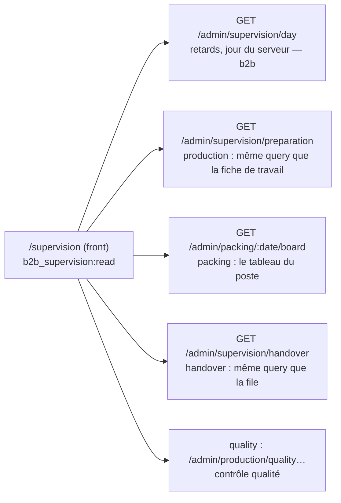

# La Supervision du jour

**État : ✅ bâtie (première version 2026-09-25, refonte v2 le 2026-09-28), relue
contre le code le 2026-10-12.** Remplace `plan-supervision-du-jour` et
`plan-supervision-v2` (supprimés le 2026-10-12 ; l'historique, la maquette
`handoff-suivi` et le handoff v2 — hors dépôt — sont décrits par leurs
références dans git). Demande de Hugo : « un endroit pour superviser à la fois
le suivi de prod, de packing, de retrait et de livraison », **orienté view**, à
part : **on voit, on n'agit pas** — le manager qui regarde peut ensuite aller
opérer au comptoir ou au colisage.

## 1. Le principe : l'unité change de colonne

Ce n'est pas un kanban. On prépare des **produits**, on colise des
**commandes**, on retire à des **gens dans un créneau**.

| Colonne                 | Unité                   | Ce qu'on y voit                                                            |
| ----------------------- | ----------------------- | -------------------------------------------------------------------------- |
| 1 · Préparation         | le **rayon** (produits) | `n / N` lignes par rayon, lignes non faites listées ; rayons finis repliés |
| 2 · Colisage            | la **commande**         | références posées / total, bacs, « attend le four »                        |
| 3 · Retrait / livraison | le **créneau**          | par tranche horaire : retirées, attendues, créneau dépassé, pas prête      |

🔴 **Aucun geste de la maquette n'est repris.** Cocher, Étiquettes, Remettre,
Scanner : chacun devient un **renvoi**, affiché seulement si le lecteur a le
droit de la cible (`supervision-links.ts`), libellé par ce qu'on va y faire
(« Ouvrir le colisage »), jamais par le geste. « Appeler » est retiré : le
téléphone du client ne sort sur aucun écran de supervision, et l'exposer est une
décision d'accès, à part.

## 2. Où vit la composition

**Chaque bloc sert sa propre colonne sous `b2b_supervision` ; le front
juxtapose.** Aucun bloc ne lit l'intérieur d'un autre, aucun handler n'est
dupliqué : un second contrôleur par bloc envoie la **même** query que le poste.

| Colonne         | Route                                      | Bloc         | Garde                                                   |
| --------------- | ------------------------------------------ | ------------ | ------------------------------------------------------- |
| jour, retards   | `GET /admin/supervision/day` (+ `version`) | `b2b/orders` | `b2b_supervision`                                       |
| 1 · Préparation | `GET /admin/supervision/preparation`       | `production` | `b2b_supervision`                                       |
| 2 · Colisage    | `GET /admin/packing/:date/board`           | `packing`    | `production_packing:read` **ou** `b2b_supervision:read` |
| 3 · Retrait     | `GET /admin/supervision/handover`          | `handover`   | `b2b_supervision`                                       |

⚠️ **La colonne Colisage a changé de route** : le plan lisait
`/admin/supervision/packing` (le colisage était dans le fournil). Depuis que le
colisage est un bloc (K3c), le front lit `admin/packing/:date/board` avec une
double autorisation (`@RequireAnyPermission`), vérifié le 2026-10-12 dans
`packing-board.controller.ts` et `supervision.service.ts`.

**Le coût** : quatre lectures par rafraîchissement. Le front les réutilise par
`shared/periodic-refresh.ts` (suspend quand l'onglet est caché, ne chevauche
jamais deux cycles) et relit les colonnes **« on-turn »** seulement quand les
routes `…/version` (`supervision/version`, `production-version`) disent que le
jour a bougé. Les lectures n'ont pas d'instant commun : une commande « colisée »
en colonne 2 peut être « pas prête » en colonne 3 le temps d'un cycle — assumé
pour une vue qui n'agit pas.

## 3. L'accès

- La page exige **`b2b_supervision:read` seul** : ses lectures sont sous ce droit
  et la supervision « se donne à qui supervise sans ouvrir les commandes ».
- Ce que le droit montre : l'avancement du fournil par rayon, les commandes du
  jour avec le nom du client, leurs lignes et leurs bacs, la file de retrait.
  **Aucun montant, aucun contact.**
- Les renvois exigent `b2b_orders:read` (la garde héritée des coquilles cibles) ;
  un test confronte chaque renvoi à la garde effective de sa cible. Les renvois
  visent les **listes**, jamais une fiche en écriture.
- **Migration** `20260926110100_la_supervision_est_accordee` : elle accorde
  `b2b_supervision` à `admin` dans `staff_role_definitions`. Comme celle du
  comptoir, elle est **antérieure à la règle du 2026-10-01** (une migration
  n'écrit pas de droit à un rôle) : exception historique, qui ne se rejoue pas.

## 4. Les colonnes (v2)

**En-tête** : « Supervision · Avancement du jour », date, « à jour à … » ; le jour
par défaut est celui du **serveur** (`supervision/day` sans date), jamais celui du
poste ; un calendrier (`supervision-calendar`) choisit un autre jour. Une bande de
compteurs par colonne ; une recherche (`supervision-search.ts`) met en évidence
références et SKU à travers les colonnes (une commande « attend le four » renvoie
vers le produit attendu).

- **Préparation** : une carte par groupe de la fiche de travail, barre
  `doneCount / lineCount`, état Terminé / En cours / Pas commencé ; **Bloqué** n'a
  pas de donnée.
- **Colisage** : Colisée (bac fermé, N bacs) · En cours (`k références sur N
posées`) · **Attend le four** (au moins une ligne `awaitingProduction`, **lu tel
  quel**, jamais recalculé) · À coliser. Tri : attend le four, en cours, puis heure
  de retrait (créneau joint par `reference`). Journée non arrêtée : la colonne le
  dit (« le colisage commence à la clôture »).
- **Retrait / livraison** : segmenté Retrait · Livraison, groupé par tranche
  horaire ; Retirée (barrée) · **Créneau dépassé** (le verdict vient de
  `supervision/day`, la durée se calcule au front) · Annulée · Pas prête · sans
  créneau (jamais en retard).
- **Mobile** : une colonne à la fois, trois onglets, le rôle choisit l'onglet
  d'arrivée (`supervision-tabs.ts`), une pastille remonte les blocages voisins.
- **Contrôler** : le panneau de contrôle qualité (`quality-panel`, voir
  [`../fournil/plan-controle-qualite.md`](../fournil/plan-controle-qualite.md))
  est la seule partie qui écrit (verdicts append-only) ; le reste est en lecture.
- Le design suit la maquette (Hugo : « je veux le même design »), **par les
  tokens fold, jamais en hexadécimal** ; l'état est toujours porté aussi par un
  libellé.

## 5. Hors périmètre, reste à faire

- **Rayon bloqué · rupture matière** : rien ne l'enregistre (un geste et une
  table, plan à part).
- **Tournée** (véhicule, départ, arrêts) : l'onglet Livraison liste les commandes
  par créneau sans ordre de route. Le module de livraison a un bloc depuis ; le
  raccord à la supervision n'a pas été revérifié ici.
- **« Signé par … »** : on sait qui a retiré et quand, pas de signature client.
- **Appeler** : décision d'accès, à part.
