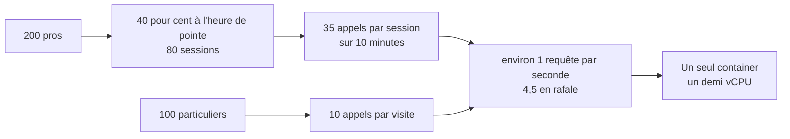

# Procédure de calcul de charge

> 📐 **Préparé le 2026-11-05, jamais lancé.** Le script k6 décrit ici
> **n'est pas encore écrit** (Hugo, 2026-11-05 : « pas de script pour
> l'instant ») ; ce qui suit le spécifie. Aucun test de charge n'a tourné,
> ni sur dev ni sur la production.
> Les chiffres de la partie 1 sont des **hypothèses**, pas des mesures.

La question de Hugo : la plateforme tiendra-t-elle **~200 clients pros**, plus
les particuliers ?

# Partie 1 — L'explication simple

## Ce que fait un client

Quand un pro ouvre sa boutique, son navigateur pose **une vingtaine de
questions** à l'API, en trois vagues (qui suis-je, que puis-je voir, puis le
catalogue, le panier, les commandes…). Ensuite, chaque rayon ouvert en pose une,
et chaque article ajouté au panier en pose deux (le devis et les suggestions).

Une session typique — ouvrir, parcourir cinq rayons, mettre cinq articles au
panier — fait donc environ **20 + 5 + 10 ≈ 35 appels en ~10 minutes**, soit
**~3,5 appels par minute** de navigation. Un visiteur anonyme en fait ~10.

## Combien sont là en même temps

Ce n'est pas « 200 à la fois ». Ce qui compte, c'est combien sont en ligne
**pendant l'heure la plus chargée** — la veille au soir ou le matin tôt, avant
l'heure limite de commande.

| Hypothèse (à confirmer par Hugo)                  | Valeur retenue |
| ------------------------------------------------- | -------------- |
| pros qui commandent un jour donné                 | 200            |
| part d'entre eux pendant l'heure de pointe        | 40 % → 80      |
| durée d'une session pro                           | 10 min         |
| appels par session pro                            | 35             |
| visites de particuliers à l'heure de pointe       | 100            |
| durée / appels d'une visite de particulier        | 5 min / 10     |
| rafale (tous arrivent dans le même quart d'heure) | × 4            |

- Pros simultanés : 80 sessions/h × 10 min / 60 = **~13 en même temps**.
- Requêtes par seconde, moyenne de l'heure : (80 × 35 + 100 × 10) / 3600 ≈
  **1,1 req/s**.
- Avec la rafale (× 4) : **~4,5 req/s**, et des pics de **~20 requêtes en
  moins d'une seconde** à chaque ouverture de boutique (une vague part d'un
  bloc).

**Cible du test : tenir 10 req/s soutenues** (deux fois la rafale) avec un p95
sous 1,5 s, et voir où ça casse au-delà.



La seule pièce qui ne grossit pas toute seule est le **container** : une seule
instance, un demi-processeur. Le test sert à savoir combien de requêtes par
seconde il absorbe avant que la file d'attente monte.

# Partie 2 — La partie technique

## La chaîne mesurée (vérifiée le 2026-11-05)

Passerelle (Worker Cloudflare) → Worker de l'API
([`apps/lfd-api/container/worker.ts`](../../apps/lfd-api/container/worker.ts)) →
Durable Object `Backend`, un Cloudflare Container `standard-1` (demi-vCPU),
`max_instances: 1` (vérifié le 2026-11-05 dans [`apps/lfd-api/wrangler.jsonc`](../../apps/lfd-api/wrangler.jsonc))
→ Nest → Prisma Postgres, facturé à l'opération et loin de l'API.

Chaque réponse porte un en-tête `Server-Timing`
([`server-timing.ts`](../../apps/lfd-api/src/platform/metrics/server-timing.ts)) :
`verify`, `principal`, `app` côté Nest, puis `container`, `worker`, `gateway`
ajoutés en remontant. Le script en fera une métrique k6 par marque
(`st_verify`, `st_app`, …) et en dérivera **`st_queue = container − app`** : le
temps passé dans le container hors de Nest, c'est-à-dire l'attente du
demi-vCPU.

## La formule

```
req/s = Σ (sessions à l'heure de pointe × appels par session) / 3600 × facteur de rafale
simultanés = sessions par heure × durée de session (h)
```

Les appels par session ont été comptés sur les contrôleurs (vérifiés le
2026-11-05) : vague 1 `GET /me`, `/feature-access/mine`, `/shop/copy?locale=fr` ;
vague 2 `GET /content/footer`, `/order-opening`, `/delivery-zones`,
`/delivery-availability`, `/fulfillment-days/mine` ; vague 3
`GET /shop/catalogue/mine`, `/shop/cart`, `/me/loyalty`,
`/pickup-addresses/mine`, `/orders/mine`, `/order-admission/mine`,
`/shop/storefront/all/mine`, puis `/fulfillment-days/mine?skus=…` ; ensuite
`GET /shop/storefront/<rayon>/mine`, `POST /shop/quote/mine`
(`{ lines, fulfillment }`) et `POST /shop/suggestions/cart/mine`
(`{ skus, target }`), deux lectures qui ne mutent rien. L'en-tête d'espace est
`x-lfc-company` (`WORKSPACE_HEADER`, valeur `personal` ou un id de société).
**Aucune passation par défaut** : le scénario `buyer` (`POST /orders`) ne
s'activera qu'avec `LFD_ORDERS=1`, et refusera toute cible qui n'est pas un
environnement de charge. Son environnement, ses clients de test et son calcul
sont dans [`plan-environnement-de-charge.md`](plan-environnement-de-charge.md).

## Installer et lancer

```bash
brew install k6
# le script n'existe pas encore : les variables ci-dessous sont sa spécification
k6 run <script>                                   # LFD_SMOKE=1 : un passage par scénario
LFD_TOKENS=sub_test_1,sub_test_2 LFD_TARGET=20 LFD_STEP=2m k6 run <script>
```

Défaut : `http://localhost:3200` (l'API de dev). Une autre cible se donne par
`LFD_BASE_URL` — la publique est `https://lafoliecoffee.info/api/lfd`, **jamais
par défaut**. Les jetons (`LFD_TOKENS`) sont ceux de **comptes de test**, jamais
écrits dans le dépôt ; en local seulement, le harnais e2e admet que le jeton
porteur est le `sub`. Les autres variables seront décrites en tête du script.

Trois scénarios prévus : `visitor` (routes publiques), `pro` (les trois vagues puis
cinq tours rayon → devis + suggestions, avec 8 à 30 s de lecture entre deux),
`switcher` (un dixième des pros, qui rouvre la boutique dans deux espaces de
`LFD_WORKSPACES`). Chacun montera en quatre paliers de `LFD_STEP` jusqu'à sa
cible (`ramping-vus`).

## Quoi lire

- **p95 de `http_req_duration`** : le ressenti. Seuil par défaut 1,5 s.
- **`st_app`** : Nest et la base. S'il monte, c'est la base (lectures loin) ou
  le calcul ; regarder par route (`route` en tag).
- **`st_queue`** : la file du demi-vCPU. Plate puis qui décolle = la saturation
  du container, le palier atteint est la capacité.
- **`st_worker − st_container`, `st_gateway − st_worker`** : les sauts
  Cloudflare ; ils ne devraient pas bouger avec la charge.
- **Coût** : chaque requête lit la base. Lectures par requête × requêtes du test
  = opérations facturées ; les relever dans la console Prisma avant et après.
  Les ordres de grandeur par écran sont dans
  [`plan-cache-du-catalogue.md`](../caching-usage/plan-cache-du-catalogue.md).
- **Côté Cloudflare** : Workers → l'API → Observability (logs et traces,
  activés dans `wrangler.jsonc`), et l'onglet Containers pour le CPU et la
  mémoire de l'instance.

## Ne jamais faire tomber la production

- **Jamais sans Hugo**, jamais pendant les heures de commande : hors heures,
  annoncé.
- D'abord en local, puis sur dev ; la production en dernier.
- **Paliers courts** (`LFD_STEP=1m`), cible qui double à chaque essai, pas plus.
- Arrêt automatique (`abortOnFail`), à écrire dans le script : plus de 1 % d'échecs, 5 réponses 5xx, ou
  une file p95 au-delà de 500 ms. Ctrl-C arrête aussi tout.
- La passation (`LFD_ORDERS=1`) **jamais** contre la production : le script
  devra la refuser **avant le premier appel**, sur le nom d'hôte **et** sur la
  preuve servie par l'environnement de charge (`x-lfd-environment: load` sur
  `GET /health`, à bâtir) ; un 5xx sur `/orders` arrêtera le palier.
- Les **409** de la passation sont des réponses métier : le script les
  déclarera attendus (`http.expectedStatuses({ min: 200, max: 399 }, 409)`),
  hors de `http_req_failed`, comptés à part avec leur propre seuil. Un tour qui
  ne peut pas commander est un échec compté, et un palier sans assez de
  passations réussies n'est pas concluant. Détail : §3 du
  [plan](plan-environnement-de-charge.md).
- Le container étant unique, une saturation y ralentit **les vrais clients**.

## Ce qui n'est pas vérifié

- Les hypothèses de fréquentation (40 %, 10 min, rafale × 4) : à confirmer.
- Le compte d'appels vient des contrôleurs et de la mesure du 2026-11-05 ;
  il n'a pas été recompté dans l'onglet Réseau sur chaque écran.
- Que `container`, `worker` et `gateway` soient présents sur toutes les routes
  (les Trends ne reçoivent que les marques effectivement présentes).
- La forme exacte des réponses de catalogue : à lire avant d'écrire le script,
  qui y cherchera les `sku` ; un tour sans article sera un échec compté.
- k6 est absent du poste (2026-11-05).
