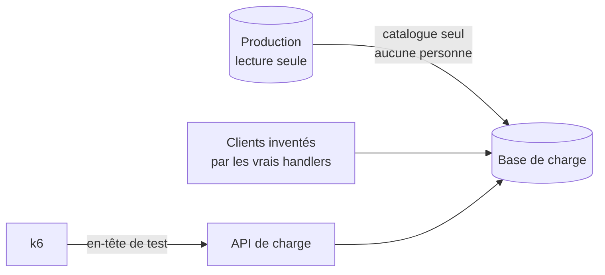

# Plan — l'environnement de charge

> ⚔️ **Contredit par `vitruve` le 2026-11-05, corrigé le même jour** : liste
> blanche par colonne, lieux copiés, 409 attendus, garde de la cible distante,
> mode de charge qui n'ouvre pas `/admin`, abonnés de la passation inventoriés.
> Les choix ouverts sont dans « Décisions pour Hugo », à la fin.
>
> 📝 **Plan du 2026-11-05, rien n'est bâti, rien n'est exécuté.** Le script du
> **visiteur anonyme** existe depuis le 2026-11-05
> ([`visiteur.md`](visiteur.md)) ; le script **connecté** (pro, passation),
> objet de ce plan, n'existe pas : ce qui suit le **spécifie**. Il touche une
> copie de données de production et une frontière de sécurité (un mode
> d'authentification de charge) : il passe par `vitruve` avant Hugo. Tout geste
> qui lit la production est **à valider par Hugo, jamais exécuté sans lui**, et
> en **lecture seule**. La procédure de mesure est dans [`README.md`](README.md).

# Partie 1 — L'explication simple

Pour savoir si la plateforme tient 200 pros qui **passent commande**, il faut
passer des commandes. On ne peut pas le faire en production : une commande
écrite y part au fournil, au colisage, et dans la comptabilité. Il faut donc un
**double** de la plateforme, avec trois choses :

1. **le vrai catalogue** — les mêmes articles, prix, promotions, rayons : c'est
   leur nombre et leur forme qui font le coût d'un rayon ou d'un devis ;
2. **des clients inventés en masse** — des sociétés, des particuliers, des
   rattachements, aucun vrai nom ;
3. **une porte d'entrée de test** — pour que k6 se présente comme ces clients
   sans passer par Auth0, et qui **n'existe pas** en production.



# Partie 2 — La partie technique

## 1. Dupliquer le catalogue, sans aucune donnée personnelle

### Ce qui existe (ouvert le 2026-11-05)

- `pnpm --filter lfd-api seed:pim` ([`seed-pim.ts`](../../apps/lfd-api/prisma/seed-pim.ts))
  rejoue le catalogue **du dépôt** commande par commande, et refuse toute cible
  qui n'est pas un Postgres local. Il ne lit **aucune** base, par principe.
- `pnpm db:dev:clone` ([`clone-dev.ts`](../../apps/lfd-api/prisma/clone-dev.ts))
  copie **toutes** les tables scalaires d'une source (`CLONE_SOURCE_URL`) vers
  une cible locale qu'il purge (`refuseNonLocalTarget`). Il copie donc aussi les
  personnes : **inutilisable tel quel** contre la production.
- Le semis de démonstration (`src/dev/seeding/`, verrou
  `refuseUnlessLocalDevelopment`) fabrique sociétés, clients et commandes par
  les vrais handlers, contre un Postgres local seulement.

### Les tables du catalogue (lues dans `prisma/schema/` le 2026-11-05)

| Bloc                | Modèles candidats                                                                                                                                                                                                                                                                                                                                                                              |
| ------------------- | ---------------------------------------------------------------------------------------------------------------------------------------------------------------------------------------------------------------------------------------------------------------------------------------------------------------------------------------------------------------------------------------------- |
| `pim/`              | `SkuRegistry`, `Product`, `ProductVariant`, `ProductPackaging`, `ProductReadiness`, `ProductContextVat`, `Category*`, `VatRate`, `Operation`, `OperationItem`, `SalesContext`, `OrderTimeLimit`, `ProductEditorial`, `ProductMedia`, `CatalogContent`, fiche réglementaire (`NutritionDeclaration`, `VariantAllergens`, `Ingredient`, `Allergen*`, …), `CatalogRevision*`, `B2bChannelBinding` |
| `public/catalog`    | `CatalogItem`, `CatalogCategory`, `CatalogVersion`, `CatalogEntry`, `CatalogRules`, `CatalogItemOverride`, `CatalogPriceHistory`, `ProductNorm`, `CatalogDelivery`                                                                                                                                                                                                                             |
| `public/pricing`    | `PriceRule`, `PriceFloor`, `VolumeLadder`, `PriceTemplate`                                                                                                                                                                                                                                                                                                                                     |
| `public/promotions` | `Promotion`, `PromotionScopeRule`, `PromotionSetting`, `PromotionAudienceTarget`, `PromotionPickupPoint`, `PromotionDeliveryZone`                                                                                                                                                                                                                                                              |
| `public/settings`   | `Site`, `PickupDiscountRule`, `DeliveryZone` (cf. « Les lieux » plus bas)                                                                                                                                                                                                                                                                                                                      |
| autres              | `CatalogOperation*`, `Bundle*`, `Storefront*`, les médias (`media/`)                                                                                                                                                                                                                                                                                                                           |

### La liste blanche est par COLONNE, pas par modèle

Une liste par modèle ne tient pas, et le registre RGPD ne la rattrape pas :
[`rgpd-registre.json`](../legal/rgpd-registre.json) est tenu **par colonne**
et ne couvre que le **staff** et les réceptionnaires (`lint:rgpd-staff`), pas
les clients. Or, lu le 2026-11-05 :

- **presque chaque modèle du catalogue porte une colonne staff** :
  `Product`, `ProductVariant`, `ProductPackaging`.`updated_by`
  (`pim/product.prisma:117`, `:295`, `:385`), `ready_by` (`:415`),
  `CatalogRevision.taken_by` (`pim/revisions.prisma:54`), `published_by`
  (`pim/revisions.prisma:121`, `pim/channels.prisma:23`), `started_by`
  (`pim/channels.prisma:67`), `updated_by` des catégories et contextes de
  vente, `PriceRule` / `VolumeLadder` / `PriceTemplate`.`created_by`,
  `paused_by`, `archived_by` (`public/pricing.prisma`), `Promotion`.`paused_by`,
  `archived_by`, `created_by` (`public/promotions.prisma:58`, `:61`, `:90`),
  `CatalogVersion.created_by` (`public/catalog.prisma:595`), `accepted_by`,
  `decided_by`, `reserved_by` (`public/catalog.prisma:530`, `:649`, `:686`),
  `written_by` / `decided_by` (`bundles.prisma:23`, `catalog-operations.prisma:64`,
  `:115`), `Storefront*.updated_by_staff_id` (`public/storefront.prisma:29`, `:49`) ;
- **des colonnes visent un CLIENT** sans être au registre :
  `PriceRule.audience_type = 'company'` + `audience_id`
  (`public/pricing.prisma:33-34` ; l'étage `mercuriale` vit aussi dans
  `price_rules`, `stage`, ligne 22), la même paire sur `VolumeLadder`
  (`:241-242`), `Promotion.audience_company_id` (`public/promotions.prisma:67`),
  `PromotionAudienceTarget.company_id` (`:145`).

Le script de copie (à bâtir) tient donc **une table par modèle copié, où
chaque colonne a exactement une des trois classes** :

| Classe        | Ce que fait la copie                                                                       | Exemples                                                                                                   |
| ------------- | ------------------------------------------------------------------------------------------ | ---------------------------------------------------------------------------------------------------------- |
| `copy`        | copiée telle quelle                                                                        | identifiants, libellés produit, prix, TVA, fenêtres, `scope_*`, `stage`, couleurs et adresses de NOS sites |
| `staff`       | remplacée par l'identifiant d'**un staff synthétique** de la base de charge (`load-staff`) | toutes les colonnes `*_by`, `*_by_staff_id` ci-dessus                                                      |
| `exclude-row` | si la valeur désigne une société ou une personne, la **ligne entière** est écartée         | `audience_type = 'company'`, `audience_company_id` non nul, `PromotionAudienceTarget.company_id` non nul   |

Les lignes écartées sont **recréées en même forme** (même nombre, même
étage, même portée) sur des sociétés inventées, par les handlers de la
tarification et des promotions, après le semis des clients (§2). Une promotion
dont la seule audience était une société réelle est écartée avec ses cibles,
ses portées et ses liens de lieu (aucune FK `Restrict` ne reste pendante).
`audience_type = 'segment'` : `audience_id` nomme un segment, pas une société
— classé `copy`, **à confirmer** au bâti en ouvrant la liste des segments.

**La garde qui refuse une colonne non classée** — exigence du bâti, pas une
option : au démarrage, le script lit les colonnes réelles de chaque table
copiée (`information_schema.columns` de la **cible** migrée) et refuse de
copier quoi que ce soit si une colonne n'a pas de classe, ou si une classe
nomme une colonne qui n'existe plus. Un test unitaire du script fait la même
comparaison contre le DMMF Prisma, pour que l'ajout d'une colonne au schéma
rougisse en CI et non le jour de la copie. Une colonne ajoutée plus tard part
donc **refusée par défaut**, jamais copiée par défaut.

🔴 **Les mercuriales ne se copient pas.** `CompanyMercuriale`,
`CompanyMercurialeAmendment`, `VolumeCommitment` et `MercurialeDraft` portent un
`company_id` (`public/pricing.prisma:313`, `:436`, `:534`) : c'est un prix
**négocié avec une société réelle**. Elles sont recréées sur les sociétés
inventées, en même nombre et même forme (lignes par mercuriale). `PricingEvent`
(un journal, colonne `actor`) ne se copie pas non plus : la base de charge
écrit son propre journal.

### Les lieux : copier `Site` et `DeliveryZone`

`PromotionPickupPoint` et `PromotionDeliveryZone` ont une FK
`onDelete: Restrict` vers `Site` et `DeliveryZone`
(`public/promotions.prisma:160`, `:177`, lu le 2026-11-05) : copier les
promotions sans les lieux échouerait à l'insertion. Colonnes lues le
2026-11-05 dans `public/settings.prisma` :

- `Site` : libellé, adresse postale (`ligne1`, `code_postal`, `ville`…), `gps`,
  horaires (`opening`), remises de retrait, drapeaux, couleurs, mode de
  transfert. **Aucun contact, aucun téléphone, aucune personne** : ce sont nos
  boutiques. `PickupDiscountRule` vise une catégorie ou un produit, jamais un
  client (enum `PickupDiscountTarget`).
- `DeliveryZone` : préfixes postaux, libellé, frais. Aucune personne.

**Recommandé : copier `Site`, `PickupDiscountRule` et `DeliveryZone`** (classe
`copy`, sous la même garde par colonne). Écarter les liens ferait perdre aux
promotions leur portée de lieu, donc le coût que le devis paie à les
résoudre. Question à Hugo dans « Décisions » plus bas.

### Deux options

|                 | A. Export ciblé des tables du catalogue                           | B. Rejeu par les vrais handlers                                                             |
| --------------- | ----------------------------------------------------------------- | ------------------------------------------------------------------------------------------- |
| Geste           | lecture seule des tables listées, écriture dans la base de charge | lire le catalogue de prod par l'API staff (lecture), le rejouer par le bus comme `seed:pim` |
| Fidélité        | exacte, y compris des états que le domaine refuserait aujourd'hui | ce que le domaine accepte aujourd'hui ; un refus est rapporté                               |
| Risque de fuite | tenu par la garde par colonne (refus par défaut)                  | seuls les champs que les commandes portent                                                  |
| Coût de bâti    | un script (copie de `clone-dev.ts` à **liste blanche**)           | un lecteur + réutiliser `seed-pim`                                                          |

**Recommandation : A, à liste blanche par colonne, jamais à liste noire.** La
source est une URL en **lecture seule** (rôle Postgres `SELECT` sur ces tables,
à créer par Hugo).

### La garde de la cible

`refuseNonLocalTarget` ne convient qu'au local ; le staging vit sur une base
Prisma Postgres **distante**. Le script tient donc une **liste fermée** des
hôtes de base de charge admis (écrite dans le script, jamais lue d'une
variable), et refuse :

- toute cible dont l'hôte n'est ni local ni dans cette liste ;
- toute cible dont l'hôte **et** la base sont ceux de la source (on n'écrit
  jamais là où on lit) ;
- toute cible dont l'hôte est celui de la production, **nommé** dans le script
  et refusé avant même la liste — même si quelqu'un l'y ajoutait par erreur.

La base de staging est créée par Hugo ; son hôte entre dans la liste par un
commit relu.

**Geste — à valider par Hugo, jamais exécuté contre la prod sans lui :**

```bash
# 1. base de charge vide et migrée (locale)
pnpm dev:infra && pnpm --filter lfd-api db:migrate
# 2. copie du catalogue (script À BÂTIR, nom provisoire)
CLONE_SOURCE_URL=<URL prod, rôle lecture seule> CLONE_TARGET_URL=<base de charge> \
  pnpm --filter lfd-api db:load:catalogue
```

Coût : Prisma Postgres est facturé à l'opération. Une copie lit chaque table
une fois par lot ; l'ordre de grandeur (quelques milliers de lignes, quelques
dizaines d'opérations) **n'est pas mesuré**.

### Où tourne l'environnement

|          | Local : Docker + `wrangler dev`                       | Staging déployé (`charge.<domaine>`)                                                                                          |
| -------- | ----------------------------------------------------- | ----------------------------------------------------------------------------------------------------------------------------- |
| Base     | Postgres local, gratuit                               | une base Prisma Postgres dédiée, **facturée à l'opération** : un test de 10 min à 10 req/s × ~6 lectures = ~36 000 opérations |
| Fidélité | ne mesure pas le demi-vCPU ni la latence vers la base | même container `standard-1`, même distance à la base                                                                          |
| Risque   | nul pour la prod                                      | un secret ou un binding mal recopié vise la prod                                                                              |

Proposé : **local d'abord** (valide le script et les volumes), puis un staging
déployé pour la mesure qui compte, sur un Worker et une base **séparés**, sans
binding vers la production. Le staging n'existe pas.

## 2. Des clients de test en masse

- **Fabrication** : par les handlers du domaine, comme le semis
  (`src/dev/seeding/client.seed.ts`, `sub-accounts.seed.ts`, …) : 200 sociétés
  pro (dont une part avec sites et rattachements multiples, pour le scénario
  « change d'espace »), 300 particuliers, chacun avec un `sub` synthétique
  (`load|pro-001`…), et le staff synthétique `load-staff` du §1. Aucun e-mail
  réel : un domaine réservé (`@example.test`).
- **E-mails** : sans clé Resend (`RESEND_MAILER_B2B_API_KEY` /
  `RESEND_API_KEY` absentes), `createMailer` rend un `DryRunMailer`
  (`packages/mailer/src/create-mailer.ts`, lu le 2026-11-05) : rien ne part, et
  le démarrage n'est pas refusé (`optionalMailerConfig`). La base de charge ne
  reçoit **jamais** la clé de production.

### L'authentification de charge

- Le harnais e2e (« le jeton porteur est le `sub` ») remplace
  `AccessTokenVerifier` dans les tests seulement ; il n'existe pas hors e2e.
- **`DevImpersonation`**
  ([`dev-impersonation.ts`](../../apps/lfd-api/src/platform/auth/dev-impersonation.ts)) —
  `AUTH_DEV_IMPERSONATE=true`, sujet par l'en-tête `x-dev-impersonate`,
  refusé au démarrage si `NODE_ENV=production`. En local, il suffit.
- ⚠️ **L'impersonation ouvre aussi `/admin`.** `adminDevBypass()` est vrai dès
  que l'impersonation est active (`apps/lfd-api/src/platform/config/app-config.ts`,
  vers la ligne 450, lu le 2026-11-05) : `/admin/*` ne vérifie plus aucun jeton.
  Acceptable en local, **inacceptable** sur un environnement joignable.
- **L'image déployée pose `NODE_ENV=production`** (`apps/lfd-api/Dockerfile:42`,
  lu le 2026-11-05) : un staging construit sur la même image refuserait
  l'impersonation au démarrage. C'est voulu, et c'est pourquoi il faut un
  mode distinct.

**Le mode `AUTH_LOAD_TEST` — spécification, rien n'est bâti :**

1. Il ne remplace que la vérification du jeton **client** : le sujet vient d'un
   en-tête de charge (`x-lfd-load-subject`), accompagné d'un secret
   partagé (`x-lfd-load-key` = `LOAD_TEST_KEY`), comparé à temps constant.
2. Il **n'ouvre pas `/admin`** : `adminDevBypass()` ne le lit pas, et un test
   unitaire d'`AppConfig` l'affirme (`AUTH_LOAD_TEST` seul ⇒ `adminDevBypass()`
   faux).
3. **Refus au démarrage de l'API** si le mode est actif et que :
   le marqueur d'environnement `LFD_ENVIRONMENT` ne vaut pas `load` ; ou
   `DATABASE_LFD_URL` vise un hôte hors de la liste fermée du §1 (le même
   module, partagé) ; ou l'hôte est celui de la production ; ou
   `LOAD_TEST_KEY` manque. Ce refus est ce qui rattrape un **secret posé par
   `wrangler secret put`**, que la porte de CI ne voit pas.
4. **La passerelle retire les en-têtes** `x-dev-impersonate`,
   `x-lfd-load-subject` et `x-lfd-load-key` en production, comme elle
   écrase `x-lfc-client-ip`. Aujourd'hui elle les **relaie** : la requête
   sortante est construite sur la requête admise
   (`new Request(destination.url, admitted)`, `gateway/src/index.ts`, vers la
   ligne 108), et `withClientIp` / `withTraceContext` (lignes 270-294) ne
   retirent que leurs propres en-têtes (lu le 2026-11-05).
5. **Porte de CI** `lint:no-load-auth-in-production` : refuse que la
   configuration de production (`apps/lfd-api/wrangler.jsonc`, ses `vars`,
   les workflows de déploiement) nomme `AUTH_LOAD_TEST`,
   `AUTH_DEV_IMPERSONATE` ou `LOAD_TEST_KEY`. Elle ne voit pas les secrets
   posés à la main : c'est le point 3 qui les tient.
6. **Preuve servie** : en mode de charge, `GET /health` porte l'en-tête
   `x-lfd-environment: load`. Aucun autre environnement ne le sert.

L'alternative sans mode d'auth : un tenant Auth0 **de développement** et des
jetons M2M ; plus sûr (aucun contournement de vérification n'existe dans le
code), plus lent à bâtir. À trancher par Hugo.

## 3. Le scénario de passation (spécification du script à écrire)

`buyer`, **éteint par défaut** (`LFD_ORDERS=1`). **Deux gardes avant le premier
appel**, sinon refus :

1. l'hôte de `LFD_BASE_URL` est local, ou a pour premier label `charge`,
   `load` ou `staging` ; le domaine public est refusé nommément ;
2. hors local, `GET /health` répond avec `x-lfd-environment: load` (§2,
   point 6). Un hôte bien nommé qui ne sert pas ce marqueur est refusé.

Ce qu'il fait : ouvre la boutique, lit points de retrait et jours, ajoute 1 à
6 articles un par un (devis + suggestions à chaque ajout), devise une dernière
fois avec le créneau, puis `POST /orders`.

Vérifié dans le code le 2026-11-05 :

- `POST /orders` ([`orders.controller.ts`](../../apps/lfd-api/src/b2b/orders/http/orders.controller.ts)),
  corps `placeOrderPayloadSchema` : `idempotencyKey` (UUID, un par itération),
  `settlement` (`card` | `account` | `null`), `salesTerms` (requis, nullable),
  `expectedTotalCents` (lu sur `totalCents` du devis), plus le contenu
  (`lines`, `fulfillmentMethod`, `pickupAddressId`, `requestedDeliveryDate`,
  `requestedWindow`). La société vient de l'en-tête d'espace.
- Le handler crée l'intention **Stripe avant** la persistance pour une carte
  ([`place-order.handler.ts`](../../apps/lfd-api/src/b2b/orders/application/commands/place-order.handler.ts)).
  Défaut du script : `account` (sociétés aux termes accordés, pas de Stripe).
  `card` n'est admis qu'avec des clés `sk_test_` — le code ne le vérifie pas.

**Un tour qui ne peut pas commander est un échec compté.** Un tour `buyer` sans
point de retrait, sans jour ouvert, sans article ou sans total au devis
incrémente `buyer_skipped` ; au-delà de 1 % des tours, le palier échoue — sinon
un catalogue mal copié rendrait un test vert sans passation. Et **chaque palier
exige un minimum de passations réussies** (`buyer_placed`, par défaut 20 par
palier, `LFD_MIN_ORDERS`) : en deçà, le palier ne mesure rien et il est déclaré
non concluant.

### Les 409, statuts attendus

Un 409 (`BusinessError` : créneau fermé, total qui a bougé, rejeu d'une
`idempotencyKey`) est une réponse métier, pas une panne. Le script le déclare
attendu :

```js
http.setResponseCallback(http.expectedStatuses({ min: 200, max: 399 }, 409));
```

Il sort donc de `http_req_failed`, et il est compté à part (`conflicts_409`,
taggé par route) avec **son propre seuil** : `rate < 0.05` par palier. Un taux
de 409 qui monte avec la charge (et non avec les données) est une contention :
on arrête et on lit.

### Ce que la passation déclenche (inventaire lu le 2026-11-05)

| Abonné                                                              | Écoute                                     | Ce qu'il écrit / fait                                                                                            |
| ------------------------------------------------------------------- | ------------------------------------------ | ---------------------------------------------------------------------------------------------------------------- |
| `growth/…/on-order-placed.handler.ts`                               | `OrderPlacedEvent` (mémoire)               | deux lectures (société, personne) puis une ligne d'activité, idempotente par commande                            |
| `alerts/…/on-order-placed.handler.ts`                               | `OrderPlacedEvent` (mémoire)               | relit la commande, évalue les règles d'alerte du compte ; n'écrit que si une règle active se déclenche           |
| `orders/…/replace-unsettled-shop-orders.handler.ts`                 | `OrderPlacedEvent` (mémoire), sans société | annule les commandes boutique **non réglées** précédentes du même particulier (intention Stripe annulée d'abord) |
| `delivery/channels/commerce/commerce-order-placed.fact.ts`          | fait durable `commerce.order_placed`       | une ligne dans la boîte d'envoi, **dans la transaction** de la passation                                         |
| `delivery/…/locate-on-order-placed.handler.ts`                      | `commerce.order_placed`                    | situe l'adresse d'une livraison : géocodage par la BAN (`api-adresse.data.gouv.fr`), en fond, avec cache         |
| `delivery/…/attach-on-order-placed.handler.ts`                      | `commerce.order_placed`                    | rattache au transfert un retrait passé après la clôture d'un site servi par transfert                            |
| `orders/…/send-order-placed-mail.handler.ts`                        | `commerce.order_placed`                    | relit la commande, ses destinataires, fabrique le bon en PDF ; un courriel (sec sans clé)                        |
| `orders/…/send-guest-order-notice.handler.ts`                       | `commerce.order_placed`                    | commande sans compte seulement : registre d'unicité, un courriel (sec sans clé)                                  |
| `sub-account-notices/…/notify-principal-on-order-placed.handler.ts` | `commerce.order_placed`                    | un site qui commande : prévient son principal                                                                    |

Ce que ça change à la mesure :

- **Écritures** : par passation, la commande et ses lignes, une ligne de boîte
  d'envoi, un reçu par abonné durable (cinq), une ligne d'activité, plus ce
  qu'écrivent les abonnés quand ils agissent. Au pic du §4 (~0,04
  passation/s), quelques écritures par seconde : négligeable en débit, pas en
  **verrous** ni en CPU — la fabrication du PDF de l'accusé tourne dans le
  même demi-vCPU. Le script mesure donc aussi `st_queue` **après** les
  passations, pas seulement pendant.
- **Particulier `card` en boucle** : chaque passation annule la précédente non
  réglée (`replaceEarlier`), et chaque annulation appelle Stripe. Le scénario
  `buyer` des particuliers paie donc en `card` avec une **nouvelle** identité
  par itération, ou en `account` côté pro ; sinon la mesure compte des
  annulations qu'aucun client réel ne produit.
- **Livraison** : chaque commande livrée appelle la BAN, service public tiers.
  Le scénario passe en **retrait** par défaut ; la livraison n'est essayée
  qu'en petit nombre, ou avec le géocodeur doublé — **à trancher au bâti**.
- **Resend** : aucun envoi réel sans clé (`DryRunMailer`, §2).

## 4. Le calcul, avec la passation

Hypothèse : les commandes se concentrent **la veille au soir**, avant l'heure
limite. Si 150 des 200 pros commandent entre 19 h et 21 h, et la moitié dans
la dernière demi-heure : ~75 passations en 30 min, soit **~2,5 par minute**,
chacune précédée d'une session (~40 appels). Débit de ce quart d'heure :
75 × 40 / 1800 ≈ **1,7 req/s**, × 4 en rafale ≈ **7 req/s**, dont
**~0,04 passation/s**. La cible de 10 req/s du README couvre ce pic ; la
passation y ajoute surtout des **transactions** et le travail des abonnés,
que seul le test mesurera.

Critères d'arrêt en plus de ceux du README : un 5xx sur `/orders` arrête le
palier ; le seuil des 409 et le minimum de passations sont au §3.

## Décisions pour Hugo

1. **Copier `Site`, `PickupDiscountRule` et `DeliveryZone`** avec le catalogue
   (recommandé : ce sont nos lieux, aucune personne), ou écarter les liens
   lieu des promotions ?
2. **Local d'abord, puis un staging** déployé (Worker et base séparés, hôte de
   base ajouté à la liste fermée par commit) — ou le local seul pour
   commencer ?
3. **Mode d'authentification du staging** : `AUTH_LOAD_TEST` (§2, six
   garde-fous, contournement de vérification dans le code), ou un tenant Auth0
   de développement avec jetons M2M (rien à contourner, plus long à bâtir) ?
4. Le rôle Postgres en lecture seule sur la production, à créer par lui.

## Ce qui n'est pas vérifié

- `audience_type = 'segment'` : que `audience_id` ne désigne jamais une
  société (liste des segments non ouverte).
- La liste complète des colonnes `*_by` : celles du §1 viennent d'un grep sur
  `_by`/`By` ; la garde par colonne est faite pour rattraper les autres.
- Que la passation `account` aboutisse sans Stripe configuré (lu : seule la
  carte crée une intention ; non exécuté).
- D'où le front tire la révision des CGV : le script la prendra en variable
  (`LFD_SALES_TERMS`).
- Les volumes (lignes du catalogue, opérations d'une copie).
