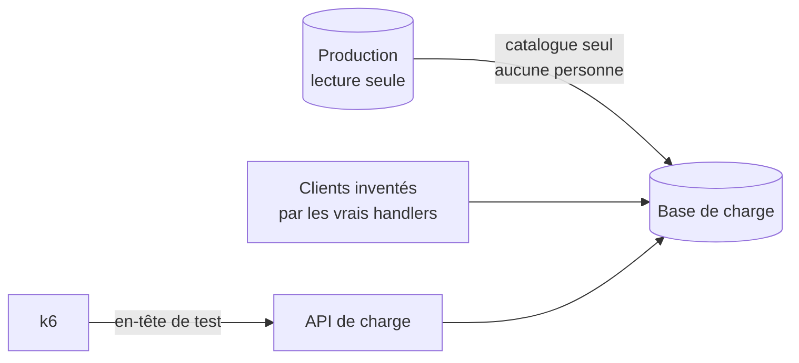

# Plan — l'environnement de charge

> 📝 **Plan du 2026-11-05, rien n'est bâti, rien n'est exécuté.** Il touche une
> copie de données de production et une frontière de sécurité (un mode
> d'authentification de charge) : il passe par `vitruve` avant Hugo. Tout geste
> qui lit la production est **à valider par Hugo, jamais exécuté sans lui**, et
> en **lecture seule**. La procédure de mesure est dans [`README.md`](README.md).

# Partie 1 — L'explication simple

Pour savoir si la plateforme tient 200 pros qui **passent commande**, il faut
passer des commandes. On ne peut pas le faire en production : une commande
écrite y part au fournil, au colisage, et dans la comptabilité. Il faut donc un
**double** de la plateforme, avec trois choses :

1. **le vrai catalogue** — les mêmes articles, prix, promotions, rayons : c'est
   leur nombre et leur forme qui font le coût d'un rayon ou d'un devis ;
2. **des clients inventés en masse** — des sociétés, des particuliers, des
   rattachements, aucun vrai nom ;
3. **une porte d'entrée de test** — pour que k6 se présente comme ces clients
   sans passer par Auth0, et qui **n'existe pas** en production.



# Partie 2 — La partie technique

## 1. Dupliquer le catalogue, sans aucune donnée personnelle

### Ce qui existe (ouvert le 2026-11-05)

- `pnpm --filter lfd-api seed:pim` ([`seed-pim.ts`](../../apps/lfd-api/prisma/seed-pim.ts))
  rejoue le catalogue **du dépôt** commande par commande, et refuse toute cible
  qui n'est pas un Postgres local. Il ne lit **aucune** base, par principe.
- `pnpm db:dev:clone` ([`clone-dev.ts`](../../apps/lfd-api/prisma/clone-dev.ts))
  copie **toutes** les tables scalaires d'une source (`CLONE_SOURCE_URL`) vers
  une cible locale qu'il purge (`refuseNonLocalTarget`). Il copie donc aussi les
  personnes : **inutilisable tel quel** contre la production.
- Le semis de démonstration (`src/dev/seeding/`, verrou
  `refuseUnlessLocalDevelopment`) fabrique sociétés, clients et commandes par
  les vrais handlers, contre un Postgres local seulement.

### Les tables du catalogue (lues dans `prisma/schema/` le 2026-11-05)

| Bloc                | Modèles candidats                                                                                                                                                                                                                                                                                                                                                                              |
| ------------------- | ---------------------------------------------------------------------------------------------------------------------------------------------------------------------------------------------------------------------------------------------------------------------------------------------------------------------------------------------------------------------------------------------- |
| `pim/`              | `SkuRegistry`, `Product`, `ProductVariant`, `ProductPackaging`, `ProductReadiness`, `ProductContextVat`, `Category*`, `VatRate`, `Operation`, `OperationItem`, `SalesContext`, `OrderTimeLimit`, `ProductEditorial`, `ProductMedia`, `CatalogContent`, fiche réglementaire (`NutritionDeclaration`, `VariantAllergens`, `Ingredient`, `Allergen*`, …), `CatalogRevision*`, `B2bChannelBinding` |
| `public/catalog`    | `CatalogItem`, `CatalogCategory`, `CatalogVersion`, `CatalogEntry`, `CatalogRules`, `CatalogItemOverride`, `CatalogPriceHistory`, `ProductNorm`, `CatalogDelivery`                                                                                                                                                                                                                             |
| `public/pricing`    | `PriceRule`, `PriceFloor`, `VolumeLadder`, `PriceTemplate`                                                                                                                                                                                                                                                                                                                                     |
| `public/promotions` | `Promotion`, `PromotionScopeRule`, `PromotionSetting` ; `PromotionAudienceTarget`, `PromotionPickupPoint`, `PromotionDeliveryZone` à vérifier                                                                                                                                                                                                                                                  |
| autres              | `CatalogOperation*`, `Bundle*`, `Storefront`, les médias (`media/`)                                                                                                                                                                                                                                                                                                                            |

🔴 **Les mercuriales ne se copient pas.** `CompanyMercuriale`,
`CompanyMercurialeAmendment`, `VolumeCommitment` et `MercurialeDraft` portent un
`company_id` : c'est un prix **négocié avec une société réelle**, une donnée
commerciale d'un client. Le plan les **recrée** sur les sociétés inventées, en
même nombre et même forme (nombre de lignes par mercuriale), par les handlers
de la tarification. Idem pour toute règle de `PriceRule` ou ciblage de
promotion qui vise une société, un client ou un point de retrait nommément :
**non vérifié** colonne par colonne, à faire avant toute copie.

Les points de retrait (`pickup-addresses`) et zones de livraison sont des
réglages, pas des personnes, mais portent des adresses de **nos** sites : à
trancher par Hugo (copie, ou sites inventés).

### Deux options

|                 | A. Export ciblé des tables du catalogue                           | B. Rejeu par les vrais handlers                                                             |
| --------------- | ----------------------------------------------------------------- | ------------------------------------------------------------------------------------------- |
| Geste           | lecture seule des tables listées, écriture dans la base de charge | lire le catalogue de prod par l'API staff (lecture), le rejouer par le bus comme `seed:pim` |
| Fidélité        | exacte, y compris des états que le domaine refuserait aujourd'hui | ce que le domaine accepte aujourd'hui ; un refus est rapporté                               |
| Risque de fuite | une colonne personnelle oubliée part avec (liste blanche à tenir) | seuls les champs que les commandes portent                                                  |
| Coût de bâti    | un script (copie de `clone-dev.ts` à **liste blanche**)           | un lecteur + réutiliser `seed-pim`                                                          |

**Recommandation : A, à liste blanche, jamais à liste noire.** Le script ne
copie que les modèles nommés ci-dessus, refuse tout modèle absent de sa liste,
et refuse tout modèle qui figure au registre
[`rgpd-registre.json`](../legal/rgpd-registre.json). La source est une URL en
**lecture seule** (rôle Postgres `SELECT` sur ces tables, à créer par Hugo) ;
la cible est refusée si elle n'est pas la base de charge (même garde que
`refuseNonLocalTarget`). B reste l'option si `vitruve` juge la liste blanche
trop fragile.

**Geste — à valider par Hugo, jamais exécuté contre la prod sans lui :**

```bash
# 1. base de charge vide et migrée (locale)
pnpm dev:infra && pnpm --filter lfd-api db:migrate
# 2. copie du catalogue (script À BÂTIR, nom provisoire)
CLONE_SOURCE_URL=<URL prod, rôle lecture seule> CLONE_TARGET_URL=<base de charge> \
  pnpm --filter lfd-api db:load:catalogue
```

Coût : Prisma Postgres est facturé à l'opération. Une copie lit chaque table
une fois par lot ; l'ordre de grandeur (quelques milliers de lignes, quelques
dizaines d'opérations) **n'est pas mesuré**.

### Où tourne l'environnement

|          | Local : Docker + `wrangler dev`                       | Staging déployé (`charge.<domaine>`)                                                                                          |
| -------- | ----------------------------------------------------- | ----------------------------------------------------------------------------------------------------------------------------- |
| Base     | Postgres local, gratuit                               | une base Prisma Postgres dédiée, **facturée à l'opération** : un test de 10 min à 10 req/s × ~6 lectures = ~36 000 opérations |
| Fidélité | ne mesure pas le demi-vCPU ni la latence vers la base | même container `standard-1`, même distance à la base                                                                          |
| Risque   | nul pour la prod                                      | un secret ou un binding mal recopié vise la prod                                                                              |

Proposé : **local d'abord** (valide le script et les volumes), puis un staging
déployé pour la mesure qui compte, sur un Worker et une base **séparés**, sans
binding vers la production. Le staging n'existe pas.

## 2. Des clients de test en masse

- **Fabrication** : par les handlers du domaine, comme le semis
  (`src/dev/seeding/client.seed.ts`, `sub-accounts.seed.ts`, …) : 200 sociétés
  pro (dont une part avec sites et rattachements multiples, pour le scénario
  « change d'espace »), 300 particuliers, chacun avec un `sub` synthétique
  (`load|pro-001`…). Aucun e-mail réel : un domaine réservé (`@example.test`).
  L'envoi d'e-mails est **coupé** dans l'environnement de charge (Resend non
  configuré) — à vérifier que la passation ne refuse pas sans lui.
- **Jetons** : le harnais e2e (« le jeton porteur est le `sub` ») remplace
  `AccessTokenVerifier` dans les tests seulement ; il n'existe pas hors e2e.
  Ce qui existe : **`DevImpersonation`**
  ([`dev-impersonation.ts`](../../apps/lfd-api/src/platform/auth/dev-impersonation.ts)) —
  `AUTH_DEV_IMPERSONATE=true`, sujet par l'en-tête `x-dev-impersonate`,
  **refusé au démarrage si `NODE_ENV=production`**. En local, il suffit :
  `LFD_AUTH_MODE=impersonate LFD_TOKENS=load|pro-001,…`.
- **Sur un staging déployé**, le container tourne en `NODE_ENV=production`
  (**non vérifié**) : l'impersonation y serait refusée, et c'est bien. Il
  faudrait un mode `AUTH_LOAD_TEST` distinct, **à concevoir** :
  - actif seulement si l'hôte de la base de charge est sur une liste écrite, et
    si un secret partagé (`LOAD_TEST_KEY`) accompagne l'en-tête ;
  - la passerelle de production **retire** l'en-tête de test (à vérifier : la
    passerelle ne mentionne pas `x-dev-impersonate` aujourd'hui) ;
  - **porte de CI** `lint:no-load-auth-in-production` : refuse que la
    configuration de production (`wrangler.jsonc`, `env.production`, secrets
    déclarés) nomme `AUTH_LOAD_TEST` ou `AUTH_DEV_IMPERSONATE`.
    L'alternative sans mode d'auth : un tenant Auth0 **de développement** et des
    jetons M2M ; plus sûr, plus lent à bâtir. À trancher par Hugo.

## 3. Le scénario de passation

Dans le script, `buyer`, **éteint par défaut** (`LFD_ORDERS=1`), et
**refusé avant le premier appel** si l'hôte n'est pas local ou n'a pas pour
premier label `charge`, `load` ou `staging` — le domaine public est refusé
nommément.

Ce qu'il fait : ouvre la boutique, lit points de retrait et jours,
ajoute 1 à 6 articles un par un (devis + suggestions à chaque ajout), devise
une dernière fois avec le créneau, puis `POST /orders`.

Vérifié dans le code le 2026-11-05 :

- `POST /orders` ([`orders.controller.ts`](../../apps/lfd-api/src/b2b/orders/http/orders.controller.ts)),
  corps `placeOrderPayloadSchema` : `idempotencyKey` (UUID, un par itération),
  `settlement` (`card` | `account` | `null`), `salesTerms` (requis, nullable),
  `expectedTotalCents` (lu sur `totalCents` du devis), plus le contenu
  (`lines`, `fulfillmentMethod`, `pickupAddressId`, `requestedDeliveryDate`,
  `requestedWindow`). La société vient de l'en-tête d'espace.
- Le handler crée l'intention **Stripe avant** la persistance pour une carte
  ([`place-order.handler.ts`](../../apps/lfd-api/src/b2b/orders/application/commands/place-order.handler.ts)),
  puis publie `OrderPlacedEvent`. Défaut du script : `account` (sociétés aux
  termes accordés, pas de Stripe). `card` n'est admis qu'avec des clés
  `sk_test_` — le code ne le vérifie pas (`app-config.ts` le dit).
- Ce qui écrit ailleurs : les abonnés de `OrderPlacedEvent` (fournil,
  colisage, journal, e-mail) — **non inventoriés** ici. C'est une raison de plus
  pour que l'environnement soit séparé.

## 4. Le calcul, avec la passation

Hypothèse : les commandes se concentrent **la veille au soir**, avant l'heure
limite. Si 150 des 200 pros commandent entre 19 h et 21 h, et la moitié dans
la dernière demi-heure : ~75 passations en 30 min, soit **~2,5 par minute**,
chacune précédée d'une session (~40 appels). Débit de ce quart d'heure :
75 × 40 / 1800 ≈ **1,7 req/s**, × 4 en rafale ≈ **7 req/s**, dont
**~0,04 écriture/s**. La cible de 10 req/s du README couvre ce pic ; la
passation y ajoute surtout des **transactions** (verrous, réservations), que
seul le test mesurera.

Critères d'arrêt en plus de ceux du README : un 5xx sur `/orders` arrête le
palier ; un taux de 409 qui monte avec la charge (et non avec les données) est
une contention, pas un refus métier — on arrête et on lit.

## Ce qui n'est pas vérifié

- Quelles colonnes des tables « catalogue » nomment une société, un client ou
  un lieu (ciblages de promotions, règles de prix).
- Que la passation fonctionne sans Resend ni Stripe configurés.
- `NODE_ENV` du container déployé, et le traitement de `x-dev-impersonate` par
  la passerelle.
- Les abonnés de `OrderPlacedEvent` et ce qu'ils écrivent.
- D'où le front tire la révision des CGV : le script la prend en variable
  (`LFD_SALES_TERMS`).
- Les volumes (lignes du catalogue, opérations d'une copie).
