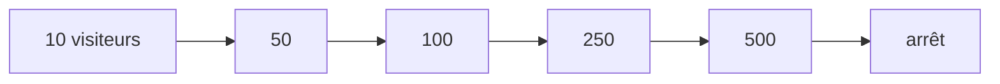

# Le test du visiteur anonyme

> 📍 **État au 2026-11-05.** Le script existe
> ([`dev-toolbox/charge/visiteur.js`](../../dev-toolbox/charge/visiteur.js)) et
> a passé un essai de fumée contre la production (3 visiteurs, 36 réponses sur
> 36 en 2xx). **Le test par paliers n'a jamais tourné.** La procédure générale,
> la formule et les seuils sont dans [`README.md`](README.md).

# Partie 1 — L'explication simple

## Ce qu'on teste

Des gens qui arrivent sur la boutique **sans se connecter**, regardent, et
repartent. C'est le test le plus simple, parce qu'il n'a besoin de rien :
ni compte, ni jeton, ni copie de la base, ni Stripe. Il **n'écrit rien** :
il lit des pages et demande des devis, qui se calculent sans s'enregistrer.

Il sert d'abord de **répétition générale** : vérifier sur un cas sans risque
que les paliers, l'arrêt automatique et la lecture des résultats marchent,
avant le test du pro connecté — celui qui touche vraiment la base.

## Comment se comportent les visiteurs

Chaque visiteur simulé tire au sort son comportement, et fait des pauses de
lecture au hasard entre deux gestes, comme un humain :

| Qui        | Part     | Ce qu'il fait                                                  |
| ---------- | -------- | -------------------------------------------------------------- |
| le curieux | 1 sur 2  | ouvre la boutique, regarde un rayon, part                      |
| le flâneur | 1 sur 3  | ouvre la boutique, parcourt 3 à 7 rayons, lit longuement       |
| l'hésitant | le reste | quelques rayons, puis 1 à 3 devis sur un panier tiré au hasard |

## Les paliers



Chaque palier monte en une minute, puis tient deux minutes : environ
**seize minutes** en tout. 500 visiteurs en même temps, c'est très au-delà de
ce que l'hypothèse de pointe prévoit (une quinzaine de clients simultanés,
[`README.md`](README.md)) : c'est voulu, on cherche où ça casse.

## Ce qu'on regarde à la fin

1. **Le ressenti** : 95 % des réponses arrivent-elles en moins d'1,5 s ?
2. **Le cache** : quelle part est servie par Cloudflare sans toucher l'API ?
   Elle devrait rester haute à tous les paliers.
3. **L'attente du processeur** (`st_queue`) : plate, puis qui décolle d'un
   coup — le palier où elle décolle est la limite du container.
4. **Les refus de débit** (`limited`) : voir la limite ci-dessous.

## La limite à connaître avant de lancer

Chaque route publique de l'API n'accepte que **60 appels par minute et par
adresse IP**. Lancé depuis un seul ordinateur, le test partage une seule
adresse : dès une cinquantaine de visiteurs, une partie des **devis** est
refusée (429). Ce que le cache Cloudflare sert n'est pas concerné, il ne
touche pas l'API.

Le script compte ces refus à part : ce n'est pas une panne, c'est la
protection qui travaille. Mais au-delà de ce seuil, le test mesure en partie
notre protection et non la plateforme. Deux façons d'en sortir, **non
décidées** : lever la limite pour une adresse le temps du test (un réglage de
sécurité, à écrire et à retirer), ou lancer depuis plusieurs machines.

## Ne jamais faire tomber la production

- **Hors des heures de commande**, et annoncé — même en pré-lancement.
- **Arrêt automatique** au-delà de 1 % d'échecs, de 5 erreurs serveur, ou
  d'une attente du processeur au-delà de 500 ms (p95).
- **Ctrl-C** arrête tout, à n'importe quel moment.
- Hors de l'ordinateur local, le script **refuse de partir** sans
  `LFD_PROD=oui`.

# Partie 2 — La partie technique

## Lancer

```bash
brew install k6
```

Un passage par comportement, pour vérifier que tout répond :

```bash
LFD_SMOKE=1 LFD_BASE_URL=https://lafoliecoffee.info/api/lfd LFD_SHOP_URL=https://lafoliecoffee.info LFD_PROD=oui k6 run dev-toolbox/charge/visiteur.js
```

Le test par paliers :

```bash
LFD_BASE_URL=https://lafoliecoffee.info/api/lfd LFD_SHOP_URL=https://lafoliecoffee.info LFD_PROD=oui k6 run dev-toolbox/charge/visiteur.js
```

| Variable       | Défaut                  | Rôle                                                                      |
| -------------- | ----------------------- | ------------------------------------------------------------------------- |
| `LFD_BASE_URL` | `http://localhost:3200` | l'API visée                                                               |
| `LFD_SHOP_URL` | vide                    | la boutique : si posée, la page `/boutique` est demandée au rendu serveur |
| `LFD_STAGES`   | `10,50,100,250,500`     | les paliers, en visiteurs simultanés                                      |
| `LFD_STEP`     | `2m`                    | la durée d'un plateau                                                     |
| `LFD_SMOKE`    | —                       | `1` : trois visiteurs, un passage chacun, pauses courtes                  |
| `LFD_PROD`     | —                       | `oui` : obligatoire hors `localhost` / `127.0.0.1`                        |

## Ce que le script appelle

Lues dans les contrôleurs `@Public()` le 2026-11-05.

- **L'ouverture** (`landing`), en une rafale parallèle comme le navigateur :
  `GET /shop/copy?locale=fr`, `/feature-access`, `/content/footer`,
  `/order-opening`, `/delivery-zones`, `/delivery-availability`,
  `/pickup-addresses`, `/shop/catalogue`, `/shop/storefront/all`.
- **Un rayon** : `GET /shop/storefront/<id>`, l'identifiant tiré parmi les
  familles que `GET /shop/catalogue` rend au démarrage (`setup`).
- **Un devis** : `POST /shop/quote`, 1 à 6 lignes tirées parmi les SKU du
  catalogue, en retrait (`pickupAddressId: null`) ou en livraison sur un code
  postal tiré parmi `73150`, `73320`, `73000`, `75001` (le dernier hors zone).

Les suggestions publiques (`/shop/suggestions/*`) ne sont pas appelées : leur
corps n'a pas été relu.

## Les métriques

| Métrique                                  | Source                     | Lecture                                                           |
| ----------------------------------------- | -------------------------- | ----------------------------------------------------------------- |
| `http_req_duration`                       | k6                         | le ressenti, vu du client ; seuil p95 < 1,5 s                     |
| `http_req_failed`                         | k6                         | les échecs ; les 429 n'y sont **pas** (déclarés attendus)         |
| `edge_hit`                                | en-tête `Cf-Cache-Status`  | la part servie par le cache Cloudflare                            |
| `limited`                                 | statut 429                 | les refus de la limite de débit, par route                        |
| `server_errors`                           | statut ≥ 500               | les pannes ; 5 arrêtent le test                                   |
| `st_app`                                  | `Server-Timing` de l'API   | Nest et la base                                                   |
| `st_queue`                                | `container − app`          | l'attente du demi-vCPU ; p95 > 500 ms arrête le test              |
| `st_container`, `st_worker`, `st_gateway` | `Server-Timing` des étages | les sauts Cloudflare ; ils ne devraient pas bouger avec la charge |

Chaque métrique porte l'étiquette `route` (`catalogue`, `storefront`,
`quote`…) : `k6 run --summary-trend-stats` ou une sortie JSON
(`--out json=resultats.json`) la découpe route par route.

🔴 **Une réponse servie du cache n'entre pas dans les `st_*`.** Cloudflare
garde l'en-tête `Server-Timing` avec la réponse : un `HIT` porte les marques
du calcul d'ORIGINE, vieilles de jusqu'à trente secondes. Les compter
mesurerait une requête passée. Le premier essai de fumée les comptait encore,
et la moyenne de `st_queue` y valait le double de celle de l'essai corrigé.

## L'arrêt automatique

Écrit dans `options.thresholds` du script :

- `http_req_failed` > 1 %, évalué après 30 s ;
- `server_errors` ≥ 5 ;
- `st_queue` p95 > 500 ms, évalué après 1 min.

Les trois portent `abortOnFail` : k6 coupe tout le test, pas seulement le
palier.

## Ce qui n'est pas vérifié

- Le débit réel qu'un seul poste peut tenir à 500 visiteurs : k6 lui-même peut
  saturer la machine ou sa connexion avant l'API.
- Que la limite de débit de l'API soit la seule en amont : Cloudflare peut
  appliquer ses propres protections contre un trafic venu d'une seule adresse.
- La part exacte des devis refusés à chaque palier : à lire au premier vrai
  passage.
