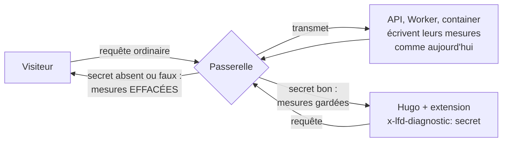

# Plan — les mesures de chaque réponse, visibles par Hugo seul

> 📝 Plan du 2026-11-14, décidé avec Hugo : **un en-tête secret**, vérifié par la
> passerelle. Il ferme [`todo-server-timing-public.md`](todo-server-timing-public.md).
> Bâti le 2026-11-14 (`gateway/src/diagnostic.ts`) ; reste la mise en service (§ 3.5). Le test de la 101 n'existe pas : Node refuse de fabriquer une réponse 101.

## 1. En très simple

Aujourd'hui, chaque réponse dit à **tout le monde** comment elle a été
fabriquée (`Server-Timing`, et `X-Shelf-Cache` sur le rayon public).
Demain, **seul celui qui montre le bon mot de passe** les verra.

- Hugo crée le secret lui-même (`wrangler secret put`). Il n'est jamais dans le
  code et n'est jamais transmis plus loin que la passerelle. Les journaux et
  traces Cloudflare de la passerelle, privés au compte, **peuvent** garder les
  en-têtes de la requête (non vérifié) : le secret se change alors d'une
  commande, et c'est un risque assumé (il n'ouvre que des durées).
- Hugo l'envoie avec une extension de navigateur (ModHeader ou équivalente),
  allumée seulement quand il mesure.
- **Un seul endroit change : la passerelle.** L'API, le Worker et le container
  continuent d'écrire leurs mesures ; c'est la sortie qui trie.

## 2. Pourquoi la sortie, et pas l'entrée

Trier à la sortie est le seul tri qui tient **même pour une réponse venue du
cache** : un rayon public gardé 30 s porte les mesures de la requête qui l'a
rempli ; si un diagnostic l'avait rempli, un visiteur la recevrait ensuite
telle quelle. La passerelle est devant tous les caches de l'API (Workers Cache
vit dans le Worker de l'API, derrière elle), donc rien ne la contourne.

Rien ne contourne non plus la passerelle : le Worker de l'API et le
planificateur ont `workers_dev: false` et aucune route
(`apps/lfd-api/wrangler.jsonc:146`, `apps/lfd-route-planner/wrangler.jsonc:54`,
vérifié le 2026-11-14) ; il n'est joint que par le service binding
`LFD_BACKEND` (`gateway/wrangler.toml`).

## 3. Technique

### 3.1 Dans `gateway/src/`

- Nouveau fichier `diagnostic.ts`, fonctions pures et testées :
  - `isDiagnostic(request, secret)` — vrai seulement si `secret` est défini et
    non vide **et** que `x-lfd-diagnostic` lui est égal, comparé en temps
    constant : les deux valeurs sont hachées (SHA-256) puis les condensats
    comparés octet par octet sans s'arrêter à la première différence (`sameBytes` ; `timingSafeEqual` n'existe pas sous Node, où tournent les tests) — même longueur toujours, rien
    ne fuit de la longueur du secret, aucune exception. Secret absent de l'environnement ⇒ **toujours faux**
    (fermé par défaut, y compris en `wrangler dev` sans `.dev.vars`).
  - `withoutDiagnosticHeaders(response)` — refait la réponse (en-têtes
    immuables d'un `fetch`, même corps en flux) sans `Server-Timing` ni
    `X-Shelf-Cache`.
- `index.ts`, dans `fetch`, **autour de `handle`** — un seul point de tri,
  qui couvre toutes les sorties (amont, `guardTarget` et ses 401/429/204,
  `gatewayFault`, redirections) :
  - la requête d'origine **perd** `x-lfd-diagnostic` avant toute branche
    (cibles `backend`, `front` et `url`) : le secret ne quitte jamais la
    passerelle ;
  - pas un diagnostic : `withoutDiagnosticHeaders` ; s'il levait, la sortie
    est une 502 de la passerelle, jamais la réponse non triée ;
  - diagnostic : mesures gardées, et `Cache-Control: private, no-store` pour
    qu'aucun cache en aval ne garde une copie mesurée ;
  - une réponse 101 (WebSocket, HMR de dev) passe **telle quelle** : elle ne
    porte pas de mesures, et la refaire pourrait perdre le `webSocket`.
- `Env` gagne `DIAGNOSTIC_SECRET?: string`.

### 3.2 Ce qui ne bouge pas

- `apps/lfd-api/src/platform/metrics/server-timing.ts`,
  `apps/lfd-api/container/server-timing.ts`, `public-shelf-cache-headers.ts` :
  inchangés. Ils écrivent toujours ; la passerelle efface.
- Aucun front ne lit ces en-têtes (recherche dans les deux `src/` le
  2026-11-14 : aucun).
- Les traces Cloudflare (privées au compte) restent le suivi dans le temps.

### 3.3 Limite assumée

Sur un succès du cache du rayon public, les marques de l'API sont celles de la
requête qui a rempli le cache, pas de celle-ci. `X-Shelf-Cache` et la marque
`worker` disent le succès ; c'est suffisant pour lire, et c'est déjà vrai
aujourd'hui.

L'extension ajoute un en-tête non simple : chaque appel d'un front vers l'API
paie alors un pré-vol `OPTIONS` (gardé 2 h par URL, `main.ts:79`). Lire les
marques **du serveur** (`app`, `worker`, `gateway`), pas le temps total du
navigateur, ou recharger une fois avant de mesurer.

### 3.4 Tests (`gateway/src/__tests__/diagnostic.spec.ts`)

1. secret absent de l'environnement + en-tête quelconque ⇒ mesures effacées ;
2. secret défini, en-tête absent ⇒ effacées ;
3. en-tête faux, de même longueur et de longueur différente ⇒ effacées, sans
   exception ;
4. en-tête juste ⇒ `Server-Timing` et `X-Shelf-Cache` gardés, `gateway`
   ajouté, `Cache-Control: private, no-store` ;
5. la requête transmise ne porte jamais `x-lfd-diagnostic`, pour les trois
   sortes de cible ;
6. une 101 passe telle quelle ;
7. corps, statut et autres en-têtes (`cache-control`, `set-cookie`)
   intacts après effacement ;
8. une `gatewayFault` sans secret ne porte pas de mesures.

### 3.5 Mise en service

1. Bâtir, tests, push `dev`.
2. **Hugo** pose le secret sur la passerelle (secret GitHub `DIAGNOSTIC_SECRET`, recopié sur la passerelle à chaque déploiement par `deploy_lfd_gateway.yml`) — avant ou après le déploiement : sans lui, tout est
   effacé, ce qui est sûr.
3. Contrôle : un `curl -sI` sans en-tête ne montre plus `Server-Timing` ;
   Hugo vérifie avec son extension qu'il les voit.
4. `carte-des-caches.md` § 6 et `qui-est-le-client.md` disent comment lire les
   mesures (l'extension) ; le todo est supprimé.
