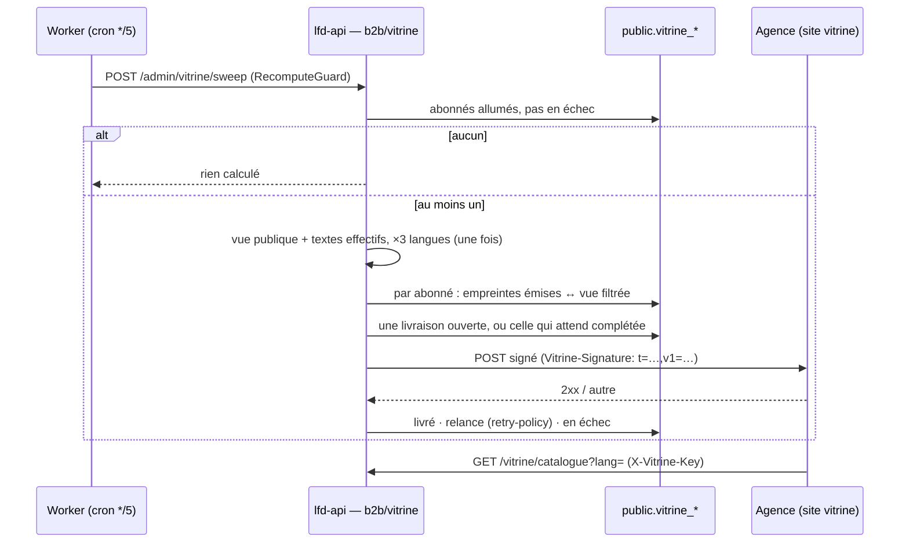

# Plan — le webhook de la vitrine (lot W)

> ✅ **Bâti le 2026-10-18** (non commité à l'écriture de ces lignes) — l'état
> de ce qui existe est au **§7**, avec ce qui reste. Les §0 à §6 sont la trace
> de la conception : le §5 (décisions de Hugo) et le §4 (contradiction de
> `vitruve`) y priment sur le §2, et le §7 dit où le code s'en écarte.
> Décidé le 2026-10-15, contredit par `vitruve` le 2026-10-15 puis le
> 2026-10-18 ; lot préalable des langues bâti le 2026-10-18 (§6).

## 0. La demande

L'agence web qui fait le **site vitrine** doit recevoir, au fur et à mesure,
ce que nos bureaux changent au catalogue publié : contenus, tarifs publics,
offres, textes, médias — et pouvoir **cocher / décocher** ce qu'elle reçoit.
Webhook **léger** : il prévient, l'agence relit.

## 1. Ce qui a changé depuis le 2026-10-15 (relu le 2026-10-18)

| Changement                                                                                                     | Effet sur le lot W                                                                                                                                                                                                                                                                |
| -------------------------------------------------------------------------------------------------------------- | --------------------------------------------------------------------------------------------------------------------------------------------------------------------------------------------------------------------------------------------------------------------------------- |
| Les interrupteurs du catalogue sont retirés, les faits du référentiel vivent en continu (X0–X5, le 2026-10-17) | La condition « W ne voit des changements en continu qu'après la bascule 2b » est **levée** : le catalogue publié change en continu, et l'empreinte (W3′) les voit.                                                                                                                |
| La mise en avant est **par audience** et s'affiche « Incontournable » (2026-10-18)                             | La vue publique porte `isFeatured` pour le **public** seulement (`prisma-catalog.reader.ts`, `featuredFor`) : la vitrine reçoit la mise en avant publique, jamais celle des pros. Le libellé est un texte de la boutique (`product.bestSeller`), donc dans `GET /vitrine/textes`. |
| Les **suggestions** du staff et calculées existent (2026-10-18)                                                | **Hors du lot W** : elles dépendent d'un panier ou d'un client. Ne sortent pas.                                                                                                                                                                                                   |
| Le chiffreur de champs vit à `apps/lfd-api/src/platform/crypto/aes-gcm-field-cipher.ts`                        | Le §2 citait le bon nom de fichier, sans chemin.                                                                                                                                                                                                                                  |
| Le cron `*/5` existe toujours (`apps/lfd-api/container/worker.ts:472`, `KEEP_WARM_CRON`)                       | Le battement de W3′ est disponible.                                                                                                                                                                                                                                               |
| La politique de relance de l'outbox existe (`apps/lfd-api/src/platform/outbox/retry-policy.ts`)                | W2′ la reprend.                                                                                                                                                                                                                                                                   |

La vue que la vitrine lirait est `ShopCatalogueView` (`packages/contracts/src/shop-catalogue.ts:301` :
`shelves`, `items`, `operations`), celle de `GET /shop/catalogue`, publique.

## 2. Le lot W tel que décidé et contredit le 2026-10-15

> « L'agence web qui produit le site vitrine a besoin d'avoir l'update des
> contenus et tarifs et offres, textes, médias, au fur et à mesure que nos
> bureaux updatent le catalogue » ; « pouvoir cocher/décocher son contenu en
> admin ». Puis : webhook **léger** ; les formules plus tard. — Hugo, 2026-10-15

Ouvert avant d'écrire : `b2b/catalog/http/shop-catalogue.controller.ts` — la
boutique publique a **déjà** sa lecture anonyme, `GET /shop/catalogue`,
résolue à `companyId: null` : prix publics, promotions publiques comprises,
mercuriale exclue. La vitrine lit **la même chose**, pas une seconde
projection.

**Principe : notifier, puis laisser relire.** Le webhook ne transporte qu'un
signal ; le contenu ne circule que par une lecture que nous servons.

| #   | Quoi                                                                                                                                                                                                                                                                                                                                                                                                                           |
| --- | ------------------------------------------------------------------------------------------------------------------------------------------------------------------------------------------------------------------------------------------------------------------------------------------------------------------------------------------------------------------------------------------------------------------------------ |
| W1  | **Ce qui sort, par construction** : la vue publique de la boutique (`ReadShopCatalogueQuery`), rien d'autre. Ni prix pro, ni mercuriale, ni palier, ni client, ni article d'audience `pro`, ni article masqué au public. Aucune case à cocher ne peut l'élargir : les cases ne font que **retirer** des familles de contenu.                                                                                                   |
| W2  | **Abonnés** (plusieurs prévus dès le départ) : `public.vitrine_subscribers` — nom, URL, secret de signature (scellé au repos comme les IBAN, `FIELD_ENCRYPTION_KEY`), clé de lecture, actif, et les familles de contenu reçues : `catalogue`, `operations`, `promotions`, `textes`, `photos`. Écran dans **Gestion Boutique** ; le secret ne s'affiche qu'une fois, à la création ou à la rotation.                            |
| W3  | **Les événements** : un `@DurableHandler` sur la plateforme écoute ce qui change la vue publique — fait fiche et fait famille (lot 2a), opérations reçues, décisions de prix et masquage de la plateforme, règles de prix publiques (promotions), textes de la boutique (`ShopCopyPublication`), visuels (`product_media_changed`). Il écrit, par abonné intéressé, une notification `{ type, id, version }` en boîte d'envoi. |
| W4  | **🔴 Le temps change aussi la vitrine** : une promotion qui commence à minuit change un prix public **sans aucune écriture**. Un passage planifié émet une notification à chaque borne de fenêtre (début et fin de promotion, d'opération, de limite) qui touche la vue publique.                                                                                                                                              |
| W5  | **L'envoi** : `POST` vers l'URL de l'abonné, corps `{ type, id, version, at }`, en-tête de signature HMAC-SHA256 du corps avec horodatage (rejeu refusable par l'agence) ; relances avec délai croissant, puis lettre morte visible. Plusieurs changements de la même fiche dans une courte fenêtre (proposé : 10 s) partent en **une** notification, de la version la plus haute.                                             |
| W6  | **La lecture de l'agence** : `GET /vitrine/catalogue` (tout, pour la première synchronisation et les rattrapages) et `GET /vitrine/produits/:id`, protégées par la clé de lecture de l'abonné (pas un compte staff ni client), passant par la passerelle, limitées en débit ; filtrées selon les cases de l'abonné. Photos en URL publiques Cloudflare, aux tailles déjà servies.                                              |
| W7  | **Le journal des envois** : livré, en échec, en attente ; « renvoyer » une notification ; « tout renvoyer » (une notification par fiche, pour resynchroniser).                                                                                                                                                                                                                                                                 |

**Refondu après `vitruve` (2026-10-15), et c'est ce bloc qui fait foi :**

Quatre BLOQUANT ont le même fond : W3 supposait des faits durables là où il
n'y en a pas (règles de prix, textes, décisions et masquages, vitrine — seuls
`orders/` et `accounting/` publient dans `b2b/`), et la boîte d'envoi ne sait
pas livrer à des abonnés qui sont des lignes en base (`durable-handler.ts:13,41`).
Plutôt que d'ajouter des faits dans cinq contextes, **on compare la vue au
lieu d'écouter ses causes** :

- **W3′ — une empreinte, pas des écouteurs.** À chaque balayage, pour chaque
  abonné actif, le serveur calcule sa vue filtrée (la vue publique, moins les
  familles décochées) et une empreinte **par élément** : article par `sku`,
  opération par `key`, rayon par `id`, texte par clé. Il compare à la dernière
  empreinte **livrée** et notifie ce qui a changé. Ça attrape **toutes** les
  causes — PIM, décisions de la plateforme, promotions, textes — et les
  bornes de temps (W4) sans mécanisme de plus : une promotion qui commence
  change l'empreinte du prix.
- **Le rythme** : le seul battement de l'API est le cron `*/5` du Worker
  (`KEEP_WARM_CRON`). Une route de balayage `RecomputeGuard` s'y ajoute :
  **l'agence est prévenue en 5 minutes au plus**. La coalescence est
  naturelle — dix enregistrements en cinq minutes font une notification.
- **La notification** : `{ subscriber, sequence, at, changed: { items: [sku…],
operations: [key…], shelves: [id…], texts: [clé…] }, removed: {…} }`.
  `sequence` est un compteur par abonné, croissant ; il n'existe pas d'autre
  version commune à toutes les sources.
- **W2′ — une boîte à elle** : `public.vitrine_deliveries` (abonné, séquence,
  corps, état, essais, prochain essai) et un relais HTTP sortant à part de
  l'outbox. Il **reprend la politique de relance** de `platform/outbox/retry-policy.ts`
  (même fonction, pas une copie), et ses lettres mortes s'affichent dans le
  journal des envois de l'écran, pas dans celui de l'outbox.
- **W1′ — ce qui sort, borné** : la vue `ShopCatalogueView` (`shelves`,
  `items`, `operations`) **et** les textes **publiés** de la boutique
  (`ShopCopyPublication`, seconde lecture nommée : `GET /vitrine/textes`).
  Rien d'autre ; le contenu des pages `storefront` attendra une décision.
  ⚠️ **Non vérifié, à prouver par test au lot** : que `listSellable("public")`
  exclut l'audience `pro` et les masqués au public, et que
  `catalogPriceMillicents` n'est jamais un tarif pro.
- **Identifiants** : `sku` pour un article, `key` pour une opération, `id`
  pour un rayon. `GET /vitrine/articles/:sku`, `GET /vitrine/catalogue`,
  `GET /vitrine/textes`.

Sérieux intégrés :

- **La clé de lecture n'est pas un gardien** : la vue est déjà publique
  (`GET /shop/catalogue`, `@Public()`). La clé **identifie** l'abonné et
  applique ses cases ; elle est rangée **hachée** (SHA-256), montrée une fois.
- **Le secret de signature est chiffré** (`aes-gcm-field-cipher.ts`), pas
  haché : il faut le relire pour signer. ⚠️ Une rotation de
  `FIELD_ENCRYPTION_KEY` le rend illisible — comme les liens d'annulation
  (`app-config.ts:162`) : la rotation impose de régénérer les secrets
  d'abonnés, et le runbook le dit.
- **SSRF** : l'URL d'un abonné est `https` seulement ; le relais refuse au
  moment de l'envoi (après résolution DNS) toute adresse privée, de bouclage,
  de lien local ou de métadonnées, et ne suit pas les redirections.
- **La passerelle** : `/vitrine/*` est déclarée explicitement dans
  `gateway/src/routes.ts` plutôt que de passer par le préfixe générique ; le
  débit est limité **par clé d'abonné**, pas seulement par IP.
- **Droits** : une ressource `shop_vitrine` (lecture/écriture), routes sous
  `/admin/vitrine/*`, écran en Gestion Boutique. La migration ajoute la
  ressource ; **Hugo l'accorde à l'écran** (`lint:no-role-grants-in-migrations`).
- **RGPD** : rien de personnel ne sort. L'abonné est une organisation (nom,
  URL) ; aucun contact nominatif n'est rangé.
- **Photos** : les URL de la vue sont des variantes Cloudflare Images ; leur
  stabilité pour un tiers qui les met en cache est vérifiée au lot.

**L'audience sort aussi (Hugo, 2026-10-15, option a)** : chaque article
livré à la vitrine porte son audience — `public` ou `both` —, pour que le
site puisse dire « aussi pour les professionnels ». Les articles réservés aux
pros **ne sortent pas** : la vue reste celle d'un particulier.

**Ordre** : W se bâtit après 2a (il en écoute les faits) ; il ne voit des
changements en continu qu'après la bascule 2b. Avant, une notification par
push accepté suffit. Frontière de sécurité (données vers un tiers, une clé de
lecture, un secret de signature) : **`vitruve` avant de bâtir**.

**Plus tard** : les formules (Hugo, 2026-10-15 — « on verra ça plus tard »).

## 3. Questions encore ouvertes

1. **Les familles de contenu cochables** : `catalogue`, `operations`,
   `promotions`, `textes`, `photos` (W2) — est-ce toujours la liste ? Les
   « Incontournables » (mise en avant publique) en font-ils une à part ?
2. **Les pages `storefront`** (vitrine éditoriale de la boutique) : toujours
   « attendront une décision » (W1′) ?
3. **Un seul abonné aujourd'hui** (l'agence) : l'écran multi-abonnés reste-t-il
   dans le premier lot, ou un abonné réglé à la main suffit-il pour démarrer ?
4. **L'agence a-t-elle une préférence** de format (signature, en-têtes,
   délai) ? À lui demander avant de figer W5.

## 4. Contradiction de `vitruve` (2026-10-18), qui prime sur le §2

Le §2 reste lisible pour la trace, mais **ce §4 fait foi** là où il le
contredit. En particulier, la phrase du §2 « W se bâtit après 2a (il en
écoute les faits) … une notification par push accepté suffit » est
**périmée** : W3′ n'écoute rien, il compare des empreintes.

**Ce que la vitrine recevrait réellement** (vérifié dans le code le
2026-10-18) — par article : `sku`, `name`, `note`, `image` et `thumbnail`
(url, alt, dimensions, point focal), `unitPriceMillicents` (HT public résolu),
`unitPriceTtcCents`, `catalogPriceMillicents` (l'étiquette avant promotion,
présente seulement si une promotion baisse le prix), `vatRatePercent`,
`shelfId`, `isFeatured` (mise en avant **publique**), `operation` ; et les
opérations publiques. Sont exclus par construction : l'audience `pro`, les
masqués au public, les arrivées non validées (`servedTo`), le prix pro, la
mise en avant pro, les opérations réservées aux pros. Un test devra
l'éprouver **sur la route `/vitrine` elle-même**.

| #   | Objection                                                                                                                                                                                                                              | Proposition                                                                                                                                                                                                                                                                                                                           |
| --- | -------------------------------------------------------------------------------------------------------------------------------------------------------------------------------------------------------------------------------------- | ------------------------------------------------------------------------------------------------------------------------------------------------------------------------------------------------------------------------------------------------------------------------------------------------------------------------------------- |
| B1  | **L'audience ne sort pas de la vue publique** : `ShopItemView` n'a pas de champ d'audience, et l'e2e de la boutique fige ses clés.                                                                                                     | **Q5 à Hugo** : (a) ajouter l'audience (`public` / `both`) à la vue publique, que la boutique exposerait aussi — sans risque, c'est l'information « aussi pour les professionnels » ; ou (b) renoncer à la faire sortir. Recommandation : **(a)**.                                                                                    |
| B2  | **« Décocher les promotions » ne retire rien** : la promotion est déjà dans le prix ; l'enlever demande un second chemin de prix. Même chose pour les photos (réécrire des champs).                                                    | **Retirer les cases `promotions` et `photos`.** Les cases restantes retirent des **ensembles** entiers : `catalogue` (articles et rayons), `operations`, `textes`. Le prix sort toujours tel que le client le paie, avec l'étiquette d'avant promotion quand il y en a une.                                                           |
| B3  | **Une agence en panne fait diverger le balayage sans fin** (une livraison toutes les 5 min, 10 essais chacune, puis plus rien n'avance).                                                                                               | Comparer à la dernière empreinte **émise** (table `vitrine_fingerprints`, une ligne par abonné et par élément) ; **une seule livraison en vol** par abonné (la suivante remplace celle en attente) ; après les relances, l'abonné passe **« en échec »** visible à l'écran, plus rien ne part ; à la reprise, « tout renvoyer » (W7). |
| S1  | **Les textes non modifiés n'arrivent pas** : `shop/copy` ne sert que les remplacements publiés ; les textes par défaut vivent dans les dictionnaires du front.                                                                         | `GET /vitrine/textes` sert **le texte effectif** de chaque clé : le publié s'il existe, sinon le défaut — la copie du manifeste que `pnpm copy:digest` dépose déjà côté API. À vérifier au lot.                                                                                                                                       |
| S2  | **SSRF par rebinding DNS** si l'on vérifie l'adresse puis qu'on reconnecte ; pas de délai ni de taille de réponse bornés.                                                                                                              | Un adaptateur sortant dans `platform/` qui **épingle l'adresse vérifiée** pour la connexion, `https` seul, sans redirection, délai court (5 s) et réponse lue bornée (quelques ko).                                                                                                                                                   |
| S3  | **Coût** : la vue complète ne dépend pas de l'abonné.                                                                                                                                                                                  | Calculer la vue **une fois par balayage**, puis filtrer par abonné ; **aucun calcul** sans abonné actif.                                                                                                                                                                                                                              |
| S4  | **La passerelle route par déployable**, pas par chemin ; une limite « par clé » à l'edge s'esquive en changeant de clé.                                                                                                                | Pas de route dédiée à la passerelle : `/vitrine/*` passe par `/api/lfd` comme le reste ; la limite de débit est un `@Throttle` côté API, par IP. La vue étant publique, la clé **identifie** l'abonné, elle ne protège rien.                                                                                                          |
| S5  | **Le contrat devient celui d'un tiers dès le premier envoi** (corps, signature, identifiants).                                                                                                                                         | La question 4 (préférences de l'agence) se tranche **avant** de bâtir l'envoi, pas pendant.                                                                                                                                                                                                                                           |
| M1  | Détails : `/vitrine/produits/:id` contre `/vitrine/articles/:sku` ; `ShopCopyPublication` n'est pas un nom du code ; une URL d'abonné avec un jeton en query serait affichée ; décocher une famille déclenche-t-il un retrait massif ? | Route retenue : `/vitrine/articles/:sku`. URL d'abonné **sans query string** (refusée à la saisie). Décocher une famille : **aucune** notification de retrait ; l'agence relit le catalogue complet si elle le souhaite. Le JSDoc de `catalogPriceMillicents` (« tarif catalogue pro ») est à corriger au lot.                        |

**Non vérifié, à éprouver au lot** : le comportement du moteur de prix à
`companyId: null` sur les règles « toute audience » ; la stabilité des URL
d'images pour un tiers qui les garde en cache ; la **langue** de `name` et
`note` (la vue publique n'a pas de paramètre de langue — l'agence recevra le
français ; ⚠️ **périmé le 2026-10-18** : `?lang=` existe, cf. §6) ; la durée réelle d'un balayage sous le cron du Worker.

### Questions à Hugo, mises à jour

1. **Les cases** : `catalogue`, `operations`, `textes` seulement (B2) ?
2. **Les pages éditoriales de la boutique** : hors du webhook pour l'instant ?
3. **Un seul abonné réglé à la main** pour démarrer, ou l'écran multi-abonnés
   dès le premier lot ?
4. **L'agence** : ses préférences de format, **avant** de bâtir l'envoi (S5).
5. **L'audience** dans la vue publique (B1) : (a) ou (b) ?
6. **Les langues** : l'agence a-t-elle besoin de l'anglais et de l'italien des
   fiches ? (Le référentiel a des noms traduits ; la vue publique ne sert que
   le français.)

## 5. Décisions de Hugo (2026-10-18), qui priment

1. **Les cases** : `catalogue`, `operations`, `textes` **et** `incontournables`
   (la mise en avant publique : sans elle, `isFeatured` ne sort pas).
2. **Les pages éditoriales** (les pages composées de la boutique —
   `apps/lfd-api/src/b2b/storefront/`, Gestion Boutique › Vitrine : blocs,
   images et annonces placés à la main au-dessus des rayons) : **hors du
   webhook** (Hugo, 2026-10-18) — l'agence compose son site à partir des
   articles.
3. **L'écran multi-abonnés dès le premier lot** (corrigé par Hugo le
   2026-10-18 : « non, directement une page multi-abonnés ») : Gestion
   Boutique, liste des abonnés, création, cases, rotation du secret et de la
   clé, journal des envois.
4. **Format : JSON, et XML depuis le 2026-10-18.** ~~L'agence accepte aussi
   XML ; on ne sert que du JSON tant qu'elle n'en a pas besoin.~~ Corrigé le
   2026-10-18 (Hugo : « servir la vitrine en XML ») : les trois lectures
   `/vitrine/*` servent la même ressource en XML sur `Accept: application/xml`
   ou `?format=xml` (`json` par défaut, toute autre valeur en 400
   `http.payload.invalid`), décrite par `GET /vitrine/schema.xsd`. Le XSD et
   le sérialiseur sont dérivés des mêmes formes, typées contre le contrat
   (`apps/lfd-api/src/b2b/vitrine/http/xml/`). Les notifications restent en
   JSON. Le même jour : une livraison qui absorbe de nouveaux changements
   repart sous un `Vitrine-Delivery` NEUF (colonne `dispatch_id`), pour
   qu'une agence qui écarte les doublons par lui ne perde pas les ajouts.
5. **L'audience sort** (option a de B1) : elle est ajoutée à la vue publique,
   que la boutique expose aussi.
6. **Le prix sort tel qu'il est aujourd'hui**, promotions comprises (B2) ; il
   n'y a pas de case `promotions`.
7. **Les trois langues** (fr, en, it) : la vitrine sert les noms et les notes
   dans les trois langues. À bâtir : la vue publique ne sert aujourd'hui que le
   français ; il faut lire ce que le commerce reçoit du référentiel en langues
   et, si les traductions ne descendent pas, les faire descendre (lot à part,
   avant W).

## 6. Les langues — ce qui a été lu, et le lot préalable bâti (2026-10-18)

Lot à part, avant W (décision 7 du §5) : faire descendre les traductions du
référentiel jusqu'à la vue publique. **Bâti le 2026-10-18** ; ce qui suit dit
d'abord l'état lu AVANT le lot (fichiers au commit `ccfa6b53f`), puis ce qui a
été fait.

### 6.1 Ce qui a été lu (au commit `ccfa6b53f`)

| Où                                                | Ce qui s'y trouvait                                                                                                                                                                                                                                                                                                                                                                                                              |
| ------------------------------------------------- | -------------------------------------------------------------------------------------------------------------------------------------------------------------------------------------------------------------------------------------------------------------------------------------------------------------------------------------------------------------------------------------------------------------------------------- |
| Le référentiel                                    | Tout est `LocalizedText` (`{ fr, en?, it? }`, `packages/pim-contracts/src/shared.ts:15-37`) : le nom de la fiche (`apps/lfd-api/src/pim/catalogue/product/domain/entities/product.ts:52`), celui de la déclinaison (`entities/variant.ts:101`), celui de la famille (`catalogue/shared/domain/ports/catalog-facts.reader.ts:15`), la ligne courte (`descriptionShort`, `catalogue/product/domain/ports/editorial-reader.ts:16`). |
| Les faits (`pim/channels/b2b-platform/products/`) | **Tout aplati en français.** Famille : `name: family.name.fr` (`catalog-facts.ts:112`). Fiche : `name: product.name.fr` (`:158`), `note: showcase?.note` (`:161`), elle-même `descriptionShort?.[SOURCE_LOCALE]` (`showcase.ts:50`). Déclinaison : `name: frenchOf(variant.name)` (`projection.ts:89`). Les schémas du fil le disent (`packages/catalog-sync/src/snapshot.ts:34-37`, `:366`, `:384`).                            |
| Le récepteur du commerce                          | Recopie ces chaînes : `name: variant.name`, `note: product.note` (`apps/lfd-api/src/b2b/catalog/application/handlers/catalog-fact-mapping.ts:37`, `:50`), `name: family.name` (`:72`).                                                                                                                                                                                                                                           |
| Ce que le commerce range                          | Une colonne texte, française : `catalog_categories.name`, `catalog_items.name`, `catalog_items.note` (`apps/lfd-api/prisma/schema/public/catalog.prisma:90`, `:140`, `:239`).                                                                                                                                                                                                                                                    |
| `GET /shop/catalogue`                             | `ShopItemView.name` / `note` et `ShopShelfView.name` sont des chaînes, recopiées (`apps/lfd-api/src/b2b/catalog/application/shop-catalogue-view.ts:65-66`, `:103`). Aucun paramètre de langue.                                                                                                                                                                                                                                   |
| Les opérations                                    | **Déjà localisées** : `ShopOperationView.name` / `lede` sont des `ShopOperationText` `{ fr, en?, it? }` (`packages/contracts/src/shop-catalogue.ts:182`, `:200`), saisies au commerce. Rien à faire.                                                                                                                                                                                                                             |
| Les textes de la boutique                         | Déjà en trois langues : dictionnaires `apps/lfc-ecommerce-frontend/src/app/client/copy/fr.ts`, `en.ts`, `it.ts`, et les remplacements publiés de `shop/copy`. Rien à faire ici ; c'est `GET /vitrine/textes` (W1′, S1) qui les servira.                                                                                                                                                                                          |

**Conclusion lue** : les traductions existaient au référentiel et ne
descendaient pas ; le commerce ne savait que le français.

### 6.2 Ce qui a été bâti

- **Les faits portent les traductions**, dans des champs ajoutés, la source
  restant dans `name` / `note` : `nameTranslations` sur chaque déclinaison et
  sur la famille, `noteTranslations` sur la fiche — `{ en?, it? }`
  (`apps/lfd-api/src/pim/channels/b2b-platform/products/translations.ts:24`,
  `catalog-facts.ts:129`, `:179`, `:218`). **Un fait d'avant le lot reste
  lisible** : le champ absent se lit `null`, « on ne sait pas »
  (`translations.ts:47`, `catalog-product-changed.fact.ts:37-38`,
  `catalog-category-changed.fact.ts:24`). Une langue inconnue ou le français
  y sont refusés.
- **Le commerce les range** dans trois colonnes `jsonb` nullables, par une
  migration additive (`20261018220000_les_langues_du_catalogue`) :
  `catalog_items.name_translations`, `note_translations`,
  `catalog_categories.name_translations`. Écrites par le seul récepteur
  (`prisma-catalog-product-facts.projection.ts:84`, `:115-116` ;
  `prisma-catalog-family-facts.projection.ts:26`). Frontière tenue : le
  commerce lit un fait du canal, jamais la base du référentiel.
- **La vue publique les sert par un paramètre** : `GET /shop/catalogue?lang=en`
  (`fr` par défaut, `de` refusé en 400) rend `name`, `note` et le nom des
  rayons dans la langue demandée, **en français texte par texte** quand le
  référentiel n'a pas traduit (`inLanguage`,
  `apps/lfd-api/src/b2b/catalog/domain/catalog-translations.ts:33-52` ;
  `inShopLanguage`, `application/shop-catalogue-view.ts:98`). Appliquée après
  le prix : rien de ce qui se range, se vend ou se tarife ne dépend de la
  langue.
- **Pourquoi un paramètre et pas des champs traduits en plus** : la forme de
  la vue ne change pas (l'e2e qui fige les clés n'a gagné que `audience`) ;
  la boutique déployée, qui n'envoie rien, lit exactement la même chose ; elle
  ne téléchargera que la langue qu'elle affiche quand elle la demandera. Le
  prix pour W : **trois lectures** au lieu d'une pour un balayage, ou une
  composition à trois langues du même calcul — à trancher au lot W, sans
  changer la vue.
- **L'audience sort** (décision 5) : `ShopItemView.audience`
  (`packages/contracts/src/shop-catalogue.ts:194`), `public` ou `both` sur la
  route publique ; la boutique la reçoit aussi. Le JSDoc de
  `catalogPriceMillicents` dit désormais « l'étiquette publique » sur la route
  publique (M1).

**Le passé** : les lignes existantes restent à `NULL` et servent le français.
Un **« tout réémettre »** (`POST /pim/channels/b2b/reemit`, le bouton de
l'écran des canaux) les remplit — à lancer une fois le lot déployé.

### 6.3 Ce qui reste, pour W ou après

- **La boutique ne demande pas encore sa langue.** `ShopCatalogueStore` ne
  recharge qu'à un changement de lecteur, et la route reconnue
  (`/shop/catalogue/mine`) n'a pas de paramètre (elle sert le français) :
  brancher `ClientLocale` demande de recharger à chaque changement de langue,
  sur les deux routes. Laissé pour plus tard ; le paquet initial n'a pas
  bougé.
- ~~Le nom traduit de la _fiche_ ne descend pas.~~ **Corrigé le 2026-10-18**
  (constat en production après la réémission : aucun nom anglais servi, le
  staff traduit la fiche, pas sa déclinaison). Règle de repli, langue par
  langue, dans le canal du référentiel (`variantNameTranslationsOf`,
  `apps/lfd-api/src/pim/channels/b2b-platform/products/translations.ts`) :
  la traduction de la déclinaison si elle existe, **sinon celle de la fiche
  quand le nom français de la déclinaison est identique à celui de la
  fiche**. Une déclinaison au nom différent (« Pain aux olives 2 kg ») ne
  reçoit rien de la fiche — on n'invente pas « Olive bread » à la place
  d'un nom qui dit le poids : elle sert le français. Le champ du fait garde
  sa forme ; la boutique et le récepteur n'ont pas bougé. La ligne (`note`)
  vient déjà de l'éditorial de la fiche. Une réémission complète est à
  relancer après déploiement.
- **Les textes alternatifs des images** (`alt`) restent en français.
- **W** décide comment il lit les trois langues (6.2) et doit l'éprouver sur
  `/vitrine` elle-même.

## 7. Ce qui est bâti (2026-10-18)

**Où vit le code.** `apps/lfd-api/src/b2b/vitrine/` (B2B, commande et handler
séparés) ; le relais sortant dans `apps/lfd-api/src/platform/outbound/` ; les
contrats dans `packages/contracts/src/vitrine.ts` ; l'écran dans
`apps/lfd-backoffice-frontend/src/app/vitrine-webhook/` (Gestion Boutique ›
« Webhook vitrine », rail ET lanceur mobile, route `/webhook-vitrine`).

| Sujet                | Ce qui existe                                                                                                                                                                                                                                                                                                                                                                                                                          |
| -------------------- | -------------------------------------------------------------------------------------------------------------------------------------------------------------------------------------------------------------------------------------------------------------------------------------------------------------------------------------------------------------------------------------------------------------------------------------- |
| Tables               | `vitrine_subscribers`, `vitrine_fingerprints`, `vitrine_deliveries` (migration additive `20261018230100_les_abonnes_de_la_vitrine`) ; un index unique partiel tient **une seule livraison de changements en attente par abonné**. Droit `shop_vitrine` ajouté seul (`20261018230000_le_droit_de_la_vitrine`), **accordé à l'écran** (runbook).                                                                                         |
| Abonné               | Agrégat `VitrineSubscriber` : URL `https` sans `?`, `#` ni identifiants (refus nommés) ; secret de signature **scellé** (`FieldCipher`) ; clé de lecture **hachée** (SHA-256) ; secret et clé montrés une fois, à la création et à la rotation. « En échec » n'est levé que par « Tout renvoyer ». Jamais supprimé : coupé.                                                                                                            |
| Cases                | `catalogue` (articles + rayons), `operations`, `texts`, `featured` (« Incontournables » : sans elle, `isFeatured` ne sort pas). Les **valeurs** sont en anglais (lexique) ; l'écran dit les mots du §5. Décocher retire l'ensemble, `operation` d'un article compris, et n'envoie **aucun** retrait.                                                                                                                                   |
| Empreintes           | Une par élément (article `sku`, opération `key`, rayon `id`, texte clé), calculée sur ses **trois langues à la fois** (une ligne, pas une par langue) ; comparée à la dernière **émise**. Vue publique et textes lus **une fois par balayage et par langue** (trois lectures de `ReadShopCatalogueQuery`, le choix laissé au lot par le §6.2), **aucune** lecture sans abonné livrable.                                                |
| Livraison            | Corps `{ subscriber, sequence, at, changed, removed }` ; un essai porte `sequence: 0, test: true`. En-têtes `Vitrine-Signature: t=<s>,v1=<hex HMAC-SHA256 de « t.corps »>` (à la Stripe) et `Vitrine-Delivery: <id>`. Une livraison qui attend **absorbe** les changements suivants (même séquence, mêmes essais) ; relances par `retry-policy.ts` (la même fonction) ; épuisée → abonné « en échec », plus rien ne part.              |
| Relais sortant       | `PinnedHttpsWebhookPoster` : `https` seul ; le nom est résolu et **toutes** ses adresses vérifiées (bouclage, privées, CGNAT, lien local, métadonnées, réservées, IPv4 embarquée dans IPv6) ; l'adresse vérifiée est **épinglée** pour la connexion (`lookup`), certificat vérifié sur le nom ; aucune redirection ; 5 s en tout ; réponse coupée au-delà de 4 Kio ; pas d'agent partagé.                                              |
| Lectures de l'agence | `GET /vitrine/catalogue`, `/vitrine/articles/:sku`, `/vitrine/textes`, `?lang=` `fr` · `en` · `it` (repli `fr`), en-tête `X-Vitrine-Key` ; `@Public()` + `@Throttle` 60/min par IP. Textes **effectifs** : publié sinon texte du code (`GetEffectiveShopCopyQuery`, sur la copie du manifeste embarquée).                                                                                                                              |
| Écran                | Liste, création (secret et clé montrés une fois), cases, rotation, couper/rallumer, « Envoyer un test », journal des envois (livré / en attente / en échec, « Renvoyer », « Tout renvoyer »).                                                                                                                                                                                                                                          |
| Preuves              | Domaine (`b2b/vitrine/domain/**/__tests__`), application (doubles hérités des ports), relais (`platform/outbound/__tests__` : refus de chaque classe d'adresse, sans réseau), e2e `test/vitrine-webhook.e2e-spec.ts` : livraison signée vers un serveur local, rejeu détecté, panne → une seule livraison puis « en échec », « tout renvoyer », et sur `/vitrine` même : ni prix pro, ni article pro, ni masqué, ni mise en avant pro. |

**Un abonné coupé ne lit plus** (décision de Hugo, 2026-10-18). Couper
arrête les envois **et** la lecture : `/vitrine/*` refuse sa clé exactement
comme une clé inconnue (même statut, même message, aucun indice qu'elle a
existé). Rallumer rend la lecture avec la même clé. La règle vit dans la
résolution de la clé (`application/vitrine-read-support.ts`) ; éprouvée à
l'unité et par l'e2e.

**Nom, description et contact** (demande de Hugo, 2026-10-18). Un abonné se
renomme, porte une **description** facultative (à quoi il sert, 500 caractères
au plus) et un **contact** facultatif (adresse e-mail de l'agence, pour les
e-mails de mise à jour — cf. « Notifier les abonnés » ci-dessous). Saisis à la création
ou par « Modifier » sur la carte (`PUT /admin/vitrine/subscribers/:id/identity`,
`UpdateVitrineSubscriberIdentityCommand`) ; les bornes vivent dans l'agrégat
(`rename`, `describe`, `setContact` — `EmailAddress` du compte, en minuscules)
et dans des `CHECK` (migration additive `20261018240000_la_description_d_un_abonne_vitrine`).
Ni l'un ni l'autre ne sort vers l'agence : absents de `/vitrine/*` et du corps
du webhook, éprouvé par l'e2e. ⚠️ Le contact peut être **nominatif** et n'est
**pas** encore au registre RGPD : le registre ne connaît pas de personne
« agence » (cf. rapport du lot, en attente de décision). **Inscrit le
2026-10-18** sous la catégorie générique `tiers` (décision de Hugo), avec sa
copie dans les annonces ; `lint:rgpd-staff` réclame désormais toute colonne
`*email` d'une table `public.vitrine_*`. Conservation non décidée (dette
comptée).

**Notifier les abonnés** (décision de Hugo, 2026-10-18). Sous `shop_vitrine`
en écriture, l'écran écrit un e-mail aux contacts : objet (150 caractères,
une ligne) et message (5000, texte brut), destinataires = tous ceux qui ont un
contact ou une sélection — un abonné **coupé reste notifiable**, un abonné
sans contact est signalé et ne se choisit pas. Un **aperçu** rendu par le
serveur (`POST /admin/vitrine/notices/preview`, même gabarit
`agency.vitrine-notice` et même marque que l'envoi, sous la coquille de la
maison) montre l'e-mail et les adresses ; rien ne part avant « Envoyer »
(`POST /admin/vitrine/notices`, clé d'idempotence UUID tirée par l'écran à
l'aperçu). Un e-mail par adresse, jamais les autres en copie, clé Resend
`vitrine-notice:<annonce>:<abonné>`.

- **Agrégat** `VitrineNotice` : texte valide (`VitrineNoticeText`), au moins un
  destinataire, issue d'un envoi consignée une fois (`recordAttempt`). Le choix
  des destinataires (`selectVitrineNoticeAddressees`) est partagé par l'aperçu
  et l'envoi.
- **Journal** : `vitrine_notices` (auteur = id du staff, objet, message, clé
  unique) et `vitrine_notice_recipients` (adresse **à l'envoi**, `mail_sent`
  `NULL` pas tenté · `true` accepté par le fournisseur · `false` refusé ou
  mailer à blanc), migration additive
  `20261018250000_les_annonces_aux_abonnes_vitrine`, clés en `RESTRICT`, pas de
  DELETE. L'annonce est rangée **avant** le premier envoi : deux clics
  simultanés se départagent sur l'index unique de la clé, le second n'envoie
  rien et rend l'id du premier.
- **Écran** : « Notifier les abonnés » (désactivé sans aucun contact), puis
  « Dernières annonces » (20) avec l'issue par destinataire et la phrase
  « accepté ≠ arrivé ». L'auteur s'affiche par son **id** de staff.
- **Jamais** l'adresse dans un log ni un message d'erreur : le refus d'un
  abonné sans contact le nomme par son nom.
- **Preuves** : domaine (`vitrine-notice.spec.ts`), application
  (`vitrine-notice-handlers.spec.ts`, mailer doublé), gabarit
  (`vitrine-notice-mail.spec.ts`), e2e `test/vitrine-notices.e2e-spec.ts`
  (aperçu sans écriture, double clic simultané, coupé notifié, refus nommé),
  écran (`vitrine-notice-panel.spec.ts`, page).
- **Non éprouvé** : l'arrivée réelle chez Resend (mailer doublé), et une
  reprise d'une annonce interrompue au milieu de ses envois — les
  destinataires restent « pas tentés », aucun geste ne les relance.

**Ce qui reste, ou n'est pas éprouvé :**

- **Le relais épinglé réel n'est pas traversé par l'e2e** : l'agence de test
  écoute en clair sur 127.0.0.1, ce que le relais refuse ; l'e2e double le port
  `WebhookPoster`. Le refus des adresses est prouvé à l'unité ; la connexion
  TLS épinglée réelle ne l'est par aucun test.
- **Deux balayages simultanés** (un passage de plus de cinq minutes) pourraient
  envoyer deux fois la même livraison : pas de bail. L'agence l'écarte par
  `Vitrine-Delivery` ; un bail est à ajouter si les passages s'allongent.
- **La durée réelle d'un balayage** sous le cron du Worker n'est pas mesurée
  (trois lectures du catalogue par passage dès qu'un abonné existe).
- **La stabilité des URL d'images** pour un tiers qui les garde en cache, et
  les `alt` en français seulement (§6.3), sont inchangées.
- **L'agence** n'a pas confirmé le format (§3, question 4) : JSON et, depuis
  le 2026-10-18, XML (§5 point 4) ; signature à la Stripe.
