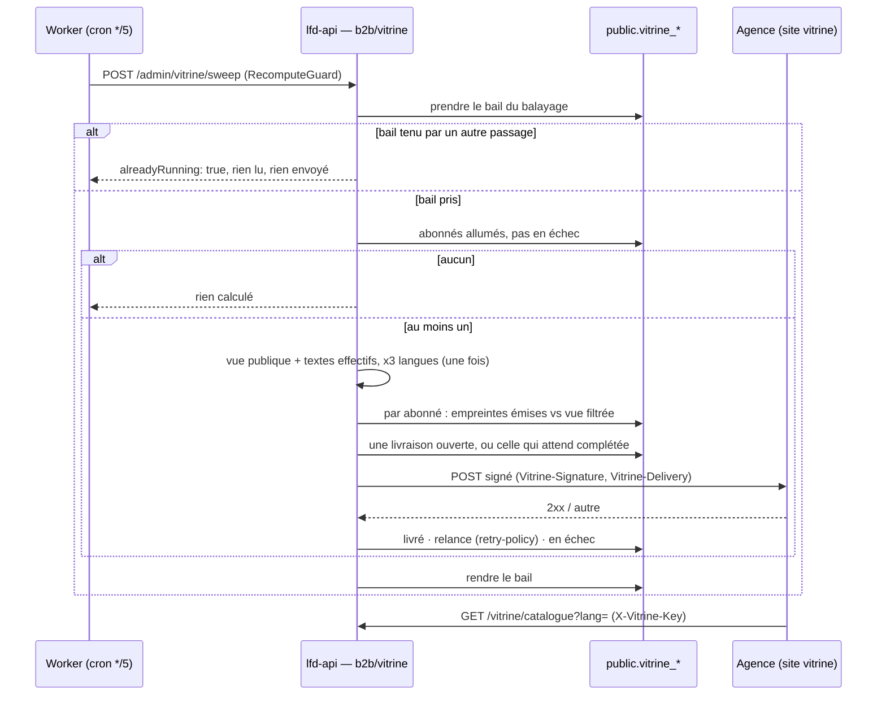
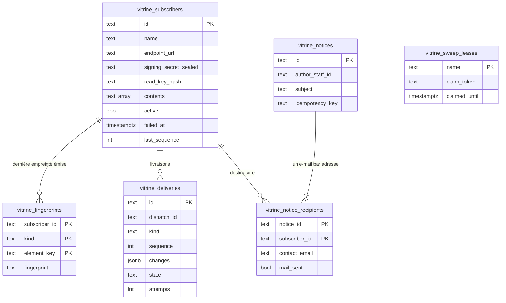

# Le webhook de la vitrine

> ✅ **Implémenté** — bâti le 2026-10-18 (lot W), restes finis le 2026-10-19
> (bail du balayage, reprise d'une annonce, auteur nommé, identifiant d'envoi
> au journal). Ce document décrit ce qui existe ; il remplace le plan de
> conception, dont la trace reste dans l'historique git (commit `7c78320be` et
> ses voisins). **Ce qui reste** est au §8 : la recette avec l'agence, et elle
> seule.

L'agence web qui fait le **site vitrine** reçoit, au fur et à mesure, ce que
nos bureaux changent au catalogue publié — contenus, tarifs publics,
opérations, textes, mises en avant — et chaque abonné choisit à l'écran ce
qu'il reçoit. Le webhook est **léger** : il prévient, l'agence relit.

## 1. Ce qui existe

**Principe : notifier, puis laisser relire.** Le webhook ne porte qu'un signal
(les clés de ce qui a changé ou disparu) ; le contenu ne circule que par trois
lectures que nous servons, sur la vue **publique** de la boutique.

**Le balayage compare, il n'écoute pas.** À chaque passage du cron `*/5` du
Worker (`apps/lfd-api/container/worker.ts`, `POST /admin/vitrine/sweep` sous
`RecomputeGuard`), le serveur calcule la vue publique une fois par langue, la
filtre par abonné, en tire une empreinte **par élément** (article par `sku`,
opération par `key`, rayon par `id`, texte par clé, dans les trois langues à la
fois) et la compare à la dernière empreinte **émise**. Toutes les causes sont
donc vues sans écouteur : une fiche du référentiel, une décision de prix, une
promotion qui commence à minuit sans aucune écriture, un texte publié.
L'agence est prévenue en cinq minutes au plus ; dix enregistrements en cinq
minutes font une notification. Sans abonné livrable, **rien** n'est calculé.

| Sujet                | Ce qui existe                                                                                                                                                                                                                                                                                                                                                             |
| -------------------- | ------------------------------------------------------------------------------------------------------------------------------------------------------------------------------------------------------------------------------------------------------------------------------------------------------------------------------------------------------------------------- |
| Où vit le code       | `apps/lfd-api/src/b2b/vitrine/` (B2B : commande et handler en fichiers séparés) ; le relais sortant dans `apps/lfd-api/src/platform/outbound/` ; les contrats dans `packages/contracts/src/vitrine.ts` ; l'écran dans `apps/lfd-backoffice-frontend/src/app/vitrine-webhook/` (Gestion Boutique › « Webhook vitrine », rail ET lanceur mobile, route `/webhook-vitrine`). |
| Abonné               | Agrégat `VitrineSubscriber` : URL `https` sans `?`, `#` ni identifiants (refus nommés) ; secret de signature **scellé** (`FieldCipher`) ; clé de lecture **hachée** (SHA-256) ; secret et clé montrés une fois, à la création et à la rotation. Nom, description (500 caractères) et contact facultatifs. Jamais supprimé : coupé.                                        |
| Cases                | `catalogue` (articles + rayons), `operations`, `texts`, `featured` (« Incontournables » : sans elle, `isFeatured` ne sort pas). Une case ne fait que **retirer** un ensemble ; décocher n'envoie **aucun** retrait.                                                                                                                                                       |
| Livraison            | Corps `{ subscriber, sequence, at, changed, removed }` ; un essai porte `sequence: 0, test: true`. En-têtes `Vitrine-Signature: t=<s>,v1=<hex HMAC-SHA256 de « t.corps »>` (à la Stripe) et `Vitrine-Delivery: <identifiant d'envoi>`. Relances par `platform/outbox/retry-policy.ts` (la même fonction, pas une copie).                                                  |
| Lectures de l'agence | `GET /vitrine/catalogue`, `/vitrine/articles/:sku`, `/vitrine/textes`, `?lang=` `fr` · `en` · `it` (repli `fr`), en-tête `X-Vitrine-Key`. En XML sur `Accept: application/xml` ou `?format=xml`, décrites par `GET /vitrine/schema.xsd`. Textes **effectifs** : le publié, sinon le texte du code (`GetEffectiveShopCopyQuery`).                                          |
| Écran                | Liste, création, cases, rotation, couper/rallumer, « Modifier », « Envoyer un test », journal des envois (livré / en attente / en échec, identifiant d'envoi copiable, « Renvoyer », « Tout renvoyer »), « Notifier les abonnés » et « Dernières annonces » (§7).                                                                                                         |
| Guide de l'agence    | Lisible dans l'admin (`/documentation/webhook-vitrine`) et imprimable : ce que l'agence doit savoir pour vérifier une signature et relire.                                                                                                                                                                                                                                |

**Ce qui sort, par construction** : la vue publique (`ReadShopCatalogueQuery`
à `companyId: null`) et les textes publiés de la boutique, rien d'autre. Par
article : `sku`, `name`, `note`, `image`, `thumbnail`, `unitPriceMillicents`
(HT public résolu), `unitPriceTtcCents`, `catalogPriceMillicents` (l'étiquette
avant promotion, seulement si une promotion baisse le prix), `vatRatePercent`,
`shelfId`, `audience` (`public` ou `both`), `isFeatured` (mise en avant
**publique**), `operation`. Sont exclus : l'audience `pro`, les masqués au
public, les arrivées non validées, le prix pro, la mise en avant pro, les
opérations réservées aux pros. L'e2e l'éprouve **sur `/vitrine` elle-même**.

## 2. Le flux

## 3. Les tables

Toutes dans `public`, écrites par le seul contexte `b2b/vitrine`, sans DELETE
(clés étrangères en `RESTRICT`). Schéma : `apps/lfd-api/prisma/schema/public/vitrine.prisma`.

| Migration (additive)                                       | Ce qu'elle pose                                                                              |
| ---------------------------------------------------------- | -------------------------------------------------------------------------------------------- |
| `20261018230000_le_droit_de_la_vitrine`                    | la ressource `shop_vitrine`, **accordée à l'écran** (runbook)                                |
| `20261018230100_les_abonnes_de_la_vitrine`                 | abonnés, empreintes, livraisons ; index unique partiel : une livraison en attente par abonné |
| `20261018240000_la_description_d_un_abonne_vitrine`        | description et contact, bornés par `CHECK`                                                   |
| `20261018250000_les_annonces_aux_abonnes_vitrine`          | les annonces et leurs destinataires                                                          |
| `20261018260000_un_envoi_vitrine_neuf_a_chaque_absorption` | `dispatch_id`                                                                                |
| `20261019090000_le_bail_du_balayage_vitrine`               | le bail du balayage                                                                          |

## 4. Les décisions de Hugo

1. **Les cases** (2026-10-18) : `catalogue`, `operations`, `textes` et
   `incontournables` (la mise en avant publique). Pas de case `promotions` ni
   `photos` : la promotion est déjà dans le prix, et retirer une photo
   demanderait un second chemin de la vue.
2. **Les pages éditoriales** de la boutique (`apps/lfd-api/src/b2b/storefront/`)
   restent **hors du webhook** (2026-10-18) : l'agence compose son site à
   partir des articles.
3. **L'écran multi-abonnés dès le premier lot** (2026-10-18, « non,
   directement une page multi-abonnés »).
4. **Format : JSON, et XML** (2026-10-18, « servir la vitrine en XML ») : les
   trois lectures servent la même ressource en XML sur `Accept:
application/xml` ou `?format=xml` (`json` par défaut, toute autre valeur en
   400 `http.payload.invalid`), décrite par `GET /vitrine/schema.xsd`. Le XSD
   et le sérialiseur sont dérivés des mêmes formes, typées contre le contrat
   (`apps/lfd-api/src/b2b/vitrine/http/xml/`). Les notifications restent en
   JSON. Une livraison qui absorbe de nouveaux changements repart sous un
   `Vitrine-Delivery` **neuf**, pour qu'une agence qui écarte les doublons par
   lui ne perde pas les ajouts.
5. **L'audience sort** (2026-10-18) : `ShopItemView.audience`, `public` ou
   `both`, ajoutée à la vue publique que la boutique expose aussi — le site
   peut dire « aussi pour les professionnels ». Les articles réservés aux pros
   ne sortent pas.
6. **Le prix sort tel qu'il est aujourd'hui**, promotions comprises
   (2026-10-18), avec l'étiquette d'avant promotion quand il y en a une.
7. **Les trois langues** (fr, en, it) (2026-10-18) : noms et notes servis dans
   les trois langues (§5).
8. **Un abonné coupé ne lit plus** (2026-10-18) : couper arrête les envois
   **et** la lecture ; `/vitrine/*` refuse sa clé exactement comme une clé
   inconnue (même statut, même message). Rallumer rend la lecture avec la même
   clé. La règle vit dans `application/vitrine-read-support.ts`.
9. **Nom, description et contact** (2026-10-18) : saisis à la création ou par
   « Modifier » ; jamais servis à l'agence ni dans le corps du webhook. Le
   contact, possiblement nominatif, est au registre RGPD sous la catégorie
   `tiers` (décision de Hugo), avec sa copie dans les annonces ;
   `lint:rgpd-staff` réclame toute colonne `*email` d'une table
   `public.vitrine_*`. Conservation non décidée (dette comptée par la porte).
10. **Notifier les abonnés par e-mail** (2026-10-18), §7.
11. **Finir les restes** (2026-10-19, « finis tous les restes ») : le bail du
    balayage, la reprise d'une annonce interrompue, l'auteur par son nom,
    l'identifiant d'envoi au journal.

## 5. Les langues

Les traductions du référentiel descendent jusqu'à la vue publique (lot
préalable bâti le 2026-10-18) :

- **Les faits portent les traductions** dans des champs ajoutés, la source
  restant dans `name` / `note` : `nameTranslations` sur chaque déclinaison et
  sur la famille, `noteTranslations` sur la fiche — `{ en?, it? }`
  (`apps/lfd-api/src/pim/channels/b2b-platform/products/translations.ts`). Un
  fait d'avant le lot reste lisible : le champ absent se lit `null`.
- **Repli de la déclinaison sur la fiche**, langue par langue : la traduction
  de la déclinaison si elle existe, sinon celle de la fiche **quand le nom
  français de la déclinaison est identique à celui de la fiche**. Une
  déclinaison au nom différent (« Pain aux olives 2 kg ») sert le français :
  on n'invente pas un nom qui perdrait le poids.
- **Le commerce les range** dans trois colonnes `jsonb` nullables
  (`20261018220000_les_langues_du_catalogue`) : `catalog_items.name_translations`,
  `note_translations`, `catalog_categories.name_translations`, écrites par le
  seul récepteur des faits. Le commerce ne lit jamais la base du référentiel.
- **La vue publique les sert par un paramètre** : `GET /shop/catalogue?lang=en`
  (`fr` par défaut, une autre langue refusée en 400), en français texte par
  texte quand le référentiel n'a pas traduit
  (`apps/lfd-api/src/b2b/catalog/domain/catalog-translations.ts`). Appliquée
  après le prix : rien de ce qui se vend ou se tarife ne dépend de la langue.
  La forme de la vue ne change pas ; la boutique déployée lit la même chose.
- **Le balayage lit trois fois** la vue (une par langue) et en tire une
  empreinte par élément sur les trois langues à la fois.
- Les lignes d'avant le lot servent le français jusqu'à une réémission
  complète (`POST /pim/channels/b2b/reemit`, le bouton de l'écran des canaux).
- Restent en français : les textes alternatifs des images (`alt`). La
  boutique ne demande pas encore sa langue (`ShopCatalogueStore`) — c'est un
  sujet de la boutique, pas du webhook.

## 6. Les garde-fous

| Risque                                  | Ce qui le tient                                                                                                                                                                                                                                                                                                        |
| --------------------------------------- | ---------------------------------------------------------------------------------------------------------------------------------------------------------------------------------------------------------------------------------------------------------------------------------------------------------------------- |
| Un tiers reçoit ce qui n'est pas public | La seule source est la vue publique ; une case ne fait que retirer. Éprouvé par l'e2e sur `/vitrine` : ni prix pro, ni article pro, ni masqué, ni mise en avant pro.                                                                                                                                                   |
| SSRF, rebinding DNS                     | `PinnedHttpsWebhookPoster` : `https` seul ; le nom est résolu et **toutes** ses adresses vérifiées (bouclage, privées, CGNAT, lien local, métadonnées, réservées, IPv4 dans IPv6) ; l'adresse vérifiée est **épinglée** pour la connexion ; aucune redirection ; 5 s ; réponse coupée au-delà de 4 Kio.                |
| Une agence en panne                     | **Une seule livraison en vol** par abonné (index unique partiel) : la suivante absorbe celle qui attend ; après les relances, l'abonné passe **« en échec »** et plus rien ne part, jusqu'à « Tout renvoyer ».                                                                                                         |
| Deux balayages qui se chevauchent       | **Le bail** (2026-10-19) : `vitrine_sweep_leases`, pris par une seule écriture conditionnée (`INSERT … ON CONFLICT DO UPDATE … WHERE` échu), mesuré au `WallClock`, quinze minutes. Le second passage sort sans rien lire ni envoyer, et le dit (`alreadyRunning`, log). Un balayage tué libère la place à l'échéance. |
| Rejeu d'une notification                | Signature horodatée à la Stripe : l'agence refuse un `t` hors fenêtre (cinq minutes).                                                                                                                                                                                                                                  |
| Fuite de la clé de lecture              | Elle n'est qu'un **identifiant** (la vue est déjà publique) ; rangée hachée, montrée une fois. `@Throttle` 60/min par IP sur `/vitrine/*`, passant par `/api/lfd` comme le reste.                                                                                                                                      |
| Rotation de `FIELD_ENCRYPTION_KEY`      | Les secrets de signature deviennent illisibles : chaque abonné se régénère à l'écran — geste au [runbook](../ops/runbook.md).                                                                                                                                                                                          |
| Une adresse dans les logs               | Jamais l'adresse d'un contact dans un log ni un message d'erreur : un refus nomme l'abonné par son nom.                                                                                                                                                                                                                |

## 7. Les annonces aux abonnés

Sous `shop_vitrine` en écriture, l'écran écrit un e-mail aux contacts : objet
(150 caractères, une ligne) et message (5000, texte brut), destinataires =
tous ceux qui ont un contact, ou une sélection. Un abonné **coupé reste
notifiable** ; un abonné sans contact est signalé et ne se choisit pas. Un
**aperçu** rendu par le serveur (`POST /admin/vitrine/notices/preview`, même
gabarit `agency.vitrine-notice` que l'envoi) montre l'e-mail et les adresses ;
rien ne part avant « Envoyer » (`POST /admin/vitrine/notices`, clé
d'idempotence UUID tirée par l'écran). Un e-mail par adresse, jamais les
autres en copie, clé Resend `vitrine-notice:<annonce>:<abonné>`.

- **Agrégat** `VitrineNotice` : texte valide, au moins un destinataire, issue
  d'un envoi consignée **une fois** (`recordAttempt`) ; la reprise
  (`resumption`) ne rend que les « pas tentés » et refuse s'il n'en reste
  aucun.
- **Journal** : `vitrine_notices` (auteur = id du staff) et
  `vitrine_notice_recipients` (adresse **à l'envoi**, `mail_sent` `NULL` pas
  tenté · `true` accepté par le fournisseur · `false` refusé ou mailer à
  blanc). L'annonce est rangée **avant** le premier envoi : deux clics
  simultanés se départagent sur l'index unique de la clé.
- **L'auteur s'affiche par son nom**, lu dans l'annuaire du staff **à la
  lecture** (`StaffAuthorDirectory`, comme les liens de paiement) — jamais
  recopié en base. Un id qui ne désigne plus personne s'affiche tel quel.
- **« Reprendre l'envoi »** (2026-10-19, `POST /admin/vitrine/notices/:id/resume`,
  bouton sur l'annonce qui a des « pas tentés ») : un envoi coupé au milieu
  (redémarrage, déploiement) laissait des destinataires « pas tentés » sans
  geste pour les relancer. La reprise n'écrit **qu'à eux**, avec la **même**
  clé Resend (un e-mail accepté juste avant la coupure ne repart pas, Resend
  dédoublonne), et la base n'écrase jamais une issue déjà consignée.
  **Décidé au lot : les refusés (`false`) ne sont pas repris.** Leur issue
  reste au journal (on ne réécrit pas un journal), et un `false` peut venir
  d'un fournisseur qui a accepté avant de couper la réponse — le reprendre
  au-delà de la fenêtre de dédoublonnage de Resend enverrait deux fois. Pour
  réécrire à un refusé : une nouvelle annonce.

## 8. Ce qui reste — la recette avec l'agence

Le code est fini. Ce qui reste ne se prouve qu'avec l'agence, sur son vrai
point d'arrivée :

- **Le format** : l'agence n'a pas encore confirmé JSON / XML, la signature à
  la Stripe et les en-têtes (`Vitrine-Signature`, `Vitrine-Delivery`). Le
  guide de l'agence est à lui remettre.
- **Le relais épinglé réel** : l'e2e double le port `WebhookPoster` (l'agence
  de test écoute en clair sur 127.0.0.1, ce que le relais refuse) ; le refus
  des adresses est prouvé à l'unité, mais la connexion TLS épinglée réelle ne
  l'est par aucun test. « Envoyer un test » vers l'agence la prouve.
- **La durée réelle d'un balayage** sous le cron du Worker (trois lectures du
  catalogue dès qu'un abonné existe) : le bail en écarte les conséquences,
  pas la mesure.
- **La stabilité des URL d'images** pour un tiers qui les garde en cache.
- **L'arrivée réelle des annonces** chez l'agence (le mailer est doublé dans
  les tests ; « accepté » n'est pas « arrivé »).

## Preuves

Domaine (`apps/lfd-api/src/b2b/vitrine/domain/**/__tests__`), application
(doubles hérités des ports, dont le bail en mémoire), relais
(`apps/lfd-api/src/platform/outbound/__tests__`), e2e
`apps/lfd-api/test/vitrine-webhook.e2e-spec.ts` (livraison signée, rejeu
détecté, panne, « tout renvoyer », bail, identifiant d'envoi, ce qui sort sur
`/vitrine`), `vitrine-notices.e2e-spec.ts` (aperçu, double clic, coupé
notifié, auteur nommé, reprise), `vitrine-xml.e2e-spec.ts` ; écran
(`apps/lfd-backoffice-frontend/src/app/vitrine-webhook/**`).
